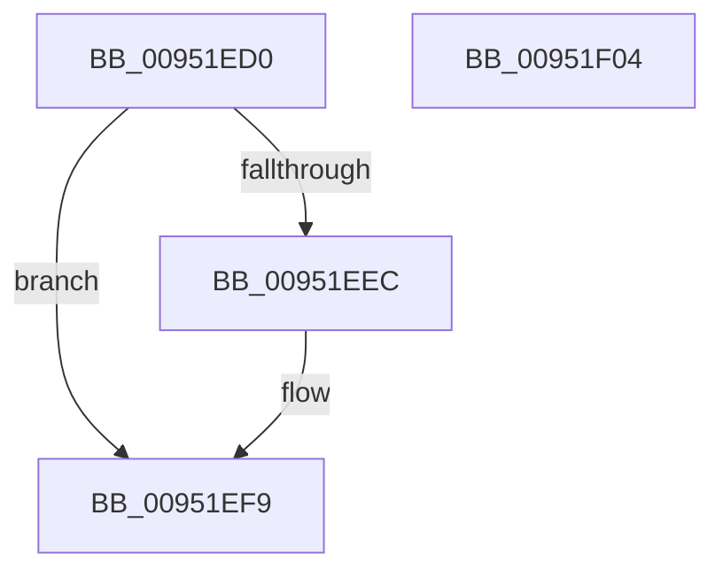

# PnpConcatenateUnicodeStrings

- RVA: `0x00951ED0`–`0x00951F05` (길이 `53` bytes)
- VA: `0x0000000140951ED0`
- 실행 섹션: `PAGE`
- PDB 이름 있음: `예`; PDB Function 태그: `아니요`
- unwind 정보 RVA: `0x0005CAAC`
- 디코드: `18`개 명령, `53/53` bytes 표시
- 미해석 바이트: `0` (있으면 어셈블리에 `.byte`로 보존)

> 이 문서는 커널 이미지의 기계어와 PDB 기호를 분석해 생성했습니다. 4번과 5번은 함수 원형과 자료형을 바이너리 사용 방식에서 추정한 C 해석이며 원본 소스 복구 결과는 아닙니다.

## 1. Dependencies

- 직접 호출 지점: **2**; 고유 호출 대상: **2**
- 직접 호출자로 확인된 함수: **6**
- RIP 상대 이미지 참조: **0**

### Outgoing calls
- `0x00951EE3` → [IopAllocateUnicodeString](IopAllocateUnicodeString_function_00951F0C.md) (function, `0x00951F0C`)
- `0x00951EF2` → [RtlCopyUnicodeString](../../text/3F/RtlCopyUnicodeString_function_003FEF30.md) (function, `0x003FEF30`)

### Direct callers
- [IoGetDeviceInstanceName](../../text/4A/IoGetDeviceInstanceName_function_004AADA4.md) at `0x004AADED`
- [IoGetDeviceDirectory](../72/IoGetDeviceDirectory_function_00728370.md) at `0x00728578`
- [PiCreateDirectoryPath](../72/PiCreateDirectoryPath_function_0072885C.md) at `0x00728973`
- [PiCreateRegistryPath](../72/PiCreateRegistryPath_function_00728B58.md) at `0x00728C4D`
- [PipServiceInstanceToDeviceInstance](../72/PipServiceInstanceToDeviceInstance_function_0072C150.md) at `0x0072C26F`
- [PiInitializeDevice](../73/PiInitializeDevice_function_0073EC5C.md) at `0x0073EF98`

### Static image references
- 디코드된 RIP-relative 메모리 참조가 없습니다.

## 2. Other-region calls and transfers

- 다른 실행 섹션으로 향하는 call: **1**
  - `0x00951EF2` → [RtlCopyUnicodeString](../../text/3F/RtlCopyUnicodeString_function_003FEF30.md) (`PAGE` → `.text`)
- 별도 외부 분기/꼬리 이동을 확인하지 못했습니다.

## 3. Assembly (complete function range)

```asm
00951ED0  48 89 5C 24 08                  mov qword ptr [rsp + 8], rbx
00951ED5  57                              push rdi
00951ED6  48 83 EC 20                     sub rsp, 0x20
00951EDA  48 8B DA                        mov rbx, rdx
00951EDD  48 8B F9                        mov rdi, rcx
00951EE0  0F B7 12                        movzx edx, word ptr [rdx]
00951EE3  E8 24 00 00 00                  call 0x140951f0c
00951EE8  85 C0                           test eax, eax
00951EEA  78 0D                           js 0x140951ef9
00951EEC  48 8B D3                        mov rdx, rbx
00951EEF  48 8B CF                        mov rcx, rdi
00951EF2  E8 39 D0 AA FF                  call 0x1403fef30
00951EF7  33 C0                           xor eax, eax
00951EF9  48 8B 5C 24 30                  mov rbx, qword ptr [rsp + 0x30]
00951EFE  48 83 C4 20                     add rsp, 0x20
00951F02  5F                              pop rdi
00951F03  C3                              ret
00951F04  CC                              int3
```

## 4. C-style interpretation (structured pseudocode)

```c
__int64 __fastcall PnpConcatenateUnicodeStrings(__int64 a1, __int64 a2)
{
    __int64 result;
    __int64 v_rsp;
    unsigned __int64 v_stack_p8;

    v_stack_p8 = v_rbx;
    v_rsp = (v_rsp) - (32);
    result = IopAllocateUnicodeString(a1, *(unsigned __int16 *)(a2), a3, a4);
    if (!(sign_flag)) {
        a2 = a2;
        a1 = a1;
        result = RtlCopyUnicodeString(a1, a2, a3, a4);
        result = 0;
    }
    v_rsp = (v_rsp) + (32);
    return result;
}
```

## 5. (Beta) C Style

```c
int64_t PnpConcatenateUnicodeStrings(int64_t Arg1, void *Arg2)
{
    uint8_t *arg2 = (uint8_t *)Arg2;

    int64_t result;
    int64_t local_rsp;
    uint64_t v_stack_p8;

    v_stack_p8 = local_rbx;
    local_rsp = (local_rsp) - (32);
    result = IopAllocateUnicodeString(Arg1, *(uint16_t *)(arg2), a3, a4);
    if (!(sign_flag)) {
        Arg2 = Arg2;
        Arg1 = Arg1;
        result = RtlCopyUnicodeString(Arg1, Arg2, a3, a4);
        result = 0;
    }
    local_rsp = (local_rsp) + (32);
    return result;
}
```

### 관측된 메모리 오프셋

구조체 형식이 확인되지 않은 접근은 인자 기준의 오프셋으로만 기록했습니다.

| 기준 인자 | 오프셋 표현 | 폭 (bit) | 접근 |
|---|---:|---:|---|
| `Arg2` | `+ 0x0` | `16` | `R` |

## 6. Execution-region graph

[열기: 2D/3D 그래프와 함수 탐색 컨트롤 패널](../../../control-panel.html?section=page&rva=0x00951ED0&view=graph)

- 2D 그래프는 위에서 아래로 흐르고, 3D 그래프는 빈 공간을 드래그해 회전합니다. Shift+드래그는 이동, 휠은 확대·축소, 함수 노드 선택은 대상 보고서 이동입니다.

### Static fallback


