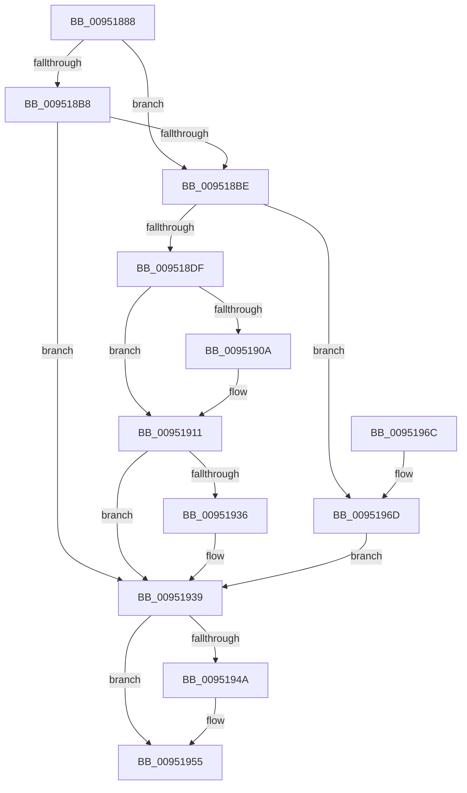

# PnpDeferNotification

- RVA: `0x00951888`–`0x00951974` (길이 `236` bytes)
- VA: `0x0000000140951888`
- 실행 섹션: `PAGE`
- PDB 이름 있음: `예`; PDB Function 태그: `아니요`
- unwind 정보 RVA: `0x00069AD0`
- 디코드: `59`개 명령, `236/236` bytes 표시
- 미해석 바이트: `0` (있으면 어셈블리에 `.byte`로 보존)

> 이 문서는 커널 이미지의 기계어와 PDB 기호를 분석해 생성했습니다. 4번과 5번은 함수 원형과 자료형을 바이너리 사용 방식에서 추정한 C 해석이며 원본 소스 복구 결과는 아닙니다.

## 1. Dependencies

- 직접 호출 지점: **6**; 고유 호출 대상: **4**
- 직접 호출자로 확인된 함수: **3**
- RIP 상대 이미지 참조: **6**

### Outgoing calls
- `0x009518AB` → [ExAcquireFastMutex](../../text/20/ExAcquireFastMutex_function_0020E5A0.md) (function, `0x0020E5A0`)
- `0x009518CE` → [ExAllocatePool2](../../poolcode/B8/ExAllocatePool2_function_00B820F0.md) (function, `0x00B820F0`)
- `0x009518F2` → [ExAcquireFastMutex](../../text/20/ExAcquireFastMutex_function_0020E5A0.md) (function, `0x0020E5A0`)
- `0x00951929` → [ExReleaseFastMutex](../../text/25/ExReleaseFastMutex_function_002519C0.md) (function, `0x002519C0`)
- `0x00951940` → [ExReleaseFastMutex](../../text/25/ExReleaseFastMutex_function_002519C0.md) (function, `0x002519C0`)
- `0x0095194E` → [PnpInsertNoopEvent](PnpInsertNoopEvent_function_0095197C.md) (function, `0x0095197C`)

### Direct callers
- [PiRegisterKernelSoftRestartNotification](../73/PiRegisterKernelSoftRestartNotification_function_0073E28C.md) at `0x0073E333`
- [IoRegisterPlugPlayNotification](IoRegisterPlugPlayNotification_function_009535A0.md) at `0x009536A3`
- [IoRegisterPlugPlayNotification](IoRegisterPlugPlayNotification_function_009535A0.md) at `0x009537A2`
- [sub_00B26446](../B2/Unknown_function_00B26446.md) at `0x00B2649A`

### Static image references
- `0x009518A2` → RVA `0x00F8AC40` (`.data`; read)
- `0x009518B0` → RVA `0x00FD8003` (`PAGEDATA`; read)
- `0x009518E3` → RVA `0x00F8CD20` (`.data`; read)
- `0x009518F7` → RVA `0x00FD9FB0` (`PAGEDATA`; read)
- `0x009518FE` → RVA `0x00FD9FA8` (`PAGEDATA`; read)
- `0x00951922` → RVA `0x00FD9FB0` (`PAGEDATA`; write)

## 2. Other-region calls and transfers

- 다른 실행 섹션으로 향하는 call: **5**
  - `0x009518AB` → [ExAcquireFastMutex](../../text/20/ExAcquireFastMutex_function_0020E5A0.md) (`PAGE` → `.text`)
  - `0x009518CE` → [ExAllocatePool2](../../poolcode/B8/ExAllocatePool2_function_00B820F0.md) (`PAGE` → `POOLCODE`)
  - `0x009518F2` → [ExAcquireFastMutex](../../text/20/ExAcquireFastMutex_function_0020E5A0.md) (`PAGE` → `.text`)
  - `0x00951929` → [ExReleaseFastMutex](../../text/25/ExReleaseFastMutex_function_002519C0.md) (`PAGE` → `.text`)
  - `0x00951940` → [ExReleaseFastMutex](../../text/25/ExReleaseFastMutex_function_002519C0.md) (`PAGE` → `.text`)
- 별도 외부 분기/꼬리 이동을 확인하지 못했습니다.

## 3. Assembly (complete function range)

```asm
00951888  48 89 5C 24 08                  mov qword ptr [rsp + 8], rbx
0095188D  48 89 6C 24 10                  mov qword ptr [rsp + 0x10], rbp
00951892  48 89 74 24 18                  mov qword ptr [rsp + 0x18], rsi
00951897  57                              push rdi
00951898  48 83 EC 20                     sub rsp, 0x20
0095189C  48 8B F1                        mov rsi, rcx
0095189F  40 32 ED                        xor bpl, bpl
009518A2  48 8D 0D 97 93 63 00            lea rcx, [rip + 0x639397]
009518A9  33 DB                           xor ebx, ebx
009518AB  E8 F0 CC 8B FF                  call 0x14020e5a0
009518B0  38 1D 4D 67 68 00               cmp byte ptr [rip + 0x68674d], bl
009518B6  75 06                           jne 0x1409518be
009518B8  83 7E 10 03                     cmp dword ptr [rsi + 0x10], 3
009518BC  75 7B                           jne 0x140951939
009518BE  BA 18 00 00 00                  mov edx, 0x18
009518C3  B9 00 01 00 00                  mov ecx, 0x100
009518C8  41 B8 50 6E 70 37               mov r8d, 0x37706e50
009518CE  E8 1D 08 23 00                  call 0x140b820f0
009518D3  48 8B F8                        mov rdi, rax
009518D6  48 85 C0                        test rax, rax
009518D9  0F 84 8E 00 00 00               je 0x14095196d
009518DF  48 89 70 10                     mov qword ptr [rax + 0x10], rsi
009518E3  48 8D 0D 36 B4 63 00            lea rcx, [rip + 0x63b436]
009518EA  66 FF 46 38                     inc word ptr [rsi + 0x38]
009518EE  C6 46 3A 01                     mov byte ptr [rsi + 0x3a], 1
009518F2  E8 A9 CC 8B FF                  call 0x14020e5a0
009518F7  48 8B 05 B2 86 68 00            mov rax, qword ptr [rip + 0x6886b2]
009518FE  48 8D 0D A3 86 68 00            lea rcx, [rip + 0x6886a3]
00951905  48 39 08                        cmp qword ptr [rax], rcx
00951908  74 07                           je 0x140951911
0095190A  B9 03 00 00 00                  mov ecx, 3
0095190F  CD 29                           int 0x29
00951911  48 89 0F                        mov qword ptr [rdi], rcx
00951914  48 8D 0D 05 B4 63 00            lea rcx, [rip + 0x63b405]
0095191B  48 89 47 08                     mov qword ptr [rdi + 8], rax
0095191F  48 89 38                        mov qword ptr [rax], rdi
00951922  48 89 3D 87 86 68 00            mov qword ptr [rip + 0x688687], rdi
00951929  E8 92 00 90 FF                  call 0x1402519c0
0095192E  38 1D CF 66 68 00               cmp byte ptr [rip + 0x6866cf], bl
00951934  75 03                           jne 0x140951939
00951936  40 B5 01                        mov bpl, 1
00951939  48 8D 0D 00 93 63 00            lea rcx, [rip + 0x639300]
00951940  E8 7B 00 90 FF                  call 0x1402519c0
00951945  40 84 ED                        test bpl, bpl
00951948  74 0B                           je 0x140951955
0095194A  33 D2                           xor edx, edx
0095194C  33 C9                           xor ecx, ecx
0095194E  E8 29 00 00 00                  call 0x14095197c
00951953  33 DB                           xor ebx, ebx
00951955  48 8B 6C 24 38                  mov rbp, qword ptr [rsp + 0x38]
0095195A  8B C3                           mov eax, ebx
0095195C  48 8B 5C 24 30                  mov rbx, qword ptr [rsp + 0x30]
00951961  48 8B 74 24 40                  mov rsi, qword ptr [rsp + 0x40]
00951966  48 83 C4 20                     add rsp, 0x20
0095196A  5F                              pop rdi
0095196B  C3                              ret
0095196C  CC                              int3
0095196D  BB 9A 00 00 C0                  mov ebx, 0xc000009a
00951972  EB C5                           jmp 0x140951939
```

## 4. C-style interpretation (structured pseudocode)

```c
__int64 __fastcall PnpDeferNotification(__int64 a1)
{
    __int64 result;
    __int64 v_rbp;
    __int64 v_rbx;
    __int64 v_rsp;
    unsigned __int64 v_stack_p10;
    unsigned __int64 v_stack_p18;
    unsigned __int64 v_stack_p8;

    v_stack_p8 = v_rbx;
    v_stack_p10 = v_rbp;
    v_stack_p18 = v_rsi;
    v_rsp = (v_rsp) - (32);
    v_rbp = 0;
    v_rbx = 0;
    result = ExAcquireFastMutex(v_rip + 6525847, a2, a3, a4);
    if ((*(unsigned __int8 *)(v_rip + 6842189)) != 0) goto loc_009518BE;
    if ((*(unsigned int *)(a1 + 16)) != 3) goto loc_00951939;
loc_009518BE:
    result = ExAllocatePool2(256, 24, (unsigned int)(0x37706E50ULL), a4);
    if (result == 0) goto loc_0095196D;
    *(unsigned __int64 *)(result + 16) = a1;
    *(unsigned __int8 *)(a1 + 58) = 1;
    result = ExAcquireFastMutex(v_rip + 6534198, 24, (unsigned int)(0x37706E50ULL), a4);
    if ((*(unsigned __int64 *)(*(unsigned __int64 *)(v_rip + 6850226))) != (v_rip + 6850211)) {
        a1 = 3;
    }
    *(unsigned __int64 *)(result) = a1;
    *(unsigned __int64 *)(result + 8) = *(unsigned __int64 *)(v_rip + 6850226);
    *(unsigned __int64 *)(*(unsigned __int64 *)(v_rip + 6850226)) = result;
    *(unsigned __int64 *)(v_rip + 6850183) = result;
    result = ExReleaseFastMutex(v_rip + 6534149, 24, (unsigned int)(0x37706E50ULL), a4);
    if ((*(unsigned __int8 *)(v_rip + 6842063)) == 0) {
        v_rbp = 1;
    }
    result = ExReleaseFastMutex(v_rip + 6525696, 24, (unsigned int)(0x37706E50ULL), a4);
    if ((unsigned __int8)(v_rbp) != 0) {
        a2 = 0;
        a1 = 0;
        result = PnpInsertNoopEvent(a1, a2, (unsigned int)(0x37706E50ULL), a4);
        v_rbx = 0;
    }
    v_rsp = (v_rsp) + (32);
    return 0;
loc_0095196D:
    goto loc_00951939;
}
```

## 5. (Beta) C Style

```c
int64_t PnpDeferNotification(void *Arg1)
{
    uint8_t *arg1 = (uint8_t *)Arg1;

    int64_t result;
    int64_t local_rbp;
    int64_t local_rbx;
    int64_t local_rsp;
    uint64_t v_stack_p10;
    uint64_t v_stack_p18;
    uint64_t v_stack_p8;

    v_stack_p8 = local_rbx;
    v_stack_p10 = local_rbp;
    v_stack_p18 = local_rsi;
    local_rsp = (local_rsp) - (32);
    local_rbp = 0;
    local_rbx = 0;
    result = ExAcquireFastMutex(v_rip + 6525847, a2, a3, a4);
    if ((*(uint8_t *)(v_rip + 0x68674D)) != 0) goto loc_009518BE;
    if ((*(uint32_t *)(arg1 + 0x10)) != 3) goto loc_00951939;
loc_009518BE:
    result = ExAllocatePool2(256, 24, (uint32_t)(0x37706E50ULL), a4);
    if (result == 0) goto loc_0095196D;
    *(void **)(result + 0x10) = Arg1;
    *(uint8_t *)(arg1 + 0x3A) = 1;
    result = ExAcquireFastMutex(v_rip + 6534198, 24, (uint32_t)(0x37706E50ULL), a4);
    if ((*(uint64_t *)(*(uint64_t *)(v_rip + 0x6886B2))) != (v_rip + 6850211)) {
        Arg1 = 3;
    }
    *(void **)(result) = Arg1;
    *(uint64_t *)(result + 0x8) = *(uint64_t *)(v_rip + 0x6886B2);
    *(uint64_t *)(*(uint64_t *)(v_rip + 0x6886B2)) = result;
    *(uint64_t *)(v_rip + 0x688687) = result;
    result = ExReleaseFastMutex(v_rip + 6534149, 24, (uint32_t)(0x37706E50ULL), a4);
    if ((*(uint8_t *)(v_rip + 0x6866CF)) == 0) {
        local_rbp = 1;
    }
    result = ExReleaseFastMutex(v_rip + 6525696, 24, (uint32_t)(0x37706E50ULL), a4);
    if ((uint8_t)(local_rbp) != 0) {
        a2 = 0;
        Arg1 = 0;
        result = PnpInsertNoopEvent(Arg1, a2, (uint32_t)(0x37706E50ULL), a4);
        local_rbx = 0;
    }
    local_rsp = (local_rsp) + (32);
    return 0;
loc_0095196D:
    goto loc_00951939;
}
```

### 관측된 메모리 오프셋

구조체 형식이 확인되지 않은 접근은 인자 기준의 오프셋으로만 기록했습니다.

| 기준 인자 | 오프셋 표현 | 폭 (bit) | 접근 |
|---|---:|---:|---|
| `Arg1` | `+ 0x10` | `32` | `R` |
| `Arg1` | `+ 0x38` | `16` | `R/W` |
| `Arg1` | `+ 0x3A` | `8` | `W` |

## 6. Execution-region graph

[열기: 2D/3D 그래프와 함수 탐색 컨트롤 패널](../../../control-panel.html?section=page&rva=0x00951888&view=graph)

- 2D 그래프는 위에서 아래로 흐르고, 3D 그래프는 빈 공간을 드래그해 회전합니다. Shift+드래그는 이동, 휠은 확대·축소, 함수 노드 선택은 대상 보고서 이동입니다.

### Static fallback


