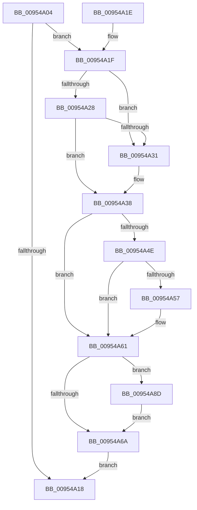

# PnpDereferenceNotify

- RVA: `0x00954A04`–`0x00954A99` (길이 `149` bytes)
- VA: `0x0000000140954A04`
- 실행 섹션: `PAGE`
- PDB 이름 있음: `예`; PDB Function 태그: `아니요`
- unwind 정보 RVA: `0x00092234`
- 디코드: `44`개 명령, `149/149` bytes 표시
- 미해석 바이트: `0` (있으면 어셈블리에 `.byte`로 보존)

> 이 문서는 커널 이미지의 기계어와 PDB 기호를 분석해 생성했습니다. 4번과 5번은 함수 원형과 자료형을 바이너리 사용 방식에서 추정한 C 해석이며 원본 소스 복구 결과는 아닙니다.

## 1. Dependencies

- 직접 호출 지점: **6**; 고유 호출 대상: **4**
- 직접 호출자로 확인된 함수: **8**
- RIP 상대 이미지 참조: **0**

### Outgoing calls
- `0x00954A43` → [ObfDereferenceObject](../../text/2F/ObfDereferenceObject_function_002F9350.md) (function, `0x002F9350`)
- `0x00954A57` → [ObfDereferenceObject](../../text/2F/ObfDereferenceObject_function_002F9350.md) (function, `0x002F9350`)
- `0x00954A6E` → [ExDeleteResourceLite](../../text/38/ExDeleteResourceLite_function_0038BA60.md) (function, `0x0038BA60`)
- `0x00954A7C` → [ExFreePoolWithTag](../../poolcode/B8/ExFreePoolWithTag_function_00B82870.md) (function, `0x00B82870`)
- `0x00954A86` → [ExFreePoolWithTag](../../poolcode/B8/ExFreePoolWithTag_function_00B82870.md) (function, `0x00B82870`)
- `0x00954A8D` → [ZwClose](../../text/6A/ZwClose_function_006AD2B0.md) (function, `0x006AD2B0`)

### Direct callers
- [PnpUnregisterPlugPlayNotification](../../text/47/PnpUnregisterPlugPlayNotification_function_0047AFAC.md) at `0x0047B04C`
- [PnpUnregisterPlugPlayNotification](../../text/47/PnpUnregisterPlugPlayNotification_function_0047AFAC.md) at `0x0047B0BE`
- [PnpNotifyHwProfileChange](../72/PnpNotifyHwProfileChange_function_00729B04.md) at `0x00729CD4`
- [PnpNotifyHwProfileChange](../72/PnpNotifyHwProfileChange_function_00729B04.md) at `0x00729CE1`
- [PnpNotifyHwProfileChange](../72/PnpNotifyHwProfileChange_function_00729B04.md) at `0x00729D44`
- [PipKsrNotifyDrivers](../73/PipKsrNotifyDrivers_function_0073E48C.md) at `0x0073E603`
- [PnpNotifyDeviceClassChange](PnpNotifyDeviceClassChange_function_0095441C.md) at `0x009544E8`
- [PnpProcessDeferredRegistrations](PnpProcessDeferredRegistrations_function_009545BC.md) at `0x009546F0`
- [PnpNotifyTargetDeviceChange](PnpNotifyTargetDeviceChange_function_00954790.md) at `0x00954916`
- [sub_00B264F4](../B2/Unknown_function_00B264F4.md) at `0x00B26555`
- [sub_00B26560](../B2/Unknown_function_00B26560.md) at `0x00B2662F`
- [sub_00B26560](../B2/Unknown_function_00B26560.md) at `0x00B2663C`

### Static image references
- 디코드된 RIP-relative 메모리 참조가 없습니다.

## 2. Other-region calls and transfers

- 다른 실행 섹션으로 향하는 call: **6**
  - `0x00954A43` → [ObfDereferenceObject](../../text/2F/ObfDereferenceObject_function_002F9350.md) (`PAGE` → `.text`)
  - `0x00954A57` → [ObfDereferenceObject](../../text/2F/ObfDereferenceObject_function_002F9350.md) (`PAGE` → `.text`)
  - `0x00954A6E` → [ExDeleteResourceLite](../../text/38/ExDeleteResourceLite_function_0038BA60.md) (`PAGE` → `.text`)
  - `0x00954A7C` → [ExFreePoolWithTag](../../poolcode/B8/ExFreePoolWithTag_function_00B82870.md) (`PAGE` → `POOLCODE`)
  - `0x00954A86` → [ExFreePoolWithTag](../../poolcode/B8/ExFreePoolWithTag_function_00B82870.md) (`PAGE` → `POOLCODE`)
  - `0x00954A8D` → [ZwClose](../../text/6A/ZwClose_function_006AD2B0.md) (`PAGE` → `.text`)
- 별도 외부 분기/꼬리 이동을 확인하지 못했습니다.

## 3. Assembly (complete function range)

```asm
00954A04  40 53                           push rbx
00954A06  48 83 EC 20                     sub rsp, 0x20
00954A0A  B8 FF FF 00 00                  mov eax, 0xffff
00954A0F  48 8B D9                        mov rbx, rcx
00954A12  66 01 41 38                     add word ptr [rcx + 0x38], ax
00954A16  74 07                           je 0x140954a1f
00954A18  48 83 C4 20                     add rsp, 0x20
00954A1C  5B                              pop rbx
00954A1D  C3                              ret
00954A1E  CC                              int3
00954A1F  48 8B 09                        mov rcx, qword ptr [rcx]
00954A22  48 39 59 08                     cmp qword ptr [rcx + 8], rbx
00954A26  75 09                           jne 0x140954a31
00954A28  48 8B 43 08                     mov rax, qword ptr [rbx + 8]
00954A2C  48 39 18                        cmp qword ptr [rax], rbx
00954A2F  74 07                           je 0x140954a38
00954A31  B9 03 00 00 00                  mov ecx, 3
00954A36  CD 29                           int 0x29
00954A38  48 89 08                        mov qword ptr [rax], rcx
00954A3B  48 89 41 08                     mov qword ptr [rcx + 8], rax
00954A3F  48 8B 4B 30                     mov rcx, qword ptr [rbx + 0x30]
00954A43  E8 08 49 9A FF                  call 0x1402f9350
00954A48  83 7B 10 03                     cmp dword ptr [rbx + 0x10], 3
00954A4C  75 13                           jne 0x140954a61
00954A4E  48 8B 4B 58                     mov rcx, qword ptr [rbx + 0x58]
00954A52  48 85 C9                        test rcx, rcx
00954A55  74 0A                           je 0x140954a61
00954A57  E8 F4 48 9A FF                  call 0x1402f9350
00954A5C  48 83 63 58 00                  and qword ptr [rbx + 0x58], 0
00954A61  48 8B 4B 18                     mov rcx, qword ptr [rbx + 0x18]
00954A65  48 85 C9                        test rcx, rcx
00954A68  75 23                           jne 0x140954a8d
00954A6A  48 8B 4B 48                     mov rcx, qword ptr [rbx + 0x48]
00954A6E  E8 ED 6F A3 FF                  call 0x14038ba60
00954A73  48 8B 4B 48                     mov rcx, qword ptr [rbx + 0x48]
00954A77  BA 50 6E 70 56                  mov edx, 0x56706e50
00954A7C  E8 EF DD 22 00                  call 0x140b82870
00954A81  33 D2                           xor edx, edx
00954A83  48 8B CB                        mov rcx, rbx
00954A86  E8 E5 DD 22 00                  call 0x140b82870
00954A8B  EB 8B                           jmp 0x140954a18
00954A8D  E8 1E 88 D5 FF                  call 0x1406ad2b0
00954A92  48 83 63 18 00                  and qword ptr [rbx + 0x18], 0
00954A97  EB D1                           jmp 0x140954a6a
```

## 4. C-style interpretation (structured pseudocode)

```c
__int64 __fastcall PnpDereferenceNotify(__int64 a1)
{
    __int64 result;
    __int64 v_rsp;

    v_rsp = (v_rsp) - (32);
    if (condition_is_equal) goto loc_00954A1F;
loc_00954A18:
    v_rsp = (v_rsp) + (32);
    return (unsigned int)(0xFFFFULL);
loc_00954A1F:
    if ((*(unsigned __int64 *)(*(unsigned __int64 *)(a1) + 8)) != a1) goto loc_00954A31;
    if ((*(unsigned __int64 *)(*(unsigned __int64 *)(a1 + 8))) != a1) {
        a1 = 3;
    }
    *(unsigned __int64 *)(*(unsigned __int64 *)(a1 + 8)) = a1;
    *(unsigned __int64 *)(a1 + 8) = *(unsigned __int64 *)(a1 + 8);
    result = ObfDereferenceObject(*(unsigned __int64 *)(a1 + 48), a2, a3, a4);
    if ((*(unsigned int *)(a1 + 16)) != 3) goto loc_00954A61;
    if (*(unsigned __int64 *)(a1 + 88) != 0) {
        result = ObfDereferenceObject(*(unsigned __int64 *)(a1 + 88), a2, a3, a4);
    }
    if (*(unsigned __int64 *)(a1 + 24) != 0) goto loc_00954A8D;
loc_00954A6A:
    result = ExDeleteResourceLite(*(unsigned __int64 *)(a1 + 72), a2, a3, a4);
    result = ExFreePoolWithTag(*(unsigned __int64 *)(a1 + 72), (unsigned int)(0x56706E50ULL), a3, a4);
    a2 = 0;
    result = ExFreePoolWithTag(a1, a2, a3, a4);
    goto loc_00954A18;
loc_00954A8D:
    result = ZwClose(a1, a2, a3, a4);
    goto loc_00954A6A;
}
```

## 5. (Beta) C Style

```c
int64_t PnpDereferenceNotify(void *Arg1)
{
    uint8_t *arg1 = (uint8_t *)Arg1;

    int64_t result;
    int64_t local_rsp;

    local_rsp = (local_rsp) - (32);
    if (condition_is_equal) goto loc_00954A1F;
loc_00954A18:
    local_rsp = (local_rsp) + (32);
    return (uint32_t)(0xFFFFULL);
loc_00954A1F:
    if ((*(uint64_t *)(*(uint64_t *)(arg1) + 0x8)) != Arg1) goto loc_00954A31;
    if ((*(uint64_t *)(*(uint64_t *)(arg1 + 0x8))) != Arg1) {
        Arg1 = 3;
    }
    *(void **)(*(uint64_t *)(arg1 + 0x8)) = Arg1;
    *(uint64_t *)(arg1 + 0x8) = *(uint64_t *)(arg1 + 0x8);
    result = ObfDereferenceObject(*(uint64_t *)(arg1 + 0x30), a2, a3, a4);
    if ((*(uint32_t *)(arg1 + 0x10)) != 3) goto loc_00954A61;
    if (*(uint64_t *)(arg1 + 0x58) != 0) {
        result = ObfDereferenceObject(*(uint64_t *)(arg1 + 0x58), a2, a3, a4);
    }
    if (*(uint64_t *)(arg1 + 0x18) != 0) goto loc_00954A8D;
loc_00954A6A:
    result = ExDeleteResourceLite(*(uint64_t *)(arg1 + 0x48), a2, a3, a4);
    result = ExFreePoolWithTag(*(uint64_t *)(arg1 + 0x48), (uint32_t)(0x56706E50ULL), a3, a4);
    a2 = 0;
    result = ExFreePoolWithTag(Arg1, a2, a3, a4);
    goto loc_00954A18;
loc_00954A8D:
    result = ZwClose(Arg1, a2, a3, a4);
    goto loc_00954A6A;
}
```

### 관측된 메모리 오프셋

구조체 형식이 확인되지 않은 접근은 인자 기준의 오프셋으로만 기록했습니다.

| 기준 인자 | 오프셋 표현 | 폭 (bit) | 접근 |
|---|---:|---:|---|
| `Arg1` | `+ 0x0` | `64` | `R` |
| `Arg1` | `+ 0x8` | `64` | `R` |
| `Arg1` | `+ 0x10` | `32` | `R` |
| `Arg1` | `+ 0x18` | `64` | `R` |
| `Arg1` | `+ 0x18` | `64` | `R/W` |
| `Arg1` | `+ 0x30` | `64` | `R` |
| `Arg1` | `+ 0x38` | `16` | `R/W` |
| `Arg1` | `+ 0x48` | `64` | `R` |
| `Arg1` | `+ 0x58` | `64` | `R` |
| `Arg1` | `+ 0x58` | `64` | `R/W` |

## 6. Execution-region graph

[열기: 2D/3D 그래프와 함수 탐색 컨트롤 패널](../../../control-panel.html?section=page&rva=0x00954A04&view=graph)

- 2D 그래프는 위에서 아래로 흐르고, 3D 그래프는 빈 공간을 드래그해 회전합니다. Shift+드래그는 이동, 휠은 확대·축소, 함수 노드 선택은 대상 보고서 이동입니다.

### Static fallback


