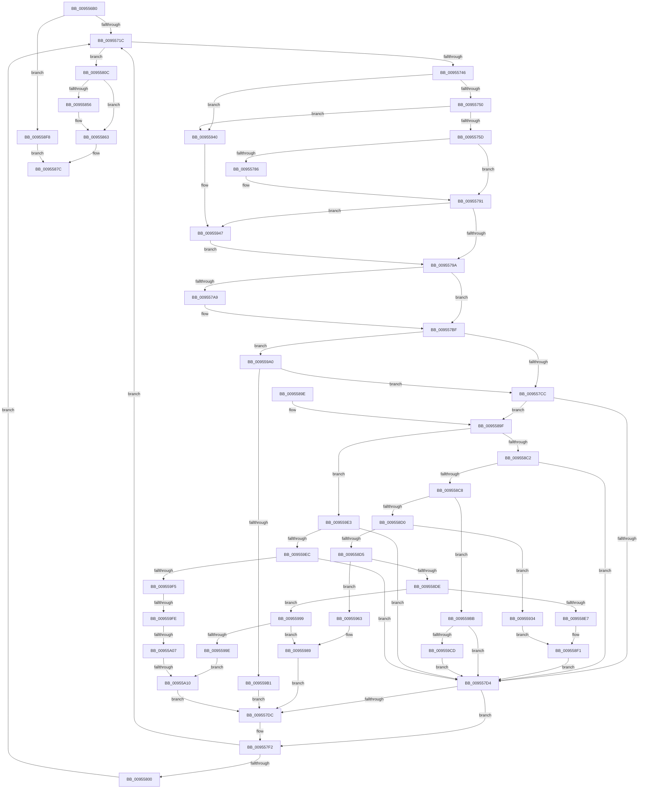

# PnpDeviceEventWorker

- RVA: `0x009556B0`–`0x00955A1A` (길이 `874` bytes)
- VA: `0x00000001409556B0`
- 실행 섹션: `PAGE`
- PDB 이름 있음: `예`; PDB Function 태그: `예`
- unwind 정보 RVA: `0x0009230C`
- 디코드: `199`개 명령, `874/874` bytes 표시
- 미해석 바이트: `0` (있으면 어셈블리에 `.byte`로 보존)

> 이 문서는 커널 이미지의 기계어와 PDB 기호를 분석해 생성했습니다. 4번과 5번은 함수 원형과 자료형을 바이너리 사용 방식에서 추정한 C 해석이며 원본 소스 복구 결과는 아닙니다.

## 1. Dependencies

- 직접 호출 지점: **28**; 고유 호출 대상: **19**
- 직접 호출자로 확인된 함수: **0**
- RIP 상대 이미지 참조: **10**

### Outgoing calls
- `0x0095570F` → [KeWaitForSingleObject](../../text/20/KeWaitForSingleObject_function_0020E6B0.md) (function, `0x0020E6B0`)
- `0x0095572A` → [ExAcquireFastMutex](../../text/20/ExAcquireFastMutex_function_0020E5A0.md) (function, `0x0020E5A0`)
- `0x0095576F` → [ExReleaseFastMutex](../../text/25/ExReleaseFastMutex_function_002519C0.md) (function, `0x002519C0`)
- `0x009557E1` → [PnpDisableAndFreeEventWatchdog](PnpDisableAndFreeEventWatchdog_function_00955ABC.md) (function, `0x00955ABC`)
- `0x009557ED` → [PnpCompleteDeviceEvent](PnpCompleteDeviceEvent_function_00955548.md) (function, `0x00955548`)
- `0x009557F2` → [PnpProcessDeferredRegistrations](PnpProcessDeferredRegistrations_function_009545BC.md) (function, `0x009545BC`)
- `0x00955802` → [IoSetActivityIdThread](../../text/46/IoSetActivityIdThread_function_00466340.md) (function, `0x00466340`)
- `0x00955813` → [ExAcquireFastMutex](../../text/20/ExAcquireFastMutex_function_0020E5A0.md) (function, `0x0020E5A0`)
- `0x00955824` → [KeSetEvent](../../text/33/KeSetEvent_function_0033F310.md) (function, `0x0033F310`)
- `0x00955830` → [PnpProcessDeferredRegistrations](PnpProcessDeferredRegistrations_function_009545BC.md) (function, `0x009545BC`)
- `0x0095583C` → [ExReleaseFastMutex](../../text/25/ExReleaseFastMutex_function_002519C0.md) (function, `0x002519C0`)
- `0x0095584C` → [ExReleaseFastMutex](../../text/25/ExReleaseFastMutex_function_002519C0.md) (function, `0x002519C0`)
- `0x0095585E` → [ExFreePoolWithTag](../../poolcode/B8/ExFreePoolWithTag_function_00B82870.md) (function, `0x00B82870`)
- `0x00955877` → [KeReleaseMutex](../../text/39/KeReleaseMutex_function_00396810.md) (function, `0x00396810`)
- `0x00955884` → [_security_check_cookie](../../text/6A/_security_check_cookie_function_006AC640.md) (function, `0x006AC640`)
- `0x009558A2` → [PnpAllocateAndEnableEventWatchdog](../8F/PnpAllocateAndEnableEventWatchdog_function_008FB3F8.md) (function, `0x008FB3F8`)
- `0x009558AE` → [PnpActivatePdcForDeviceEvent](PnpActivatePdcForDeviceEvent_function_00953A9C.md) (function, `0x00953A9C`)
- `0x009558EC` → [PnpProcessCustomDeviceEvent](PnpProcessCustomDeviceEvent_function_00954734.md) (function, `0x00954734`)
- `0x009558FF` → [ExAcquireFastMutex](../../text/20/ExAcquireFastMutex_function_0020E5A0.md) (function, `0x0020E5A0`)
- `0x00955910` → [KeSetEvent](../../text/33/KeSetEvent_function_0033F310.md) (function, `0x0033F310`)
- `0x00955923` → [ExReleaseFastMutex](../../text/25/ExReleaseFastMutex_function_002519C0.md) (function, `0x002519C0`)
- `0x00955939` → [PnpProcessTargetDeviceEvent](../A0/PnpProcessTargetDeviceEvent_function_00A046BC.md) (function, `0x00A046BC`)
- `0x00955956` → [IoSetActivityIdThread](../../text/46/IoSetActivityIdThread_function_00466340.md) (function, `0x00466340`)
- `0x0095596F` → [RtlInitUnicodeString](../../text/42/RtlInitUnicodeString_function_0042A780.md) (function, `0x0042A780`)
- `0x00955984` → [PnpNotifyDeviceClassChange](PnpNotifyDeviceClassChange_function_0095441C.md) (function, `0x0095441C`)
- `0x0095598C` → [PiUEventNotifyUserMode](PiUEventNotifyUserMode_function_00954CB4.md) (function, `0x00954CB4`)
- `0x009559BE` → [PiUEventNotifyUserMode](PiUEventNotifyUserMode_function_00954CB4.md) (function, `0x00954CB4`)
- `0x009559D9` → [PnpNotifyHwProfileChange](../72/PnpNotifyHwProfileChange_function_00729B04.md) (function, `0x00729B04`)

### Direct callers
- 이 함수 시작 RVA로 연결되는 직접 call은 확인되지 않았습니다. 간접 호출은 완전히 역산할 수 없습니다.

### Static image references
- `0x009556C2` → RVA `0x00E0A740` (`.data`; read)
- `0x009556FB` → RVA `0x00FD8048` (`PAGEDATA`; read)
- `0x00955708` → RVA `0x00E663B8` (`.data`; write)
- `0x00955774` → RVA `0x000112D0` (`.rdata`; read)
- `0x00955786` → RVA `0x000112D8` (`.rdata`; read)
- `0x009557BF` → RVA `0x00F8C5E4` (`.data`; read)
- `0x0095580C` → RVA `0x00F8AC40` (`.data`; read)
- `0x0095581B` → RVA `0x00F8AC80` (`.data`; read)
- `0x00955829` → RVA `0x00FD8003` (`PAGEDATA`; write)
- `0x009559A2` → RVA `0x00E663B0` (`.data`; read)

## 2. Other-region calls and transfers

- 다른 실행 섹션으로 향하는 call: **16**
  - `0x0095570F` → [KeWaitForSingleObject](../../text/20/KeWaitForSingleObject_function_0020E6B0.md) (`PAGE` → `.text`)
  - `0x0095572A` → [ExAcquireFastMutex](../../text/20/ExAcquireFastMutex_function_0020E5A0.md) (`PAGE` → `.text`)
  - `0x0095576F` → [ExReleaseFastMutex](../../text/25/ExReleaseFastMutex_function_002519C0.md) (`PAGE` → `.text`)
  - `0x00955802` → [IoSetActivityIdThread](../../text/46/IoSetActivityIdThread_function_00466340.md) (`PAGE` → `.text`)
  - `0x00955813` → [ExAcquireFastMutex](../../text/20/ExAcquireFastMutex_function_0020E5A0.md) (`PAGE` → `.text`)
  - `0x00955824` → [KeSetEvent](../../text/33/KeSetEvent_function_0033F310.md) (`PAGE` → `.text`)
  - `0x0095583C` → [ExReleaseFastMutex](../../text/25/ExReleaseFastMutex_function_002519C0.md) (`PAGE` → `.text`)
  - `0x0095584C` → [ExReleaseFastMutex](../../text/25/ExReleaseFastMutex_function_002519C0.md) (`PAGE` → `.text`)
  - `0x0095585E` → [ExFreePoolWithTag](../../poolcode/B8/ExFreePoolWithTag_function_00B82870.md) (`PAGE` → `POOLCODE`)
  - `0x00955877` → [KeReleaseMutex](../../text/39/KeReleaseMutex_function_00396810.md) (`PAGE` → `.text`)
  - `0x00955884` → [_security_check_cookie](../../text/6A/_security_check_cookie_function_006AC640.md) (`PAGE` → `.text`)
  - `0x009558FF` → [ExAcquireFastMutex](../../text/20/ExAcquireFastMutex_function_0020E5A0.md) (`PAGE` → `.text`)
  - `0x00955910` → [KeSetEvent](../../text/33/KeSetEvent_function_0033F310.md) (`PAGE` → `.text`)
  - `0x00955923` → [ExReleaseFastMutex](../../text/25/ExReleaseFastMutex_function_002519C0.md) (`PAGE` → `.text`)
  - `0x00955956` → [IoSetActivityIdThread](../../text/46/IoSetActivityIdThread_function_00466340.md) (`PAGE` → `.text`)
  - `0x0095596F` → [RtlInitUnicodeString](../../text/42/RtlInitUnicodeString_function_0042A780.md) (`PAGE` → `.text`)
- call이 아닌 외부 분기/꼬리 이동: **3**
  - `0x009559F8` → [sub_00B269D0](../B2/Unknown_function_00B269D0.md) (`tail-transfer`)
  - `0x00955A01` → [sub_00B269D0](../B2/Unknown_function_00B269D0.md) (`tail-transfer`)
  - `0x00955A0A` → [sub_00B269D0](../B2/Unknown_function_00B269D0.md) (`tail-transfer`)

## 3. Assembly (complete function range)

```asm
009556B0  48 89 5C 24 10                  mov qword ptr [rsp + 0x10], rbx
009556B5  48 89 6C 24 18                  mov qword ptr [rsp + 0x18], rbp
009556BA  56                              push rsi
009556BB  57                              push rdi
009556BC  41 56                           push r14
009556BE  48 83 EC 60                     sub rsp, 0x60
009556C2  48 8B 05 77 50 4B 00            mov rax, qword ptr [rip + 0x4b5077]
009556C9  48 33 C4                        xor rax, rsp
009556CC  48 89 44 24 58                  mov qword ptr [rsp + 0x58], rax
009556D1  48 8B E9                        mov rbp, rcx
009556D4  0F 57 C0                        xorps xmm0, xmm0
009556D7  0F 11 44 24 48                  movups xmmword ptr [rsp + 0x48], xmm0
009556DC  45 33 F6                        xor r14d, r14d
009556DF  45 33 C9                        xor r9d, r9d
009556E2  0F 57 C9                        xorps xmm1, xmm1
009556E5  4C 89 74 24 20                  mov qword ptr [rsp + 0x20], r14
009556EA  0F 11 4C 24 38                  movups xmmword ptr [rsp + 0x38], xmm1
009556EF  65 48 8B 04 25 88 01 00 00      mov rax, qword ptr gs:[0x188]
009556F8  45 33 C0                        xor r8d, r8d
009556FB  48 8B 0D 46 29 68 00            mov rcx, qword ptr [rip + 0x682946]
00955702  33 D2                           xor edx, edx
00955704  48 83 C1 08                     add rcx, 8
00955708  48 89 05 A9 0C 51 00            mov qword ptr [rip + 0x510ca9], rax
0095570F  E8 9C 8F 8B FF                  call 0x14020e6b0
00955714  85 C0                           test eax, eax
00955716  0F 88 DC 01 00 00               js 0x1409558f8
0095571C  48 8B 0D 25 29 68 00            mov rcx, qword ptr [rip + 0x682925]
00955723  41 8A F6                        mov sil, r14b
00955726  48 83 C1 40                     add rcx, 0x40
0095572A  E8 71 8E 8B FF                  call 0x14020e5a0
0095572F  48 8B 15 12 29 68 00            mov rdx, qword ptr [rip + 0x682912]
00955736  48 8D 42 78                     lea rax, [rdx + 0x78]
0095573A  48 8B 18                        mov rbx, qword ptr [rax]
0095573D  48 3B D8                        cmp rbx, rax
00955740  0F 84 C6 00 00 00               je 0x14095580c
00955746  48 39 43 08                     cmp qword ptr [rbx + 8], rax
0095574A  0F 85 F0 01 00 00               jne 0x140955940
00955750  48 8B 0B                        mov rcx, qword ptr [rbx]
00955753  48 39 59 08                     cmp qword ptr [rcx + 8], rbx
00955757  0F 85 E3 01 00 00               jne 0x140955940
0095575D  48 89 08                        mov qword ptr [rax], rcx
00955760  48 89 41 08                     mov qword ptr [rcx + 8], rax
00955764  48 8D 4A 40                     lea rcx, [rdx + 0x40]
00955768  48 89 5B 08                     mov qword ptr [rbx + 8], rbx
0095576C  48 89 1B                        mov qword ptr [rbx], rbx
0095576F  E8 4C C2 8F FF                  call 0x1402519c0
00955774  48 8B 0D 55 BB 6B FF            mov rcx, qword ptr [rip - 0x9444ab]
0095577B  48 89 5C 24 30                  mov qword ptr [rsp + 0x30], rbx
00955780  48 2B 4B 58                     sub rcx, qword ptr [rbx + 0x58]
00955784  75 0B                           jne 0x140955791
00955786  48 8B 0D 4B BB 6B FF            mov rcx, qword ptr [rip - 0x9444b5]
0095578D  48 2B 4B 60                     sub rcx, qword ptr [rbx + 0x60]
00955791  48 85 C9                        test rcx, rcx
00955794  0F 85 AD 01 00 00               jne 0x140955947
0095579A  48 8B 83 A0 00 00 00            mov rax, qword ptr [rbx + 0xa0]
009557A1  41 8B FE                        mov edi, r14d
009557A4  48 85 C0                        test rax, rax
009557A7  74 16                           je 0x1409557bf
009557A9  48 8B 80 38 01 00 00            mov rax, qword ptr [rax + 0x138]
009557B0  48 8B 48 28                     mov rcx, qword ptr [rax + 0x28]
009557B4  B8 0E 00 00 C0                  mov eax, 0xc000000e
009557B9  48 85 C9                        test rcx, rcx
009557BC  0F 44 F8                        cmove edi, eax
009557BF  44 39 35 1E 6E 63 00            cmp dword ptr [rip + 0x636e1e], r14d
009557C6  0F 85 D4 01 00 00               jne 0x1409559a0
009557CC  85 FF                           test edi, edi
009557CE  0F 89 CB 00 00 00               jns 0x14095589f
009557D4  81 FF 03 01 00 00               cmp edi, 0x103
009557DA  74 16                           je 0x1409557f2
009557DC  48 8B 4C 24 30                  mov rcx, qword ptr [rsp + 0x30]
009557E1  E8 D6 02 00 00                  call 0x140955abc
009557E6  48 8B 4C 24 30                  mov rcx, qword ptr [rsp + 0x30]
009557EB  8B D7                           mov edx, edi
009557ED  E8 56 FD FF FF                  call 0x140955548
009557F2  E8 C5 ED FF FF                  call 0x1409545bc
009557F7  40 84 F6                        test sil, sil
009557FA  0F 84 1C FF FF FF               je 0x14095571c
00955800  33 C9                           xor ecx, ecx
00955802  E8 39 0B B1 FF                  call 0x140466340
00955807  E9 10 FF FF FF                  jmp 0x14095571c
0095580C  48 8D 0D 2D 54 63 00            lea rcx, [rip + 0x63542d]
00955813  E8 88 8D 8B FF                  call 0x14020e5a0
00955818  45 33 C0                        xor r8d, r8d
0095581B  48 8D 0D 5E 54 63 00            lea rcx, [rip + 0x63545e]
00955822  33 D2                           xor edx, edx
00955824  E8 E7 9A 9E FF                  call 0x14033f310
00955829  44 88 35 D3 27 68 00            mov byte ptr [rip + 0x6827d3], r14b
00955830  E8 87 ED FF FF                  call 0x1409545bc
00955835  48 8D 0D 04 54 63 00            lea rcx, [rip + 0x635404]
0095583C  E8 7F C1 8F FF                  call 0x1402519c0
00955841  48 8B 0D 00 28 68 00            mov rcx, qword ptr [rip + 0x682800]
00955848  48 83 C1 40                     add rcx, 0x40
0095584C  E8 6F C1 8F FF                  call 0x1402519c0
00955851  48 85 ED                        test rbp, rbp
00955854  74 0D                           je 0x140955863
00955856  BA 50 6E 70 4C                  mov edx, 0x4c706e50
0095585B  48 8B CD                        mov rcx, rbp
0095585E  E8 0D D0 22 00                  call 0x140b82870
00955863  48 8B 0D DE 27 68 00            mov rcx, qword ptr [rip + 0x6827de]
0095586A  33 D2                           xor edx, edx
0095586C  48 83 C1 08                     add rcx, 8
00955870  4C 89 35 41 0B 51 00            mov qword ptr [rip + 0x510b41], r14
00955877  E8 94 0F A4 FF                  call 0x140396810
0095587C  48 8B 4C 24 58                  mov rcx, qword ptr [rsp + 0x58]
00955881  48 33 CC                        xor rcx, rsp
00955884  E8 B7 6D D5 FF                  call 0x1406ac640
00955889  4C 8D 5C 24 60                  lea r11, [rsp + 0x60]
0095588E  49 8B 5B 28                     mov rbx, qword ptr [r11 + 0x28]
00955892  49 8B 6B 30                     mov rbp, qword ptr [r11 + 0x30]
00955896  49 8B E3                        mov rsp, r11
00955899  41 5E                           pop r14
0095589B  5F                              pop rdi
0095589C  5E                              pop rsi
0095589D  C3                              ret
0095589E  CC                              int3
0095589F  48 8B CB                        mov rcx, rbx
009558A2  E8 51 5B FA FF                  call 0x1408fb3f8
009558A7  48 8B CB                        mov rcx, rbx
009558AA  48 89 43 68                     mov qword ptr [rbx + 0x68], rax
009558AE  E8 E9 E1 FF FF                  call 0x140953a9c
009558B3  8B 8B 88 00 00 00               mov ecx, dword ptr [rbx + 0x88]
009558B9  83 F9 06                        cmp ecx, 6
009558BC  0F 8F 21 01 00 00               jg 0x1409559e3
009558C2  0F 84 0C FF FF FF               je 0x1409557d4
009558C8  85 C9                           test ecx, ecx
009558CA  0F 84 EB 00 00 00               je 0x1409559bb
009558D0  83 E9 01                        sub ecx, 1
009558D3  74 5F                           je 0x140955934
009558D5  83 E9 01                        sub ecx, 1
009558D8  0F 84 85 00 00 00               je 0x140955963
009558DE  83 E9 01                        sub ecx, 1
009558E1  0F 85 B2 00 00 00               jne 0x140955999
009558E7  48 8D 4C 24 30                  lea rcx, [rsp + 0x30]
009558EC  E8 43 EE FF FF                  call 0x140954734
009558F1  8B F8                           mov edi, eax
009558F3  E9 DC FE FF FF                  jmp 0x1409557d4
009558F8  48 8D 0D 41 53 63 00            lea rcx, [rip + 0x635341]
009558FF  E8 9C 8C 8B FF                  call 0x14020e5a0
00955904  45 33 C0                        xor r8d, r8d
00955907  48 8D 0D 72 53 63 00            lea rcx, [rip + 0x635372]
0095590E  33 D2                           xor edx, edx
00955910  E8 FB 99 9E FF                  call 0x14033f310
00955915  48 8D 0D 24 53 63 00            lea rcx, [rip + 0x635324]
0095591C  44 88 35 E0 26 68 00            mov byte ptr [rip + 0x6826e0], r14b
00955923  E8 98 C0 8F FF                  call 0x1402519c0
00955928  4C 89 35 89 0A 51 00            mov qword ptr [rip + 0x510a89], r14
0095592F  E9 48 FF FF FF                  jmp 0x14095587c
00955934  48 8D 4C 24 30                  lea rcx, [rsp + 0x30]
00955939  E8 7E ED 0A 00                  call 0x140a046bc
0095593E  EB B1                           jmp 0x1409558f1
00955940  B9 03 00 00 00                  mov ecx, 3
00955945  CD 29                           int 0x29
00955947  0F 10 43 58                     movups xmm0, xmmword ptr [rbx + 0x58]
0095594B  48 8D 4C 24 48                  lea rcx, [rsp + 0x48]
00955950  F3 0F 7F 44 24 48               movdqu xmmword ptr [rsp + 0x48], xmm0
00955956  E8 E5 09 B1 FF                  call 0x140466340
0095595B  40 B6 01                        mov sil, 1
0095595E  E9 37 FE FF FF                  jmp 0x14095579a
00955963  48 8D 93 B8 00 00 00            lea rdx, [rbx + 0xb8]
0095596A  48 8D 4C 24 38                  lea rcx, [rsp + 0x38]
0095596F  E8 0C 4E AD FF                  call 0x14042a780
00955974  48 8D 93 A8 00 00 00            lea rdx, [rbx + 0xa8]
0095597B  48 8D 4B 78                     lea rcx, [rbx + 0x78]
0095597F  4C 8D 44 24 38                  lea r8, [rsp + 0x38]
00955984  E8 93 EA FF FF                  call 0x14095441c
00955989  48 8B CB                        mov rcx, rbx
0095598C  E8 23 F3 FF FF                  call 0x140954cb4
00955991  41 8B FE                        mov edi, r14d
00955994  E9 43 FE FF FF                  jmp 0x1409557dc
00955999  83 F9 01                        cmp ecx, 1
0095599C  74 EB                           je 0x140955989
0095599E  EB 70                           jmp 0x140955a10
009559A0  33 C0                           xor eax, eax
009559A2  F0 4C 0F B1 35 05 0A 51 00      lock cmpxchg qword ptr [rip + 0x510a05], r14
009559AB  0F 85 1B FE FF FF               jne 0x1409557cc
009559B1  BF 89 01 00 C0                  mov edi, 0xc0000189
009559B6  E9 21 FE FF FF                  jmp 0x1409557dc
009559BB  48 8B CB                        mov rcx, rbx
009559BE  E8 F1 F2 FF FF                  call 0x140954cb4
009559C3  8B F8                           mov edi, eax
009559C5  85 C0                           test eax, eax
009559C7  0F 88 07 FE FF FF               js 0x1409557d4
009559CD  4C 8B 43 38                     mov r8, qword ptr [rbx + 0x38]
009559D1  48 8D 4B 78                     lea rcx, [rbx + 0x78]
009559D5  48 8B 53 30                     mov rdx, qword ptr [rbx + 0x30]
009559D9  E8 26 41 DD FF                  call 0x140729b04
009559DE  E9 F1 FD FF FF                  jmp 0x1409557d4
009559E3  83 E9 07                        sub ecx, 7
009559E6  0F 84 E8 FD FF FF               je 0x1409557d4
009559EC  83 E9 01                        sub ecx, 1
009559EF  0F 84 DF FD FF FF               je 0x1409557d4
009559F5  83 E9 01                        sub ecx, 1
009559F8  0F 84 D2 0F 1D 00               je 0x140b269d0
009559FE  83 E9 01                        sub ecx, 1
00955A01  0F 84 C9 0F 1D 00               je 0x140b269d0
00955A07  83 F9 01                        cmp ecx, 1
00955A0A  0F 84 C0 0F 1D 00               je 0x140b269d0
00955A10  BF 01 00 00 C0                  mov edi, 0xc0000001
00955A15  E9 C2 FD FF FF                  jmp 0x1409557dc
```

## 4. C-style interpretation (structured pseudocode)

```c
__int64 __fastcall PnpDeviceEventWorker(__int64 a1, int a2, int a3, int a4)
{
    __int64 result;
    __int64 v_r14;
    __int64 v_rdi;
    __int64 v_rsp;
    unsigned __int64 v_stack_m18;
    unsigned __int64 v_stack_m20;
    unsigned __int64 v_stack_m28;
    unsigned __int64 v_stack_m30;
    unsigned __int64 v_stack_m40;
    unsigned __int64 v_stack_m48;
    unsigned __int64 v_stack_m58;
    unsigned __int64 v_stack_p10;
    unsigned __int64 v_stack_p18;

    v_stack_p10 = v_rbx;
    v_stack_p18 = v_rbp;
    v_rsp = (v_rsp) - (96);
    result = (*(unsigned __int64 *)(v_rip + 4935799)) ^ (v_rsp);
    v_stack_m20 = result;
    v_stack_m30 = v_xmm0;
    v_r14 = 0;
    a4 = 0;
    v_stack_m58 = 0;
    v_stack_m40 = v_xmm1;
    a3 = 0;
    a2 = 0;
    a1 = (*(unsigned __int64 *)(v_rip + 6826310)) + (8);
    *(unsigned __int64 *)(v_rip + 5311657) = *(unsigned __int64 *)(gs_base + (0 + 392));
    result = KeWaitForSingleObject(a1, a2, a3, a4);
    if (sign_flag) goto loc_009558F8;
loc_0095571C:
    a1 = (*(unsigned __int64 *)(v_rip + 6826277)) + (64);
    result = ExAcquireFastMutex(a1, a2, a3, a4);
    if ((*(unsigned __int64 *)(*(unsigned __int64 *)(v_rip + 6826258) + 120)) == (*(unsigned __int64 *)(v_rip + 6826258) + 120)) goto loc_0095580C;
    if ((*(unsigned __int64 *)(*(unsigned __int64 *)(*(unsigned __int64 *)(v_rip + 6826258) + 120) + 8)) != (*(unsigned __int64 *)(v_rip + 6826258) + 120)) goto loc_00955940;
    if ((*(unsigned __int64 *)(*(unsigned __int64 *)(*(unsigned __int64 *)(*(unsigned __int64 *)(v_rip + 6826258) + 120)) + 8)) != (*(unsigned __int64 *)(*(unsigned __int64 *)(v_rip + 6826258) + 120))) goto loc_00955940;
    *(unsigned __int64 *)(*(unsigned __int64 *)(v_rip + 6826258) + 120) = *(unsigned __int64 *)(*(unsigned __int64 *)(*(unsigned __int64 *)(v_rip + 6826258) + 120));
    *(unsigned __int64 *)(*(unsigned __int64 *)(*(unsigned __int64 *)(*(unsigned __int64 *)(v_rip + 6826258) + 120)) + 8) = *(unsigned __int64 *)(v_rip + 6826258) + 120;
    *(unsigned __int64 *)(*(unsigned __int64 *)(*(unsigned __int64 *)(v_rip + 6826258) + 120) + 8) = *(unsigned __int64 *)(*(unsigned __int64 *)(v_rip + 6826258) + 120);
    *(unsigned __int64 *)(*(unsigned __int64 *)(*(unsigned __int64 *)(v_rip + 6826258) + 120)) = *(unsigned __int64 *)(*(unsigned __int64 *)(v_rip + 6826258) + 120);
    result = ExReleaseFastMutex(*(unsigned __int64 *)(v_rip + 6826258) + 64, *(unsigned __int64 *)(v_rip + 6826258), a3, a4);
    v_stack_m48 = *(unsigned __int64 *)(*(unsigned __int64 *)(v_rip + 6826258) + 120);
    a1 = (*(unsigned __int64 *)(v_rip - 9716907)) - (*(unsigned __int64 *)(*(unsigned __int64 *)(*(unsigned __int64 *)(v_rip + 6826258) + 120) + 88));
    if (!(condition_is_not_equal)) {
        a1 = *(unsigned __int64 *)(v_rip - 9716917);
        a1 = (a1) - (*(unsigned __int64 *)(*(unsigned __int64 *)(*(unsigned __int64 *)(v_rip + 6826258) + 120) + 96));
    }
    if (a1 != 0) goto loc_00955947;
loc_0095579A:
    result = *(unsigned __int64 *)(*(unsigned __int64 *)(*(unsigned __int64 *)(v_rip + 6826258) + 120) + 160);
    v_rdi = 0;
    if (*(unsigned __int64 *)(*(unsigned __int64 *)(*(unsigned __int64 *)(v_rip + 6826258) + 120) + 160) != 0) {
        result = *(unsigned __int64 *)(*(unsigned __int64 *)(*(unsigned __int64 *)(*(unsigned __int64 *)(v_rip + 6826258) + 120) + 160) + 312);
        a1 = *(unsigned __int64 *)(result + 40);
        result = 0xC000000EULL;
        v_rdi = 0;
        if (a1 == 0) { v_rdi = (unsigned int)(result); }
    }
    if ((*(unsigned int *)(v_rip + 6516254)) != 0) goto loc_009559A0;
loc_009557CC:
    if (!sign_flag) goto loc_0095589F;
loc_009557D4:
    if (((unsigned int)(v_rdi)) != 259) {
        a1 = v_stack_m48;
        result = PnpDisableAndFreeEventWatchdog(a1, *(unsigned __int64 *)(v_rip + 6826258), a3, a4);
        a1 = v_stack_m48;
        a2 = (unsigned int)(v_rdi);
        result = PnpCompleteDeviceEvent(a1, a2, a3, a4);
    }
    result = PnpProcessDeferredRegistrations(a1, a2, a3, a4);
    if (0 == 0) goto loc_0095571C;
    a1 = 0;
    result = IoSetActivityIdThread(a1, a2, a3, a4);
    goto loc_0095571C;
loc_0095580C:
    result = ExAcquireFastMutex(v_rip + 6509613, a2, a3, a4);
    a3 = 0;
    a2 = 0;
    result = KeSetEvent(v_rip + 6509662, a2, a3, a4);
    *(unsigned __int8 *)(v_rip + 6825939) = 0;
    result = PnpProcessDeferredRegistrations(v_rip + 6509662, a2, a3, a4);
    result = ExReleaseFastMutex(v_rip + 6509572, a2, a3, a4);
    a1 = (*(unsigned __int64 *)(v_rip + 6825984)) + (64);
    result = ExReleaseFastMutex(a1, a2, a3, a4);
    if (a1 != 0) {
        a2 = 0x4C706E50ULL;
        a1 = a1;
        result = ExFreePoolWithTag(a1, a2, a3, a4);
    }
    a2 = 0;
    a1 = (*(unsigned __int64 *)(v_rip + 6825950)) + (8);
    *(unsigned __int64 *)(v_rip + 5311297) = 0;
    result = KeReleaseMutex(a1, a2, a3, a4);
loc_0095587C:
    a1 = (v_stack_m20) ^ (v_rsp);
    result = _security_check_cookie(a1, a2, a3, a4);
    return result;
loc_0095589F:
    result = PnpAllocateAndEnableEventWatchdog(*(unsigned __int64 *)(v_stack_m18 + 40), a2, a3, a4);
    *(unsigned __int64 *)(*(unsigned __int64 *)(v_stack_m18 + 40) + 104) = result;
    result = PnpActivatePdcForDeviceEvent(*(unsigned __int64 *)(v_stack_m18 + 40), a2, a3, a4);
    if (((unsigned int)((unsigned int)(*(unsigned int *)(*(unsigned __int64 *)(v_stack_m18 + 40) + 136)))) > 6) goto loc_009559E3;
    if (((unsigned int)((unsigned int)(*(unsigned int *)(*(unsigned __int64 *)(v_stack_m18 + 40) + 136)))) == 6) goto loc_009557D4;
    if ((unsigned int)((unsigned int)(*(unsigned int *)(*(unsigned __int64 *)(v_stack_m18 + 40) + 136))) == 0) goto loc_009559BB;
    a1 = (unsigned int)(((unsigned int)(*(unsigned int *)(*(unsigned __int64 *)(v_stack_m18 + 40) + 136))) - (1));
    if (condition_is_equal) goto loc_00955934;
    a1 = (unsigned int)((a1) - (1));
    if (condition_is_equal) goto loc_00955963;
    a1 = (unsigned int)((a1) - (1));
    if (condition_is_not_equal) goto loc_00955999;
    result = PnpProcessCustomDeviceEvent(v_stack_m30, a2, a3, a4);
loc_009558F1:
    goto loc_009557D4;
loc_009558F8:
    result = ExAcquireFastMutex(v_rip + 6509377, a2, a3, a4);
    a3 = 0;
    a2 = 0;
    result = KeSetEvent(v_rip + 6509426, a2, a3, a4);
    *(unsigned __int8 *)(v_rip + 6825696) = 0;
    result = ExReleaseFastMutex(v_rip + 6509348, a2, a3, a4);
    *(unsigned __int64 *)(v_rip + 5311113) = 0;
    goto loc_0095587C;
loc_00955934:
    result = PnpProcessTargetDeviceEvent(v_stack_m30, a2, a3, a4);
    goto loc_009558F1;
loc_00955940:
loc_00955947:
    v_stack_m18 = v_xmm0;
    result = IoSetActivityIdThread(v_stack_m18, a2, a3, a4);
    goto loc_0095579A;
loc_00955963:
    result = RtlInitUnicodeString(v_stack_m28, *(unsigned __int64 *)(v_stack_m18 + 40) + 184, a3, a4);
    result = PnpNotifyDeviceClassChange(*(unsigned __int64 *)(v_stack_m18 + 40) + 120, *(unsigned __int64 *)(v_stack_m18 + 40) + 168, v_stack_m28, a4);
loc_00955989:
    result = PiUEventNotifyUserMode(*(unsigned __int64 *)(v_stack_m18 + 40), *(unsigned __int64 *)(v_stack_m18 + 40) + 168, v_stack_m28, a4);
    goto loc_009557DC;
loc_00955999:
    if (((unsigned int)(*(unsigned __int64 *)(v_stack_m18 + 40))) == 1) goto loc_00955989;
    goto loc_00955A10;
loc_009559A0:
    result = 0;
    if (condition_is_not_equal) goto loc_009557CC;
    goto loc_009557DC;
loc_009559BB:
    result = PiUEventNotifyUserMode(*(unsigned __int64 *)(v_stack_m18 + 40), *(unsigned __int64 *)(v_stack_m18 + 40) + 168, v_stack_m28, a4);
    if (sign_flag) goto loc_009557D4;
    result = PnpNotifyHwProfileChange(*(unsigned __int64 *)(v_stack_m18 + 40) + 120, *(unsigned __int64 *)(*(unsigned __int64 *)(v_stack_m18 + 40) + 48), *(unsigned __int64 *)(*(unsigned __int64 *)(v_stack_m18 + 40) + 56), a4);
    goto loc_009557D4;
loc_009559E3:
    a1 = (unsigned int)((*(unsigned __int64 *)(v_stack_m18 + 40) + 120) - (7));
    if (condition_is_equal) goto loc_009557D4;
    a1 = (unsigned int)((a1) - (1));
    if (condition_is_equal) goto loc_009557D4;
    a1 = (unsigned int)((a1) - (1));
    a1 = (unsigned int)((a1) - (1));
loc_00955A10:
    goto loc_009557DC;
}
```

## 5. (Beta) C Style

```c
int64_t PnpDeviceEventWorker(int64_t Arg1, int32_t Arg2, int32_t Arg3, int32_t Arg4)
{
    int64_t result;
    int64_t local_r14;
    int64_t local_rdi;
    int64_t local_rsp;
    uint64_t v_stack_m18;
    uint64_t v_stack_m20;
    uint64_t v_stack_m28;
    uint64_t v_stack_m30;
    uint64_t v_stack_m40;
    uint64_t v_stack_m48;
    uint64_t v_stack_m58;
    uint64_t v_stack_p10;
    uint64_t v_stack_p18;

    v_stack_p10 = local_rbx;
    v_stack_p18 = local_rbp;
    local_rsp = (local_rsp) - (96);
    result = (*(uint64_t *)(v_rip + 0x4B5077)) ^ (local_rsp);
    v_stack_m20 = result;
    v_stack_m30 = v_xmm0;
    local_r14 = 0;
    Arg4 = 0;
    v_stack_m58 = 0;
    v_stack_m40 = v_xmm1;
    Arg3 = 0;
    Arg2 = 0;
    Arg1 = (*(uint64_t *)(v_rip + 0x682946)) + (8);
    *(uint64_t *)(v_rip + 0x510CA9) = *(uint64_t *)(gs_base + (0 + 0x188));
    result = KeWaitForSingleObject(Arg1, Arg2, Arg3, Arg4);
    if (sign_flag) goto loc_009558F8;
loc_0095571C:
    Arg1 = (*(uint64_t *)(v_rip + 0x682925)) + (64);
    result = ExAcquireFastMutex(Arg1, Arg2, Arg3, Arg4);
    if ((*(uint64_t *)(*(uint64_t *)(v_rip + 0x682912) + 0x78)) == (*(uint64_t *)(v_rip + 0x682912) + 120)) goto loc_0095580C;
    if ((*(uint64_t *)(*(uint64_t *)(*(uint64_t *)(v_rip + 0x682912) + 0x78) + 0x8)) != (*(uint64_t *)(v_rip + 0x682912) + 120)) goto loc_00955940;
    if ((*(uint64_t *)(*(uint64_t *)(*(uint64_t *)(*(uint64_t *)(v_rip + 0x682912) + 0x78)) + 0x8)) != (*(uint64_t *)(*(uint64_t *)(v_rip + 0x682912) + 0x78))) goto loc_00955940;
    *(uint64_t *)(*(uint64_t *)(v_rip + 0x682912) + 0x78) = *(uint64_t *)(*(uint64_t *)(*(uint64_t *)(v_rip + 0x682912) + 0x78));
    *(uint64_t *)(*(uint64_t *)(*(uint64_t *)(*(uint64_t *)(v_rip + 0x682912) + 0x78)) + 0x8) = *(uint64_t *)(v_rip + 0x682912) + 120;
    *(uint64_t *)(*(uint64_t *)(*(uint64_t *)(v_rip + 0x682912) + 0x78) + 0x8) = *(uint64_t *)(*(uint64_t *)(v_rip + 0x682912) + 0x78);
    *(uint64_t *)(*(uint64_t *)(*(uint64_t *)(v_rip + 0x682912) + 0x78)) = *(uint64_t *)(*(uint64_t *)(v_rip + 0x682912) + 0x78);
    result = ExReleaseFastMutex(*(uint64_t *)(v_rip + 0x682912) + 64, *(uint64_t *)(v_rip + 0x682912), Arg3, Arg4);
    v_stack_m48 = *(uint64_t *)(*(uint64_t *)(v_rip + 0x682912) + 0x78);
    Arg1 = (*(uint64_t *)(v_rip - 0x9444AB)) - (*(uint64_t *)(*(uint64_t *)(*(uint64_t *)(v_rip + 0x682912) + 0x78) + 0x58));
    if (!(condition_is_not_equal)) {
        Arg1 = *(uint64_t *)(v_rip - 0x9444B5);
        Arg1 = (Arg1) - (*(uint64_t *)(*(uint64_t *)(*(uint64_t *)(v_rip + 0x682912) + 0x78) + 0x60));
    }
    if (Arg1 != 0) goto loc_00955947;
loc_0095579A:
    result = *(uint64_t *)(*(uint64_t *)(*(uint64_t *)(v_rip + 0x682912) + 0x78) + 0xA0);
    local_rdi = 0;
    if (*(uint64_t *)(*(uint64_t *)(*(uint64_t *)(v_rip + 0x682912) + 0x78) + 0xA0) != 0) {
        result = *(uint64_t *)(*(uint64_t *)(*(uint64_t *)(*(uint64_t *)(v_rip + 0x682912) + 0x78) + 0xA0) + 0x138);
        Arg1 = *(uint64_t *)(result + 0x28);
        result = 0xC000000EULL;
        local_rdi = 0;
        if (Arg1 == 0) { local_rdi = (uint32_t)(result); }
    }
    if ((*(uint32_t *)(v_rip + 0x636E1E)) != 0) goto loc_009559A0;
loc_009557CC:
    if (!sign_flag) goto loc_0095589F;
loc_009557D4:
    if (((uint32_t)(local_rdi)) != 259) {
        Arg1 = v_stack_m48;
        result = PnpDisableAndFreeEventWatchdog(Arg1, *(uint64_t *)(v_rip + 0x682912), Arg3, Arg4);
        Arg1 = v_stack_m48;
        Arg2 = (uint32_t)(local_rdi);
        result = PnpCompleteDeviceEvent(Arg1, Arg2, Arg3, Arg4);
    }
    result = PnpProcessDeferredRegistrations(Arg1, Arg2, Arg3, Arg4);
    if (0 == 0) goto loc_0095571C;
    Arg1 = 0;
    result = IoSetActivityIdThread(Arg1, Arg2, Arg3, Arg4);
    goto loc_0095571C;
loc_0095580C:
    result = ExAcquireFastMutex(v_rip + 6509613, Arg2, Arg3, Arg4);
    Arg3 = 0;
    Arg2 = 0;
    result = KeSetEvent(v_rip + 6509662, Arg2, Arg3, Arg4);
    *(uint8_t *)(v_rip + 0x6827D3) = 0;
    result = PnpProcessDeferredRegistrations(v_rip + 6509662, Arg2, Arg3, Arg4);
    result = ExReleaseFastMutex(v_rip + 6509572, Arg2, Arg3, Arg4);
    Arg1 = (*(uint64_t *)(v_rip + 0x682800)) + (64);
    result = ExReleaseFastMutex(Arg1, Arg2, Arg3, Arg4);
    if (Arg1 != 0) {
        Arg2 = 0x4C706E50ULL;
        Arg1 = Arg1;
        result = ExFreePoolWithTag(Arg1, Arg2, Arg3, Arg4);
    }
    Arg2 = 0;
    Arg1 = (*(uint64_t *)(v_rip + 0x6827DE)) + (8);
    *(uint64_t *)(v_rip + 0x510B41) = 0;
    result = KeReleaseMutex(Arg1, Arg2, Arg3, Arg4);
loc_0095587C:
    Arg1 = (v_stack_m20) ^ (local_rsp);
    result = _security_check_cookie(Arg1, Arg2, Arg3, Arg4);
    return result;
loc_0095589F:
    result = PnpAllocateAndEnableEventWatchdog(*(uint64_t *)(v_stack_m18 + 0x28), Arg2, Arg3, Arg4);
    *(uint64_t *)(*(uint64_t *)(v_stack_m18 + 0x28) + 0x68) = result;
    result = PnpActivatePdcForDeviceEvent(*(uint64_t *)(v_stack_m18 + 0x28), Arg2, Arg3, Arg4);
    if (((uint32_t)((uint32_t)(*(uint32_t *)(*(uint64_t *)(v_stack_m18 + 0x28) + 0x88)))) > 6) goto loc_009559E3;
    if (((uint32_t)((uint32_t)(*(uint32_t *)(*(uint64_t *)(v_stack_m18 + 0x28) + 0x88)))) == 6) goto loc_009557D4;
    if ((uint32_t)((uint32_t)(*(uint32_t *)(*(uint64_t *)(v_stack_m18 + 0x28) + 0x88))) == 0) goto loc_009559BB;
    Arg1 = (uint32_t)(((uint32_t)(*(uint32_t *)(*(uint64_t *)(v_stack_m18 + 0x28) + 0x88))) - (1));
    if (condition_is_equal) goto loc_00955934;
    Arg1 = (uint32_t)((Arg1) - (1));
    if (condition_is_equal) goto loc_00955963;
    Arg1 = (uint32_t)((Arg1) - (1));
    if (condition_is_not_equal) goto loc_00955999;
    result = PnpProcessCustomDeviceEvent(v_stack_m30, Arg2, Arg3, Arg4);
loc_009558F1:
    goto loc_009557D4;
loc_009558F8:
    result = ExAcquireFastMutex(v_rip + 6509377, Arg2, Arg3, Arg4);
    Arg3 = 0;
    Arg2 = 0;
    result = KeSetEvent(v_rip + 6509426, Arg2, Arg3, Arg4);
    *(uint8_t *)(v_rip + 0x6826E0) = 0;
    result = ExReleaseFastMutex(v_rip + 6509348, Arg2, Arg3, Arg4);
    *(uint64_t *)(v_rip + 0x510A89) = 0;
    goto loc_0095587C;
loc_00955934:
    result = PnpProcessTargetDeviceEvent(v_stack_m30, Arg2, Arg3, Arg4);
    goto loc_009558F1;
loc_00955940:
loc_00955947:
    v_stack_m18 = v_xmm0;
    result = IoSetActivityIdThread(v_stack_m18, Arg2, Arg3, Arg4);
    goto loc_0095579A;
loc_00955963:
    result = RtlInitUnicodeString(v_stack_m28, *(uint64_t *)(v_stack_m18 + 0x28) + 184, Arg3, Arg4);
    result = PnpNotifyDeviceClassChange(*(uint64_t *)(v_stack_m18 + 0x28) + 120, *(uint64_t *)(v_stack_m18 + 0x28) + 168, v_stack_m28, Arg4);
loc_00955989:
    result = PiUEventNotifyUserMode(*(uint64_t *)(v_stack_m18 + 0x28), *(uint64_t *)(v_stack_m18 + 0x28) + 168, v_stack_m28, Arg4);
    goto loc_009557DC;
loc_00955999:
    if (((uint32_t)(*(uint64_t *)(v_stack_m18 + 0x28))) == 1) goto loc_00955989;
    goto loc_00955A10;
loc_009559A0:
    result = 0;
    if (condition_is_not_equal) goto loc_009557CC;
    goto loc_009557DC;
loc_009559BB:
    result = PiUEventNotifyUserMode(*(uint64_t *)(v_stack_m18 + 0x28), *(uint64_t *)(v_stack_m18 + 0x28) + 168, v_stack_m28, Arg4);
    if (sign_flag) goto loc_009557D4;
    result = PnpNotifyHwProfileChange(*(uint64_t *)(v_stack_m18 + 0x28) + 120, *(uint64_t *)(*(uint64_t *)(v_stack_m18 + 0x28) + 0x30), *(uint64_t *)(*(uint64_t *)(v_stack_m18 + 0x28) + 0x38), Arg4);
    goto loc_009557D4;
loc_009559E3:
    Arg1 = (uint32_t)((*(uint64_t *)(v_stack_m18 + 0x28) + 120) - (7));
    if (condition_is_equal) goto loc_009557D4;
    Arg1 = (uint32_t)((Arg1) - (1));
    if (condition_is_equal) goto loc_009557D4;
    Arg1 = (uint32_t)((Arg1) - (1));
    Arg1 = (uint32_t)((Arg1) - (1));
loc_00955A10:
    goto loc_009557DC;
}
```

## 6. Execution-region graph

[열기: 2D/3D 그래프와 함수 탐색 컨트롤 패널](../../../control-panel.html?section=page&rva=0x009556B0&view=graph)

- 2D 그래프는 위에서 아래로 흐르고, 3D 그래프는 빈 공간을 드래그해 회전합니다. Shift+드래그는 이동, 휠은 확대·축소, 함수 노드 선택은 대상 보고서 이동입니다.

### Static fallback


