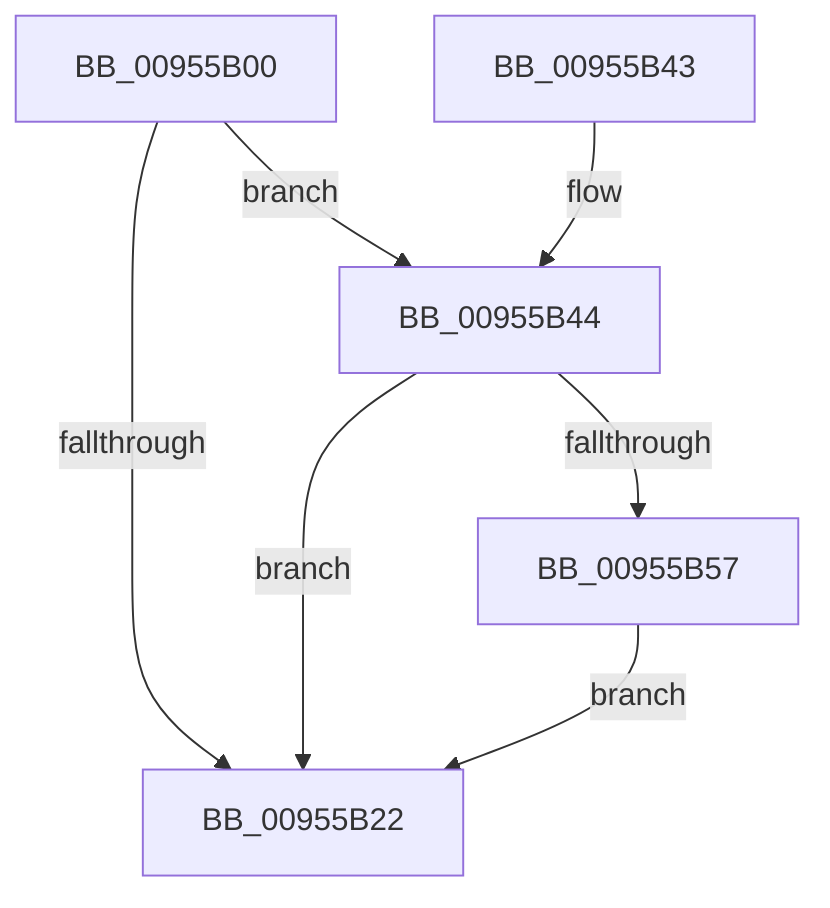

# PnpDisableWatchdog

- RVA: `0x00955B00`–`0x00955B66` (길이 `102` bytes)
- VA: `0x0000000140955B00`
- 실행 섹션: `PAGE`
- PDB 이름 있음: `예`; PDB Function 태그: `아니요`
- unwind 정보 RVA: `0x00092364`
- 디코드: `30`개 명령, `102/102` bytes 표시
- 미해석 바이트: `0` (있으면 어셈블리에 `.byte`로 보존)

> 이 문서는 커널 이미지의 기계어와 PDB 기호를 분석해 생성했습니다. 4번과 5번은 함수 원형과 자료형을 바이너리 사용 방식에서 추정한 C 해석이며 원본 소스 복구 결과는 아닙니다.

## 1. Dependencies

- 직접 호출 지점: **6**; 고유 호출 대상: **5**
- 직접 호출자로 확인된 함수: **5**
- RIP 상대 이미지 참조: **0**

### Outgoing calls
- `0x00955B0D` → [PnpWatchdogTimerPause](PnpWatchdogTimerPause_function_00955B6C.md) (function, `0x00955B6C`)
- `0x00955B17` → [PnpRecordBlackbox](PnpRecordBlackbox_function_00955C28.md) (function, `0x00955C28`)
- `0x00955B2B` → [WdtpCancelTimer](WdtpCancelTimer_function_00955C70.md) (function, `0x00955C70`)
- `0x00955B38` → [ExFreePoolWithTag](../../poolcode/B8/ExFreePoolWithTag_function_00B82870.md) (function, `0x00B82870`)
- `0x00955B4C` → [PnpWatchdogEtwWrite](../../text/4D/PnpWatchdogEtwWrite_function_004D2FB0.md) (function, `0x004D2FB0`)
- `0x00955B5F` → [PnpWatchdogEtwWrite](../../text/4D/PnpWatchdogEtwWrite_function_004D2FB0.md) (function, `0x004D2FB0`)

### Direct callers
- [PnpDeviceCompletionRequestDestroyWorkItem](../../text/47/PnpDeviceCompletionRequestDestroyWorkItem_function_00471FC0.md) at `0x00471FD9`
- [PnpCallAddDevice](../8F/PnpCallAddDevice_function_008FC164.md) at `0x008FC238`
- [PnpDisableAndFreeEventWatchdog](PnpDisableAndFreeEventWatchdog_function_00955ABC.md) at `0x00955AE2`
- [PnpCallDriverEntry](../99/PnpCallDriverEntry_function_00996AF4.md) at `0x00996B65`
- [PnpDelayedRemoveWorker](../A0/PnpDelayedRemoveWorker_function_00A08AE0.md) at `0x00A08C6E`

### Static image references
- 디코드된 RIP-relative 메모리 참조가 없습니다.

## 2. Other-region calls and transfers

- 다른 실행 섹션으로 향하는 call: **3**
  - `0x00955B38` → [ExFreePoolWithTag](../../poolcode/B8/ExFreePoolWithTag_function_00B82870.md) (`PAGE` → `POOLCODE`)
  - `0x00955B4C` → [PnpWatchdogEtwWrite](../../text/4D/PnpWatchdogEtwWrite_function_004D2FB0.md) (`PAGE` → `.text`)
  - `0x00955B5F` → [PnpWatchdogEtwWrite](../../text/4D/PnpWatchdogEtwWrite_function_004D2FB0.md) (`PAGE` → `.text`)
- 별도 외부 분기/꼬리 이동을 확인하지 못했습니다.

## 3. Assembly (complete function range)

```asm
00955B00  40 53                           push rbx
00955B02  48 83 EC 20                     sub rsp, 0x20
00955B06  48 8B D9                        mov rbx, rcx
00955B09  48 8B 49 08                     mov rcx, qword ptr [rcx + 8]
00955B0D  E8 5A 00 00 00                  call 0x140955b6c
00955B12  8B 53 10                        mov edx, dword ptr [rbx + 0x10]
00955B15  33 C9                           xor ecx, ecx
00955B17  E8 0C 01 00 00                  call 0x140955c28
00955B1C  80 7B 20 00                     cmp byte ptr [rbx + 0x20], 0
00955B20  75 22                           jne 0x140955b44
00955B22  48 8B 5B 08                     mov rbx, qword ptr [rbx + 8]
00955B26  B2 01                           mov dl, 1
00955B28  48 8B CB                        mov rcx, rbx
00955B2B  E8 40 01 00 00                  call 0x140955c70
00955B30  BA 50 57 64 54                  mov edx, 0x54645750
00955B35  48 8B CB                        mov rcx, rbx
00955B38  E8 33 CD 22 00                  call 0x140b82870
00955B3D  48 83 C4 20                     add rsp, 0x20
00955B41  5B                              pop rbx
00955B42  C3                              ret
00955B43  CC                              int3
00955B44  BA 01 00 00 00                  mov edx, 1
00955B49  48 8B CB                        mov rcx, rbx
00955B4C  E8 5F D4 B7 FF                  call 0x1404d2fb0
00955B51  80 7B 21 00                     cmp byte ptr [rbx + 0x21], 0
00955B55  75 CB                           jne 0x140955b22
00955B57  BA 03 00 00 00                  mov edx, 3
00955B5C  48 8B CB                        mov rcx, rbx
00955B5F  E8 4C D4 B7 FF                  call 0x1404d2fb0
00955B64  EB BC                           jmp 0x140955b22
```

## 4. C-style interpretation (structured pseudocode)

```c
__int64 __fastcall PnpDisableWatchdog(__int64 a1)
{
    __int64 result;
    __int64 v_rsp;

    v_rsp = (v_rsp) - (32);
    result = PnpWatchdogTimerPause(*(unsigned __int64 *)(a1 + 8), a2, a3, a4);
    a1 = 0;
    result = PnpRecordBlackbox(a1, (unsigned int)(*(unsigned int *)(a1 + 16)), a3, a4);
    if ((*(unsigned __int8 *)(a1 + 32)) != 0) goto loc_00955B44;
loc_00955B22:
    result = WdtpCancelTimer(*(unsigned __int64 *)(a1 + 8), 1, a3, a4);
    result = ExFreePoolWithTag(*(unsigned __int64 *)(a1 + 8), (unsigned int)(0x54645750ULL), a3, a4);
    v_rsp = (v_rsp) + (32);
    return result;
loc_00955B44:
    result = PnpWatchdogEtwWrite(*(unsigned __int64 *)(a1 + 8), 1, a3, a4);
    if ((*(unsigned __int8 *)(*(unsigned __int64 *)(a1 + 8) + 33)) != 0) goto loc_00955B22;
    result = PnpWatchdogEtwWrite(*(unsigned __int64 *)(a1 + 8), 3, a3, a4);
    goto loc_00955B22;
}
```

## 5. (Beta) C Style

```c
int64_t PnpDisableWatchdog(void *Arg1)
{
    uint8_t *arg1 = (uint8_t *)Arg1;

    int64_t result;
    int64_t local_rsp;

    local_rsp = (local_rsp) - (32);
    result = PnpWatchdogTimerPause(*(uint64_t *)(arg1 + 0x8), a2, a3, a4);
    Arg1 = 0;
    result = PnpRecordBlackbox(Arg1, (uint32_t)(*(uint32_t *)(arg1 + 0x10)), a3, a4);
    if ((*(uint8_t *)(arg1 + 0x20)) != 0) goto loc_00955B44;
loc_00955B22:
    result = WdtpCancelTimer(*(uint64_t *)(arg1 + 0x8), 1, a3, a4);
    result = ExFreePoolWithTag(*(uint64_t *)(arg1 + 0x8), (uint32_t)(0x54645750ULL), a3, a4);
    local_rsp = (local_rsp) + (32);
    return result;
loc_00955B44:
    result = PnpWatchdogEtwWrite(*(uint64_t *)(arg1 + 0x8), 1, a3, a4);
    if ((*(uint8_t *)(*(uint64_t *)(arg1 + 0x8) + 0x21)) != 0) goto loc_00955B22;
    result = PnpWatchdogEtwWrite(*(uint64_t *)(arg1 + 0x8), 3, a3, a4);
    goto loc_00955B22;
}
```

### 관측된 메모리 오프셋

구조체 형식이 확인되지 않은 접근은 인자 기준의 오프셋으로만 기록했습니다.

| 기준 인자 | 오프셋 표현 | 폭 (bit) | 접근 |
|---|---:|---:|---|
| `Arg1` | `+ 0x8` | `64` | `R` |
| `Arg1` | `+ 0x10` | `32` | `R` |
| `Arg1` | `+ 0x20` | `8` | `R` |
| `Arg1` | `+ 0x21` | `8` | `R` |

## 6. Execution-region graph

[열기: 2D/3D 그래프와 함수 탐색 컨트롤 패널](../../../control-panel.html?section=page&rva=0x00955B00&view=graph)

- 2D 그래프는 위에서 아래로 흐르고, 3D 그래프는 빈 공간을 드래그해 회전합니다. Shift+드래그는 이동, 휠은 확대·축소, 함수 노드 선택은 대상 보고서 이동입니다.

### Static fallback


