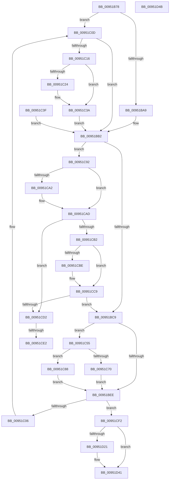

# PnpInsertEventInQueue

- RVA: `0x00951B78`–`0x00951D4C` (길이 `468` bytes)
- VA: `0x0000000140951B78`
- 실행 섹션: `PAGE`
- PDB 이름 있음: `예`; PDB Function 태그: `예`
- unwind 정보 RVA: `0x00091E7C`
- 디코드: `107`개 명령, `468/468` bytes 표시
- 미해석 바이트: `0` (있으면 어셈블리에 `.byte`로 보존)

> 이 문서는 커널 이미지의 기계어와 PDB 기호를 분석해 생성했습니다. 4번과 5번은 함수 원형과 자료형을 바이너리 사용 방식에서 추정한 C 해석이며 원본 소스 복구 결과는 아닙니다.

## 1. Dependencies

- 직접 호출 지점: **9**; 고유 호출 대상: **7**
- 직접 호출자로 확인된 함수: **16**
- RIP 상대 이미지 참조: **12**

### Outgoing calls
- `0x00951B9F` → [IoGetActivityIdThread](../../text/44/IoGetActivityIdThread_function_00445030.md) (function, `0x00445030`)
- `0x00951BD4` → [ExAcquireFastMutex](../../text/20/ExAcquireFastMutex_function_0020E5A0.md) (function, `0x0020E5A0`)
- `0x00951BE0` → [ExAcquireFastMutex](../../text/20/ExAcquireFastMutex_function_0020E5A0.md) (function, `0x0020E5A0`)
- `0x00951C0D` → [PnpIsSafeToExamineUserModeTeb](../../text/47/PnpIsSafeToExamineUserModeTeb_function_00478CF0.md) (function, `0x00478CF0`)
- `0x00951C63` → [ExAllocatePool2](../../poolcode/B8/ExAllocatePool2_function_00B820F0.md) (function, `0x00B820F0`)
- `0x00951C7E` → [KeResetEvent](../../text/24/KeResetEvent_function_00248350.md) (function, `0x00248350`)
- `0x00951D07` → [ExReleaseFastMutex](../../text/25/ExReleaseFastMutex_function_002519C0.md) (function, `0x002519C0`)
- `0x00951D17` → [ExReleaseFastMutex](../../text/25/ExReleaseFastMutex_function_002519C0.md) (function, `0x002519C0`)
- `0x00951D3C` → [ExQueueWorkItem](../../text/2F/ExQueueWorkItem_function_002F9520.md) (function, `0x002F9520`)

### Direct callers
- [PnpSetDeviceInstancePropertyChangeEventFromDeviceInstance](../../text/49/PnpSetDeviceInstancePropertyChangeEventFromDeviceInstance_function_00493500.md) at `0x004935A8`
- [PnpSetDeviceInstanceStartedEventFromDeviceInstance](../../text/4A/PnpSetDeviceInstanceStartedEventFromDeviceInstance_function_004AED80.md) at `0x004AEE28`
- [PnpSetDeviceInstanceRemovalEvent](../../text/4B/PnpSetDeviceInstanceRemovalEvent_function_004B16D8.md) at `0x004B1796`
- [PnpSetBlockedDriverEvent](../73/PnpSetBlockedDriverEvent_function_00738114.md) at `0x00738171`
- [PnpSetDeviceRemovalSafe](../73/PnpSetDeviceRemovalSafe_function_00738184.md) at `0x00738267`
- [PnpSetHwProfileChangeEvent](../73/PnpSetHwProfileChangeEvent_function_00738290.md) at `0x0073830B`
- [PnpSetInvalidIDEvent](../73/PnpSetInvalidIDEvent_function_0073832C.md) at `0x007383C0`
- [PnpSetPowerVetoEvent](../73/PnpSetPowerVetoEvent_function_007383E4.md) at `0x00738525`
- [PnpSetPlugPlayEvent](../8F/PnpSetPlugPlayEvent_function_008FBE04.md) at `0x008FBEEB`
- [PnpQueueQueryAndRemoveEvent](../94/PnpQueueQueryAndRemoveEvent_function_0094FD2C.md) at `0x0094FEF8`
- [PnpSetDeviceClassChange](PnpSetDeviceClassChange_function_009517B0.md) at `0x00951848`
- [PnpInsertNoopEvent](PnpInsertNoopEvent_function_0095197C.md) at `0x009519C9`
- [PnpSetCustomTargetEvent](PnpSetCustomTargetEvent_function_009519E8.md) at `0x00951AFC`
- [PnpSynchronizeDeviceEventQueue](../AA/PnpSynchronizeDeviceEventQueue_function_00AA4F60.md) at `0x00AA4FCD`
- [sub_00B1FAB0](../B1/Unknown_function_00B1FAB0.md) at `0x00B1FB37`
- [sub_00B49E1C](../B4/Unknown_function_00B49E1C.md) at `0x00B49EDD`

### Static image references
- `0x00951B87` → RVA `0x000112D0` (`.rdata`; read)
- `0x00951BBC` → RVA `0x00EF012B` (`.data`; read)
- `0x00951BC9` → RVA `0x00FD8048` (`PAGEDATA`; read)
- `0x00951BD9` → RVA `0x00F8AC40` (`.data`; read)
- `0x00951BE5` → RVA `0x00FD8003` (`PAGEDATA`; read)
- `0x00951C70` → RVA `0x00FD8003` (`PAGEDATA`; write)
- `0x00951C77` → RVA `0x00F8AC80` (`.data`; read)
- `0x00951C99` → RVA `0x00014D38` (`.rdata`; read)
- `0x00951CA6` → RVA `0x00014D40` (`.rdata`; read)
- `0x00951CB5` → RVA `0x00014D48` (`.rdata`; read)
- `0x00951CC2` → RVA `0x00014D50` (`.rdata`; read)
- `0x00951D21` → RVA `0x009556B0` (`PnpDeviceEventWorker`; read)

## 2. Other-region calls and transfers

- 다른 실행 섹션으로 향하는 call: **9**
  - `0x00951B9F` → [IoGetActivityIdThread](../../text/44/IoGetActivityIdThread_function_00445030.md) (`PAGE` → `.text`)
  - `0x00951BD4` → [ExAcquireFastMutex](../../text/20/ExAcquireFastMutex_function_0020E5A0.md) (`PAGE` → `.text`)
  - `0x00951BE0` → [ExAcquireFastMutex](../../text/20/ExAcquireFastMutex_function_0020E5A0.md) (`PAGE` → `.text`)
  - `0x00951C0D` → [PnpIsSafeToExamineUserModeTeb](../../text/47/PnpIsSafeToExamineUserModeTeb_function_00478CF0.md) (`PAGE` → `.text`)
  - `0x00951C63` → [ExAllocatePool2](../../poolcode/B8/ExAllocatePool2_function_00B820F0.md) (`PAGE` → `POOLCODE`)
  - `0x00951C7E` → [KeResetEvent](../../text/24/KeResetEvent_function_00248350.md) (`PAGE` → `.text`)
  - `0x00951D07` → [ExReleaseFastMutex](../../text/25/ExReleaseFastMutex_function_002519C0.md) (`PAGE` → `.text`)
  - `0x00951D17` → [ExReleaseFastMutex](../../text/25/ExReleaseFastMutex_function_002519C0.md) (`PAGE` → `.text`)
  - `0x00951D3C` → [ExQueueWorkItem](../../text/2F/ExQueueWorkItem_function_002F9520.md) (`PAGE` → `.text`)
- call이 아닌 외부 분기/꼬리 이동: **2**
  - `0x00951CDC` → [sub_00B2624A](../B2/Unknown_function_00B2624A.md) (`tail-transfer`)
  - `0x00951CED` → [sub_00B2624A + 0x3](../B2/Unknown_function_00B2624A.md) (`tail-transfer`)

## 3. Assembly (complete function range)

```asm
00951B78  48 89 4C 24 08                  mov qword ptr [rsp + 8], rcx
00951B7D  53                              push rbx
00951B7E  56                              push rsi
00951B7F  57                              push rdi
00951B80  48 83 EC 60                     sub rsp, 0x60
00951B84  48 8B D9                        mov rbx, rcx
00951B87  0F 10 05 42 F7 6B FF            movups xmm0, xmmword ptr [rip - 0x9408be]
00951B8E  F3 0F 7F 44 24 50               movdqu xmmword ptr [rsp + 0x50], xmm0
00951B94  33 F6                           xor esi, esi
00951B96  89 B4 24 88 00 00 00            mov dword ptr [rsp + 0x88], esi
00951B9D  33 FF                           xor edi, edi
00951B9F  E8 8C 34 AF FF                  call 0x140445030
00951BA4  48 85 C0                        test rax, rax
00951BA7  74 64                           je 0x140951c0d
00951BA9  0F 10 00                        movups xmm0, xmmword ptr [rax]
00951BAC  F3 0F 7F 44 24 50               movdqu xmmword ptr [rsp + 0x50], xmm0
00951BB2  0F 10 44 24 50                  movups xmm0, xmmword ptr [rsp + 0x50]
00951BB7  F3 0F 7F 43 58                  movdqu xmmword ptr [rbx + 0x58], xmm0
00951BBC  F6 05 68 E5 59 00 10            test byte ptr [rip + 0x59e568], 0x10
00951BC3  0F 85 C9 00 00 00               jne 0x140951c92
00951BC9  48 8B 0D 78 64 68 00            mov rcx, qword ptr [rip + 0x686478]
00951BD0  48 83 C1 40                     add rcx, 0x40
00951BD4  E8 C7 C9 8B FF                  call 0x14020e5a0
00951BD9  48 8D 0D 60 90 63 00            lea rcx, [rip + 0x639060]
00951BE0  E8 BB C9 8B FF                  call 0x14020e5a0
00951BE5  80 3D 17 64 68 00 00            cmp byte ptr [rip + 0x686417], 0
00951BEC  74 67                           je 0x140951c55
00951BEE  48 8B 05 53 64 68 00            mov rax, qword ptr [rip + 0x686453]
00951BF5  48 83 C0 78                     add rax, 0x78
00951BF9  48 8B 48 08                     mov rcx, qword ptr [rax + 8]
00951BFD  48 39 01                        cmp qword ptr [rcx], rax
00951C00  0F 84 EC 00 00 00               je 0x140951cf2
00951C06  B9 03 00 00 00                  mov ecx, 3
00951C0B  CD 29                           int 0x29
00951C0D  E8 DE 70 B2 FF                  call 0x140478cf0
00951C12  84 C0                           test al, al
00951C14  74 9C                           je 0x140951bb2
00951C16  65 48 8B 04 25 30 00 00 00      mov rax, qword ptr gs:[0x30]
00951C1F  48 85 C0                        test rax, rax
00951C22  74 16                           je 0x140951c3a
00951C24  65 48 8B 04 25 30 00 00 00      mov rax, qword ptr gs:[0x30]
00951C2D  0F 10 80 10 17 00 00            movups xmm0, xmmword ptr [rax + 0x1710]
00951C34  F3 0F 7F 44 24 50               movdqu xmmword ptr [rsp + 0x50], xmm0
00951C3A  E9 73 FF FF FF                  jmp 0x140951bb2
00951C3F  48 8B 9C 24 80 00 00 00         mov rbx, qword ptr [rsp + 0x80]
00951C47  8B B4 24 88 00 00 00            mov esi, dword ptr [rsp + 0x88]
00951C4E  8B FE                           mov edi, esi
00951C50  E9 5D FF FF FF                  jmp 0x140951bb2
00951C55  BA 20 00 00 00                  mov edx, 0x20
00951C5A  8D 4A 20                        lea ecx, [rdx + 0x20]
00951C5D  41 B8 50 6E 70 4C               mov r8d, 0x4c706e50
00951C63  E8 88 04 23 00                  call 0x140b820f0
00951C68  48 8B F8                        mov rdi, rax
00951C6B  48 85 C0                        test rax, rax
00951C6E  74 18                           je 0x140951c88
00951C70  C6 05 8C 63 68 00 01            mov byte ptr [rip + 0x68638c], 1
00951C77  48 8D 0D 02 90 63 00            lea rcx, [rip + 0x639002]
00951C7E  E8 CD 66 8F FF                  call 0x140248350
00951C83  E9 66 FF FF FF                  jmp 0x140951bee
00951C88  BE 9A 00 00 C0                  mov esi, 0xc000009a
00951C8D  E9 5C FF FF FF                  jmp 0x140951bee
00951C92  48 8D 53 78                     lea rdx, [rbx + 0x78]
00951C96  48 8B 02                        mov rax, qword ptr [rdx]
00951C99  48 2B 05 98 30 6C FF            sub rax, qword ptr [rip - 0x93cf68]
00951CA0  75 0B                           jne 0x140951cad
00951CA2  48 8B 42 08                     mov rax, qword ptr [rdx + 8]
00951CA6  48 2B 05 93 30 6C FF            sub rax, qword ptr [rip - 0x93cf6d]
00951CAD  48 85 C0                        test rax, rax
00951CB0  74 20                           je 0x140951cd2
00951CB2  48 8B 02                        mov rax, qword ptr [rdx]
00951CB5  48 2B 05 8C 30 6C FF            sub rax, qword ptr [rip - 0x93cf74]
00951CBC  75 0B                           jne 0x140951cc9
00951CBE  48 8B 42 08                     mov rax, qword ptr [rdx + 8]
00951CC2  48 2B 05 87 30 6C FF            sub rax, qword ptr [rip - 0x93cf79]
00951CC9  48 85 C0                        test rax, rax
00951CCC  0F 85 F7 FE FF FF               jne 0x140951bc9
00951CD2  48 8B 83 A0 00 00 00            mov rax, qword ptr [rbx + 0xa0]
00951CD9  48 85 C0                        test rax, rax
00951CDC  0F 84 68 45 1D 00               je 0x140b2624a
00951CE2  48 8B 80 38 01 00 00            mov rax, qword ptr [rax + 0x138]
00951CE9  4C 8B 48 28                     mov r9, qword ptr [rax + 0x28]
00951CED  E9 5B 45 1D 00                  jmp 0x140b2624d
00951CF2  48 89 03                        mov qword ptr [rbx], rax
00951CF5  48 89 4B 08                     mov qword ptr [rbx + 8], rcx
00951CF9  48 89 19                        mov qword ptr [rcx], rbx
00951CFC  48 89 58 08                     mov qword ptr [rax + 8], rbx
00951D00  48 8D 0D 39 8F 63 00            lea rcx, [rip + 0x638f39]
00951D07  E8 B4 FC 8F FF                  call 0x1402519c0
00951D0C  48 8B 0D 35 63 68 00            mov rcx, qword ptr [rip + 0x686335]
00951D13  48 83 C1 40                     add rcx, 0x40
00951D17  E8 A4 FC 8F FF                  call 0x1402519c0
00951D1C  48 85 FF                        test rdi, rdi
00951D1F  74 20                           je 0x140951d41
00951D21  48 8D 05 88 39 00 00            lea rax, [rip + 0x3988]
00951D28  48 89 47 10                     mov qword ptr [rdi + 0x10], rax
00951D2C  48 89 7F 18                     mov qword ptr [rdi + 0x18], rdi
00951D30  48 83 27 00                     and qword ptr [rdi], 0
00951D34  BA 01 00 00 00                  mov edx, 1
00951D39  48 8B CF                        mov rcx, rdi
00951D3C  E8 DF 77 9A FF                  call 0x1402f9520
00951D41  8B C6                           mov eax, esi
00951D43  48 83 C4 60                     add rsp, 0x60
00951D47  5F                              pop rdi
00951D48  5E                              pop rsi
00951D49  5B                              pop rbx
00951D4A  C3                              ret
00951D4B  CC                              int3
```

## 4. C-style interpretation (structured pseudocode)

```c
__int64 __fastcall PnpInsertEventInQueue(__int64 a1)
{
    __int64 result;
    __int64 v_rdi;
    __int64 v_rsi;
    __int64 v_rsp;
    unsigned __int64 v_stack_m28;
    unsigned int v_stack_p10;
    unsigned __int64 v_stack_p8;

    v_stack_p8 = a1;
    v_rsp = (v_rsp) - (96);
    v_stack_m28 = v_xmm0;
    v_rsi = 0;
    v_stack_p10 = 0;
    v_rdi = 0;
    result = IoGetActivityIdThread(a1, a2, a3, a4);
    if (result == 0) goto loc_00951C0D;
    v_stack_m28 = v_xmm0;
loc_00951BB2:
    *(unsigned __int64 *)(a1 + 88) = v_xmm0;
    if (((*(unsigned __int8 *)(v_rip + 5891432)) & (16)) != 0) goto loc_00951C92;
loc_00951BC9:
    a1 = (*(unsigned __int64 *)(v_rip + 6841464)) + (64);
    result = ExAcquireFastMutex(a1, a2, a3, a4);
    result = ExAcquireFastMutex(v_rip + 6525024, a2, a3, a4);
    if ((*(unsigned __int8 *)(v_rip + 6841367)) == 0) goto loc_00951C55;
loc_00951BEE:
    result = (*(unsigned __int64 *)(v_rip + 6841427)) + (120);
    if ((*(unsigned __int64 *)(*(unsigned __int64 *)(result + 8))) == result) goto loc_00951CF2;
loc_00951C0D:
    result = PnpIsSafeToExamineUserModeTeb(3, a2, a3, a4);
    if ((unsigned __int8)(result) == 0) goto loc_00951BB2;
    result = *(unsigned __int64 *)(gs_base + (0 + 48));
    if (*(unsigned __int64 *)(gs_base + (0 + 48)) != 0) {
        result = *(unsigned __int64 *)(gs_base + (0 + 48));
        v_stack_m28 = v_xmm0;
    }
    goto loc_00951BB2;
loc_00951C55:
    result = ExAllocatePool2(32 + 32, 32, (unsigned int)(0x4C706E50ULL), a4);
    if (result == 0) goto loc_00951C88;
    *(unsigned __int8 *)(v_rip + 6841228) = 1;
    result = KeResetEvent(v_rip + 6524930, 32, (unsigned int)(0x4C706E50ULL), a4);
    goto loc_00951BEE;
loc_00951C88:
    goto loc_00951BEE;
loc_00951C92:
    result = (*(unsigned __int64 *)(a1 + 120)) - (*(unsigned __int64 *)(v_rip - 9686888));
    if (!(condition_is_not_equal)) {
        result = *(unsigned __int64 *)(a1 + 120 + 8);
        result = (result) - (*(unsigned __int64 *)(v_rip - 9686893));
    }
    if (result == 0) goto loc_00951CD2;
    result = (*(unsigned __int64 *)(a1 + 120)) - (*(unsigned __int64 *)(v_rip - 9686900));
    if (!(condition_is_not_equal)) {
        result = *(unsigned __int64 *)(a1 + 120 + 8);
        result = (result) - (*(unsigned __int64 *)(v_rip - 9686905));
    }
    if (result != 0) goto loc_00951BC9;
loc_00951CD2:
loc_00951CF2:
    *(unsigned __int64 *)(a1) = *(unsigned __int64 *)(*(unsigned __int64 *)(a1 + 160) + 312);
    *(unsigned __int64 *)(a1 + 8) = v_rip + 6524930;
    *(unsigned __int64 *)(v_rip + 6524930) = a1;
    *(unsigned __int64 *)(*(unsigned __int64 *)(*(unsigned __int64 *)(a1 + 160) + 312) + 8) = a1;
    result = ExReleaseFastMutex(v_rip + 6524729, a1 + 120, (unsigned int)(0x4C706E50ULL), *(unsigned __int64 *)(*(unsigned __int64 *)(*(unsigned __int64 *)(a1 + 160) + 312) + 40));
    a1 = (*(unsigned __int64 *)(v_rip + 6841141)) + (64);
    result = ExReleaseFastMutex(a1, a1 + 120, (unsigned int)(0x4C706E50ULL), *(unsigned __int64 *)(*(unsigned __int64 *)(*(unsigned __int64 *)(a1 + 160) + 312) + 40));
    if (result != 0) {
        result = v_rip + 14728;
        *(unsigned __int64 *)(result + 16) = result;
        *(unsigned __int64 *)(result + 24) = result;
        a2 = 1;
        a1 = result;
        result = ExQueueWorkItem(a1, a2, (unsigned int)(0x4C706E50ULL), *(unsigned __int64 *)(*(unsigned __int64 *)(*(unsigned __int64 *)(a1 + 160) + 312) + 40));
    }
    v_rsp = (v_rsp) + (96);
    return (unsigned int)((unsigned int)((unsigned int)(0xC000009AULL)));
}
```

## 5. (Beta) C Style

```c
int64_t PnpInsertEventInQueue(void *Arg1)
{
    uint8_t *arg1 = (uint8_t *)Arg1;

    int64_t result;
    int64_t local_rdi;
    int64_t local_rsi;
    int64_t local_rsp;
    uint64_t v_stack_m28;
    uint32_t v_stack_p10;
    uint64_t v_stack_p8;

    v_stack_p8 = Arg1;
    local_rsp = (local_rsp) - (96);
    v_stack_m28 = v_xmm0;
    local_rsi = 0;
    v_stack_p10 = 0;
    local_rdi = 0;
    result = IoGetActivityIdThread(Arg1, a2, a3, a4);
    if (result == 0) goto loc_00951C0D;
    v_stack_m28 = v_xmm0;
loc_00951BB2:
    *(uint64_t *)(arg1 + 0x58) = v_xmm0;
    if (((*(uint8_t *)(v_rip + 0x59E568)) & (16)) != 0) goto loc_00951C92;
loc_00951BC9:
    Arg1 = (*(uint64_t *)(v_rip + 0x686478)) + (64);
    result = ExAcquireFastMutex(Arg1, a2, a3, a4);
    result = ExAcquireFastMutex(v_rip + 6525024, a2, a3, a4);
    if ((*(uint8_t *)(v_rip + 0x686417)) == 0) goto loc_00951C55;
loc_00951BEE:
    result = (*(uint64_t *)(v_rip + 0x686453)) + (120);
    if ((*(uint64_t *)(*(uint64_t *)(result + 0x8))) == result) goto loc_00951CF2;
loc_00951C0D:
    result = PnpIsSafeToExamineUserModeTeb(3, a2, a3, a4);
    if ((uint8_t)(result) == 0) goto loc_00951BB2;
    result = *(uint64_t *)(gs_base + (0 + 0x30));
    if (*(uint64_t *)(gs_base + (0 + 0x30)) != 0) {
        result = *(uint64_t *)(gs_base + (0 + 0x30));
        v_stack_m28 = v_xmm0;
    }
    goto loc_00951BB2;
loc_00951C55:
    result = ExAllocatePool2(32 + 32, 32, (uint32_t)(0x4C706E50ULL), a4);
    if (result == 0) goto loc_00951C88;
    *(uint8_t *)(v_rip + 0x68638C) = 1;
    result = KeResetEvent(v_rip + 6524930, 32, (uint32_t)(0x4C706E50ULL), a4);
    goto loc_00951BEE;
loc_00951C88:
    goto loc_00951BEE;
loc_00951C92:
    result = (*(uint64_t *)(arg1 + 0x78)) - (*(uint64_t *)(v_rip - 0x93CF68));
    if (!(condition_is_not_equal)) {
        result = *(uint64_t *)(arg1 + 0x78 + 0x8);
        result = (result) - (*(uint64_t *)(v_rip - 0x93CF6D));
    }
    if (result == 0) goto loc_00951CD2;
    result = (*(uint64_t *)(arg1 + 0x78)) - (*(uint64_t *)(v_rip - 0x93CF74));
    if (!(condition_is_not_equal)) {
        result = *(uint64_t *)(arg1 + 0x78 + 0x8);
        result = (result) - (*(uint64_t *)(v_rip - 0x93CF79));
    }
    if (result != 0) goto loc_00951BC9;
loc_00951CD2:
loc_00951CF2:
    *(uint64_t *)(arg1) = *(uint64_t *)(*(uint64_t *)(arg1 + 0xA0) + 0x138);
    *(uint64_t *)(arg1 + 0x8) = v_rip + 6524930;
    *(void **)(v_rip + 0x639002) = Arg1;
    *(void **)(*(uint64_t *)(*(uint64_t *)(arg1 + 0xA0) + 0x138) + 0x8) = Arg1;
    result = ExReleaseFastMutex(v_rip + 6524729, Arg1 + 120, (uint32_t)(0x4C706E50ULL), *(uint64_t *)(*(uint64_t *)(*(uint64_t *)(arg1 + 0xA0) + 0x138) + 0x28));
    Arg1 = (*(uint64_t *)(v_rip + 0x686335)) + (64);
    result = ExReleaseFastMutex(Arg1, Arg1 + 120, (uint32_t)(0x4C706E50ULL), *(uint64_t *)(*(uint64_t *)(*(uint64_t *)(arg1 + 0xA0) + 0x138) + 0x28));
    if (result != 0) {
        result = v_rip + 14728;
        *(uint64_t *)(result + 0x10) = result;
        *(uint64_t *)(result + 0x18) = result;
        a2 = 1;
        Arg1 = result;
        result = ExQueueWorkItem(Arg1, a2, (uint32_t)(0x4C706E50ULL), *(uint64_t *)(*(uint64_t *)(*(uint64_t *)(arg1 + 0xA0) + 0x138) + 0x28));
    }
    local_rsp = (local_rsp) + (96);
    return (uint32_t)((uint32_t)((uint32_t)(0xC000009AULL)));
}
```

### 관측된 메모리 오프셋

구조체 형식이 확인되지 않은 접근은 인자 기준의 오프셋으로만 기록했습니다.

| 기준 인자 | 오프셋 표현 | 폭 (bit) | 접근 |
|---|---:|---:|---|
| `Arg1` | `+ 0x0` | `64` | `R` |
| `Arg1` | `+ 0x0` | `64` | `W` |
| `Arg1` | `+ 0x8` | `64` | `R` |
| `Arg1` | `+ 0x8` | `64` | `W` |
| `Arg1` | `+ 0x58` | `128` | `W` |
| `Arg1` | `+ 0x78` | `64` | `R` |
| `Arg1` | `+ 0xA0` | `64` | `R` |

## 6. Execution-region graph

[열기: 2D/3D 그래프와 함수 탐색 컨트롤 패널](../../../control-panel.html?section=page&rva=0x00951B78&view=graph)

- 2D 그래프는 위에서 아래로 흐르고, 3D 그래프는 빈 공간을 드래그해 회전합니다. Shift+드래그는 이동, 휠은 확대·축소, 함수 노드 선택은 대상 보고서 이동입니다.

### Static fallback


