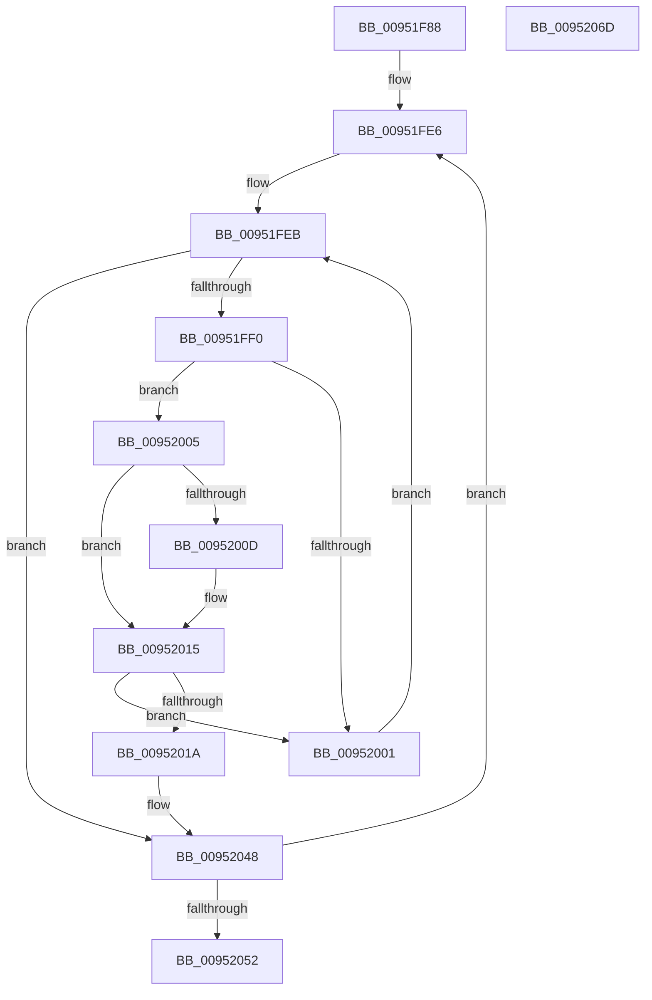

# PnpInterfaceRaisePropertyChangeEventWorker

- RVA: `0x00951F88`–`0x0095206E` (길이 `230` bytes)
- VA: `0x0000000140951F88`
- 실행 섹션: `PAGE`
- PDB 이름 있음: `예`; PDB Function 태그: `아니요`
- unwind 정보 RVA: `0x00091ECC`
- 디코드: `60`개 명령, `230/230` bytes 표시
- 미해석 바이트: `0` (있으면 어셈블리에 `.byte`로 보존)

> 이 문서는 커널 이미지의 기계어와 PDB 기호를 분석해 생성했습니다. 4번과 5번은 함수 원형과 자료형을 바이너리 사용 방식에서 추정한 C 해석이며 원본 소스 복구 결과는 아닙니다.

## 1. Dependencies

- 직접 호출 지점: **2**; 고유 호출 대상: **1**
- 직접 호출자로 확인된 함수: **3**
- RIP 상대 이미지 참조: **1**

### Outgoing calls
- `0x00951FD5` → [guard_dispatch_icall](../../text/6B/guard_dispatch_icall_function_006BAAD0.md) (function, `0x006BAAD0`)
- `0x00952043` → [guard_dispatch_icall](../../text/6B/guard_dispatch_icall_function_006BAAD0.md) (function, `0x006BAAD0`)

### Direct callers
- [PnpObjectRaisePropertyChangeEvent](../8F/PnpObjectRaisePropertyChangeEvent_function_008F7E94.md) at `0x008F7F10`
- [PnpRaiseNtPlugPlayInterfacePropertyChangeEvent](PnpRaiseNtPlugPlayInterfacePropertyChangeEvent_function_00951D54.md) at `0x00951D91`
- [CmSetDeviceInterfaceMappedProperty](../A7/CmSetDeviceInterfaceMappedProperty_function_00A7287C.md) at `0x00A729B5`

### Static image references
- `0x00951FDA` → RVA `0x00002258` (`.rdata`; read)

## 2. Other-region calls and transfers

- 다른 실행 섹션으로 향하는 call: **2**
  - `0x00951FD5` → [guard_dispatch_icall](../../text/6B/guard_dispatch_icall_function_006BAAD0.md) (`PAGE` → `.text`)
  - `0x00952043` → [guard_dispatch_icall](../../text/6B/guard_dispatch_icall_function_006BAAD0.md) (`PAGE` → `.text`)
- 별도 외부 분기/꼬리 이동을 확인하지 못했습니다.

## 3. Assembly (complete function range)

```asm
00951F88  4C 8B DC                        mov r11, rsp
00951F8B  49 89 5B 08                     mov qword ptr [r11 + 8], rbx
00951F8F  49 89 6B 10                     mov qword ptr [r11 + 0x10], rbp
00951F93  49 89 73 18                     mov qword ptr [r11 + 0x18], rsi
00951F97  49 89 7B 20                     mov qword ptr [r11 + 0x20], rdi
00951F9B  41 56                           push r14
00951F9D  48 83 EC 50                     sub rsp, 0x50
00951FA1  48 8B BC 24 80 00 00 00         mov rdi, qword ptr [rsp + 0x80]
00951FA9  49 8D 43 D8                     lea rax, [r11 - 0x28]
00951FAD  4D 89 4B E0                     mov qword ptr [r11 - 0x20], r9
00951FB1  48 8B EA                        mov rbp, rdx
00951FB4  41 B9 04 00 00 00               mov r9d, 4
00951FBA  4D 89 43 D8                     mov qword ptr [r11 - 0x28], r8
00951FBE  49 89 43 C8                     mov qword ptr [r11 - 0x38], rax
00951FC2  4C 8B F1                        mov r14, rcx
00951FC5  48 8B 84 24 88 00 00 00         mov rax, qword ptr [rsp + 0x88]
00951FCD  49 89 7B E8                     mov qword ptr [r11 - 0x18], rdi
00951FD1  45 8D 41 FF                     lea r8d, [r9 - 1]
00951FD5  E8 F6 8A D6 FF                  call 0x1406baad0
00951FDA  48 8D 1D 77 02 6B FF            lea rbx, [rip - 0x94fd89]
00951FE1  BE 02 00 00 00                  mov esi, 2
00951FE6  44 8B 0B                        mov r9d, dword ptr [rbx]
00951FE9  33 D2                           xor edx, edx
00951FEB  41 3B D1                        cmp edx, r9d
00951FEE  73 58                           jae 0x140952048
00951FF0  48 8B 43 F8                     mov rax, qword ptr [rbx - 8]
00951FF4  4C 8B 04 D0                     mov r8, qword ptr [rax + rdx*8]
00951FF8  41 8B 40 10                     mov eax, dword ptr [r8 + 0x10]
00951FFC  39 47 10                        cmp dword ptr [rdi + 0x10], eax
00951FFF  74 04                           je 0x140952005
00952001  FF C2                           inc edx
00952003  EB E6                           jmp 0x140951feb
00952005  48 8B 0F                        mov rcx, qword ptr [rdi]
00952008  49 2B 08                        sub rcx, qword ptr [r8]
0095200B  75 08                           jne 0x140952015
0095200D  48 8B 4F 08                     mov rcx, qword ptr [rdi + 8]
00952011  49 2B 48 08                     sub rcx, qword ptr [r8 + 8]
00952015  48 85 C9                        test rcx, rcx
00952018  75 E7                           jne 0x140952001
0095201A  48 8B 43 08                     mov rax, qword ptr [rbx + 8]
0095201E  44 8D 49 04                     lea r9d, [rcx + 4]
00952022  48 89 44 24 40                  mov qword ptr [rsp + 0x40], rax
00952027  44 8D 41 03                     lea r8d, [rcx + 3]
0095202B  48 8D 44 24 30                  lea rax, [rsp + 0x30]
00952030  48 8B D5                        mov rdx, rbp
00952033  48 89 44 24 20                  mov qword ptr [rsp + 0x20], rax
00952038  49 8B CE                        mov rcx, r14
0095203B  48 8B 84 24 88 00 00 00         mov rax, qword ptr [rsp + 0x88]
00952043  E8 88 8A D6 FF                  call 0x1406baad0
00952048  48 83 C3 18                     add rbx, 0x18
0095204C  48 83 EE 01                     sub rsi, 1
00952050  75 94                           jne 0x140951fe6
00952052  48 8B 5C 24 60                  mov rbx, qword ptr [rsp + 0x60]
00952057  48 8B 6C 24 68                  mov rbp, qword ptr [rsp + 0x68]
0095205C  48 8B 74 24 70                  mov rsi, qword ptr [rsp + 0x70]
00952061  48 8B 7C 24 78                  mov rdi, qword ptr [rsp + 0x78]
00952066  48 83 C4 50                     add rsp, 0x50
0095206A  41 5E                           pop r14
0095206C  C3                              ret
0095206D  CC                              int3
```

## 4. C-style interpretation (structured pseudocode)

```c
__int64 __fastcall PnpInterfaceRaisePropertyChangeEventWorker(__int64 a1, __int64 a2, __int64 a3, __int64 a4, __int64 a5, __int64 a6)
{
    __int64 result;
    __int64 v_rbx;
    __int64 v_rsi;
    __int64 v_rsp;
    unsigned __int64 v_stack_m18;
    unsigned __int64 v_stack_m28;
    unsigned __int64 v_stack_m38;
    unsigned __int64 v_stack_p10;
    unsigned __int64 v_stack_p18;
    unsigned __int64 v_stack_p20;
    unsigned __int64 v_stack_p8;

    *(unsigned __int64 *)(v_rsp + 8) = v_rbx;
    *(unsigned __int64 *)(v_rsp + 16) = v_rbp;
    *(unsigned __int64 *)(v_rsp + 24) = v_rsi;
    *(unsigned __int64 *)(v_rsp + 32) = v_rdi;
    v_rsp = (v_rsp) - (80);
    *(unsigned __int64 *)(v_rsp - 32) = a4;
    *(unsigned __int64 *)(v_rsp - 40) = a3;
    *(unsigned __int64 *)(v_rsp - 56) = v_rsp - 40;
    *(unsigned __int64 *)(v_rsp - 24) = a5;
    result = guard_dispatch_icall(a1, a2, 4 - 1, 4);
loc_00951FE6:
    a2 = 0;
loc_00951FEB:
    if (0 >= ((unsigned int)((unsigned int)(*(unsigned int *)(v_rip - 9764233))))) goto loc_00952048;
    if ((*(unsigned int *)(a5 + 16)) == ((unsigned int)((unsigned int)(*(unsigned int *)(*(unsigned __int64 *)(*(unsigned __int64 *)(v_rip - 9764233 - 8) + a2 * 8) + 16))))) goto loc_00952005;
loc_00952001:
    a2 = (unsigned int)((a2) + 1);
    goto loc_00951FEB;
loc_00952005:
    a1 = (*(unsigned __int64 *)(a5)) - (*(unsigned __int64 *)(*(unsigned __int64 *)(*(unsigned __int64 *)(v_rip - 9764233 - 8) + a2 * 8)));
    if (!(condition_is_not_equal)) {
        a1 = *(unsigned __int64 *)(a5 + 8);
        a1 = (a1) - (*(unsigned __int64 *)(*(unsigned __int64 *)(*(unsigned __int64 *)(v_rip - 9764233 - 8) + a2 * 8) + 8));
    }
    if (a1 != 0) goto loc_00952001;
    v_stack_m18 = *(unsigned __int64 *)(v_rip - 9764233 + 8);
    v_stack_m38 = v_stack_m28;
    result = guard_dispatch_icall(a1, a2, a1 + 3, a1 + 4);
loc_00952048:
    v_rbx = (v_rip - 9764233) + (24);
    v_rsi = (2) - (1);
    if (condition_is_not_equal) goto loc_00951FE6;
    v_rsp = (v_rsp) + (80);
    return result;
}
```

## 5. (Beta) C Style

```c
int64_t PnpInterfaceRaisePropertyChangeEventWorker(int64_t Arg1, int64_t Arg2, int64_t Arg3, int64_t Arg4, void *Arg5, int64_t Arg6)
{
    uint8_t *arg5 = (uint8_t *)Arg5;

    int64_t result;
    int64_t local_rbx;
    int64_t local_rsi;
    int64_t local_rsp;
    uint64_t v_stack_m18;
    uint64_t v_stack_m28;
    uint64_t v_stack_m38;
    uint64_t v_stack_p10;
    uint64_t v_stack_p18;
    uint64_t v_stack_p20;
    uint64_t v_stack_p8;

    *(uint64_t *)(local_rsp + 0x8) = local_rbx;
    *(uint64_t *)(local_rsp + 0x10) = local_rbp;
    *(uint64_t *)(local_rsp + 0x18) = local_rsi;
    *(uint64_t *)(local_rsp + 0x20) = local_rdi;
    local_rsp = (local_rsp) - (80);
    *(uint64_t *)(local_rsp - 0x20) = Arg4;
    *(uint64_t *)(local_rsp - 0x28) = Arg3;
    *(uint64_t *)(local_rsp - 0x38) = local_rsp - 40;
    *(void **)(local_rsp - 0x18) = Arg5;
    result = guard_dispatch_icall(Arg1, Arg2, 4 - 1, 4);
loc_00951FE6:
    Arg2 = 0;
loc_00951FEB:
    if (0 >= ((uint32_t)((uint32_t)(*(uint32_t *)(v_rip - 0x94FD89))))) goto loc_00952048;
    if ((*(uint32_t *)(arg5 + 0x10)) == ((uint32_t)((uint32_t)(*(uint32_t *)(*(uint64_t *)(*(uint64_t *)(v_rip - 0x94FD89 - 0x8) + Arg2 * 8) + 0x10))))) goto loc_00952005;
loc_00952001:
    Arg2 = (uint32_t)((Arg2) + 1);
    goto loc_00951FEB;
loc_00952005:
    Arg1 = (*(uint64_t *)(arg5)) - (*(uint64_t *)(*(uint64_t *)(*(uint64_t *)(v_rip - 0x94FD89 - 0x8) + Arg2 * 8)));
    if (!(condition_is_not_equal)) {
        Arg1 = *(uint64_t *)(arg5 + 0x8);
        Arg1 = (Arg1) - (*(uint64_t *)(*(uint64_t *)(*(uint64_t *)(v_rip - 0x94FD89 - 0x8) + Arg2 * 8) + 0x8));
    }
    if (Arg1 != 0) goto loc_00952001;
    v_stack_m18 = *(uint64_t *)(v_rip - 0x94FD89 + 0x8);
    v_stack_m38 = v_stack_m28;
    result = guard_dispatch_icall(Arg1, Arg2, Arg1 + 3, Arg1 + 4);
loc_00952048:
    local_rbx = (v_rip - 9764233) + (24);
    local_rsi = (2) - (1);
    if (condition_is_not_equal) goto loc_00951FE6;
    local_rsp = (local_rsp) + (80);
    return result;
}
```

### 관측된 메모리 오프셋

구조체 형식이 확인되지 않은 접근은 인자 기준의 오프셋으로만 기록했습니다.

| 기준 인자 | 오프셋 표현 | 폭 (bit) | 접근 |
|---|---:|---:|---|
| `Arg5` | `+ 0x0` | `64` | `R` |
| `Arg5` | `+ 0x8` | `64` | `R` |
| `Arg5` | `+ 0x10` | `32` | `R` |

## 6. Execution-region graph

[열기: 2D/3D 그래프와 함수 탐색 컨트롤 패널](../../../control-panel.html?section=page&rva=0x00951F88&view=graph)

- 2D 그래프는 위에서 아래로 흐르고, 3D 그래프는 빈 공간을 드래그해 회전합니다. Shift+드래그는 이동, 휠은 확대·축소, 함수 노드 선택은 대상 보고서 이동입니다.

### Static fallback


