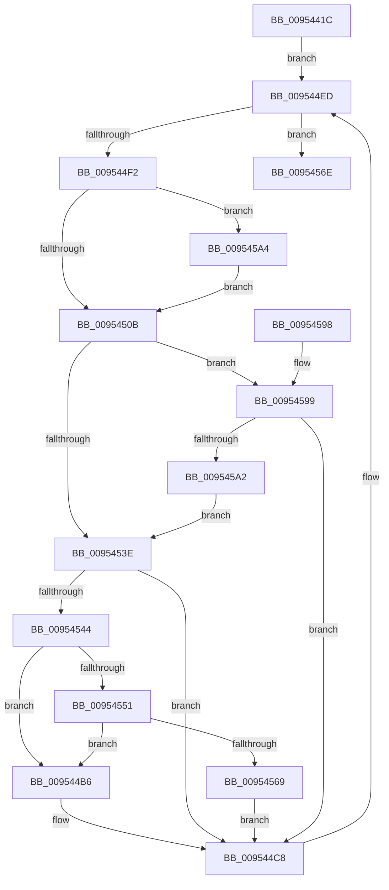

# PnpNotifyDeviceClassChange

- RVA: `0x0095441C`–`0x009545B3` (길이 `407` bytes)
- VA: `0x000000014095441C`
- 실행 섹션: `PAGE`
- PDB 이름 있음: `예`; PDB Function 태그: `아니요`
- unwind 정보 RVA: `0x000921AC`
- 디코드: `107`개 명령, `407/407` bytes 표시
- 미해석 바이트: `0` (있으면 어셈블리에 `.byte`로 보존)

> 이 문서는 커널 이미지의 기계어와 PDB 기호를 분석해 생성했습니다. 4번과 5번은 함수 원형과 자료형을 바이너리 사용 방식에서 추정한 C 해석이며 원본 소스 복구 결과는 아닙니다.

## 1. Dependencies

- 직접 호출 지점: **14**; 고유 호출 대상: **12**
- 직접 호출자로 확인된 함수: **1**
- RIP 상대 이미지 참조: **3**

### Outgoing calls
- `0x00954481` → [ExAcquireFastMutex](../../text/20/ExAcquireFastMutex_function_0020E5A0.md) (function, `0x0020E5A0`)
- `0x009544C3` → [PnpNotifyDriverCallback](PnpNotifyDriverCallback_function_00954AA0.md) (function, `0x00954AA0`)
- `0x009544CC` → [ExReleaseResourceLite](../../text/25/ExReleaseResourceLite_function_0025FA10.md) (function, `0x0025FA10`)
- `0x009544D1` → [KeLeaveCriticalRegion](../../text/25/KeLeaveCriticalRegion_function_0025D8B0.md) (function, `0x0025D8B0`)
- `0x009544DD` → [ExAcquireFastMutex](../../text/20/ExAcquireFastMutex_function_0020E5A0.md) (function, `0x0020E5A0`)
- `0x009544E8` → [PnpDereferenceNotify](PnpDereferenceNotify_function_00954A04.md) (function, `0x00954A04`)
- `0x009544F5` → [PsGetCurrentServerSilo](../../text/22/PsGetCurrentServerSilo_function_00225710.md) (function, `0x00225710`)
- `0x009544FD` → [PsGetServerSiloServiceSessionId](../../text/45/PsGetServerSiloServiceSessionId_function_0045ED00.md) (function, `0x0045ED00`)
- `0x00954517` → [ExReleaseFastMutex](../../text/25/ExReleaseFastMutex_function_002519C0.md) (function, `0x002519C0`)
- `0x00954534` → [ExAcquireResourceExclusiveLite](../../text/21/ExAcquireResourceExclusiveLite_function_00214E20.md) (function, `0x00214E20`)
- `0x0095455A` → [RtlCompareMemory](../../text/6B/RtlCompareMemory_function_006BA670.md) (function, `0x006BA670`)
- `0x00954575` → [ExReleaseFastMutex](../../text/25/ExReleaseFastMutex_function_002519C0.md) (function, `0x002519C0`)
- `0x00954584` → [_security_check_cookie](../../text/6A/_security_check_cookie_function_006AC640.md) (function, `0x006AC640`)
- `0x009545A7` → [IopGetSessionIdFromSymbolicName](../70/IopGetSessionIdFromSymbolicName_function_00702084.md) (function, `0x00702084`)

### Direct callers
- [PnpDeviceEventWorker](PnpDeviceEventWorker_function_009556B0.md) at `0x00955984`

### Static image references
- `0x0095442B` → RVA `0x00E0A740` (`.data`; read)
- `0x0095446E` → RVA `0x00F8CD60` (`.data`; read)
- `0x009544A3` → RVA `0x00FDA7E0` (`PAGEDATA`; read)

## 2. Other-region calls and transfers

- 다른 실행 섹션으로 향하는 call: **11**
  - `0x00954481` → [ExAcquireFastMutex](../../text/20/ExAcquireFastMutex_function_0020E5A0.md) (`PAGE` → `.text`)
  - `0x009544CC` → [ExReleaseResourceLite](../../text/25/ExReleaseResourceLite_function_0025FA10.md) (`PAGE` → `.text`)
  - `0x009544D1` → [KeLeaveCriticalRegion](../../text/25/KeLeaveCriticalRegion_function_0025D8B0.md) (`PAGE` → `.text`)
  - `0x009544DD` → [ExAcquireFastMutex](../../text/20/ExAcquireFastMutex_function_0020E5A0.md) (`PAGE` → `.text`)
  - `0x009544F5` → [PsGetCurrentServerSilo](../../text/22/PsGetCurrentServerSilo_function_00225710.md) (`PAGE` → `.text`)
  - `0x009544FD` → [PsGetServerSiloServiceSessionId](../../text/45/PsGetServerSiloServiceSessionId_function_0045ED00.md) (`PAGE` → `.text`)
  - `0x00954517` → [ExReleaseFastMutex](../../text/25/ExReleaseFastMutex_function_002519C0.md) (`PAGE` → `.text`)
  - `0x00954534` → [ExAcquireResourceExclusiveLite](../../text/21/ExAcquireResourceExclusiveLite_function_00214E20.md) (`PAGE` → `.text`)
  - `0x0095455A` → [RtlCompareMemory](../../text/6B/RtlCompareMemory_function_006BA670.md) (`PAGE` → `.text`)
  - `0x00954575` → [ExReleaseFastMutex](../../text/25/ExReleaseFastMutex_function_002519C0.md) (`PAGE` → `.text`)
  - `0x00954584` → [_security_check_cookie](../../text/6A/_security_check_cookie_function_006AC640.md) (`PAGE` → `.text`)
- 별도 외부 분기/꼬리 이동을 확인하지 못했습니다.

## 3. Assembly (complete function range)

```asm
0095441C  40 53                           push rbx
0095441E  55                              push rbp
0095441F  56                              push rsi
00954420  57                              push rdi
00954421  41 55                           push r13
00954423  41 56                           push r14
00954425  41 57                           push r15
00954427  48 83 EC 60                     sub rsp, 0x60
0095442B  48 8B 05 0E 63 4B 00            mov rax, qword ptr [rip + 0x4b630e]
00954432  48 33 C4                        xor rax, rsp
00954435  48 89 44 24 58                  mov qword ptr [rsp + 0x58], rax
0095443A  0F 10 0A                        movups xmm1, xmmword ptr [rdx]
0095443D  4D 8B F8                        mov r15, r8
00954440  48 8B F2                        mov rsi, rdx
00954443  0F 57 C0                        xorps xmm0, xmm0
00954446  83 CF FF                        or edi, 0xffffffff
00954449  0F 11 44 24 28                  movups xmmword ptr [rsp + 0x28], xmm0
0095444E  41 BD 01 00 00 00               mov r13d, 1
00954454  C7 44 24 28 01 00 30 00         mov dword ptr [rsp + 0x28], 0x300001
0095445C  0F 11 44 24 38                  movups xmmword ptr [rsp + 0x38], xmm0
00954461  0F 11 44 24 48                  movups xmmword ptr [rsp + 0x48], xmm0
00954466  4C 89 44 24 50                  mov qword ptr [rsp + 0x50], r8
0095446B  0F 10 01                        movups xmm0, xmmword ptr [rcx]
0095446E  48 8D 0D EB 88 63 00            lea rcx, [rip + 0x6388eb]
00954475  F3 0F 7F 4C 24 3C               movdqu xmmword ptr [rsp + 0x3c], xmm1
0095447B  F3 0F 7F 44 24 2C               movdqu xmmword ptr [rsp + 0x2c], xmm0
00954481  E8 1A A1 8B FF                  call 0x14020e5a0
00954486  8B 4E 0C                        mov ecx, dword ptr [rsi + 0xc]
00954489  B8 4F EC C4 4E                  mov eax, 0x4ec4ec4f
0095448E  03 4E 08                        add ecx, dword ptr [rsi + 8]
00954491  03 4E 04                        add ecx, dword ptr [rsi + 4]
00954494  03 0E                           add ecx, dword ptr [rsi]
00954496  F7 E1                           mul ecx
00954498  C1 EA 02                        shr edx, 2
0095449B  6B C2 0D                        imul eax, edx, 0xd
0095449E  2B C8                           sub ecx, eax
009544A0  44 8B F1                        mov r14d, ecx
009544A3  48 8D 0D 36 63 68 00            lea rcx, [rip + 0x686336]
009544AA  49 C1 E6 04                     shl r14, 4
009544AE  4C 03 F1                        add r14, rcx
009544B1  49 8B 1E                        mov rbx, qword ptr [r14]
009544B4  EB 37                           jmp 0x1409544ed
009544B6  4C 8D 44 24 20                  lea r8, [rsp + 0x20]
009544BB  48 8B CB                        mov rcx, rbx
009544BE  48 8D 54 24 28                  lea rdx, [rsp + 0x28]
009544C3  E8 D8 05 00 00                  call 0x140954aa0
009544C8  48 8B 4B 48                     mov rcx, qword ptr [rbx + 0x48]
009544CC  E8 3F B5 90 FF                  call 0x14025fa10
009544D1  E8 DA 93 90 FF                  call 0x14025d8b0
009544D6  48 8D 0D 83 88 63 00            lea rcx, [rip + 0x638883]
009544DD  E8 BE A0 8B FF                  call 0x14020e5a0
009544E2  48 8B 1B                        mov rbx, qword ptr [rbx]
009544E5  48 8B CD                        mov rcx, rbp
009544E8  E8 17 05 00 00                  call 0x140954a04
009544ED  49 3B DE                        cmp rbx, r14
009544F0  74 7C                           je 0x14095456e
009544F2  48 8B EB                        mov rbp, rbx
009544F5  E8 16 12 8D FF                  call 0x140225710
009544FA  48 8B C8                        mov rcx, rax
009544FD  E8 FE A7 B0 FF                  call 0x14045ed00
00954502  39 43 14                        cmp dword ptr [rbx + 0x14], eax
00954505  0F 85 99 00 00 00               jne 0x1409545a4
0095450B  66 44 01 6B 38                  add word ptr [rbx + 0x38], r13w
00954510  48 8D 0D 49 88 63 00            lea rcx, [rip + 0x638849]
00954517  E8 A4 D4 8F FF                  call 0x1402519c0
0095451C  65 48 8B 0C 25 88 01 00 00      mov rcx, qword ptr gs:[0x188]
00954525  41 8A D5                        mov dl, r13b
00954528  66 FF 89 E4 01 00 00            dec word ptr [rcx + 0x1e4]
0095452F  90                              nop
00954530  48 8B 4B 48                     mov rcx, qword ptr [rbx + 0x48]
00954534  E8 E7 08 8C FF                  call 0x140214e20
00954539  83 FF FF                        cmp edi, -1
0095453C  75 5B                           jne 0x140954599
0095453E  80 7B 3A 00                     cmp byte ptr [rbx + 0x3a], 0
00954542  75 84                           jne 0x1409544c8
00954544  48 8D 4B 50                     lea rcx, [rbx + 0x50]
00954548  48 3B CE                        cmp rcx, rsi
0095454B  0F 84 65 FF FF FF               je 0x1409544b6
00954551  41 B8 10 00 00 00               mov r8d, 0x10
00954557  48 8B D6                        mov rdx, rsi
0095455A  E8 11 61 D6 FF                  call 0x1406ba670
0095455F  48 83 F8 10                     cmp rax, 0x10
00954563  0F 84 4D FF FF FF               je 0x1409544b6
00954569  E9 5A FF FF FF                  jmp 0x1409544c8
0095456E  48 8D 0D EB 87 63 00            lea rcx, [rip + 0x6387eb]
00954575  E8 46 D4 8F FF                  call 0x1402519c0
0095457A  33 C0                           xor eax, eax
0095457C  48 8B 4C 24 58                  mov rcx, qword ptr [rsp + 0x58]
00954581  48 33 CC                        xor rcx, rsp
00954584  E8 B7 80 D5 FF                  call 0x1406ac640
00954589  48 83 C4 60                     add rsp, 0x60
0095458D  41 5F                           pop r15
0095458F  41 5E                           pop r14
00954591  41 5D                           pop r13
00954593  5F                              pop rdi
00954594  5E                              pop rsi
00954595  5D                              pop rbp
00954596  5B                              pop rbx
00954597  C3                              ret
00954598  CC                              int3
00954599  39 7B 14                        cmp dword ptr [rbx + 0x14], edi
0095459C  0F 85 26 FF FF FF               jne 0x1409544c8
009545A2  EB 9A                           jmp 0x14095453e
009545A4  49 8B CF                        mov rcx, r15
009545A7  E8 D8 DA DA FF                  call 0x140702084
009545AC  8B F8                           mov edi, eax
009545AE  E9 58 FF FF FF                  jmp 0x14095450b
```

## 4. C-style interpretation (structured pseudocode)

```c
__int64 __fastcall PnpNotifyDeviceClassChange(__int64 a1, __int64 a2, __int64 a3)
{
    __int64 result;
    __int64 v_r14;
    __int64 v_rdi;
    __int64 v_rsp;
    unsigned __int64 v_stack_m40;
    unsigned __int64 v_stack_m48;
    unsigned __int64 v_stack_m50;
    unsigned __int64 v_stack_m5C;
    unsigned __int64 v_stack_m60;
    unsigned __int64 v_stack_m6C;
    unsigned __int64 v_stack_m70;
    unsigned __int64 v_stack_m78;

    v_rsp = (v_rsp) - (96);
    result = (*(unsigned __int64 *)(v_rip + 4940558)) ^ (v_rsp);
    v_stack_m40 = result;
    v_rdi = (unsigned int)((v_rdi) | (0xFFFFFFFFULL));
    v_stack_m70 = v_xmm0;
    v_stack_m70 = 0x300001ULL;
    v_stack_m60 = v_xmm0;
    v_stack_m50 = v_xmm0;
    v_stack_m48 = a3;
    v_stack_m5C = v_xmm1;
    v_stack_m6C = v_xmm0;
    result = ExAcquireFastMutex(v_rip + 6523115, a2, a3, a4);
    a1 = (unsigned int)(((unsigned int)(*(unsigned int *)(a2 + 12))) + (*(unsigned int *)(a2 + 8)));
    a1 = (unsigned int)((a1) + (*(unsigned int *)(a2 + 4)));
    a1 = (unsigned int)((a1) + (*(unsigned int *)(a2)));
    a2 = (unsigned int)((a2) >> (2));
    result = (unsigned int)(((unsigned int)(0x4EC4EC4FULL)) * ((unsigned int)(a2)));
    a1 = (unsigned int)((a1) - ((unsigned int)(result)));
    v_r14 = ((unsigned int)((unsigned int)(a1))) << (4);
    v_r14 = (v_r14) + (v_rip + 6841142);
    goto loc_009544ED;
loc_009544B6:
    result = PnpNotifyDriverCallback(*(unsigned __int64 *)(v_r14), v_stack_m70, v_stack_m78, a4);
loc_009544C8:
    result = ExReleaseResourceLite(*(unsigned __int64 *)(*(unsigned __int64 *)(v_r14) + 72), v_stack_m70, v_stack_m78, a4);
    result = KeLeaveCriticalRegion(*(unsigned __int64 *)(*(unsigned __int64 *)(v_r14) + 72), v_stack_m70, v_stack_m78, a4);
    result = ExAcquireFastMutex(v_rip + 6523011, v_stack_m70, v_stack_m78, a4);
    result = PnpDereferenceNotify(v_rbp, v_stack_m70, v_stack_m78, a4);
loc_009544ED:
    if ((*(unsigned __int64 *)(*(unsigned __int64 *)(v_r14))) == v_r14) goto loc_0095456E;
    result = PsGetCurrentServerSilo(v_rbp, v_stack_m70, v_stack_m78, a4);
    result = PsGetServerSiloServiceSessionId(result, v_stack_m70, v_stack_m78, a4);
    if ((*(unsigned int *)(*(unsigned __int64 *)(*(unsigned __int64 *)(v_r14)) + 20)) != ((unsigned int)(result))) goto loc_009545A4;
loc_0095450B:
    result = ExReleaseFastMutex(v_rip + 6522953, v_stack_m70, v_stack_m78, a4);
    result = ExAcquireResourceExclusiveLite(*(unsigned __int64 *)(*(unsigned __int64 *)(*(unsigned __int64 *)(v_r14)) + 72), 1, v_stack_m78, a4);
    if (((unsigned int)(v_rdi)) != -1) goto loc_00954599;
loc_0095453E:
    if ((*(unsigned __int8 *)(*(unsigned __int64 *)(*(unsigned __int64 *)(v_r14)) + 58)) != 0) goto loc_009544C8;
    if ((*(unsigned __int64 *)(*(unsigned __int64 *)(v_r14)) + 80) == a2) goto loc_009544B6;
    result = RtlCompareMemory(*(unsigned __int64 *)(*(unsigned __int64 *)(v_r14)) + 80, a2, 16, a4);
    if (result == 16) goto loc_009544B6;
    goto loc_009544C8;
loc_0095456E:
    result = ExReleaseFastMutex(v_rip + 6522859, a2, 16, a4);
    result = 0;
    a1 = (v_stack_m40) ^ (v_rsp);
    result = _security_check_cookie(a1, a2, 16, a4);
    v_rsp = (v_rsp) + (96);
    return result;
loc_00954599:
    if ((*(unsigned int *)(*(unsigned __int64 *)(*(unsigned __int64 *)(v_r14)) + 20)) != ((unsigned int)(v_rdi))) goto loc_009544C8;
    goto loc_0095453E;
loc_009545A4:
    result = IopGetSessionIdFromSymbolicName(a3, a2, 16, a4);
    goto loc_0095450B;
}
```

## 5. (Beta) C Style

```c
int64_t PnpNotifyDeviceClassChange(void *Arg1, void *Arg2, int64_t Arg3)
{
    uint8_t *arg1 = (uint8_t *)Arg1;
    uint8_t *arg2 = (uint8_t *)Arg2;

    int64_t result;
    int64_t local_r14;
    int64_t local_rdi;
    int64_t local_rsp;
    uint64_t v_stack_m40;
    uint64_t v_stack_m48;
    uint64_t v_stack_m50;
    uint64_t v_stack_m5C;
    uint64_t v_stack_m60;
    uint64_t v_stack_m6C;
    uint64_t v_stack_m70;
    uint64_t v_stack_m78;

    local_rsp = (local_rsp) - (96);
    result = (*(uint64_t *)(v_rip + 0x4B630E)) ^ (local_rsp);
    v_stack_m40 = result;
    local_rdi = (uint32_t)((local_rdi) | (0xFFFFFFFFULL));
    v_stack_m70 = v_xmm0;
    v_stack_m70 = 0x300001ULL;
    v_stack_m60 = v_xmm0;
    v_stack_m50 = v_xmm0;
    v_stack_m48 = Arg3;
    v_stack_m5C = v_xmm1;
    v_stack_m6C = v_xmm0;
    result = ExAcquireFastMutex(v_rip + 6523115, Arg2, Arg3, a4);
    Arg1 = (uint32_t)(((uint32_t)(*(uint32_t *)(arg2 + 0xC))) + (*(uint32_t *)(arg2 + 0x8)));
    Arg1 = (uint32_t)((Arg1) + (*(uint32_t *)(arg2 + 0x4)));
    Arg1 = (uint32_t)((Arg1) + (*(uint32_t *)(arg2)));
    Arg2 = (uint32_t)((Arg2) >> (2));
    result = (uint32_t)(((uint32_t)(0x4EC4EC4FULL)) * ((uint32_t)(Arg2)));
    Arg1 = (uint32_t)((Arg1) - ((uint32_t)(result)));
    local_r14 = ((uint32_t)((uint32_t)(Arg1))) << (4);
    local_r14 = (local_r14) + (v_rip + 6841142);
    goto loc_009544ED;
loc_009544B6:
    result = PnpNotifyDriverCallback(*(uint64_t *)(local_r14), v_stack_m70, v_stack_m78, a4);
loc_009544C8:
    result = ExReleaseResourceLite(*(uint64_t *)(*(uint64_t *)(local_r14) + 0x48), v_stack_m70, v_stack_m78, a4);
    result = KeLeaveCriticalRegion(*(uint64_t *)(*(uint64_t *)(local_r14) + 0x48), v_stack_m70, v_stack_m78, a4);
    result = ExAcquireFastMutex(v_rip + 6523011, v_stack_m70, v_stack_m78, a4);
    result = PnpDereferenceNotify(local_rbp, v_stack_m70, v_stack_m78, a4);
loc_009544ED:
    if ((*(uint64_t *)(*(uint64_t *)(local_r14))) == local_r14) goto loc_0095456E;
    result = PsGetCurrentServerSilo(local_rbp, v_stack_m70, v_stack_m78, a4);
    result = PsGetServerSiloServiceSessionId(result, v_stack_m70, v_stack_m78, a4);
    if ((*(uint32_t *)(*(uint64_t *)(*(uint64_t *)(local_r14)) + 0x14)) != ((uint32_t)(result))) goto loc_009545A4;
loc_0095450B:
    result = ExReleaseFastMutex(v_rip + 6522953, v_stack_m70, v_stack_m78, a4);
    result = ExAcquireResourceExclusiveLite(*(uint64_t *)(*(uint64_t *)(*(uint64_t *)(local_r14)) + 0x48), 1, v_stack_m78, a4);
    if (((uint32_t)(local_rdi)) != -1) goto loc_00954599;
loc_0095453E:
    if ((*(uint8_t *)(*(uint64_t *)(*(uint64_t *)(local_r14)) + 0x3A)) != 0) goto loc_009544C8;
    if ((*(uint64_t *)(*(uint64_t *)(local_r14)) + 80) == Arg2) goto loc_009544B6;
    result = RtlCompareMemory(*(uint64_t *)(*(uint64_t *)(local_r14)) + 80, Arg2, 16, a4);
    if (result == 16) goto loc_009544B6;
    goto loc_009544C8;
loc_0095456E:
    result = ExReleaseFastMutex(v_rip + 6522859, Arg2, 16, a4);
    result = 0;
    Arg1 = (v_stack_m40) ^ (local_rsp);
    result = _security_check_cookie(Arg1, Arg2, 16, a4);
    local_rsp = (local_rsp) + (96);
    return result;
loc_00954599:
    if ((*(uint32_t *)(*(uint64_t *)(*(uint64_t *)(local_r14)) + 0x14)) != ((uint32_t)(local_rdi))) goto loc_009544C8;
    goto loc_0095453E;
loc_009545A4:
    result = IopGetSessionIdFromSymbolicName(Arg3, Arg2, 16, a4);
    goto loc_0095450B;
}
```

### 관측된 메모리 오프셋

구조체 형식이 확인되지 않은 접근은 인자 기준의 오프셋으로만 기록했습니다.

| 기준 인자 | 오프셋 표현 | 폭 (bit) | 접근 |
|---|---:|---:|---|
| `Arg1` | `+ 0x0` | `128` | `R` |
| `Arg2` | `+ 0x0` | `32` | `R` |
| `Arg2` | `+ 0x0` | `128` | `R` |
| `Arg2` | `+ 0x4` | `32` | `R` |
| `Arg2` | `+ 0x8` | `32` | `R` |
| `Arg2` | `+ 0xC` | `32` | `R` |

## 6. Execution-region graph

[열기: 2D/3D 그래프와 함수 탐색 컨트롤 패널](../../../control-panel.html?section=page&rva=0x0095441C&view=graph)

- 2D 그래프는 위에서 아래로 흐르고, 3D 그래프는 빈 공간을 드래그해 회전합니다. Shift+드래그는 이동, 휠은 확대·축소, 함수 노드 선택은 대상 보고서 이동입니다.

### Static fallback


