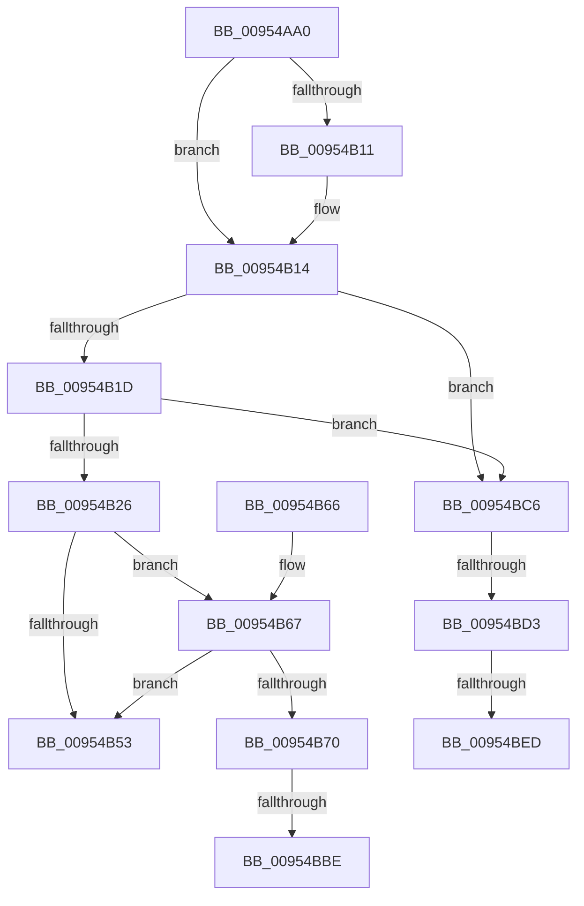

# PnpNotifyDriverCallback

- RVA: `0x00954AA0`–`0x00954C0E` (길이 `366` bytes)
- VA: `0x0000000140954AA0`
- 실행 섹션: `PAGE`
- PDB 이름 있음: `예`; PDB Function 태그: `예`
- unwind 정보 RVA: `0x00092240`
- 디코드: `90`개 명령, `366/366` bytes 표시
- 미해석 바이트: `0` (있으면 어셈블리에 `.byte`로 보존)

> 이 문서는 커널 이미지의 기계어와 PDB 기호를 분석해 생성했습니다. 4번과 5번은 함수 원형과 자료형을 바이너리 사용 방식에서 추정한 C 해석이며 원본 소스 복구 결과는 아닙니다.

## 1. Dependencies

- 직접 호출 지점: **6**; 고유 호출 대상: **4**
- 직접 호출자로 확인된 함수: **7**
- RIP 상대 이미지 참조: **2**

### Outgoing calls
- `0x00954ABE` → [Feature_PreventInterfaceChangeConcurrentNotify__private_ReportDeviceUsage](../../text/48/Feature_PreventInterfaceChangeConcurrentNotify__private_ReportDeviceUsage_function_00487ED0.md) (function, `0x00487ED0`)
- `0x00954AEF` → [guard_dispatch_icall](../../text/6B/guard_dispatch_icall_function_006BAAD0.md) (function, `0x006BAAD0`)
- `0x00954BA8` → [PnpExtractNotificationSpecificData](../72/PnpExtractNotificationSpecificData_function_00729AA0.md) (function, `0x00729AA0`)
- `0x00954BD7` → [IoAddTriageDumpDataBlock](../../text/42/IoAddTriageDumpDataBlock_function_00428374.md) (function, `0x00428374`)
- `0x00954BF2` → [IoAddTriageDumpDataBlock](../../text/42/IoAddTriageDumpDataBlock_function_00428374.md) (function, `0x00428374`)
- `0x00954C03` → [IoAddTriageDumpDataBlock](../../text/42/IoAddTriageDumpDataBlock_function_00428374.md) (function, `0x00428374`)

### Direct callers
- [PnpNotifyHwProfileChange](../72/PnpNotifyHwProfileChange_function_00729B04.md) at `0x00729BC4`
- [PnpNotifyHwProfileChange](../72/PnpNotifyHwProfileChange_function_00729B04.md) at `0x00729CAE`
- [PnpNotifyTargetDeviceChangeNotifyEntry](../72/PnpNotifyTargetDeviceChangeNotifyEntry_function_00729D54.md) at `0x00729DD6`
- [PipKsrNotifyDrivers](../73/PipKsrNotifyDrivers_function_0073E48C.md) at `0x0073E58B`
- [IoRegisterPlugPlayNotification](IoRegisterPlugPlayNotification_function_009535A0.md) at `0x009538D2`
- [PnpNotifyDeviceClassChange](PnpNotifyDeviceClassChange_function_0095441C.md) at `0x009544C3`
- [PnpNotifyTargetDeviceChange](PnpNotifyTargetDeviceChange_function_00954790.md) at `0x009548D2`
- [sub_00B26560](../B2/Unknown_function_00B26560.md) at `0x00B26609`

### Static image references
- `0x00954B47` → RVA `0x00E0A9E8` (`.data`; read)
- `0x00954B67` → RVA `0x00EF012C` (`.data`; read)

## 2. Other-region calls and transfers

- 다른 실행 섹션으로 향하는 call: **5**
  - `0x00954ABE` → [Feature_PreventInterfaceChangeConcurrentNotify__private_ReportDeviceUsage](../../text/48/Feature_PreventInterfaceChangeConcurrentNotify__private_ReportDeviceUsage_function_00487ED0.md) (`PAGE` → `.text`)
  - `0x00954AEF` → [guard_dispatch_icall](../../text/6B/guard_dispatch_icall_function_006BAAD0.md) (`PAGE` → `.text`)
  - `0x00954BD7` → [IoAddTriageDumpDataBlock](../../text/42/IoAddTriageDumpDataBlock_function_00428374.md) (`PAGE` → `.text`)
  - `0x00954BF2` → [IoAddTriageDumpDataBlock](../../text/42/IoAddTriageDumpDataBlock_function_00428374.md) (`PAGE` → `.text`)
  - `0x00954C03` → [IoAddTriageDumpDataBlock](../../text/42/IoAddTriageDumpDataBlock_function_00428374.md) (`PAGE` → `.text`)
- call이 아닌 외부 분기/꼬리 이동: **5**
  - `0x00954BB8` → [sub_00B26652](../B2/Unknown_function_00B26652.md) (`tail-transfer`)
  - `0x00954BC1` → [sub_00B26652 + 0xA](../B2/Unknown_function_00B26652.md) (`tail-transfer`)
  - `0x00954BCD` → [sub_00B26652 + 0x5B](../B2/Unknown_function_00B26652.md) (`tail-transfer`)
  - `0x00954BE7` → [sub_00B26652 + 0x5B](../B2/Unknown_function_00B26652.md) (`tail-transfer`)
  - `0x00954C09` → [sub_00B26652 + 0x5B](../B2/Unknown_function_00B26652.md) (`tail-transfer`)

## 3. Assembly (complete function range)

```asm
00954AA0  48 89 54 24 10                  mov qword ptr [rsp + 0x10], rdx
00954AA5  53                              push rbx
00954AA6  55                              push rbp
00954AA7  56                              push rsi
00954AA8  57                              push rdi
00954AA9  41 54                           push r12
00954AAB  41 55                           push r13
00954AAD  41 56                           push r14
00954AAF  41 57                           push r15
00954AB1  48 83 EC 68                     sub rsp, 0x68
00954AB5  4D 8B F8                        mov r15, r8
00954AB8  48 8B FA                        mov rdi, rdx
00954ABB  48 8B F1                        mov rsi, rcx
00954ABE  E8 0D 34 B3 FF                  call 0x140487ed0
00954AC3  45 0F 20 C4                     mov r12, cr8
00954AC7  65 48 8B 04 25 88 01 00 00      mov rax, qword ptr gs:[0x188]
00954AD0  49 BE 14 00 00 00 80 F7 FF FF   movabs r14, 0xfffff78000000014
00954ADA  48 8B CF                        mov rcx, rdi
00954ADD  49 8B 1E                        mov rbx, qword ptr [r14]
00954AE0  44 8B A8 E4 01 00 00            mov r13d, dword ptr [rax + 0x1e4]
00954AE7  48 8B 46 20                     mov rax, qword ptr [rsi + 0x20]
00954AEB  48 8B 56 28                     mov rdx, qword ptr [rsi + 0x28]
00954AEF  E8 DC 5F D6 FF                  call 0x1406baad0
00954AF4  49 8B 0E                        mov rcx, qword ptr [r14]
00954AF7  45 0F 20 C6                     mov r14, cr8
00954AFB  65 48 8B 14 25 88 01 00 00      mov rdx, qword ptr gs:[0x188]
00954B04  33 FF                           xor edi, edi
00954B06  8B AA E4 01 00 00               mov ebp, dword ptr [rdx + 0x1e4]
00954B0C  4D 85 FF                        test r15, r15
00954B0F  74 03                           je 0x140954b14
00954B11  41 89 07                        mov dword ptr [r15], eax
00954B14  45 3A E6                        cmp r12b, r14b
00954B17  0F 85 A9 00 00 00               jne 0x140954bc6
00954B1D  44 3B ED                        cmp r13d, ebp
00954B20  0F 85 A0 00 00 00               jne 0x140954bc6
00954B26  48 2B CB                        sub rcx, rbx
00954B29  48 B8 4B 59 86 38 D6 C5 6D 34   movabs rax, 0x346dc5d63886594b
00954B33  48 F7 E9                        imul rcx
00954B36  4C 8B DA                        mov r11, rdx
00954B39  49 C1 FB 0B                     sar r11, 0xb
00954B3D  49 8B C3                        mov rax, r11
00954B40  48 C1 E8 3F                     shr rax, 0x3f
00954B44  4C 03 D8                        add r11, rax
00954B47  0F B7 05 9A 5E 4B 00            movzx eax, word ptr [rip + 0x4b5e9a]
00954B4E  4C 3B D8                        cmp r11, rax
00954B51  7F 14                           jg 0x140954b67
00954B53  33 C0                           xor eax, eax
00954B55  48 83 C4 68                     add rsp, 0x68
00954B59  41 5F                           pop r15
00954B5B  41 5E                           pop r14
00954B5D  41 5D                           pop r13
00954B5F  41 5C                           pop r12
00954B61  5F                              pop rdi
00954B62  5E                              pop rsi
00954B63  5D                              pop rbp
00954B64  5B                              pop rbx
00954B65  C3                              ret
00954B66  CC                              int3
00954B67  F6 05 BE B5 59 00 02            test byte ptr [rip + 0x59b5be], 2
00954B6E  74 E3                           je 0x140954b53
00954B70  48 8B 8C 24 B8 00 00 00         mov rcx, qword ptr [rsp + 0xb8]
00954B78  4C 8D 8C 24 B0 00 00 00         lea r9, [rsp + 0xb0]
00954B80  4C 8D 84 24 C0 00 00 00         lea r8, [rsp + 0xc0]
00954B88  48 89 BC 24 C8 00 00 00         mov qword ptr [rsp + 0xc8], rdi
00954B90  48 8D 94 24 C8 00 00 00         lea rdx, [rsp + 0xc8]
00954B98  48 89 BC 24 C0 00 00 00         mov qword ptr [rsp + 0xc0], rdi
00954BA0  48 89 BC 24 B0 00 00 00         mov qword ptr [rsp + 0xb0], rdi
00954BA8  E8 F3 4E DD FF                  call 0x140729aa0
00954BAD  48 8B 8C 24 B0 00 00 00         mov rcx, qword ptr [rsp + 0xb0]
00954BB5  48 85 C9                        test rcx, rcx
00954BB8  0F 85 94 1A 1D 00               jne 0x140b26652
00954BBE  48 8B C7                        mov rax, rdi
00954BC1  E9 96 1A 1D 00                  jmp 0x140b2665c
00954BC6  48 8B 4E 30                     mov rcx, qword ptr [rsi + 0x30]
00954BCA  48 85 C9                        test rcx, rcx
00954BCD  0F 84 DA 1A 1D 00               je 0x140b266ad
00954BD3  0F BF 51 02                     movsx edx, word ptr [rcx + 2]
00954BD7  E8 98 37 AD FF                  call 0x140428374
00954BDC  48 8B 4E 30                     mov rcx, qword ptr [rsi + 0x30]
00954BE0  48 83 C1 38                     add rcx, 0x38
00954BE4  66 39 39                        cmp word ptr [rcx], di
00954BE7  0F 84 C0 1A 1D 00               je 0x140b266ad
00954BED  BA 02 00 00 00                  mov edx, 2
00954BF2  E8 7D 37 AD FF                  call 0x140428374
00954BF7  48 8B 4E 30                     mov rcx, qword ptr [rsi + 0x30]
00954BFB  0F B7 51 38                     movzx edx, word ptr [rcx + 0x38]
00954BFF  48 8B 49 40                     mov rcx, qword ptr [rcx + 0x40]
00954C03  E8 6C 37 AD FF                  call 0x140428374
00954C08  90                              nop
00954C09  E9 9F 1A 1D 00                  jmp 0x140b266ad
```

## 4. C-style interpretation (structured pseudocode)

```c
__int64 __fastcall PnpNotifyDriverCallback(__int64 a1, __int64 a2, __int64 a3)
{
    __int64 result;
    __int64 v_r11;
    __int64 v_rdi;
    __int64 v_rsp;
    unsigned __int64 v_stack_p10;
    unsigned __int64 v_stack_pB0;
    unsigned __int64 v_stack_pB8;
    unsigned __int64 v_stack_pC0;
    unsigned __int64 v_stack_pC8;

    v_stack_p10 = a2;
    v_rsp = (v_rsp) - (104);
    result = Feature_PreventInterfaceChangeConcurrentNotify__private_ReportDeviceUsage(a1, a2, a3, a4);
    result = guard_dispatch_icall(a2, *(unsigned __int64 *)(a1 + 40), a3, a4);
    v_rdi = 0;
    if (a3 != 0) {
        *(unsigned int *)(a3) = (unsigned int)(result);
    }
    if (((unsigned __int8)(v_cr8)) != ((unsigned __int8)(v_cr8))) goto loc_00954BC6;
    if (((unsigned int)((unsigned int)(*(unsigned int *)(*(unsigned __int64 *)(gs_base + (0 + 392)) + 484)))) != ((unsigned int)((unsigned int)(*(unsigned int *)(*(unsigned __int64 *)(gs_base + (0 + 392)) + 484))))) goto loc_00954BC6;
    a1 = (*(unsigned __int64 *)(v_r14)) - (*(unsigned __int64 *)(v_r14));
    v_r11 = (*(unsigned __int64 *)(gs_base + (0 + 392))) >> (11);
    result = (v_r11) >> (63);
    v_r11 = (v_r11) + (result);
    if (v_r11 > (*(unsigned __int16 *)(v_rip + 4939418))) goto loc_00954B67;
loc_00954B53:
    result = 0;
    v_rsp = (v_rsp) + (104);
    return result;
loc_00954B67:
    if (((*(unsigned __int8 *)(v_rip + 5879230)) & (2)) == 0) goto loc_00954B53;
    v_stack_pC8 = 0;
    v_stack_pC0 = 0;
    v_stack_pB0 = 0;
    result = PnpExtractNotificationSpecificData(v_stack_pB8, v_stack_pC8, v_stack_pC0, v_stack_pB0);
loc_00954BC6:
    result = IoAddTriageDumpDataBlock(*(unsigned __int64 *)(a1 + 48), (__int16)(*(unsigned __int16 *)(*(unsigned __int64 *)(a1 + 48) + 2)), v_stack_pC0, v_stack_pB0);
    a1 = (*(unsigned __int64 *)(a1 + 48)) + (56);
    result = IoAddTriageDumpDataBlock(a1, 2, v_stack_pC0, v_stack_pB0);
    result = IoAddTriageDumpDataBlock(*(unsigned __int64 *)(*(unsigned __int64 *)(a1 + 48) + 64), *(unsigned __int16 *)(*(unsigned __int64 *)(a1 + 48) + 56), v_stack_pC0, v_stack_pB0);
}
```

## 5. (Beta) C Style

```c
int64_t PnpNotifyDriverCallback(void *Arg1, int64_t Arg2, int64_t Arg3)
{
    uint8_t *arg1 = (uint8_t *)Arg1;

    int64_t result;
    int64_t local_r11;
    int64_t local_rdi;
    int64_t local_rsp;
    uint64_t v_stack_p10;
    uint64_t v_stack_pB0;
    uint64_t v_stack_pB8;
    uint64_t v_stack_pC0;
    uint64_t v_stack_pC8;

    v_stack_p10 = Arg2;
    local_rsp = (local_rsp) - (104);
    result = Feature_PreventInterfaceChangeConcurrentNotify__private_ReportDeviceUsage(Arg1, Arg2, Arg3, a4);
    result = guard_dispatch_icall(Arg2, *(uint64_t *)(arg1 + 0x28), Arg3, a4);
    local_rdi = 0;
    if (Arg3 != 0) {
        *(uint32_t *)(Arg3) = (uint32_t)(result);
    }
    if (((uint8_t)(v_cr8)) != ((uint8_t)(v_cr8))) goto loc_00954BC6;
    if (((uint32_t)((uint32_t)(*(uint32_t *)(*(uint64_t *)(gs_base + (0 + 0x188)) + 0x1E4)))) != ((uint32_t)((uint32_t)(*(uint32_t *)(*(uint64_t *)(gs_base + (0 + 0x188)) + 0x1E4))))) goto loc_00954BC6;
    Arg1 = (*(uint64_t *)(local_r14)) - (*(uint64_t *)(local_r14));
    local_r11 = (*(uint64_t *)(gs_base + (0 + 0x188))) >> (11);
    result = (local_r11) >> (63);
    local_r11 = (local_r11) + (result);
    if (local_r11 > (*(uint16_t *)(v_rip + 0x4B5E9A))) goto loc_00954B67;
loc_00954B53:
    result = 0;
    local_rsp = (local_rsp) + (104);
    return result;
loc_00954B67:
    if (((*(uint8_t *)(v_rip + 0x59B5BE)) & (2)) == 0) goto loc_00954B53;
    v_stack_pC8 = 0;
    v_stack_pC0 = 0;
    v_stack_pB0 = 0;
    result = PnpExtractNotificationSpecificData(v_stack_pB8, v_stack_pC8, v_stack_pC0, v_stack_pB0);
loc_00954BC6:
    result = IoAddTriageDumpDataBlock(*(uint64_t *)(arg1 + 0x30), (int16_t)(*(uint16_t *)(*(uint64_t *)(arg1 + 0x30) + 0x2)), v_stack_pC0, v_stack_pB0);
    Arg1 = (*(uint64_t *)(arg1 + 0x30)) + (56);
    result = IoAddTriageDumpDataBlock(Arg1, 2, v_stack_pC0, v_stack_pB0);
    result = IoAddTriageDumpDataBlock(*(uint64_t *)(*(uint64_t *)(arg1 + 0x30) + 0x40), *(uint16_t *)(*(uint64_t *)(arg1 + 0x30) + 0x38), v_stack_pC0, v_stack_pB0);
}
```

### 관측된 메모리 오프셋

구조체 형식이 확인되지 않은 접근은 인자 기준의 오프셋으로만 기록했습니다.

| 기준 인자 | 오프셋 표현 | 폭 (bit) | 접근 |
|---|---:|---:|---|
| `Arg1` | `+ 0x20` | `64` | `R` |
| `Arg1` | `+ 0x28` | `64` | `R` |
| `Arg1` | `+ 0x30` | `64` | `R` |

## 6. Execution-region graph

[열기: 2D/3D 그래프와 함수 탐색 컨트롤 패널](../../../control-panel.html?section=page&rva=0x00954AA0&view=graph)

- 2D 그래프는 위에서 아래로 흐르고, 3D 그래프는 빈 공간을 드래그해 회전합니다. Shift+드래그는 이동, 휠은 확대·축소, 함수 노드 선택은 대상 보고서 이동입니다.

### Static fallback


