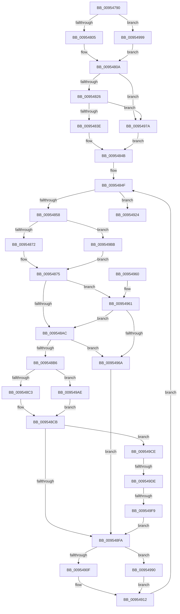

# PnpNotifyTargetDeviceChange

- RVA: `0x00954790`–`0x009549FE` (길이 `622` bytes)
- VA: `0x0000000140954790`
- 실행 섹션: `PAGE`
- PDB 이름 있음: `예`; PDB Function 태그: `예`
- unwind 정보 RVA: `0x00092200`
- 디코드: `151`개 명령, `622/622` bytes 표시
- 미해석 바이트: `0` (있으면 어셈블리에 `.byte`로 보존)

> 이 문서는 커널 이미지의 기계어와 PDB 기호를 분석해 생성했습니다. 4번과 5번은 함수 원형과 자료형을 바이너리 사용 방식에서 추정한 C 해석이며 원본 소스 복구 결과는 아닙니다.

## 1. Dependencies

- 직접 호출 지점: **19**; 고유 호출 대상: **14**
- 직접 호출자로 확인된 함수: **4**
- RIP 상대 이미지 참조: **4**

### Outgoing calls
- `0x009547E4` → [ObfReferenceObjectWithTag](../../text/21/ObfReferenceObjectWithTag_function_00210710.md) (function, `0x00210710`)
- `0x00954811` → [ExAcquireFastMutex](../../text/20/ExAcquireFastMutex_function_0020E5A0.md) (function, `0x0020E5A0`)
- `0x0095482F` → [RtlCompareMemory](../../text/6B/RtlCompareMemory_function_006BA670.md) (function, `0x006BA670`)
- `0x0095485C` → [PsGetCurrentServerSilo](../../text/22/PsGetCurrentServerSilo_function_00225710.md) (function, `0x00225710`)
- `0x00954864` → [PsGetServerSiloServiceSessionId](../../text/45/PsGetServerSiloServiceSessionId_function_0045ED00.md) (function, `0x0045ED00`)
- `0x00954881` → [ExReleaseFastMutex](../../text/25/ExReleaseFastMutex_function_002519C0.md) (function, `0x002519C0`)
- `0x0095489E` → [ExAcquireResourceExclusiveLite](../../text/21/ExAcquireResourceExclusiveLite_function_00214E20.md) (function, `0x00214E20`)
- `0x009548D2` → [PnpNotifyDriverCallback](PnpNotifyDriverCallback_function_00954AA0.md) (function, `0x00954AA0`)
- `0x009548DD` → [ExReleaseResourceLite](../../text/25/ExReleaseResourceLite_function_0025FA10.md) (function, `0x0025FA10`)
- `0x009548E2` → [KeLeaveCriticalRegion](../../text/25/KeLeaveCriticalRegion_function_0025D8B0.md) (function, `0x0025D8B0`)
- `0x00954901` → [ExAcquireFastMutex](../../text/20/ExAcquireFastMutex_function_0020E5A0.md) (function, `0x0020E5A0`)
- `0x00954916` → [PnpDereferenceNotify](PnpDereferenceNotify_function_00954A04.md) (function, `0x00954A04`)
- `0x0095492B` → [ExReleaseFastMutex](../../text/25/ExReleaseFastMutex_function_002519C0.md) (function, `0x002519C0`)
- `0x00954939` → [ObfDereferenceObjectWithTag](../../text/2F/ObfDereferenceObjectWithTag_function_002F78E0.md) (function, `0x002F78E0`)
- `0x00954947` → [_security_check_cookie](../../text/6A/_security_check_cookie_function_006AC640.md) (function, `0x006AC640`)
- `0x0095496E` → [ExReleaseResourceLite](../../text/25/ExReleaseResourceLite_function_0025FA10.md) (function, `0x0025FA10`)
- `0x00954973` → [KeLeaveCriticalRegion](../../text/25/KeLeaveCriticalRegion_function_0025D8B0.md) (function, `0x0025D8B0`)
- `0x009549BF` → [IopGetSessionIdFromPDO](../8F/IopGetSessionIdFromPDO_function_008FFDD8.md) (function, `0x008FFDD8`)
- `0x009549EA` → [RtlCompareMemory](../../text/6B/RtlCompareMemory_function_006BA670.md) (function, `0x006BA670`)

### Direct callers
- [PiSendTargetDeviceRemoveCanceledNotification](../74/PiSendTargetDeviceRemoveCanceledNotification_function_00744364.md) at `0x007443C3`
- [PnpProcessCustomDeviceEvent](PnpProcessCustomDeviceEvent_function_00954734.md) at `0x00954771`
- [PipSendTargetDeviceQueryRemoveNotification](../A0/PipSendTargetDeviceQueryRemoveNotification_function_00A04518.md) at `0x00A0459F`
- [PiSendTargetDeviceRemoveCompleteNotification](../A0/PiSendTargetDeviceRemoveCompleteNotification_function_00A059F8.md) at `0x00A05A33`

### Static image references
- `0x009547A9` → RVA `0x00E0A740` (`.data`; read)
- `0x0095480A` → RVA `0x00F8CDA0` (`.data`; read)
- `0x00954816` → RVA `0x00012320` (`.rdata`; read)
- `0x009549CE` → RVA `0x0001A210` (`.rdata`; read)

## 2. Other-region calls and transfers

- 다른 실행 섹션으로 향하는 call: **16**
  - `0x009547E4` → [ObfReferenceObjectWithTag](../../text/21/ObfReferenceObjectWithTag_function_00210710.md) (`PAGE` → `.text`)
  - `0x00954811` → [ExAcquireFastMutex](../../text/20/ExAcquireFastMutex_function_0020E5A0.md) (`PAGE` → `.text`)
  - `0x0095482F` → [RtlCompareMemory](../../text/6B/RtlCompareMemory_function_006BA670.md) (`PAGE` → `.text`)
  - `0x0095485C` → [PsGetCurrentServerSilo](../../text/22/PsGetCurrentServerSilo_function_00225710.md) (`PAGE` → `.text`)
  - `0x00954864` → [PsGetServerSiloServiceSessionId](../../text/45/PsGetServerSiloServiceSessionId_function_0045ED00.md) (`PAGE` → `.text`)
  - `0x00954881` → [ExReleaseFastMutex](../../text/25/ExReleaseFastMutex_function_002519C0.md) (`PAGE` → `.text`)
  - `0x0095489E` → [ExAcquireResourceExclusiveLite](../../text/21/ExAcquireResourceExclusiveLite_function_00214E20.md) (`PAGE` → `.text`)
  - `0x009548DD` → [ExReleaseResourceLite](../../text/25/ExReleaseResourceLite_function_0025FA10.md) (`PAGE` → `.text`)
  - `0x009548E2` → [KeLeaveCriticalRegion](../../text/25/KeLeaveCriticalRegion_function_0025D8B0.md) (`PAGE` → `.text`)
  - `0x00954901` → [ExAcquireFastMutex](../../text/20/ExAcquireFastMutex_function_0020E5A0.md) (`PAGE` → `.text`)
  - `0x0095492B` → [ExReleaseFastMutex](../../text/25/ExReleaseFastMutex_function_002519C0.md) (`PAGE` → `.text`)
  - `0x00954939` → [ObfDereferenceObjectWithTag](../../text/2F/ObfDereferenceObjectWithTag_function_002F78E0.md) (`PAGE` → `.text`)
  - `0x00954947` → [_security_check_cookie](../../text/6A/_security_check_cookie_function_006AC640.md) (`PAGE` → `.text`)
  - `0x0095496E` → [ExReleaseResourceLite](../../text/25/ExReleaseResourceLite_function_0025FA10.md) (`PAGE` → `.text`)
  - `0x00954973` → [KeLeaveCriticalRegion](../../text/25/KeLeaveCriticalRegion_function_0025D8B0.md) (`PAGE` → `.text`)
  - `0x009549EA` → [RtlCompareMemory](../../text/6B/RtlCompareMemory_function_006BA670.md) (`PAGE` → `.text`)
- call이 아닌 외부 분기/꼬리 이동: **2**
  - `0x009549D8` → [sub_00B26560](../B2/Unknown_function_00B26560.md) (`tail-transfer`)
  - `0x009549F3` → [sub_00B26560](../B2/Unknown_function_00B26560.md) (`tail-transfer`)

## 3. Assembly (complete function range)

```asm
00954790  40 55                           push rbp
00954792  53                              push rbx
00954793  56                              push rsi
00954794  57                              push rdi
00954795  41 54                           push r12
00954797  41 55                           push r13
00954799  41 56                           push r14
0095479B  41 57                           push r15
0095479D  48 8D 6C 24 E1                  lea rbp, [rsp - 0x1f]
009547A2  48 81 EC 88 00 00 00            sub rsp, 0x88
009547A9  48 8B 05 90 5F 4B 00            mov rax, qword ptr [rip + 0x4b5f90]
009547B0  48 33 C4                        xor rax, rsp
009547B3  48 89 45 07                     mov qword ptr [rbp + 7], rax
009547B7  83 4D BB FF                     or dword ptr [rbp - 0x45], 0xffffffff
009547BB  48 8B DA                        mov rbx, rdx
009547BE  0F 57 C0                        xorps xmm0, xmm0
009547C1  48 89 55 BF                     mov qword ptr [rbp - 0x41], rdx
009547C5  4C 8B F9                        mov r15, rcx
009547C8  4C 89 4D D7                     mov qword ptr [rbp - 0x29], r9
009547CC  33 F6                           xor esi, esi
009547CE  48 8B CB                        mov rcx, rbx
009547D1  BA 50 6E 70 4E                  mov edx, 0x4e706e50
009547D6  89 75 B7                        mov dword ptr [rbp - 0x49], esi
009547D9  4D 8B E0                        mov r12, r8
009547DC  0F 11 45 E7                     movups xmmword ptr [rbp - 0x19], xmm0
009547E0  0F 11 45 F7                     movups xmmword ptr [rbp - 9], xmm0
009547E4  E8 27 BF 8B FF                  call 0x140210710
009547E9  48 8B 83 38 01 00 00            mov rax, qword ptr [rbx + 0x138]
009547F0  44 8D 76 01                     lea r14d, [rsi + 1]
009547F4  48 8B 58 28                     mov rbx, qword ptr [rax + 0x28]
009547F8  48 89 5D DF                     mov qword ptr [rbp - 0x21], rbx
009547FC  4D 85 E4                        test r12, r12
009547FF  0F 84 94 01 00 00               je 0x140954999
00954805  66 45 89 34 24                  mov word ptr [r12], r14w
0095480A  48 8D 0D 8F 85 63 00            lea rcx, [rip + 0x63858f]
00954811  E8 8A 9D 8B FF                  call 0x14020e5a0
00954816  48 8D 15 03 DB 6B FF            lea rdx, [rip - 0x9424fd]
0095481D  4C 3B FA                        cmp r15, rdx
00954820  0F 84 54 01 00 00               je 0x14095497a
00954826  41 B8 10 00 00 00               mov r8d, 0x10
0095482C  49 8B CF                        mov rcx, r15
0095482F  E8 3C 5E D6 FF                  call 0x1406ba670
00954834  48 83 F8 10                     cmp rax, 0x10
00954838  0F 84 3C 01 00 00               je 0x14095497a
0095483E  48 8D 83 D8 01 00 00            lea rax, [rbx + 0x1d8]
00954845  44 8A EE                        mov r13b, sil
00954848  48 8B 38                        mov rdi, qword ptr [rax]
0095484B  48 89 45 C7                     mov qword ptr [rbp - 0x39], rax
0095484F  48 3B F8                        cmp rdi, rax
00954852  0F 84 CC 00 00 00               je 0x140954924
00954858  48 89 7D CF                     mov qword ptr [rbp - 0x31], rdi
0095485C  E8 AF 0E 8D FF                  call 0x140225710
00954861  48 8B C8                        mov rcx, rax
00954864  E8 97 A4 B0 FF                  call 0x14045ed00
00954869  39 47 14                        cmp dword ptr [rdi + 0x14], eax
0095486C  0F 85 49 01 00 00               jne 0x1409549bb
00954872  8B 5D BB                        mov ebx, dword ptr [rbp - 0x45]
00954875  66 44 01 77 38                  add word ptr [rdi + 0x38], r14w
0095487A  48 8D 0D 1F 85 63 00            lea rcx, [rip + 0x63851f]
00954881  E8 3A D1 8F FF                  call 0x1402519c0
00954886  65 48 8B 04 25 88 01 00 00      mov rax, qword ptr gs:[0x188]
0095488F  41 8A D6                        mov dl, r14b
00954892  66 FF 88 E4 01 00 00            dec word ptr [rax + 0x1e4]
00954899  90                              nop
0095489A  48 8B 4F 48                     mov rcx, qword ptr [rdi + 0x48]
0095489E  E8 7D 05 8C FF                  call 0x140214e20
009548A3  83 FB FF                        cmp ebx, -1
009548A6  0F 85 B5 00 00 00               jne 0x140954961
009548AC  40 38 77 3A                     cmp byte ptr [rdi + 0x3a], sil
009548B0  0F 85 B4 00 00 00               jne 0x14095496a
009548B6  48 8B 47 50                     mov rax, qword ptr [rdi + 0x50]
009548BA  4D 85 E4                        test r12, r12
009548BD  0F 84 EB 00 00 00               je 0x1409549ae
009548C3  49 89 44 24 18                  mov qword ptr [r12 + 0x18], rax
009548C8  49 8B D4                        mov rdx, r12
009548CB  4C 8D 45 B7                     lea r8, [rbp - 0x49]
009548CF  48 8B CF                        mov rcx, rdi
009548D2  E8 C9 01 00 00                  call 0x140954aa0
009548D7  48 8B 4F 48                     mov rcx, qword ptr [rdi + 0x48]
009548DB  8B D8                           mov ebx, eax
009548DD  E8 2E B1 90 FF                  call 0x14025fa10
009548E2  E8 C9 8F 90 FF                  call 0x14025d8b0
009548E7  8B 45 B7                        mov eax, dword ptr [rbp - 0x49]
009548EA  85 DB                           test ebx, ebx
009548EC  0F 48 C6                        cmovs eax, esi
009548EF  89 45 B7                        mov dword ptr [rbp - 0x49], eax
009548F2  85 C0                           test eax, eax
009548F4  0F 88 D4 00 00 00               js 0x1409549ce
009548FA  48 8D 0D 9F 84 63 00            lea rcx, [rip + 0x63849f]
00954901  E8 9A 9C 8B FF                  call 0x14020e5a0
00954906  45 84 ED                        test r13b, r13b
00954909  0F 85 81 00 00 00               jne 0x140954990
0095490F  48 8B 3F                        mov rdi, qword ptr [rdi]
00954912  48 8B 4D CF                     mov rcx, qword ptr [rbp - 0x31]
00954916  E8 E9 00 00 00                  call 0x140954a04
0095491B  48 8B 45 C7                     mov rax, qword ptr [rbp - 0x39]
0095491F  E9 2B FF FF FF                  jmp 0x14095484f
00954924  48 8D 0D 75 84 63 00            lea rcx, [rip + 0x638475]
0095492B  E8 90 D0 8F FF                  call 0x1402519c0
00954930  48 8B 4D BF                     mov rcx, qword ptr [rbp - 0x41]
00954934  BA 50 6E 70 4E                  mov edx, 0x4e706e50
00954939  E8 A2 2F 9A FF                  call 0x1402f78e0
0095493E  8B C6                           mov eax, esi
00954940  48 8B 4D 07                     mov rcx, qword ptr [rbp + 7]
00954944  48 33 CC                        xor rcx, rsp
00954947  E8 F4 7C D5 FF                  call 0x1406ac640
0095494C  48 81 C4 88 00 00 00            add rsp, 0x88
00954953  41 5F                           pop r15
00954955  41 5E                           pop r14
00954957  41 5D                           pop r13
00954959  41 5C                           pop r12
0095495B  5F                              pop rdi
0095495C  5E                              pop rsi
0095495D  5B                              pop rbx
0095495E  5D                              pop rbp
0095495F  C3                              ret
00954960  CC                              int3
00954961  39 5F 14                        cmp dword ptr [rdi + 0x14], ebx
00954964  0F 84 42 FF FF FF               je 0x1409548ac
0095496A  48 8B 4F 48                     mov rcx, qword ptr [rdi + 0x48]
0095496E  E8 9D B0 90 FF                  call 0x14025fa10
00954973  E8 38 8F 90 FF                  call 0x14025d8b0
00954978  EB 80                           jmp 0x1409548fa
0095497A  48 8B BB E0 01 00 00            mov rdi, qword ptr [rbx + 0x1e0]
00954981  48 8D 83 D8 01 00 00            lea rax, [rbx + 0x1d8]
00954988  45 8A EE                        mov r13b, r14b
0095498B  E9 BB FE FF FF                  jmp 0x14095484b
00954990  48 8B 7F 08                     mov rdi, qword ptr [rdi + 8]
00954994  E9 79 FF FF FF                  jmp 0x140954912
00954999  41 0F 10 07                     movups xmm0, xmmword ptr [r15]
0095499D  C7 45 E7 01 00 20 00            mov dword ptr [rbp - 0x19], 0x200001
009549A4  F3 0F 7F 45 EB                  movdqu xmmword ptr [rbp - 0x15], xmm0
009549A9  E9 5C FE FF FF                  jmp 0x14095480a
009549AE  48 89 45 FF                     mov qword ptr [rbp - 1], rax
009549B2  48 8D 55 E7                     lea rdx, [rbp - 0x19]
009549B6  E9 10 FF FF FF                  jmp 0x1409548cb
009549BB  48 8B 4D BF                     mov rcx, qword ptr [rbp - 0x41]
009549BF  E8 14 B4 FA FF                  call 0x1408ffdd8
009549C4  8B D8                           mov ebx, eax
009549C6  89 45 BB                        mov dword ptr [rbp - 0x45], eax
009549C9  E9 A7 FE FF FF                  jmp 0x140954875
009549CE  48 8D 1D 3B 58 6C FF            lea rbx, [rip - 0x93a7c5]
009549D5  4C 3B FB                        cmp r15, rbx
009549D8  0F 84 82 1B 1D 00               je 0x140b26560
009549DE  41 B8 10 00 00 00               mov r8d, 0x10
009549E4  48 8B D3                        mov rdx, rbx
009549E7  49 8B CF                        mov rcx, r15
009549EA  E8 81 5C D6 FF                  call 0x1406ba670
009549EF  48 83 F8 10                     cmp rax, 0x10
009549F3  0F 84 67 1B 1D 00               je 0x140b26560
009549F9  E9 FC FE FF FF                  jmp 0x1409548fa
```

## 4. C-style interpretation (structured pseudocode)

```c
__int64 __fastcall PnpNotifyTargetDeviceChange(__int64 a1, __int64 a2, __int64 a3, __int64 a4)
{
    __int64 result;
    __int64 v_rsi;
    __int64 v_rsp;
    unsigned __int64 v_stack_m58;
    unsigned __int64 v_stack_m5F;
    unsigned __int64 v_stack_m60;
    unsigned __int64 v_stack_m68;
    unsigned __int64 v_stack_m74;
    unsigned __int64 v_stack_m78;
    unsigned __int64 v_stack_m80;
    unsigned __int64 v_stack_m88;
    unsigned __int64 v_stack_m90;
    unsigned __int64 v_stack_m98;
    unsigned __int64 v_stack_mA0;
    unsigned int v_stack_mA4;
    unsigned int v_stack_mA8;

    v_rsp = (v_rsp) - (136);
    result = (*(unsigned __int64 *)(v_rip + 4939664)) ^ (v_rsp);
    v_stack_m58 = result;
    v_stack_mA0 = a2;
    v_stack_m88 = a4;
    v_rsi = 0;
    v_stack_mA8 = 0;
    v_stack_m78 = v_xmm0;
    v_stack_m68 = v_xmm0;
    result = ObfReferenceObjectWithTag(a2, (unsigned int)(0x4E706E50ULL), a3, a4);
    v_stack_m80 = *(unsigned __int64 *)(*(unsigned __int64 *)(a2 + 312) + 40);
    if (a3 == 0) goto loc_00954999;
    *(unsigned __int16 *)(a3) = (unsigned __int16)(v_rsi + 1);
loc_0095480A:
    result = ExAcquireFastMutex(v_rip + 6522255, (unsigned int)(0x4E706E50ULL), a3, a4);
    if (a1 == (v_rip - 9708797)) goto loc_0095497A;
    result = RtlCompareMemory(a1, v_rip - 9708797, 16, a4);
    if (result == 16) goto loc_0095497A;
loc_0095484B:
    v_stack_m98 = *(unsigned __int64 *)(*(unsigned __int64 *)(a2 + 312) + 40) + 472;
loc_0095484F:
    if ((*(unsigned __int64 *)(*(unsigned __int64 *)(*(unsigned __int64 *)(a2 + 312) + 40) + 472)) == (*(unsigned __int64 *)(*(unsigned __int64 *)(a2 + 312) + 40) + 472)) goto loc_00954924;
    v_stack_m90 = *(unsigned __int64 *)(*(unsigned __int64 *)(*(unsigned __int64 *)(a2 + 312) + 40) + 472);
    result = PsGetCurrentServerSilo(a1, v_rip - 9708797, 16, a4);
    result = PsGetServerSiloServiceSessionId(result, v_rip - 9708797, 16, a4);
    if ((*(unsigned int *)(*(unsigned __int64 *)(*(unsigned __int64 *)(*(unsigned __int64 *)(a2 + 312) + 40) + 472) + 20)) != ((unsigned int)(result))) goto loc_009549BB;
loc_00954875:
    result = ExReleaseFastMutex(v_rip + 6522143, v_rip - 9708797, 16, a4);
    result = ExAcquireResourceExclusiveLite(*(unsigned __int64 *)(*(unsigned __int64 *)(*(unsigned __int64 *)(*(unsigned __int64 *)(a2 + 312) + 40) + 472) + 72), (unsigned __int8)(v_rsi + 1), 16, a4);
    if (((unsigned int)((unsigned int)(v_stack_mA4))) != -1) goto loc_00954961;
loc_009548AC:
    if ((*(unsigned __int8 *)(*(unsigned __int64 *)(*(unsigned __int64 *)(*(unsigned __int64 *)(a2 + 312) + 40) + 472) + 58)) != 0) goto loc_0095496A;
    if (a3 == 0) goto loc_009549AE;
    *(unsigned __int64 *)(a3 + 24) = *(unsigned __int64 *)(*(unsigned __int64 *)(*(unsigned __int64 *)(*(unsigned __int64 *)(a2 + 312) + 40) + 472) + 80);
loc_009548CB:
    result = PnpNotifyDriverCallback(*(unsigned __int64 *)(*(unsigned __int64 *)(*(unsigned __int64 *)(a2 + 312) + 40) + 472), a3, v_stack_mA8, a4);
    result = ExReleaseResourceLite(*(unsigned __int64 *)(*(unsigned __int64 *)(*(unsigned __int64 *)(*(unsigned __int64 *)(a2 + 312) + 40) + 472) + 72), a3, v_stack_mA8, a4);
    result = KeLeaveCriticalRegion(*(unsigned __int64 *)(*(unsigned __int64 *)(*(unsigned __int64 *)(*(unsigned __int64 *)(a2 + 312) + 40) + 472) + 72), a3, v_stack_mA8, a4);
    result = (unsigned int)(v_stack_mA8);
    if (sign_flag) { result = 0; }
    v_stack_mA8 = (unsigned int)(result);
    if (sign_flag) goto loc_009549CE;
loc_009548FA:
    result = ExAcquireFastMutex(v_rip + 6522015, a3, v_stack_mA8, a4);
    if (0 != 0) goto loc_00954990;
loc_00954912:
    result = PnpDereferenceNotify(v_stack_m90, a3, v_stack_mA8, a4);
    goto loc_0095484F;
loc_00954924:
    result = ExReleaseFastMutex(v_rip + 6521973, a3, v_stack_mA8, a4);
    result = ObfDereferenceObjectWithTag(v_stack_mA0, (unsigned int)(0x4E706E50ULL), v_stack_mA8, a4);
    a1 = (v_stack_m58) ^ (v_rsp);
    result = _security_check_cookie(a1, (unsigned int)(0x4E706E50ULL), v_stack_mA8, a4);
    v_rsp = (v_rsp) + (136);
    return result;
loc_00954961:
    if ((*(unsigned int *)(*(unsigned __int64 *)(*(unsigned __int64 *)(*(unsigned __int64 *)(*(unsigned __int64 *)(a2 + 312) + 40) + 472)) + 20)) == ((unsigned int)((unsigned int)((unsigned int)(result))))) goto loc_009548AC;
loc_0095496A:
    result = ExReleaseResourceLite(*(unsigned __int64 *)(*(unsigned __int64 *)(*(unsigned __int64 *)(*(unsigned __int64 *)(*(unsigned __int64 *)(a2 + 312) + 40) + 472)) + 72), (unsigned int)(0x4E706E50ULL), v_stack_mA8, a4);
    result = KeLeaveCriticalRegion(*(unsigned __int64 *)(*(unsigned __int64 *)(*(unsigned __int64 *)(*(unsigned __int64 *)(*(unsigned __int64 *)(a2 + 312) + 40) + 472)) + 72), (unsigned int)(0x4E706E50ULL), v_stack_mA8, a4);
    goto loc_009548FA;
loc_0095497A:
    goto loc_0095484B;
loc_00954990:
    goto loc_00954912;
loc_00954999:
    v_stack_m78 = 0x200001ULL;
    v_stack_m74 = v_xmm0;
    goto loc_0095480A;
loc_009549AE:
    v_stack_m60 = (unsigned int)((unsigned int)(result)) + 472;
    goto loc_009548CB;
loc_009549BB:
    result = IopGetSessionIdFromPDO(v_stack_mA0, v_stack_m78, v_stack_mA8, a4);
    v_stack_mA4 = (unsigned int)(result);
    goto loc_00954875;
loc_009549CE:
    result = RtlCompareMemory(a1, v_rip - 9676741, 16, a4);
    goto loc_009548FA;
}
```

## 5. (Beta) C Style

```c
int64_t PnpNotifyTargetDeviceChange(void *Arg1, void *Arg2, int64_t Arg3, int64_t Arg4)
{
    uint8_t *arg1 = (uint8_t *)Arg1;
    uint8_t *arg2 = (uint8_t *)Arg2;

    int64_t result;
    int64_t local_rsi;
    int64_t local_rsp;
    uint64_t v_stack_m58;
    uint64_t v_stack_m5F;
    uint64_t v_stack_m60;
    uint64_t v_stack_m68;
    uint64_t v_stack_m74;
    uint64_t v_stack_m78;
    uint64_t v_stack_m80;
    uint64_t v_stack_m88;
    uint64_t v_stack_m90;
    uint64_t v_stack_m98;
    uint64_t v_stack_mA0;
    uint32_t v_stack_mA4;
    uint32_t v_stack_mA8;

    local_rsp = (local_rsp) - (136);
    result = (*(uint64_t *)(v_rip + 0x4B5F90)) ^ (local_rsp);
    v_stack_m58 = result;
    v_stack_mA0 = Arg2;
    v_stack_m88 = Arg4;
    local_rsi = 0;
    v_stack_mA8 = 0;
    v_stack_m78 = v_xmm0;
    v_stack_m68 = v_xmm0;
    result = ObfReferenceObjectWithTag(Arg2, (uint32_t)(0x4E706E50ULL), Arg3, Arg4);
    v_stack_m80 = *(uint64_t *)(*(uint64_t *)(arg2 + 0x138) + 0x28);
    if (Arg3 == 0) goto loc_00954999;
    *(uint16_t *)(Arg3) = (uint16_t)(local_rsi + 1);
loc_0095480A:
    result = ExAcquireFastMutex(v_rip + 6522255, (uint32_t)(0x4E706E50ULL), Arg3, Arg4);
    if (Arg1 == (v_rip - 9708797)) goto loc_0095497A;
    result = RtlCompareMemory(Arg1, v_rip - 9708797, 16, Arg4);
    if (result == 16) goto loc_0095497A;
loc_0095484B:
    v_stack_m98 = *(uint64_t *)(*(uint64_t *)(arg2 + 0x138) + 0x28) + 472;
loc_0095484F:
    if ((*(uint64_t *)(*(uint64_t *)(*(uint64_t *)(arg2 + 0x138) + 0x28) + 0x1D8)) == (*(uint64_t *)(*(uint64_t *)(arg2 + 0x138) + 0x28) + 472)) goto loc_00954924;
    v_stack_m90 = *(uint64_t *)(*(uint64_t *)(*(uint64_t *)(arg2 + 0x138) + 0x28) + 0x1D8);
    result = PsGetCurrentServerSilo(Arg1, v_rip - 9708797, 16, Arg4);
    result = PsGetServerSiloServiceSessionId(result, v_rip - 9708797, 16, Arg4);
    if ((*(uint32_t *)(*(uint64_t *)(*(uint64_t *)(*(uint64_t *)(arg2 + 0x138) + 0x28) + 0x1D8) + 0x14)) != ((uint32_t)(result))) goto loc_009549BB;
loc_00954875:
    result = ExReleaseFastMutex(v_rip + 6522143, v_rip - 9708797, 16, Arg4);
    result = ExAcquireResourceExclusiveLite(*(uint64_t *)(*(uint64_t *)(*(uint64_t *)(*(uint64_t *)(arg2 + 0x138) + 0x28) + 0x1D8) + 0x48), (uint8_t)(local_rsi + 1), 16, Arg4);
    if (((uint32_t)((uint32_t)(v_stack_mA4))) != -1) goto loc_00954961;
loc_009548AC:
    if ((*(uint8_t *)(*(uint64_t *)(*(uint64_t *)(*(uint64_t *)(arg2 + 0x138) + 0x28) + 0x1D8) + 0x3A)) != 0) goto loc_0095496A;
    if (Arg3 == 0) goto loc_009549AE;
    *(uint64_t *)(Arg3 + 0x18) = *(uint64_t *)(*(uint64_t *)(*(uint64_t *)(*(uint64_t *)(arg2 + 0x138) + 0x28) + 0x1D8) + 0x50);
loc_009548CB:
    result = PnpNotifyDriverCallback(*(uint64_t *)(*(uint64_t *)(*(uint64_t *)(arg2 + 0x138) + 0x28) + 0x1D8), Arg3, v_stack_mA8, Arg4);
    result = ExReleaseResourceLite(*(uint64_t *)(*(uint64_t *)(*(uint64_t *)(*(uint64_t *)(arg2 + 0x138) + 0x28) + 0x1D8) + 0x48), Arg3, v_stack_mA8, Arg4);
    result = KeLeaveCriticalRegion(*(uint64_t *)(*(uint64_t *)(*(uint64_t *)(*(uint64_t *)(arg2 + 0x138) + 0x28) + 0x1D8) + 0x48), Arg3, v_stack_mA8, Arg4);
    result = (uint32_t)(v_stack_mA8);
    if (sign_flag) { result = 0; }
    v_stack_mA8 = (uint32_t)(result);
    if (sign_flag) goto loc_009549CE;
loc_009548FA:
    result = ExAcquireFastMutex(v_rip + 6522015, Arg3, v_stack_mA8, Arg4);
    if (0 != 0) goto loc_00954990;
loc_00954912:
    result = PnpDereferenceNotify(v_stack_m90, Arg3, v_stack_mA8, Arg4);
    goto loc_0095484F;
loc_00954924:
    result = ExReleaseFastMutex(v_rip + 6521973, Arg3, v_stack_mA8, Arg4);
    result = ObfDereferenceObjectWithTag(v_stack_mA0, (uint32_t)(0x4E706E50ULL), v_stack_mA8, Arg4);
    Arg1 = (v_stack_m58) ^ (local_rsp);
    result = _security_check_cookie(Arg1, (uint32_t)(0x4E706E50ULL), v_stack_mA8, Arg4);
    local_rsp = (local_rsp) + (136);
    return result;
loc_00954961:
    if ((*(uint32_t *)(*(uint64_t *)(*(uint64_t *)(*(uint64_t *)(*(uint64_t *)(arg2 + 0x138) + 0x28) + 0x1D8)) + 0x14)) == ((uint32_t)((uint32_t)((uint32_t)(result))))) goto loc_009548AC;
loc_0095496A:
    result = ExReleaseResourceLite(*(uint64_t *)(*(uint64_t *)(*(uint64_t *)(*(uint64_t *)(*(uint64_t *)(arg2 + 0x138) + 0x28) + 0x1D8)) + 0x48), (uint32_t)(0x4E706E50ULL), v_stack_mA8, Arg4);
    result = KeLeaveCriticalRegion(*(uint64_t *)(*(uint64_t *)(*(uint64_t *)(*(uint64_t *)(*(uint64_t *)(arg2 + 0x138) + 0x28) + 0x1D8)) + 0x48), (uint32_t)(0x4E706E50ULL), v_stack_mA8, Arg4);
    goto loc_009548FA;
loc_0095497A:
    goto loc_0095484B;
loc_00954990:
    goto loc_00954912;
loc_00954999:
    v_stack_m78 = 0x200001ULL;
    v_stack_m74 = v_xmm0;
    goto loc_0095480A;
loc_009549AE:
    v_stack_m60 = (uint32_t)((uint32_t)(result)) + 472;
    goto loc_009548CB;
loc_009549BB:
    result = IopGetSessionIdFromPDO(v_stack_mA0, v_stack_m78, v_stack_mA8, Arg4);
    v_stack_mA4 = (uint32_t)(result);
    goto loc_00954875;
loc_009549CE:
    result = RtlCompareMemory(Arg1, v_rip - 9676741, 16, Arg4);
    goto loc_009548FA;
}
```

### 관측된 메모리 오프셋

구조체 형식이 확인되지 않은 접근은 인자 기준의 오프셋으로만 기록했습니다.

| 기준 인자 | 오프셋 표현 | 폭 (bit) | 접근 |
|---|---:|---:|---|
| `Arg1` | `+ 0x0` | `128` | `R` |
| `Arg2` | `+ 0x138` | `64` | `R` |

## 6. Execution-region graph

[열기: 2D/3D 그래프와 함수 탐색 컨트롤 패널](../../../control-panel.html?section=page&rva=0x00954790&view=graph)

- 2D 그래프는 위에서 아래로 흐르고, 3D 그래프는 빈 공간을 드래그해 회전합니다. Shift+드래그는 이동, 휠은 확대·축소, 함수 노드 선택은 대상 보고서 이동입니다.

### Static fallback


