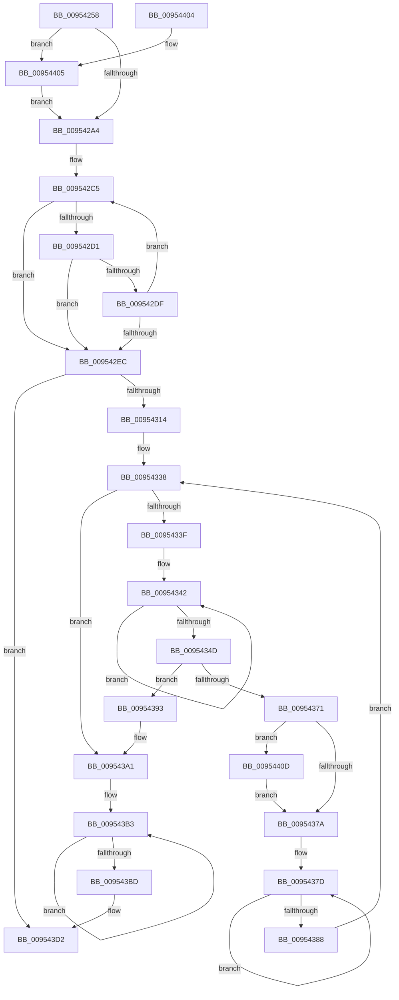

# PnpNotifyUserModeDeviceRemoval

- RVA: `0x00954258`–`0x00954415` (길이 `445` bytes)
- VA: `0x0000000140954258`
- 실행 섹션: `PAGE`
- PDB 이름 있음: `예`; PDB Function 태그: `아니요`
- unwind 정보 RVA: `0x00092180`
- 디코드: `117`개 명령, `445/445` bytes 표시
- 미해석 바이트: `0` (있으면 어셈블리에 `.byte`로 보존)

> 이 문서는 커널 이미지의 기계어와 PDB 기호를 분석해 생성했습니다. 4번과 5번은 함수 원형과 자료형을 바이너리 사용 방식에서 추정한 C 해석이며 원본 소스 복구 결과는 아닙니다.

## 1. Dependencies

- 직접 호출 지점: **4**; 고유 호출 대상: **3**
- 직접 호출자로 확인된 함수: **3**
- RIP 상대 이미지 참조: **1**

### Outgoing calls
- `0x0095435B` → [memcpy](../../text/6C/memcpy_function_006C6840.md) (function, `0x006C6840`)
- `0x00954363` → [PiUEventNotifyUserMode](PiUEventNotifyUserMode_function_00954CB4.md) (function, `0x00954CB4`)
- `0x009543CD` → [memcpy](../../text/6C/memcpy_function_006C6840.md) (function, `0x006C6840`)
- `0x009543DF` → [_security_check_cookie](../../text/6A/_security_check_cookie_function_006AC640.md) (function, `0x006AC640`)

### Direct callers
- [PnpProcessQueryRemoveAndEject](../A0/PnpProcessQueryRemoveAndEject_function_00A05170.md) at `0x00A052F7`
- [PnpProcessQueryRemoveAndEject](../A0/PnpProcessQueryRemoveAndEject_function_00A05170.md) at `0x00A0566A`
- [PiProcessQueryAndCancelRemoval](../A0/PiProcessQueryAndCancelRemoval_function_00A05A58.md) at `0x00A05AB7`
- [PiProcessQueryAndCancelRemoval](../A0/PiProcessQueryAndCancelRemoval_function_00A05A58.md) at `0x00A05BDE`
- [sub_00B33FE8](../B3/Unknown_function_00B33FE8.md) at `0x00B34274`

### Static image references
- `0x00954275` → RVA `0x00E0A740` (`.data`; read)

## 2. Other-region calls and transfers

- 다른 실행 섹션으로 향하는 call: **3**
  - `0x0095435B` → [memcpy](../../text/6C/memcpy_function_006C6840.md) (`PAGE` → `.text`)
  - `0x009543CD` → [memcpy](../../text/6C/memcpy_function_006C6840.md) (`PAGE` → `.text`)
  - `0x009543DF` → [_security_check_cookie](../../text/6A/_security_check_cookie_function_006AC640.md) (`PAGE` → `.text`)
- 별도 외부 분기/꼬리 이동을 확인하지 못했습니다.

## 3. Assembly (complete function range)

```asm
00954258  48 8B C4                        mov rax, rsp
0095425B  48 89 58 18                     mov qword ptr [rax + 0x18], rbx
0095425F  55                              push rbp
00954260  56                              push rsi
00954261  57                              push rdi
00954262  41 54                           push r12
00954264  41 55                           push r13
00954266  41 56                           push r14
00954268  41 57                           push r15
0095426A  48 81 EC D0 01 00 00            sub rsp, 0x1d0
00954271  0F 29 70 B8                     movaps xmmword ptr [rax - 0x48], xmm6
00954275  48 8B 05 C4 64 4B 00            mov rax, qword ptr [rip + 0x4b64c4]
0095427C  48 33 C4                        xor rax, rsp
0095427F  48 89 84 24 B0 01 00 00         mov qword ptr [rsp + 0x1b0], rax
00954287  4C 8B B4 24 38 02 00 00         mov r14, qword ptr [rsp + 0x238]
0095428F  45 33 DB                        xor r11d, r11d
00954292  4D 8B D0                        mov r10, r8
00954295  48 8B EA                        mov rbp, rdx
00954298  48 8B F1                        mov rsi, rcx
0095429B  4D 85 F6                        test r14, r14
0095429E  0F 85 61 01 00 00               jne 0x140954405
009542A4  0F 10 71 78                     movups xmm6, xmmword ptr [rcx + 0x78]
009542A8  4C 8B 61 30                     mov r12, qword ptr [rcx + 0x30]
009542AC  48 8D 44 24 20                  lea rax, [rsp + 0x20]
009542B1  4C 8B 69 38                     mov r13, qword ptr [rcx + 0x38]
009542B5  4C 8B C6                        mov r8, rsi
009542B8  4C 2B C0                        sub r8, rax
009542BB  48 8D 4C 24 20                  lea rcx, [rsp + 0x20]
009542C0  BA C8 00 00 00                  mov edx, 0xc8
009542C5  48 8D 82 36 FF FF 7F            lea rax, [rdx + 0x7fffff36]
009542CC  48 85 C0                        test rax, rax
009542CF  74 1B                           je 0x1409542ec
009542D1  41 0F B7 84 08 A8 00 00 00      movzx eax, word ptr [r8 + rcx + 0xa8]
009542DA  66 85 C0                        test ax, ax
009542DD  74 0D                           je 0x1409542ec
009542DF  66 89 01                        mov word ptr [rcx], ax
009542E2  48 83 C1 02                     add rcx, 2
009542E6  48 83 EA 01                     sub rdx, 1
009542EA  75 D9                           jne 0x1409542c5
009542EC  48 85 D2                        test rdx, rdx
009542EF  48 8D 41 FE                     lea rax, [rcx - 2]
009542F3  48 0F 45 C1                     cmovne rax, rcx
009542F7  66 44 89 18                     mov word ptr [rax], r11w
009542FB  48 8B C2                        mov rax, rdx
009542FE  48 F7 D8                        neg rax
00954301  1B DB                           sbb ebx, ebx
00954303  F7 D3                           not ebx
00954305  81 E3 05 00 00 80               and ebx, 0x80000005
0095430B  48 85 D2                        test rdx, rdx
0095430E  0F 84 BE 00 00 00               je 0x1409543d2
00954314  41 0F 10 02                     movups xmm0, xmmword ptr [r10]
00954318  48 8B 84 24 30 02 00 00         mov rax, qword ptr [rsp + 0x230]
00954320  4C 8D BE A8 00 00 00            lea r15, [rsi + 0xa8]
00954327  4C 89 4E 30                     mov qword ptr [rsi + 0x30], r9
0095432B  48 83 CF FF                     or rdi, 0xffffffffffffffff
0095432F  F3 0F 7F 46 78                  movdqu xmmword ptr [rsi + 0x78], xmm0
00954334  48 89 46 38                     mov qword ptr [rsi + 0x38], rax
00954338  66 44 39 5D 00                  cmp word ptr [rbp], r11w
0095433D  74 62                           je 0x1409543a1
0095433F  4C 8B C7                        mov r8, rdi
00954342  49 FF C0                        inc r8
00954345  66 46 39 5C 45 00               cmp word ptr [rbp + r8*2], r11w
0095434B  75 F5                           jne 0x140954342
0095434D  4E 8D 04 45 02 00 00 00         lea r8, [r8*2 + 2]
00954355  48 8B D5                        mov rdx, rbp
00954358  49 8B CF                        mov rcx, r15
0095435B  E8 E0 24 D7 FF                  call 0x1406c6840
00954360  48 8B CE                        mov rcx, rsi
00954363  E8 4C 09 00 00                  call 0x140954cb4
00954368  45 33 DB                        xor r11d, r11d
0095436B  8B D8                           mov ebx, eax
0095436D  85 C0                           test eax, eax
0095436F  78 22                           js 0x140954393
00954371  4D 85 F6                        test r14, r14
00954374  0F 85 93 00 00 00               jne 0x14095440d
0095437A  48 8B C7                        mov rax, rdi
0095437D  48 FF C0                        inc rax
00954380  66 44 39 5C 45 00               cmp word ptr [rbp + rax*2], r11w
00954386  75 F5                           jne 0x14095437d
00954388  48 8D 6C 45 00                  lea rbp, [rbp + rax*2]
0095438D  48 83 C5 02                     add rbp, 2
00954391  EB A5                           jmp 0x140954338
00954393  81 FB 20 01 00 C0               cmp ebx, 0xc0000120
00954399  B8 28 00 00 80                  mov eax, 0x80000028
0095439E  0F 44 D8                        cmove ebx, eax
009543A1  F3 0F 7F 76 78                  movdqu xmmword ptr [rsi + 0x78], xmm6
009543A6  4C 89 66 30                     mov qword ptr [rsi + 0x30], r12
009543AA  48 8D 44 24 20                  lea rax, [rsp + 0x20]
009543AF  4C 89 6E 38                     mov qword ptr [rsi + 0x38], r13
009543B3  48 FF C7                        inc rdi
009543B6  66 44 39 1C 78                  cmp word ptr [rax + rdi*2], r11w
009543BB  75 F6                           jne 0x1409543b3
009543BD  4C 8D 04 7D 02 00 00 00         lea r8, [rdi*2 + 2]
009543C5  49 8B CF                        mov rcx, r15
009543C8  48 8D 54 24 20                  lea rdx, [rsp + 0x20]
009543CD  E8 6E 24 D7 FF                  call 0x1406c6840
009543D2  8B C3                           mov eax, ebx
009543D4  48 8B 8C 24 B0 01 00 00         mov rcx, qword ptr [rsp + 0x1b0]
009543DC  48 33 CC                        xor rcx, rsp
009543DF  E8 5C 82 D5 FF                  call 0x1406ac640
009543E4  4C 8D 9C 24 D0 01 00 00         lea r11, [rsp + 0x1d0]
009543EC  49 8B 5B 50                     mov rbx, qword ptr [r11 + 0x50]
009543F0  41 0F 28 73 F0                  movaps xmm6, xmmword ptr [r11 - 0x10]
009543F5  49 8B E3                        mov rsp, r11
009543F8  41 5F                           pop r15
009543FA  41 5E                           pop r14
009543FC  41 5D                           pop r13
009543FE  41 5C                           pop r12
00954400  5F                              pop rdi
00954401  5E                              pop rsi
00954402  5D                              pop rbp
00954403  C3                              ret
00954404  CC                              int3
00954405  45 89 1E                        mov dword ptr [r14], r11d
00954408  E9 97 FE FF FF                  jmp 0x1409542a4
0095440D  41 FF 06                        inc dword ptr [r14]
00954410  E9 65 FF FF FF                  jmp 0x14095437a
```

## 4. C-style interpretation (structured pseudocode)

```c
__int64 __fastcall PnpNotifyUserModeDeviceRemoval(__int64 a1, __int64 a2, __int64 a3, __int64 a4, __int64 a5, __int64 a6)
{
    __int64 result;
    __int64 v_r11;
    __int64 v_rbp;
    __int64 v_rbx;
    __int64 v_rdi;
    __int64 v_rsp;
    unsigned __int64 v_stack_m1E8;
    unsigned __int64 v_stack_m38;
    unsigned __int64 v_stack_m58;

    *(unsigned __int64 *)(v_rsp + 24) = v_rbx;
    v_rsp = (v_rsp) - (464);
    *(unsigned __int64 *)(v_rsp - 72) = v_xmm6;
    result = (*(unsigned __int64 *)(v_rip + 4940996)) ^ (v_rsp);
    v_stack_m58 = result;
    v_r11 = 0;
    if (a6 != 0) goto loc_00954405;
loc_009542A4:
    a3 = (a1) - (v_stack_m1E8);
loc_009542C5:
    if (200 + 2147483446 == 0) goto loc_009542EC;
    if ((unsigned __int16)(*(unsigned __int16 *)(a3 + v_stack_m1E8 * 1 + 168)) == 0) goto loc_009542EC;
    *(unsigned __int16 *)(v_stack_m1E8) = (unsigned __int16)(*(unsigned __int16 *)(a3 + v_stack_m1E8 * 1 + 168));
    a1 = (v_stack_m1E8) + (2);
    a2 = (200) - (1);
    if (condition_is_not_equal) goto loc_009542C5;
loc_009542EC:
    result = a1 - 2;
    if (a2 != 0) { result = a1; }
    *(unsigned __int16 *)(result) = 0;
    result = -(a2);
    v_rbx = (unsigned int)(~(v_rbx));
    v_rbx = (unsigned int)((v_rbx) & (0x80000005ULL));
    if (a2 == 0) goto loc_009543D2;
    *(unsigned __int64 *)(a1 + 48) = a4;
    v_rdi = (v_rdi) | (-1);
    *(unsigned __int64 *)(a1 + 120) = v_xmm0;
    *(unsigned __int64 *)(a1 + 56) = a5;
loc_00954338:
    if ((*(unsigned __int16 *)(a2)) == 0) goto loc_009543A1;
loc_00954342:
    a3 = (v_rdi) + 1;
    if ((*(unsigned __int16 *)(a2 + a3 * 2)) != 0) goto loc_00954342;
    result = memcpy(a1 + 168, a2, a3 * 2 + 2, a4);
    result = PiUEventNotifyUserMode(a1, a2, a3 * 2 + 2, a4);
    v_r11 = 0;
    if (sign_flag) goto loc_00954393;
    if (a6 != 0) goto loc_0095440D;
loc_0095437A:
loc_0095437D:
    result = (v_rdi) + 1;
    if ((*(unsigned __int16 *)(a2 + result * 2)) != 0) goto loc_0095437D;
    v_rbp = (a2 + result * 2) + (2);
    goto loc_00954338;
loc_00954393:
    v_rbx = (unsigned int)((unsigned int)(result));
    if (((unsigned int)((unsigned int)((unsigned int)(result)))) == 0xC0000120ULL) { v_rbx = (unsigned int)((unsigned int)(0x80000028ULL)); }
loc_009543A1:
    *(unsigned __int64 *)(a1 + 120) = v_xmm6;
    *(unsigned __int64 *)(a1 + 48) = *(unsigned __int64 *)(a1 + 48);
    *(unsigned __int64 *)(a1 + 56) = *(unsigned __int64 *)(a1 + 56);
loc_009543B3:
    v_rdi = (v_rdi) + 1;
    if ((*(unsigned __int16 *)(v_stack_m1E8 + v_rdi * 2)) != 0) goto loc_009543B3;
    result = memcpy(a1 + 168, v_stack_m1E8, v_rdi * 2 + 2, a4);
loc_009543D2:
    a1 = (v_stack_m58) ^ (v_rsp);
    result = _security_check_cookie(a1, v_stack_m1E8, v_rdi * 2 + 2, a4);
    return result;
loc_00954405:
    *(unsigned int *)(a6) = (unsigned int)(v_stack_m38);
    goto loc_009542A4;
loc_0095440D:
    goto loc_0095437A;
}
```

## 5. (Beta) C Style

```c
int64_t PnpNotifyUserModeDeviceRemoval(void *Arg1, void *Arg2, void *Arg3, int64_t Arg4, int64_t Arg5, int64_t Arg6)
{
    uint8_t *arg1 = (uint8_t *)Arg1;
    uint8_t *arg2 = (uint8_t *)Arg2;
    uint8_t *arg3 = (uint8_t *)Arg3;

    int64_t result;
    int64_t local_r11;
    int64_t local_rbp;
    int64_t local_rbx;
    int64_t local_rdi;
    int64_t local_rsp;
    uint64_t v_stack_m1E8;
    uint64_t v_stack_m38;
    uint64_t v_stack_m58;

    *(uint64_t *)(local_rsp + 0x18) = local_rbx;
    local_rsp = (local_rsp) - (464);
    *(uint64_t *)(local_rsp - 0x48) = v_xmm6;
    result = (*(uint64_t *)(v_rip + 0x4B64C4)) ^ (local_rsp);
    v_stack_m58 = result;
    local_r11 = 0;
    if (Arg6 != 0) goto loc_00954405;
loc_009542A4:
    Arg3 = (Arg1) - (v_stack_m1E8);
loc_009542C5:
    if (200 + 2147483446 == 0) goto loc_009542EC;
    if ((uint16_t)(*(uint16_t *)(arg3 + v_stack_m1E8 * 1 + 0xA8)) == 0) goto loc_009542EC;
    *(uint16_t *)(v_stack_m1E8) = (uint16_t)(*(uint16_t *)(arg3 + v_stack_m1E8 * 1 + 0xA8));
    Arg1 = (v_stack_m1E8) + (2);
    Arg2 = (200) - (1);
    if (condition_is_not_equal) goto loc_009542C5;
loc_009542EC:
    result = Arg1 - 2;
    if (Arg2 != NULL) { result = Arg1; }
    *(uint16_t *)(result) = 0;
    result = -(Arg2);
    local_rbx = (uint32_t)(~(local_rbx));
    local_rbx = (uint32_t)((local_rbx) & (0x80000005ULL));
    if (Arg2 == NULL) goto loc_009543D2;
    *(uint64_t *)(arg1 + 0x30) = Arg4;
    local_rdi = (local_rdi) | (-1);
    *(uint64_t *)(arg1 + 0x78) = v_xmm0;
    *(uint64_t *)(arg1 + 0x38) = Arg5;
loc_00954338:
    if ((*(uint16_t *)(arg2)) == 0) goto loc_009543A1;
loc_00954342:
    Arg3 = (local_rdi) + 1;
    if ((*(uint16_t *)(arg2 + arg3 * 2)) != 0) goto loc_00954342;
    result = memcpy(Arg1 + 168, Arg2, Arg3 * 2 + 2, Arg4);
    result = PiUEventNotifyUserMode(Arg1, Arg2, Arg3 * 2 + 2, Arg4);
    local_r11 = 0;
    if (sign_flag) goto loc_00954393;
    if (Arg6 != 0) goto loc_0095440D;
loc_0095437A:
loc_0095437D:
    result = (local_rdi) + 1;
    if ((*(uint16_t *)(arg2 + result * 2)) != 0) goto loc_0095437D;
    local_rbp = (Arg2 + result * 2) + (2);
    goto loc_00954338;
loc_00954393:
    local_rbx = (uint32_t)((uint32_t)(result));
    if (((uint32_t)((uint32_t)((uint32_t)(result)))) == 0xC0000120ULL) { local_rbx = (uint32_t)((uint32_t)(0x80000028ULL)); }
loc_009543A1:
    *(uint64_t *)(arg1 + 0x78) = v_xmm6;
    *(uint64_t *)(arg1 + 0x30) = *(uint64_t *)(arg1 + 0x30);
    *(uint64_t *)(arg1 + 0x38) = *(uint64_t *)(arg1 + 0x38);
loc_009543B3:
    local_rdi = (local_rdi) + 1;
    if ((*(uint16_t *)(v_stack_m1E8 + local_rdi * 2)) != 0) goto loc_009543B3;
    result = memcpy(Arg1 + 168, v_stack_m1E8, local_rdi * 2 + 2, Arg4);
loc_009543D2:
    Arg1 = (v_stack_m58) ^ (local_rsp);
    result = _security_check_cookie(Arg1, v_stack_m1E8, local_rdi * 2 + 2, Arg4);
    return result;
loc_00954405:
    *(uint32_t *)(Arg6) = (uint32_t)(v_stack_m38);
    goto loc_009542A4;
loc_0095440D:
    goto loc_0095437A;
}
```

### 관측된 메모리 오프셋

구조체 형식이 확인되지 않은 접근은 인자 기준의 오프셋으로만 기록했습니다.

| 기준 인자 | 오프셋 표현 | 폭 (bit) | 접근 |
|---|---:|---:|---|
| `Arg1` | `+ 0x30` | `64` | `R` |
| `Arg1` | `+ 0x30` | `64` | `W` |
| `Arg1` | `+ 0x38` | `64` | `R` |
| `Arg1` | `+ 0x38` | `64` | `W` |
| `Arg1` | `+ 0x78` | `128` | `R` |
| `Arg1` | `+ 0x78` | `128` | `W` |
| `Arg1` | `+ 0xA8` | `64` | `R` |
| `Arg1` | `+ 0xA8 + rcx*1` | `16` | `R` |
| `Arg2` | `+ 0x0` | `16` | `R` |
| `Arg2` | `+ 0x0 + r8*2` | `16` | `R` |
| `Arg2` | `+ 0x0 + rax*2` | `16` | `R` |
| `Arg2` | `+ 0x0 + rax*2` | `64` | `R` |
| `Arg3` | `+ 0x0` | `128` | `R` |

## 6. Execution-region graph

[열기: 2D/3D 그래프와 함수 탐색 컨트롤 패널](../../../control-panel.html?section=page&rva=0x00954258&view=graph)

- 2D 그래프는 위에서 아래로 흐르고, 3D 그래프는 빈 공간을 드래그해 회전합니다. Shift+드래그는 이동, 휠은 확대·축소, 함수 노드 선택은 대상 보고서 이동입니다.

### Static fallback


