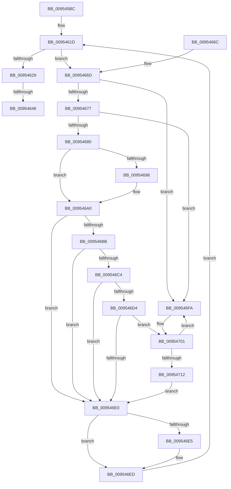

# PnpProcessDeferredRegistrations

- RVA: `0x009545BC`–`0x0095472B` (길이 `367` bytes)
- VA: `0x00000001409545BC`
- 실행 섹션: `PAGE`
- PDB 이름 있음: `예`; PDB Function 태그: `예`
- unwind 정보 RVA: `0x000921CC`
- 디코드: `95`개 명령, `367/367` bytes 표시
- 미해석 바이트: `0` (있으면 어셈블리에 `.byte`로 보존)

> 이 문서는 커널 이미지의 기계어와 PDB 기호를 분석해 생성했습니다. 4번과 5번은 함수 원형과 자료형을 바이너리 사용 방식에서 추정한 C 해석이며 원본 소스 복구 결과는 아닙니다.

## 1. Dependencies

- 직접 호출 지점: **7**; 고유 호출 대상: **5**
- 직접 호출자로 확인된 함수: **1**
- RIP 상대 이미지 참조: **4**

### Outgoing calls
- `0x0095460B` → [ExAcquireFastMutex](../../text/20/ExAcquireFastMutex_function_0020E5A0.md) (function, `0x0020E5A0`)
- `0x00954630` → [ExReleaseFastMutex](../../text/25/ExReleaseFastMutex_function_002519C0.md) (function, `0x002519C0`)
- `0x0095464D` → [_security_check_cookie](../../text/6A/_security_check_cookie_function_006AC640.md) (function, `0x006AC640`)
- `0x0095469B` → [ExAcquireFastMutex](../../text/20/ExAcquireFastMutex_function_0020E5A0.md) (function, `0x0020E5A0`)
- `0x009546B0` → [ExFreePoolWithTag](../../poolcode/B8/ExFreePoolWithTag_function_00B82870.md) (function, `0x00B82870`)
- `0x009546E8` → [ExReleaseFastMutex](../../text/25/ExReleaseFastMutex_function_002519C0.md) (function, `0x002519C0`)
- `0x009546F0` → [PnpDereferenceNotify](PnpDereferenceNotify_function_00954A04.md) (function, `0x00954A04`)

### Direct callers
- [PnpDeviceEventWorker](PnpDeviceEventWorker_function_009556B0.md) at `0x009557F2`
- [PnpDeviceEventWorker](PnpDeviceEventWorker_function_009556B0.md) at `0x00955830`

### Static image references
- `0x009545D7` → RVA `0x00E0A740` (`.data`; read)
- `0x009545F8` → RVA `0x00F8CD20` (`.data`; read)
- `0x00954610` → RVA `0x00FD9FA8` (`PAGEDATA`; read)
- `0x00954680` → RVA `0x00FD9FA8` (`PAGEDATA`; write)

## 2. Other-region calls and transfers

- 다른 실행 섹션으로 향하는 call: **6**
  - `0x0095460B` → [ExAcquireFastMutex](../../text/20/ExAcquireFastMutex_function_0020E5A0.md) (`PAGE` → `.text`)
  - `0x00954630` → [ExReleaseFastMutex](../../text/25/ExReleaseFastMutex_function_002519C0.md) (`PAGE` → `.text`)
  - `0x0095464D` → [_security_check_cookie](../../text/6A/_security_check_cookie_function_006AC640.md) (`PAGE` → `.text`)
  - `0x0095469B` → [ExAcquireFastMutex](../../text/20/ExAcquireFastMutex_function_0020E5A0.md) (`PAGE` → `.text`)
  - `0x009546B0` → [ExFreePoolWithTag](../../poolcode/B8/ExFreePoolWithTag_function_00B82870.md) (`PAGE` → `POOLCODE`)
  - `0x009546E8` → [ExReleaseFastMutex](../../text/25/ExReleaseFastMutex_function_002519C0.md) (`PAGE` → `.text`)
- call이 아닌 외부 분기/꼬리 이동: **1**
  - `0x00954640` → [sub_00B264F4](../B2/Unknown_function_00B264F4.md) (`tail-transfer`)

## 3. Assembly (complete function range)

```asm
009545BC  48 89 5C 24 08                  mov qword ptr [rsp + 8], rbx
009545C1  48 89 74 24 10                  mov qword ptr [rsp + 0x10], rsi
009545C6  48 89 7C 24 18                  mov qword ptr [rsp + 0x18], rdi
009545CB  55                              push rbp
009545CC  41 54                           push r12
009545CE  41 57                           push r15
009545D0  48 8B EC                        mov rbp, rsp
009545D3  48 83 EC 60                     sub rsp, 0x60
009545D7  48 8B 05 62 61 4B 00            mov rax, qword ptr [rip + 0x4b6162]
009545DE  48 33 C4                        xor rax, rsp
009545E1  48 89 45 F8                     mov qword ptr [rbp - 8], rax
009545E5  83 65 D0 00                     and dword ptr [rbp - 0x30], 0
009545E9  48 8D 45 C0                     lea rax, [rbp - 0x40]
009545ED  0F 57 C0                        xorps xmm0, xmm0
009545F0  48 89 45 C8                     mov qword ptr [rbp - 0x38], rax
009545F4  48 8D 45 C0                     lea rax, [rbp - 0x40]
009545F8  48 8D 0D 21 87 63 00            lea rcx, [rip + 0x638721]
009545FF  48 89 45 C0                     mov qword ptr [rbp - 0x40], rax
00954603  0F 11 45 D8                     movups xmmword ptr [rbp - 0x28], xmm0
00954607  0F 11 45 E8                     movups xmmword ptr [rbp - 0x18], xmm0
0095460B  E8 90 9F 8B FF                  call 0x14020e5a0
00954610  4C 8D 3D 91 59 68 00            lea r15, [rip + 0x685991]
00954617  41 BC 01 00 00 00               mov r12d, 1
0095461D  48 8B 1D 84 59 68 00            mov rbx, qword ptr [rip + 0x685984]
00954624  49 3B DF                        cmp rbx, r15
00954627  75 44                           jne 0x14095466d
00954629  48 8D 0D F0 86 63 00            lea rcx, [rip + 0x6386f0]
00954630  E8 8B D3 8F FF                  call 0x1402519c0
00954635  48 8B 5D C0                     mov rbx, qword ptr [rbp - 0x40]
00954639  48 8D 45 C0                     lea rax, [rbp - 0x40]
0095463D  48 3B D8                        cmp rbx, rax
00954640  0F 85 AE 1E 1D 00               jne 0x140b264f4
00954646  48 8B 4D F8                     mov rcx, qword ptr [rbp - 8]
0095464A  48 33 CC                        xor rcx, rsp
0095464D  E8 EE 7F D5 FF                  call 0x1406ac640
00954652  4C 8D 5C 24 60                  lea r11, [rsp + 0x60]
00954657  49 8B 5B 20                     mov rbx, qword ptr [r11 + 0x20]
0095465B  49 8B 73 28                     mov rsi, qword ptr [r11 + 0x28]
0095465F  49 8B 7B 30                     mov rdi, qword ptr [r11 + 0x30]
00954663  49 8B E3                        mov rsp, r11
00954666  41 5F                           pop r15
00954668  41 5C                           pop r12
0095466A  5D                              pop rbp
0095466B  C3                              ret
0095466C  CC                              int3
0095466D  4C 39 7B 08                     cmp qword ptr [rbx + 8], r15
00954671  0F 85 83 00 00 00               jne 0x1409546fa
00954677  48 8B 03                        mov rax, qword ptr [rbx]
0095467A  48 39 58 08                     cmp qword ptr [rax + 8], rbx
0095467E  75 7A                           jne 0x1409546fa
00954680  48 89 05 21 59 68 00            mov qword ptr [rip + 0x685921], rax
00954687  4C 89 78 08                     mov qword ptr [rax + 8], r15
0095468B  48 8B 7B 10                     mov rdi, qword ptr [rbx + 0x10]
0095468F  48 8B 77 40                     mov rsi, qword ptr [rdi + 0x40]
00954693  48 85 F6                        test rsi, rsi
00954696  74 08                           je 0x1409546a0
00954698  48 8B CE                        mov rcx, rsi
0095469B  E8 00 9F 8B FF                  call 0x14020e5a0
009546A0  48 8B 43 10                     mov rax, qword ptr [rbx + 0x10]
009546A4  BA 50 6E 70 37                  mov edx, 0x37706e50
009546A9  48 8B CB                        mov rcx, rbx
009546AC  C6 40 3A 00                     mov byte ptr [rax + 0x3a], 0
009546B0  E8 BB E1 22 00                  call 0x140b82870
009546B5  83 7F 10 03                     cmp dword ptr [rdi + 0x10], 3
009546B9  75 25                           jne 0x1409546e0
009546BB  48 8B 47 58                     mov rax, qword ptr [rdi + 0x58]
009546BF  48 85 C0                        test rax, rax
009546C2  74 1C                           je 0x1409546e0
009546C4  48 8B 80 38 01 00 00            mov rax, qword ptr [rax + 0x138]
009546CB  48 8B 40 28                     mov rax, qword ptr [rax + 0x28]
009546CF  48 85 C0                        test rax, rax
009546D2  74 0C                           je 0x1409546e0
009546D4  F7 80 C0 02 00 00 00 40 00 00   test dword ptr [rax + 0x2c0], 0x4000
009546DE  75 21                           jne 0x140954701
009546E0  48 85 F6                        test rsi, rsi
009546E3  74 08                           je 0x1409546ed
009546E5  48 8B CE                        mov rcx, rsi
009546E8  E8 D3 D2 8F FF                  call 0x1402519c0
009546ED  48 8B CF                        mov rcx, rdi
009546F0  E8 0F 03 00 00                  call 0x140954a04
009546F5  E9 23 FF FF FF                  jmp 0x14095461d
009546FA  B9 03 00 00 00                  mov ecx, 3
009546FF  CD 29                           int 0x29
00954701  48 8B 4D C8                     mov rcx, qword ptr [rbp - 0x38]
00954705  48 8D 55 C0                     lea rdx, [rbp - 0x40]
00954709  48 8D 47 60                     lea rax, [rdi + 0x60]
0095470D  48 39 11                        cmp qword ptr [rcx], rdx
00954710  75 E8                           jne 0x1409546fa
00954712  48 89 48 08                     mov qword ptr [rax + 8], rcx
00954716  48 8D 55 C0                     lea rdx, [rbp - 0x40]
0095471A  48 89 10                        mov qword ptr [rax], rdx
0095471D  48 89 01                        mov qword ptr [rcx], rax
00954720  48 89 45 C8                     mov qword ptr [rbp - 0x38], rax
00954724  66 44 01 67 38                  add word ptr [rdi + 0x38], r12w
00954729  EB B5                           jmp 0x1409546e0
```

## 4. C-style interpretation (structured pseudocode)

```c
__int64 __fastcall PnpProcessDeferredRegistrations(void)
{
    __int64 result;
    __int64 v_rsp;
    unsigned __int64 v_stack_m18;
    unsigned __int64 v_stack_m20;
    unsigned __int64 v_stack_m30;
    unsigned __int64 v_stack_m40;
    unsigned int v_stack_m48;
    unsigned __int64 v_stack_m50;
    unsigned __int64 v_stack_m58;
    unsigned __int64 v_stack_p10;
    unsigned __int64 v_stack_p18;
    unsigned __int64 v_stack_p8;

    v_stack_p8 = v_rbx;
    v_stack_p10 = v_rsi;
    v_stack_p18 = v_rdi;
    v_rsp = (v_rsp) - (96);
    result = (*(unsigned __int64 *)(v_rip + 4940130)) ^ (v_rsp);
    v_stack_m20 = result;
    v_stack_m50 = v_stack_m58;
    v_stack_m58 = v_stack_m58;
    v_stack_m40 = v_xmm0;
    v_stack_m30 = v_xmm0;
    result = ExAcquireFastMutex(v_rip + 6522657, a2, a3, a4);
loc_0095461D:
    if ((*(unsigned __int64 *)(v_rip + 6838660)) != (v_rip + 6838673)) goto loc_0095466D;
    result = ExReleaseFastMutex(v_rip + 6522608, a2, a3, a4);
    a1 = (v_stack_m20) ^ (v_rsp);
    result = _security_check_cookie(a1, a2, a3, a4);
    return result;
loc_0095466D:
    if ((*(unsigned __int64 *)(*(unsigned __int64 *)(v_stack_m18 + 32) + 8)) != (v_rip + 6838673)) goto loc_009546FA;
    if ((*(unsigned __int64 *)(*(unsigned __int64 *)(*(unsigned __int64 *)(v_stack_m18 + 32)) + 8)) != (*(unsigned __int64 *)(v_stack_m18 + 32))) goto loc_009546FA;
    *(unsigned __int64 *)(v_rip + 6838561) = *(unsigned __int64 *)(*(unsigned __int64 *)(v_stack_m18 + 32));
    *(unsigned __int64 *)(*(unsigned __int64 *)(*(unsigned __int64 *)(v_stack_m18 + 32)) + 8) = v_rip + 6838673;
    result = *(unsigned __int64 *)(*(unsigned __int64 *)(v_stack_m18 + 32));
    if (*(unsigned __int64 *)(*(unsigned __int64 *)(*(unsigned __int64 *)(v_stack_m18 + 32) + 16) + 64) != 0) {
        a1 = *(unsigned __int64 *)(*(unsigned __int64 *)(*(unsigned __int64 *)(v_stack_m18 + 32) + 16) + 64);
        result = ExAcquireFastMutex(a1, a2, a3, a4);
    }
    *(unsigned __int8 *)(*(unsigned __int64 *)(*(unsigned __int64 *)(v_stack_m18 + 32) + 16) + 58) = 0;
    result = ExFreePoolWithTag(*(unsigned __int64 *)(v_stack_m18 + 32), (unsigned int)(0x37706E50ULL), a3, a4);
    if ((*(unsigned int *)(*(unsigned __int64 *)(*(unsigned __int64 *)(v_stack_m18 + 32) + 16) + 16)) != 3) goto loc_009546E0;
    if (*(unsigned __int64 *)(*(unsigned __int64 *)(*(unsigned __int64 *)(v_stack_m18 + 32) + 16) + 88) == 0) goto loc_009546E0;
    if (*(unsigned __int64 *)(*(unsigned __int64 *)(*(unsigned __int64 *)(*(unsigned __int64 *)(*(unsigned __int64 *)(v_stack_m18 + 32) + 16) + 88) + 312) + 40) == 0) goto loc_009546E0;
    if (((*(unsigned int *)(*(unsigned __int64 *)(*(unsigned __int64 *)(*(unsigned __int64 *)(*(unsigned __int64 *)(*(unsigned __int64 *)(v_stack_m18 + 32) + 16) + 88) + 312) + 40) + 704)) & (0x4000ULL)) != 0) goto loc_00954701;
loc_009546E0:
    result = *(unsigned __int64 *)(*(unsigned __int64 *)(*(unsigned __int64 *)(*(unsigned __int64 *)(*(unsigned __int64 *)(v_stack_m18 + 32) + 16) + 88) + 312) + 40);
    if (*(unsigned __int64 *)(*(unsigned __int64 *)(*(unsigned __int64 *)(v_stack_m18 + 32) + 16) + 64) != 0) {
        a1 = *(unsigned __int64 *)(*(unsigned __int64 *)(*(unsigned __int64 *)(v_stack_m18 + 32) + 16) + 64);
        result = ExReleaseFastMutex(a1, (unsigned int)(0x37706E50ULL), a3, a4);
    }
    result = PnpDereferenceNotify(*(unsigned __int64 *)(*(unsigned __int64 *)(v_stack_m18 + 32) + 16), (unsigned int)(0x37706E50ULL), a3, a4);
    goto loc_0095461D;
loc_009546FA:
loc_00954701:
    if ((*(unsigned __int64 *)(v_stack_m50)) != v_stack_m58) goto loc_009546FA;
    *(unsigned __int64 *)(*(unsigned __int64 *)(*(unsigned __int64 *)(v_stack_m18 + 32) + 16) + 96 + 8) = v_stack_m50;
    *(unsigned __int64 *)(*(unsigned __int64 *)(*(unsigned __int64 *)(v_stack_m18 + 32) + 16) + 96) = v_stack_m58;
    *(unsigned __int64 *)(v_stack_m50) = *(unsigned __int64 *)(*(unsigned __int64 *)(v_stack_m18 + 32) + 16) + 96;
    v_stack_m50 = *(unsigned __int64 *)(*(unsigned __int64 *)(v_stack_m18 + 32) + 16) + 96;
    goto loc_009546E0;
}
```

## 5. (Beta) C Style

```c
void PnpProcessDeferredRegistrations(void)
{
    int64_t result;
    int64_t local_rsp;
    uint64_t v_stack_m18;
    uint64_t v_stack_m20;
    uint64_t v_stack_m30;
    uint64_t v_stack_m40;
    uint32_t v_stack_m48;
    uint64_t v_stack_m50;
    uint64_t v_stack_m58;
    uint64_t v_stack_p10;
    uint64_t v_stack_p18;
    uint64_t v_stack_p8;

    v_stack_p8 = local_rbx;
    v_stack_p10 = local_rsi;
    v_stack_p18 = local_rdi;
    local_rsp = (local_rsp) - (96);
    result = (*(uint64_t *)(v_rip + 0x4B6162)) ^ (local_rsp);
    v_stack_m20 = result;
    v_stack_m50 = v_stack_m58;
    v_stack_m58 = v_stack_m58;
    v_stack_m40 = v_xmm0;
    v_stack_m30 = v_xmm0;
    result = ExAcquireFastMutex(v_rip + 6522657, a2, a3, a4);
loc_0095461D:
    if ((*(uint64_t *)(v_rip + 0x685984)) != (v_rip + 6838673)) goto loc_0095466D;
    result = ExReleaseFastMutex(v_rip + 6522608, a2, a3, a4);
    a1 = (v_stack_m20) ^ (local_rsp);
    result = _security_check_cookie(a1, a2, a3, a4);
    return result;
loc_0095466D:
    if ((*(uint64_t *)(*(uint64_t *)(v_stack_m18 + 0x20) + 0x8)) != (v_rip + 6838673)) goto loc_009546FA;
    if ((*(uint64_t *)(*(uint64_t *)(*(uint64_t *)(v_stack_m18 + 0x20)) + 0x8)) != (*(uint64_t *)(v_stack_m18 + 0x20))) goto loc_009546FA;
    *(uint64_t *)(v_rip + 0x685921) = *(uint64_t *)(*(uint64_t *)(v_stack_m18 + 0x20));
    *(uint64_t *)(*(uint64_t *)(*(uint64_t *)(v_stack_m18 + 0x20)) + 0x8) = v_rip + 6838673;
    result = *(uint64_t *)(*(uint64_t *)(v_stack_m18 + 0x20));
    if (*(uint64_t *)(*(uint64_t *)(*(uint64_t *)(v_stack_m18 + 0x20) + 0x10) + 0x40) != 0) {
        a1 = *(uint64_t *)(*(uint64_t *)(*(uint64_t *)(v_stack_m18 + 0x20) + 0x10) + 0x40);
        result = ExAcquireFastMutex(a1, a2, a3, a4);
    }
    *(uint8_t *)(*(uint64_t *)(*(uint64_t *)(v_stack_m18 + 0x20) + 0x10) + 0x3A) = 0;
    result = ExFreePoolWithTag(*(uint64_t *)(v_stack_m18 + 0x20), (uint32_t)(0x37706E50ULL), a3, a4);
    if ((*(uint32_t *)(*(uint64_t *)(*(uint64_t *)(v_stack_m18 + 0x20) + 0x10) + 0x10)) != 3) goto loc_009546E0;
    if (*(uint64_t *)(*(uint64_t *)(*(uint64_t *)(v_stack_m18 + 0x20) + 0x10) + 0x58) == 0) goto loc_009546E0;
    if (*(uint64_t *)(*(uint64_t *)(*(uint64_t *)(*(uint64_t *)(*(uint64_t *)(v_stack_m18 + 0x20) + 0x10) + 0x58) + 0x138) + 0x28) == 0) goto loc_009546E0;
    if (((*(uint32_t *)(*(uint64_t *)(*(uint64_t *)(*(uint64_t *)(*(uint64_t *)(*(uint64_t *)(v_stack_m18 + 0x20) + 0x10) + 0x58) + 0x138) + 0x28) + 0x2C0)) & (0x4000ULL)) != 0) goto loc_00954701;
loc_009546E0:
    result = *(uint64_t *)(*(uint64_t *)(*(uint64_t *)(*(uint64_t *)(*(uint64_t *)(v_stack_m18 + 0x20) + 0x10) + 0x58) + 0x138) + 0x28);
    if (*(uint64_t *)(*(uint64_t *)(*(uint64_t *)(v_stack_m18 + 0x20) + 0x10) + 0x40) != 0) {
        a1 = *(uint64_t *)(*(uint64_t *)(*(uint64_t *)(v_stack_m18 + 0x20) + 0x10) + 0x40);
        result = ExReleaseFastMutex(a1, (uint32_t)(0x37706E50ULL), a3, a4);
    }
    result = PnpDereferenceNotify(*(uint64_t *)(*(uint64_t *)(v_stack_m18 + 0x20) + 0x10), (uint32_t)(0x37706E50ULL), a3, a4);
    goto loc_0095461D;
loc_009546FA:
loc_00954701:
    if ((*(uint64_t *)(v_stack_m50)) != v_stack_m58) goto loc_009546FA;
    *(uint64_t *)(*(uint64_t *)(*(uint64_t *)(v_stack_m18 + 0x20) + 0x10) + 0x60 + 0x8) = v_stack_m50;
    *(uint64_t *)(*(uint64_t *)(*(uint64_t *)(v_stack_m18 + 0x20) + 0x10) + 0x60) = v_stack_m58;
    *(uint64_t *)(v_stack_m50) = *(uint64_t *)(*(uint64_t *)(v_stack_m18 + 0x20) + 0x10) + 96;
    v_stack_m50 = *(uint64_t *)(*(uint64_t *)(v_stack_m18 + 0x20) + 0x10) + 96;
    goto loc_009546E0;
}
```

## 6. Execution-region graph

[열기: 2D/3D 그래프와 함수 탐색 컨트롤 패널](../../../control-panel.html?section=page&rva=0x009545BC&view=graph)

- 2D 그래프는 위에서 아래로 흐르고, 3D 그래프는 빈 공간을 드래그해 회전합니다. Shift+드래그는 이동, 휠은 확대·축소, 함수 노드 선택은 대상 보고서 이동입니다.

### Static fallback


