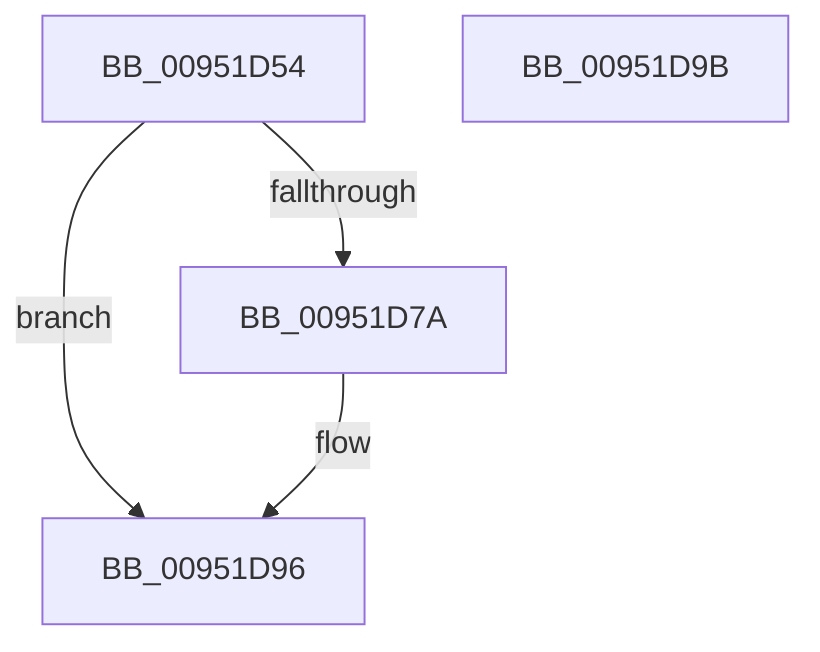

# PnpRaiseNtPlugPlayInterfacePropertyChangeEvent

- RVA: `0x00951D54`–`0x00951D9C` (길이 `72` bytes)
- VA: `0x0000000140951D54`
- 실행 섹션: `PAGE`
- PDB 이름 있음: `예`; PDB Function 태그: `아니요`
- unwind 정보 RVA: `0x0006C2A4`
- 디코드: `18`개 명령, `72/72` bytes 표시
- 미해석 바이트: `0` (있으면 어셈블리에 `.byte`로 보존)

> 이 문서는 커널 이미지의 기계어와 PDB 기호를 분석해 생성했습니다. 4번과 5번은 함수 원형과 자료형을 바이너리 사용 방식에서 추정한 C 해석이며 원본 소스 복구 결과는 아닙니다.

## 1. Dependencies

- 직접 호출 지점: **1**; 고유 호출 대상: **1**
- 직접 호출자로 확인된 함수: **1**
- RIP 상대 이미지 참조: **2**

### Outgoing calls
- `0x00951D91` → [PnpInterfaceRaisePropertyChangeEventWorker](PnpInterfaceRaisePropertyChangeEventWorker_function_00951F88.md) (function, `0x00951F88`)

### Direct callers
- [IopProcessSetInterfaceState](IopProcessSetInterfaceState_function_00950964.md) at `0x00950D09`

### Static image references
- `0x00951D58` → RVA `0x00E66398` (`.data`; read)
- `0x00951D82` → RVA `0x0000C478` (`.rdata`; read)

## 2. Other-region calls and transfers

- 다른 실행 섹션으로 향하는 call: **0**
- 별도 외부 분기/꼬리 이동을 확인하지 못했습니다.

## 3. Assembly (complete function range)

```asm
00951D54  48 83 EC 58                     sub rsp, 0x58
00951D58  48 8B 0D 39 46 51 00            mov rcx, qword ptr [rip + 0x514639]
00951D5F  33 C0                           xor eax, eax
00951D61  48 89 44 24 40                  mov qword ptr [rsp + 0x40], rax
00951D66  0F 57 C0                        xorps xmm0, xmm0
00951D69  0F 11 44 24 30                  movups xmmword ptr [rsp + 0x30], xmm0
00951D6E  48 8B 81 F0 01 00 00            mov rax, qword ptr [rcx + 0x1f0]
00951D75  48 85 C0                        test rax, rax
00951D78  74 1C                           je 0x140951d96
00951D7A  48 89 44 24 28                  mov qword ptr [rsp + 0x28], rax
00951D7F  45 33 C9                        xor r9d, r9d
00951D82  48 8B 05 EF A6 6B FF            mov rax, qword ptr [rip - 0x945911]
00951D89  45 33 C0                        xor r8d, r8d
00951D8C  48 89 44 24 20                  mov qword ptr [rsp + 0x20], rax
00951D91  E8 F2 01 00 00                  call 0x140951f88
00951D96  48 83 C4 58                     add rsp, 0x58
00951D9A  C3                              ret
00951D9B  CC                              int3
```

## 4. C-style interpretation (structured pseudocode)

```c
__int64 __fastcall PnpRaiseNtPlugPlayInterfacePropertyChangeEvent(__int64 a1, __int64 a2, int a3, int a4)
{
    __int64 result;
    __int64 v_rsp;
    unsigned __int64 v_stack_m18;
    unsigned __int64 v_stack_m28;
    unsigned __int64 v_stack_m30;
    unsigned __int64 v_stack_m38;

    v_rsp = (v_rsp) - (88);
    result = 0;
    v_stack_m18 = 0;
    v_stack_m28 = v_xmm0;
    result = *(unsigned __int64 *)(*(unsigned __int64 *)(v_rip + 5326393) + 496);
    if (*(unsigned __int64 *)(*(unsigned __int64 *)(v_rip + 5326393) + 496) != 0) {
        v_stack_m30 = *(unsigned __int64 *)(*(unsigned __int64 *)(v_rip + 5326393) + 496);
        a4 = 0;
        result = *(unsigned __int64 *)(v_rip - 9722129);
        a3 = 0;
        v_stack_m38 = result;
        result = PnpInterfaceRaisePropertyChangeEventWorker(*(unsigned __int64 *)(v_rip + 5326393), a2, a3, a4);
    }
    v_rsp = (v_rsp) + (88);
    return result;
}
```

## 5. (Beta) C Style

```c
int64_t PnpRaiseNtPlugPlayInterfacePropertyChangeEvent(int64_t Arg1, int64_t Arg2, int32_t Arg3, int32_t Arg4)
{
    int64_t result;
    int64_t local_rsp;
    uint64_t v_stack_m18;
    uint64_t v_stack_m28;
    uint64_t v_stack_m30;
    uint64_t v_stack_m38;

    local_rsp = (local_rsp) - (88);
    result = 0;
    v_stack_m18 = 0;
    v_stack_m28 = v_xmm0;
    result = *(uint64_t *)(*(uint64_t *)(v_rip + 0x514639) + 0x1F0);
    if (*(uint64_t *)(*(uint64_t *)(v_rip + 0x514639) + 0x1F0) != 0) {
        v_stack_m30 = *(uint64_t *)(*(uint64_t *)(v_rip + 0x514639) + 0x1F0);
        Arg4 = 0;
        result = *(uint64_t *)(v_rip - 0x945911);
        Arg3 = 0;
        v_stack_m38 = result;
        result = PnpInterfaceRaisePropertyChangeEventWorker(*(uint64_t *)(v_rip + 0x514639), Arg2, Arg3, Arg4);
    }
    local_rsp = (local_rsp) + (88);
    return result;
}
```

## 6. Execution-region graph

[열기: 2D/3D 그래프와 함수 탐색 컨트롤 패널](../../../control-panel.html?section=page&rva=0x00951D54&view=graph)

- 2D 그래프는 위에서 아래로 흐르고, 3D 그래프는 빈 공간을 드래그해 회전합니다. Shift+드래그는 이동, 휠은 확대·축소, 함수 노드 선택은 대상 보고서 이동입니다.

### Static fallback


