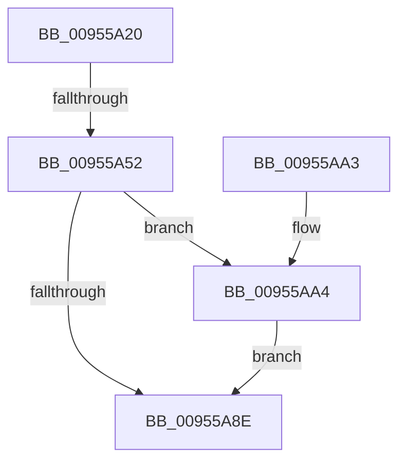

# PnpRecordBlackboxDeviceCompletionQueueInformation

- RVA: `0x00955A20`–`0x00955AB3` (길이 `147` bytes)
- VA: `0x0000000140955A20`
- 실행 섹션: `PAGE`
- PDB 이름 있음: `예`; PDB Function 태그: `예`
- unwind 정보 RVA: `0x0009233C`
- 디코드: `36`개 명령, `147/147` bytes 표시
- 미해석 바이트: `0` (있으면 어셈블리에 `.byte`로 보존)

> 이 문서는 커널 이미지의 기계어와 PDB 기호를 분석해 생성했습니다. 4번과 5번은 함수 원형과 자료형을 바이너리 사용 방식에서 추정한 C 해석이며 원본 소스 복구 결과는 아닙니다.

## 1. Dependencies

- 직접 호출 지점: **2**; 고유 호출 대상: **2**
- 직접 호출자로 확인된 함수: **1**
- RIP 상대 이미지 참조: **0**

### Outgoing calls
- `0x00955A84` → [NtPowerInformation](NtPowerInformation_function_00955D80.md) (function, `0x00955D80`)
- `0x00955AAC` → [ExFreePoolWithTag](../../poolcode/B8/ExFreePoolWithTag_function_00B82870.md) (function, `0x00B82870`)

### Direct callers
- [PnpRecordBlackbox](PnpRecordBlackbox_function_00955C28.md) at `0x00955C52`

### Static image references
- 디코드된 RIP-relative 메모리 참조가 없습니다.

## 2. Other-region calls and transfers

- 다른 실행 섹션으로 향하는 call: **1**
  - `0x00955AAC` → [ExFreePoolWithTag](../../poolcode/B8/ExFreePoolWithTag_function_00B82870.md) (`PAGE` → `POOLCODE`)
- call이 아닌 외부 분기/꼬리 이동: **1**
  - `0x00955A4C` → [sub_00B269DE](../B2/Unknown_function_00B269DE.md) (`tail-transfer`)

## 3. Assembly (complete function range)

```asm
00955A20  48 89 5C 24 08                  mov qword ptr [rsp + 8], rbx
00955A25  48 89 6C 24 10                  mov qword ptr [rsp + 0x10], rbp
00955A2A  48 89 74 24 18                  mov qword ptr [rsp + 0x18], rsi
00955A2F  57                              push rdi
00955A30  48 83 EC 50                     sub rsp, 0x50
00955A34  48 BD 08 00 00 00 80 F7 FF FF   movabs rbp, 0xfffff78000000008
00955A3E  33 DB                           xor ebx, ebx
00955A40  33 FF                           xor edi, edi
00955A42  48 8B F1                        mov rsi, rcx
00955A45  48 8B 6D 00                     mov rbp, qword ptr [rbp]
00955A49  48 85 C9                        test rcx, rcx
00955A4C  0F 85 8C 0F 1D 00               jne 0x140b269de
00955A52  48 83 64 24 40 00               and qword ptr [rsp + 0x40], 0
00955A58  48 8D 54 24 30                  lea rdx, [rsp + 0x30]
00955A5D  83 64 24 4C 00                  and dword ptr [rsp + 0x4c], 0
00955A62  45 33 C9                        xor r9d, r9d
00955A65  83 64 24 20 00                  and dword ptr [rsp + 0x20], 0
00955A6A  C7 44 24 48 0A 00 00 00         mov dword ptr [rsp + 0x48], 0xa
00955A72  48 89 5C 24 30                  mov qword ptr [rsp + 0x30], rbx
00955A77  45 8D 41 20                     lea r8d, [r9 + 0x20]
00955A7B  48 89 7C 24 38                  mov qword ptr [rsp + 0x38], rdi
00955A80  41 8D 49 5E                     lea ecx, [r9 + 0x5e]
00955A84  E8 F7 02 00 00                  call 0x140955d80
00955A89  48 85 DB                        test rbx, rbx
00955A8C  75 16                           jne 0x140955aa4
00955A8E  48 8B 5C 24 60                  mov rbx, qword ptr [rsp + 0x60]
00955A93  48 8B 6C 24 68                  mov rbp, qword ptr [rsp + 0x68]
00955A98  48 8B 74 24 70                  mov rsi, qword ptr [rsp + 0x70]
00955A9D  48 83 C4 50                     add rsp, 0x50
00955AA1  5F                              pop rdi
00955AA2  C3                              ret
00955AA3  CC                              int3
00955AA4  BA 50 6E 70 4B                  mov edx, 0x4b706e50
00955AA9  48 8B CB                        mov rcx, rbx
00955AAC  E8 BF CD 22 00                  call 0x140b82870
00955AB1  EB DB                           jmp 0x140955a8e
```

## 4. C-style interpretation (structured pseudocode)

```c
__int64 __fastcall PnpRecordBlackboxDeviceCompletionQueueInformation(__int64 a1, __int64 a2, __int64 a3, int a4)
{
    __int64 result;
    __int64 v_rbx;
    __int64 v_rdi;
    __int64 v_rsp;
    unsigned int v_stack_m10;
    unsigned __int64 v_stack_m18;
    unsigned __int64 v_stack_m20;
    unsigned __int64 v_stack_m28;
    unsigned int v_stack_m38;
    unsigned int v_stack_mC;
    unsigned __int64 v_stack_p10;
    unsigned __int64 v_stack_p18;
    unsigned __int64 v_stack_p8;

    v_stack_p8 = v_rbx;
    v_stack_p10 = v_rbp;
    v_stack_p18 = v_rsi;
    v_rsp = (v_rsp) - (80);
    v_rbx = 0;
    v_rdi = 0;
    a4 = 0;
    v_stack_m10 = 10;
    v_stack_m28 = 0;
    v_stack_m20 = 0;
    result = NtPowerInformation(a4 + 94, v_stack_m28, a4 + 32, a4);
    if (0 != 0) goto loc_00955AA4;
loc_00955A8E:
    v_rsp = (v_rsp) + (80);
    return result;
loc_00955AA4:
    result = ExFreePoolWithTag(v_stack_p8, (unsigned int)(0x4B706E50ULL), a4 + 32, a4);
    goto loc_00955A8E;
}
```

## 5. (Beta) C Style

```c
int64_t PnpRecordBlackboxDeviceCompletionQueueInformation(int64_t Arg1, int64_t Arg2, int64_t Arg3, int32_t Arg4)
{
    int64_t result;
    int64_t local_rbx;
    int64_t local_rdi;
    int64_t local_rsp;
    uint32_t v_stack_m10;
    uint64_t v_stack_m18;
    uint64_t v_stack_m20;
    uint64_t v_stack_m28;
    uint32_t v_stack_m38;
    uint32_t v_stack_mC;
    uint64_t v_stack_p10;
    uint64_t v_stack_p18;
    uint64_t v_stack_p8;

    v_stack_p8 = local_rbx;
    v_stack_p10 = local_rbp;
    v_stack_p18 = local_rsi;
    local_rsp = (local_rsp) - (80);
    local_rbx = 0;
    local_rdi = 0;
    Arg4 = 0;
    v_stack_m10 = 10;
    v_stack_m28 = 0;
    v_stack_m20 = 0;
    result = NtPowerInformation(Arg4 + 94, v_stack_m28, Arg4 + 32, Arg4);
    if (0 != 0) goto loc_00955AA4;
loc_00955A8E:
    local_rsp = (local_rsp) + (80);
    return result;
loc_00955AA4:
    result = ExFreePoolWithTag(v_stack_p8, (uint32_t)(0x4B706E50ULL), Arg4 + 32, Arg4);
    goto loc_00955A8E;
}
```

## 6. Execution-region graph

[열기: 2D/3D 그래프와 함수 탐색 컨트롤 패널](../../../control-panel.html?section=page&rva=0x00955A20&view=graph)

- 2D 그래프는 위에서 아래로 흐르고, 3D 그래프는 빈 공간을 드래그해 회전합니다. Shift+드래그는 이동, 휠은 확대·축소, 함수 노드 선택은 대상 보고서 이동입니다.

### Static fallback


