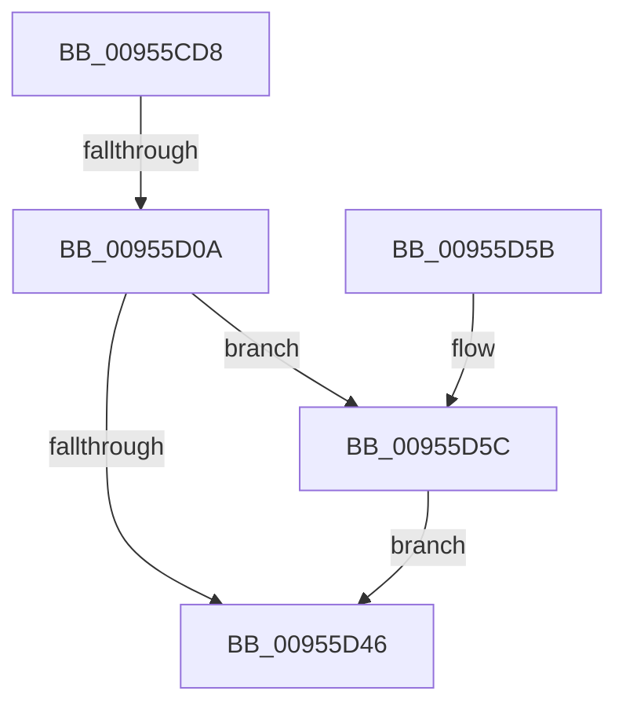

# PnpRecordBlackboxPnpEventWorkerInformation

- RVA: `0x00955CD8`–`0x00955D6B` (길이 `147` bytes)
- VA: `0x0000000140955CD8`
- 실행 섹션: `PAGE`
- PDB 이름 있음: `예`; PDB Function 태그: `예`
- unwind 정보 RVA: `0x0009233C`
- 디코드: `36`개 명령, `147/147` bytes 표시
- 미해석 바이트: `0` (있으면 어셈블리에 `.byte`로 보존)

> 이 문서는 커널 이미지의 기계어와 PDB 기호를 분석해 생성했습니다. 4번과 5번은 함수 원형과 자료형을 바이너리 사용 방식에서 추정한 C 해석이며 원본 소스 복구 결과는 아닙니다.

## 1. Dependencies

- 직접 호출 지점: **2**; 고유 호출 대상: **2**
- 직접 호출자로 확인된 함수: **1**
- RIP 상대 이미지 참조: **0**

### Outgoing calls
- `0x00955D3C` → [NtPowerInformation](NtPowerInformation_function_00955D80.md) (function, `0x00955D80`)
- `0x00955D64` → [ExFreePoolWithTag](../../poolcode/B8/ExFreePoolWithTag_function_00B82870.md) (function, `0x00B82870`)

### Direct callers
- [PnpRecordBlackbox](PnpRecordBlackbox_function_00955C28.md) at `0x00955C4B`

### Static image references
- 디코드된 RIP-relative 메모리 참조가 없습니다.

## 2. Other-region calls and transfers

- 다른 실행 섹션으로 향하는 call: **1**
  - `0x00955D64` → [ExFreePoolWithTag](../../poolcode/B8/ExFreePoolWithTag_function_00B82870.md) (`PAGE` → `POOLCODE`)
- call이 아닌 외부 분기/꼬리 이동: **1**
  - `0x00955D04` → [sub_00B26A64](../B2/Unknown_function_00B26A64.md) (`tail-transfer`)

## 3. Assembly (complete function range)

```asm
00955CD8  48 89 5C 24 08                  mov qword ptr [rsp + 8], rbx
00955CDD  48 89 6C 24 10                  mov qword ptr [rsp + 0x10], rbp
00955CE2  48 89 74 24 18                  mov qword ptr [rsp + 0x18], rsi
00955CE7  57                              push rdi
00955CE8  48 83 EC 50                     sub rsp, 0x50
00955CEC  48 BD 08 00 00 00 80 F7 FF FF   movabs rbp, 0xfffff78000000008
00955CF6  33 DB                           xor ebx, ebx
00955CF8  33 FF                           xor edi, edi
00955CFA  48 8B F1                        mov rsi, rcx
00955CFD  48 8B 6D 00                     mov rbp, qword ptr [rbp]
00955D01  48 85 C9                        test rcx, rcx
00955D04  0F 85 5A 0D 1D 00               jne 0x140b26a64
00955D0A  48 83 64 24 40 00               and qword ptr [rsp + 0x40], 0
00955D10  48 8D 54 24 30                  lea rdx, [rsp + 0x30]
00955D15  83 64 24 4C 00                  and dword ptr [rsp + 0x4c], 0
00955D1A  45 33 C9                        xor r9d, r9d
00955D1D  83 64 24 20 00                  and dword ptr [rsp + 0x20], 0
00955D22  C7 44 24 48 09 00 00 00         mov dword ptr [rsp + 0x48], 9
00955D2A  48 89 5C 24 30                  mov qword ptr [rsp + 0x30], rbx
00955D2F  45 8D 41 20                     lea r8d, [r9 + 0x20]
00955D33  48 89 7C 24 38                  mov qword ptr [rsp + 0x38], rdi
00955D38  41 8D 49 5E                     lea ecx, [r9 + 0x5e]
00955D3C  E8 3F 00 00 00                  call 0x140955d80
00955D41  48 85 DB                        test rbx, rbx
00955D44  75 16                           jne 0x140955d5c
00955D46  48 8B 5C 24 60                  mov rbx, qword ptr [rsp + 0x60]
00955D4B  48 8B 6C 24 68                  mov rbp, qword ptr [rsp + 0x68]
00955D50  48 8B 74 24 70                  mov rsi, qword ptr [rsp + 0x70]
00955D55  48 83 C4 50                     add rsp, 0x50
00955D59  5F                              pop rdi
00955D5A  C3                              ret
00955D5B  CC                              int3
00955D5C  BA 50 6E 70 4B                  mov edx, 0x4b706e50
00955D61  48 8B CB                        mov rcx, rbx
00955D64  E8 07 CB 22 00                  call 0x140b82870
00955D69  EB DB                           jmp 0x140955d46
```

## 4. C-style interpretation (structured pseudocode)

```c
__int64 __fastcall PnpRecordBlackboxPnpEventWorkerInformation(__int64 a1, __int64 a2, __int64 a3, int a4)
{
    __int64 result;
    __int64 v_rbx;
    __int64 v_rdi;
    __int64 v_rsp;
    unsigned int v_stack_m10;
    unsigned __int64 v_stack_m18;
    unsigned __int64 v_stack_m20;
    unsigned __int64 v_stack_m28;
    unsigned int v_stack_m38;
    unsigned int v_stack_mC;
    unsigned __int64 v_stack_p10;
    unsigned __int64 v_stack_p18;
    unsigned __int64 v_stack_p8;

    v_stack_p8 = v_rbx;
    v_stack_p10 = v_rbp;
    v_stack_p18 = v_rsi;
    v_rsp = (v_rsp) - (80);
    v_rbx = 0;
    v_rdi = 0;
    a4 = 0;
    v_stack_m10 = 9;
    v_stack_m28 = 0;
    v_stack_m20 = 0;
    result = NtPowerInformation(a4 + 94, v_stack_m28, a4 + 32, a4);
    if (0 != 0) goto loc_00955D5C;
loc_00955D46:
    v_rsp = (v_rsp) + (80);
    return result;
loc_00955D5C:
    result = ExFreePoolWithTag(v_stack_p8, (unsigned int)(0x4B706E50ULL), a4 + 32, a4);
    goto loc_00955D46;
}
```

## 5. (Beta) C Style

```c
int64_t PnpRecordBlackboxPnpEventWorkerInformation(int64_t Arg1, int64_t Arg2, int64_t Arg3, int32_t Arg4)
{
    int64_t result;
    int64_t local_rbx;
    int64_t local_rdi;
    int64_t local_rsp;
    uint32_t v_stack_m10;
    uint64_t v_stack_m18;
    uint64_t v_stack_m20;
    uint64_t v_stack_m28;
    uint32_t v_stack_m38;
    uint32_t v_stack_mC;
    uint64_t v_stack_p10;
    uint64_t v_stack_p18;
    uint64_t v_stack_p8;

    v_stack_p8 = local_rbx;
    v_stack_p10 = local_rbp;
    v_stack_p18 = local_rsi;
    local_rsp = (local_rsp) - (80);
    local_rbx = 0;
    local_rdi = 0;
    Arg4 = 0;
    v_stack_m10 = 9;
    v_stack_m28 = 0;
    v_stack_m20 = 0;
    result = NtPowerInformation(Arg4 + 94, v_stack_m28, Arg4 + 32, Arg4);
    if (0 != 0) goto loc_00955D5C;
loc_00955D46:
    local_rsp = (local_rsp) + (80);
    return result;
loc_00955D5C:
    result = ExFreePoolWithTag(v_stack_p8, (uint32_t)(0x4B706E50ULL), Arg4 + 32, Arg4);
    goto loc_00955D46;
}
```

## 6. Execution-region graph

[열기: 2D/3D 그래프와 함수 탐색 컨트롤 패널](../../../control-panel.html?section=page&rva=0x00955CD8&view=graph)

- 2D 그래프는 위에서 아래로 흐르고, 3D 그래프는 빈 공간을 드래그해 회전합니다. Shift+드래그는 이동, 휠은 확대·축소, 함수 노드 선택은 대상 보고서 이동입니다.

### Static fallback


