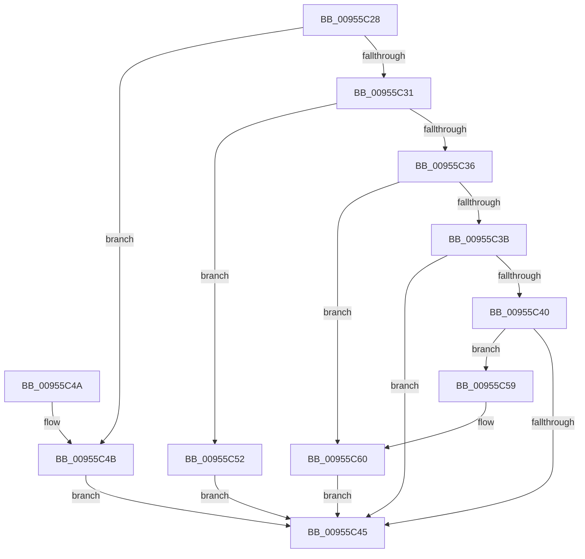

# PnpRecordBlackbox

- RVA: `0x00955C28`–`0x00955C67` (길이 `63` bytes)
- VA: `0x0000000140955C28`
- 실행 섹션: `PAGE`
- PDB 이름 있음: `예`; PDB Function 태그: `아니요`
- unwind 정보 RVA: `0x0005FC2C`
- 디코드: `22`개 명령, `63/63` bytes 표시
- 미해석 바이트: `0` (있으면 어셈블리에 `.byte`로 보존)

> 이 문서는 커널 이미지의 기계어와 PDB 기호를 분석해 생성했습니다. 4번과 5번은 함수 원형과 자료형을 바이너리 사용 방식에서 추정한 C 해석이며 원본 소스 복구 결과는 아닙니다.

## 1. Dependencies

- 직접 호출 지점: **3**; 고유 호출 대상: **3**
- 직접 호출자로 확인된 함수: **2**
- RIP 상대 이미지 참조: **0**

### Outgoing calls
- `0x00955C4B` → [PnpRecordBlackboxPnpEventWorkerInformation](PnpRecordBlackboxPnpEventWorkerInformation_function_00955CD8.md) (function, `0x00955CD8`)
- `0x00955C52` → [PnpRecordBlackboxDeviceCompletionQueueInformation](PnpRecordBlackboxDeviceCompletionQueueInformation_function_00955A20.md) (function, `0x00955A20`)
- `0x00955C60` → [PnpRecordBlackboxDelayedRemoveWorkerInformation](../73/PnpRecordBlackboxDelayedRemoveWorkerInformation_function_0073F908.md) (function, `0x0073F908`)

### Direct callers
- [PnpWatchdogFirstChanceCallback](../72/PnpWatchdogFirstChanceCallback_function_0072B8C0.md) at `0x0072B8D0`
- [PnpDisableWatchdog](PnpDisableWatchdog_function_00955B00.md) at `0x00955B17`

### Static image references
- 디코드된 RIP-relative 메모리 참조가 없습니다.

## 2. Other-region calls and transfers

- 다른 실행 섹션으로 향하는 call: **0**
- 별도 외부 분기/꼬리 이동을 확인하지 못했습니다.

## 3. Assembly (complete function range)

```asm
00955C28  48 83 EC 28                     sub rsp, 0x28
00955C2C  83 EA 01                        sub edx, 1
00955C2F  74 1A                           je 0x140955c4b
00955C31  83 EA 01                        sub edx, 1
00955C34  74 1C                           je 0x140955c52
00955C36  83 EA 01                        sub edx, 1
00955C39  74 25                           je 0x140955c60
00955C3B  83 EA 01                        sub edx, 1
00955C3E  74 05                           je 0x140955c45
00955C40  83 FA 01                        cmp edx, 1
00955C43  75 14                           jne 0x140955c59
00955C45  48 83 C4 28                     add rsp, 0x28
00955C49  C3                              ret
00955C4A  CC                              int3
00955C4B  E8 88 00 00 00                  call 0x140955cd8
00955C50  EB F3                           jmp 0x140955c45
00955C52  E8 C9 FD FF FF                  call 0x140955a20
00955C57  EB EC                           jmp 0x140955c45
00955C59  B9 05 00 00 00                  mov ecx, 5
00955C5E  CD 29                           int 0x29
00955C60  E8 A3 9C DE FF                  call 0x14073f908
00955C65  EB DE                           jmp 0x140955c45
```

## 4. C-style interpretation (structured pseudocode)

```c
__int64 __fastcall PnpRecordBlackbox(__int64 a1, int a2)
{
    __int64 result;
    __int64 v_rsp;

    v_rsp = (v_rsp) - (40);
    a2 = (unsigned int)((a2) - (1));
    if (condition_is_equal) goto loc_00955C4B;
    a2 = (unsigned int)((a2) - (1));
    if (condition_is_equal) goto loc_00955C52;
    a2 = (unsigned int)((a2) - (1));
    if (condition_is_equal) goto loc_00955C60;
    a2 = (unsigned int)((a2) - (1));
    if (condition_is_equal) goto loc_00955C45;
    if (a2 != 1) goto loc_00955C59;
loc_00955C45:
    v_rsp = (v_rsp) + (40);
    return result;
loc_00955C4B:
    result = PnpRecordBlackboxPnpEventWorkerInformation(a1, a2, a3, a4);
    goto loc_00955C45;
loc_00955C52:
    result = PnpRecordBlackboxDeviceCompletionQueueInformation(a1, a2, a3, a4);
    goto loc_00955C45;
loc_00955C59:
loc_00955C60:
    result = PnpRecordBlackboxDelayedRemoveWorkerInformation(5, a2, a3, a4);
    goto loc_00955C45;
}
```

## 5. (Beta) C Style

```c
int64_t PnpRecordBlackbox(int64_t Arg1, int32_t Arg2)
{
    int64_t result;
    int64_t local_rsp;

    local_rsp = (local_rsp) - (40);
    Arg2 = (uint32_t)((Arg2) - (1));
    if (condition_is_equal) goto loc_00955C4B;
    Arg2 = (uint32_t)((Arg2) - (1));
    if (condition_is_equal) goto loc_00955C52;
    Arg2 = (uint32_t)((Arg2) - (1));
    if (condition_is_equal) goto loc_00955C60;
    Arg2 = (uint32_t)((Arg2) - (1));
    if (condition_is_equal) goto loc_00955C45;
    if (Arg2 != 1) goto loc_00955C59;
loc_00955C45:
    local_rsp = (local_rsp) + (40);
    return result;
loc_00955C4B:
    result = PnpRecordBlackboxPnpEventWorkerInformation(Arg1, Arg2, a3, a4);
    goto loc_00955C45;
loc_00955C52:
    result = PnpRecordBlackboxDeviceCompletionQueueInformation(Arg1, Arg2, a3, a4);
    goto loc_00955C45;
loc_00955C59:
loc_00955C60:
    result = PnpRecordBlackboxDelayedRemoveWorkerInformation(5, Arg2, a3, a4);
    goto loc_00955C45;
}
```

## 6. Execution-region graph

[열기: 2D/3D 그래프와 함수 탐색 컨트롤 패널](../../../control-panel.html?section=page&rva=0x00955C28&view=graph)

- 2D 그래프는 위에서 아래로 흐르고, 3D 그래프는 빈 공간을 드래그해 회전합니다. Shift+드래그는 이동, 휠은 확대·축소, 함수 노드 선택은 대상 보고서 이동입니다.

### Static fallback


