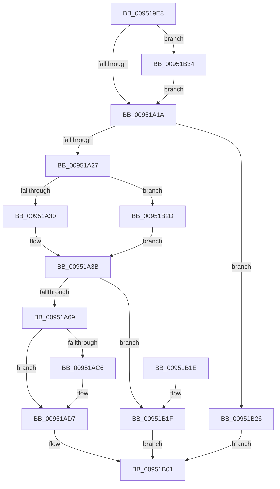

# PnpSetCustomTargetEvent

- RVA: `0x009519E8`–`0x00951B40` (길이 `344` bytes)
- VA: `0x00000001409519E8`
- 실행 섹션: `PAGE`
- PDB 이름 있음: `예`; PDB Function 태그: `아니요`
- unwind 정보 RVA: `0x00091E5C`
- 디코드: `84`개 명령, `344/344` bytes 표시
- 미해석 바이트: `0` (있으면 어셈블리에 `.byte`로 보존)

> 이 문서는 커널 이미지의 기계어와 PDB 기호를 분석해 생성했습니다. 4번과 5번은 함수 원형과 자료형을 바이너리 사용 방식에서 추정한 C 해석이며 원본 소스 복구 결과는 아닙니다.

## 1. Dependencies

- 직접 호출 지점: **5**; 고유 호출 대상: **4**
- 직접 호출자로 확인된 함수: **3**
- RIP 상대 이미지 참조: **2**

### Outgoing calls
- `0x00951A58` → [PnpCreateDeviceEventEntry](PnpCreateDeviceEventEntry_function_00951B48.md) (function, `0x00951B48`)
- `0x00951A71` → [ObfReferenceObjectWithTag](../../text/21/ObfReferenceObjectWithTag_function_00210710.md) (function, `0x00210710`)
- `0x00951AD2` → [memcpy](../../text/6C/memcpy_function_006C6840.md) (function, `0x006C6840`)
- `0x00951AF4` → [memcpy](../../text/6C/memcpy_function_006C6840.md) (function, `0x006C6840`)
- `0x00951AFC` → [PnpInsertEventInQueue](PnpInsertEventInQueue_function_00951B78.md) (function, `0x00951B78`)

### Direct callers
- [IoReportTargetDeviceChangeAsynchronous](../../text/47/IoReportTargetDeviceChangeAsynchronous_function_00475DA0.md) at `0x00475E9B`
- [PnpReportTargetDeviceChangeAsyncWorker](../72/PnpReportTargetDeviceChangeAsyncWorker_function_00729E20.md) at `0x00729E48`
- [IoReportTargetDeviceChange](../A6/IoReportTargetDeviceChange_function_00A66F20.md) at `0x00A67031`

### Static image references
- `0x00951A1A` → RVA `0x00F8C5E4` (`.data`; read)
- `0x00951A8C` → RVA `0x000122E8` (`.rdata`; read)

## 2. Other-region calls and transfers

- 다른 실행 섹션으로 향하는 call: **3**
  - `0x00951A71` → [ObfReferenceObjectWithTag](../../text/21/ObfReferenceObjectWithTag_function_00210710.md) (`PAGE` → `.text`)
  - `0x00951AD2` → [memcpy](../../text/6C/memcpy_function_006C6840.md) (`PAGE` → `.text`)
  - `0x00951AF4` → [memcpy](../../text/6C/memcpy_function_006C6840.md) (`PAGE` → `.text`)
- 별도 외부 분기/꼬리 이동을 확인하지 못했습니다.

## 3. Assembly (complete function range)

```asm
009519E8  48 8B C4                        mov rax, rsp
009519EB  48 89 58 08                     mov qword ptr [rax + 8], rbx
009519EF  48 89 68 10                     mov qword ptr [rax + 0x10], rbp
009519F3  48 89 70 18                     mov qword ptr [rax + 0x18], rsi
009519F7  4C 89 48 20                     mov qword ptr [rax + 0x20], r9
009519FB  57                              push rdi
009519FC  41 54                           push r12
009519FE  41 55                           push r13
00951A00  41 56                           push r14
00951A02  41 57                           push r15
00951A04  48 83 EC 20                     sub rsp, 0x20
00951A08  4D 8B F8                        mov r15, r8
00951A0B  4C 8B E2                        mov r12, rdx
00951A0E  48 8B F1                        mov rsi, rcx
00951A11  48 85 D2                        test rdx, rdx
00951A14  0F 85 1A 01 00 00               jne 0x140951b34
00951A1A  83 3D C3 AB 63 00 00            cmp dword ptr [rip + 0x63abc3], 0
00951A21  0F 85 FF 00 00 00               jne 0x140951b26
00951A27  48 85 F6                        test rsi, rsi
00951A2A  0F 84 FD 00 00 00               je 0x140951b2d
00951A30  48 8B 81 38 01 00 00            mov rax, qword ptr [rcx + 0x138]
00951A37  48 8B 78 28                     mov rdi, qword ptr [rax + 0x28]
00951A3B  0F B7 6F 28                     movzx ebp, word ptr [rdi + 0x28]
00951A3F  4C 8B 74 24 78                  mov r14, qword ptr [rsp + 0x78]
00951A44  83 C5 59                        add ebp, 0x59
00951A47  83 E5 F8                        and ebp, 0xfffffff8
00951A4A  41 0F B7 46 02                  movzx eax, word ptr [r14 + 2]
00951A4F  03 E8                           add ebp, eax
00951A51  44 8D 6D 78                     lea r13d, [rbp + 0x78]
00951A55  41 8B CD                        mov ecx, r13d
00951A58  E8 EB 00 00 00                  call 0x140951b48
00951A5D  48 8B D8                        mov rbx, rax
00951A60  48 85 C0                        test rax, rax
00951A63  0F 84 B6 00 00 00               je 0x140951b1f
00951A69  BA 50 6E 70 56                  mov edx, 0x56706e50
00951A6E  48 8B CE                        mov rcx, rsi
00951A71  E8 9A EC 8B FF                  call 0x140210710
00951A76  48 8B 44 24 68                  mov rax, qword ptr [rsp + 0x68]
00951A7B  48 89 43 20                     mov qword ptr [rbx + 0x20], rax
00951A7F  48 8B 44 24 70                  mov rax, qword ptr [rsp + 0x70]
00951A84  48 89 43 28                     mov qword ptr [rbx + 0x28], rax
00951A88  4C 89 63 18                     mov qword ptr [rbx + 0x18], r12
00951A8C  0F 10 05 55 08 6C FF            movups xmm0, xmmword ptr [rip - 0x93f7ab]
00951A93  83 A3 98 00 00 00 00            and dword ptr [rbx + 0x98], 0
00951A9A  C7 83 88 00 00 00 03 00 00 00   mov dword ptr [rbx + 0x88], 3
00951AA4  F3 0F 7F 43 78                  movdqu xmmword ptr [rbx + 0x78], xmm0
00951AA9  4C 89 BB 90 00 00 00            mov qword ptr [rbx + 0x90], r15
00951AB0  89 AB 9C 00 00 00               mov dword ptr [rbx + 0x9c], ebp
00951AB6  48 89 B3 A0 00 00 00            mov qword ptr [rbx + 0xa0], rsi
00951ABD  48 8B 57 30                     mov rdx, qword ptr [rdi + 0x30]
00951AC1  48 85 D2                        test rdx, rdx
00951AC4  74 11                           je 0x140951ad7
00951AC6  44 0F B7 47 28                  movzx r8d, word ptr [rdi + 0x28]
00951ACB  48 8D 8B B0 00 00 00            lea rcx, [rbx + 0xb0]
00951AD2  E8 69 4D D7 FF                  call 0x1406c6840
00951AD7  41 0F B7 46 02                  movzx eax, word ptr [r14 + 2]
00951ADC  49 8B D6                        mov rdx, r14
00951ADF  41 8B CD                        mov ecx, r13d
00951AE2  48 2B C8                        sub rcx, rax
00951AE5  48 03 CB                        add rcx, rbx
00951AE8  48 89 8B A8 00 00 00            mov qword ptr [rbx + 0xa8], rcx
00951AEF  45 0F B7 46 02                  movzx r8d, word ptr [r14 + 2]
00951AF4  E8 47 4D D7 FF                  call 0x1406c6840
00951AF9  48 8B CB                        mov rcx, rbx
00951AFC  E8 77 00 00 00                  call 0x140951b78
00951B01  48 8B 5C 24 50                  mov rbx, qword ptr [rsp + 0x50]
00951B06  48 8B 6C 24 58                  mov rbp, qword ptr [rsp + 0x58]
00951B0B  48 8B 74 24 60                  mov rsi, qword ptr [rsp + 0x60]
00951B10  48 83 C4 20                     add rsp, 0x20
00951B14  41 5F                           pop r15
00951B16  41 5E                           pop r14
00951B18  41 5D                           pop r13
00951B1A  41 5C                           pop r12
00951B1C  5F                              pop rdi
00951B1D  C3                              ret
00951B1E  CC                              int3
00951B1F  B8 9A 00 00 C0                  mov eax, 0xc000009a
00951B24  EB DB                           jmp 0x140951b01
00951B26  B8 89 01 00 C0                  mov eax, 0xc0000189
00951B2B  EB D4                           jmp 0x140951b01
00951B2D  33 FF                           xor edi, edi
00951B2F  E9 07 FF FF FF                  jmp 0x140951a3b
00951B34  41 C7 00 03 01 00 00            mov dword ptr [r8], 0x103
00951B3B  E9 DA FE FF FF                  jmp 0x140951a1a
```

## 4. C-style interpretation (structured pseudocode)

```c
__int64 __fastcall PnpSetCustomTargetEvent(__int64 a1, __int64 a2, __int64 a3, __int64 a4, __int64 a5, __int64 a6)
{
    __int64 result;
    __int64 v_rbp;
    __int64 v_rdi;
    __int64 v_rsp;
    unsigned __int64 v_stack_p10;
    unsigned __int64 v_stack_p18;
    unsigned __int64 v_stack_p20;
    unsigned __int64 v_stack_p8;

    *(unsigned __int64 *)(v_rsp + 8) = v_rbx;
    *(unsigned __int64 *)(v_rsp + 16) = v_rbp;
    *(unsigned __int64 *)(v_rsp + 24) = v_rsi;
    *(unsigned __int64 *)(v_rsp + 32) = a4;
    v_rsp = (v_rsp) - (32);
    if (a2 != 0) goto loc_00951B34;
loc_00951A1A:
    if ((*(unsigned int *)(v_rip + 6532035)) != 0) goto loc_00951B26;
    if (a1 == 0) goto loc_00951B2D;
loc_00951A3B:
    v_rbp = (unsigned int)((*(unsigned __int16 *)(*(unsigned __int64 *)(*(unsigned __int64 *)(a1 + 312) + 40) + 40)) + (89));
    v_rbp = (unsigned int)((v_rbp) & (0xFFFFFFF8ULL));
    v_rbp = (unsigned int)((v_rbp) + ((unsigned int)(*(unsigned __int16 *)(a6 + 2))));
    result = PnpCreateDeviceEventEntry((unsigned int)((unsigned int)(v_rbp + 120)), a2, a3, a4);
    if (result == 0) goto loc_00951B1F;
    result = ObfReferenceObjectWithTag(a1, (unsigned int)(0x56706E50ULL), a3, a4);
    *(unsigned __int64 *)(result + 32) = v_stack_p20;
    *(unsigned __int64 *)(result + 40) = a5;
    *(unsigned __int64 *)(result + 24) = a2;
    *(unsigned int *)(result + 136) = 3;
    *(unsigned __int64 *)(result + 120) = v_xmm0;
    *(unsigned __int64 *)(result + 144) = a3;
    *(unsigned int *)(result + 156) = (unsigned int)(v_rbp);
    *(unsigned __int64 *)(result + 160) = a1;
    result = a5;
    if (*(unsigned __int64 *)(*(unsigned __int64 *)(*(unsigned __int64 *)(a1 + 312) + 40) + 48) != 0) {
        a3 = *(unsigned __int16 *)(*(unsigned __int64 *)(*(unsigned __int64 *)(a1 + 312) + 40) + 40);
        a1 = result + 176;
        result = memcpy(a1, *(unsigned __int64 *)(*(unsigned __int64 *)(*(unsigned __int64 *)(a1 + 312) + 40) + 48), a3, a4);
    }
    a1 = ((unsigned int)((unsigned int)(v_rbp + 120))) - (*(unsigned __int16 *)(a6 + 2));
    a1 = (a1) + (result);
    *(unsigned __int64 *)(result + 168) = a1;
    result = memcpy(a1, a6, *(unsigned __int16 *)(a6 + 2), a4);
    result = PnpInsertEventInQueue(result, a6, *(unsigned __int16 *)(a6 + 2), a4);
loc_00951B01:
    v_rsp = (v_rsp) + (32);
    return result;
loc_00951B1F:
    goto loc_00951B01;
loc_00951B26:
    goto loc_00951B01;
loc_00951B2D:
    v_rdi = 0;
    goto loc_00951A3B;
loc_00951B34:
    *(unsigned int *)(*(unsigned __int16 *)(a6 + 2)) = 259;
    goto loc_00951A1A;
}
```

## 5. (Beta) C Style

```c
int64_t PnpSetCustomTargetEvent(void *Arg1, int64_t Arg2, void *Arg3, int64_t Arg4, int64_t Arg5, void *Arg6)
{
    uint8_t *arg1 = (uint8_t *)Arg1;
    uint8_t *arg3 = (uint8_t *)Arg3;
    uint8_t *arg6 = (uint8_t *)Arg6;

    int64_t result;
    int64_t local_rbp;
    int64_t local_rdi;
    int64_t local_rsp;
    uint64_t v_stack_p10;
    uint64_t v_stack_p18;
    uint64_t v_stack_p20;
    uint64_t v_stack_p8;

    *(uint64_t *)(local_rsp + 0x8) = local_rbx;
    *(uint64_t *)(local_rsp + 0x10) = local_rbp;
    *(uint64_t *)(local_rsp + 0x18) = local_rsi;
    *(uint64_t *)(local_rsp + 0x20) = Arg4;
    local_rsp = (local_rsp) - (32);
    if (Arg2 != 0) goto loc_00951B34;
loc_00951A1A:
    if ((*(uint32_t *)(v_rip + 0x63ABC3)) != 0) goto loc_00951B26;
    if (Arg1 == NULL) goto loc_00951B2D;
loc_00951A3B:
    local_rbp = (uint32_t)((*(uint16_t *)(*(uint64_t *)(*(uint64_t *)(arg1 + 0x138) + 0x28) + 0x28)) + (89));
    local_rbp = (uint32_t)((local_rbp) & (0xFFFFFFF8ULL));
    local_rbp = (uint32_t)((local_rbp) + ((uint32_t)(*(uint16_t *)(arg6 + 0x2))));
    result = PnpCreateDeviceEventEntry((uint32_t)((uint32_t)(local_rbp + 120)), Arg2, Arg3, Arg4);
    if (result == 0) goto loc_00951B1F;
    result = ObfReferenceObjectWithTag(Arg1, (uint32_t)(0x56706E50ULL), Arg3, Arg4);
    *(uint64_t *)(result + 0x20) = v_stack_p20;
    *(uint64_t *)(result + 0x28) = Arg5;
    *(uint64_t *)(result + 0x18) = Arg2;
    *(uint32_t *)(result + 0x88) = 3;
    *(uint64_t *)(result + 0x78) = v_xmm0;
    *(void **)(result + 0x90) = Arg3;
    *(uint32_t *)(result + 0x9C) = (uint32_t)(local_rbp);
    *(void **)(result + 0xA0) = Arg1;
    result = Arg5;
    if (*(uint64_t *)(*(uint64_t *)(*(uint64_t *)(arg1 + 0x138) + 0x28) + 0x30) != 0) {
        Arg3 = *(uint16_t *)(*(uint64_t *)(*(uint64_t *)(arg1 + 0x138) + 0x28) + 0x28);
        Arg1 = result + 176;
        result = memcpy(Arg1, *(uint64_t *)(*(uint64_t *)(*(uint64_t *)(arg1 + 0x138) + 0x28) + 0x30), Arg3, Arg4);
    }
    Arg1 = ((uint32_t)((uint32_t)(local_rbp + 120))) - (*(uint16_t *)(arg6 + 0x2));
    Arg1 = (Arg1) + (result);
    *(void **)(result + 0xA8) = Arg1;
    result = memcpy(Arg1, Arg6, *(uint16_t *)(arg6 + 0x2), Arg4);
    result = PnpInsertEventInQueue(result, Arg6, *(uint16_t *)(arg6 + 0x2), Arg4);
loc_00951B01:
    local_rsp = (local_rsp) + (32);
    return result;
loc_00951B1F:
    goto loc_00951B01;
loc_00951B26:
    goto loc_00951B01;
loc_00951B2D:
    local_rdi = 0;
    goto loc_00951A3B;
loc_00951B34:
    *(uint32_t *)(*(uint16_t *)(arg6 + 0x2)) = 259;
    goto loc_00951A1A;
}
```

### 관측된 메모리 오프셋

구조체 형식이 확인되지 않은 접근은 인자 기준의 오프셋으로만 기록했습니다.

| 기준 인자 | 오프셋 표현 | 폭 (bit) | 접근 |
|---|---:|---:|---|
| `Arg1` | `+ 0x138` | `64` | `R` |
| `Arg3` | `+ 0x0` | `32` | `W` |
| `Arg6` | `+ 0x2` | `16` | `R` |

## 6. Execution-region graph

[열기: 2D/3D 그래프와 함수 탐색 컨트롤 패널](../../../control-panel.html?section=page&rva=0x009519E8&view=graph)

- 2D 그래프는 위에서 아래로 흐르고, 3D 그래프는 빈 공간을 드래그해 회전합니다. Shift+드래그는 이동, 휠은 확대·축소, 함수 노드 선택은 대상 보고서 이동입니다.

### Static fallback


