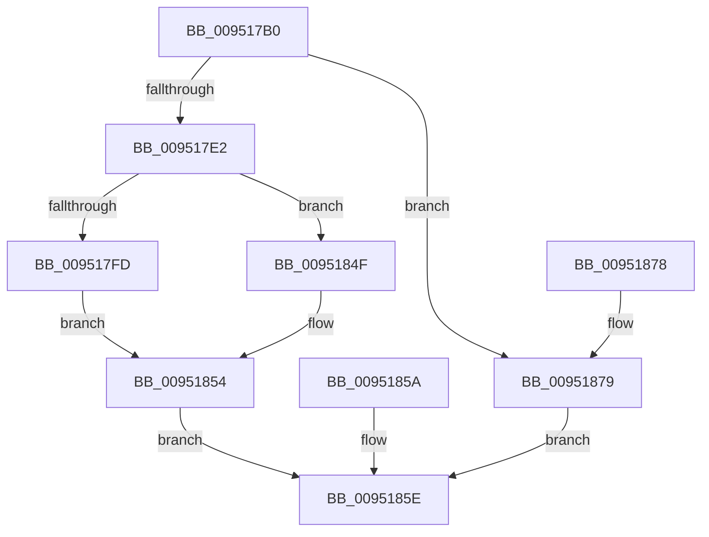

# PnpSetDeviceClassChange

- RVA: `0x009517B0`–`0x00951880` (길이 `208` bytes)
- VA: `0x00000001409517B0`
- 실행 섹션: `PAGE`
- PDB 이름 있음: `예`; PDB Function 태그: `아니요`
- unwind 정보 RVA: `0x00091E28`
- 디코드: `53`개 명령, `208/208` bytes 표시
- 미해석 바이트: `0` (있으면 어셈블리에 `.byte`로 보존)

> 이 문서는 커널 이미지의 기계어와 PDB 기호를 분석해 생성했습니다. 4번과 5번은 함수 원형과 자료형을 바이너리 사용 방식에서 추정한 C 해석이며 원본 소스 복구 결과는 아닙니다.

## 1. Dependencies

- 직접 호출 지점: **3**; 고유 호출 대상: **3**
- 직접 호출자로 확인된 함수: **1**
- RIP 상대 이미지 참조: **1**

### Outgoing calls
- `0x009517F0` → [PnpCreateDeviceEventEntry](PnpCreateDeviceEventEntry_function_00951B48.md) (function, `0x00951B48`)
- `0x00951831` → [memcpy](../../text/6C/memcpy_function_006C6840.md) (function, `0x006C6840`)
- `0x00951848` → [PnpInsertEventInQueue](PnpInsertEventInQueue_function_00951B78.md) (function, `0x00951B78`)

### Direct callers
- [IopProcessSetInterfaceState](IopProcessSetInterfaceState_function_00950964.md) at `0x00950D01`

### Static image references
- `0x009517D5` → RVA `0x00F8C5E4` (`.data`; read)

## 2. Other-region calls and transfers

- 다른 실행 섹션으로 향하는 call: **1**
  - `0x00951831` → [memcpy](../../text/6C/memcpy_function_006C6840.md) (`PAGE` → `.text`)
- 별도 외부 분기/꼬리 이동을 확인하지 못했습니다.

## 3. Assembly (complete function range)

```asm
009517B0  48 8B C4                        mov rax, rsp
009517B3  48 89 58 08                     mov qword ptr [rax + 8], rbx
009517B7  48 89 70 10                     mov qword ptr [rax + 0x10], rsi
009517BB  48 89 78 18                     mov qword ptr [rax + 0x18], rdi
009517BF  41 54                           push r12
009517C1  41 56                           push r14
009517C3  41 57                           push r15
009517C5  48 83 EC 30                     sub rsp, 0x30
009517C9  49 8B F0                        mov rsi, r8
009517CC  4C 8B F2                        mov r14, rdx
009517CF  4C 8B F9                        mov r15, rcx
009517D2  45 33 E4                        xor r12d, r12d
009517D5  44 39 25 08 AE 63 00            cmp dword ptr [rip + 0x63ae08], r12d
009517DC  0F 85 97 00 00 00               jne 0x140951879
009517E2  44 89 60 D8                     mov dword ptr [rax - 0x28], r12d
009517E6  41 0F B7 38                     movzx edi, word ptr [r8]
009517EA  83 C7 50                        add edi, 0x50
009517ED  8D 4F 78                        lea ecx, [rdi + 0x78]
009517F0  E8 53 03 00 00                  call 0x140951b48
009517F5  48 8B D8                        mov rbx, rax
009517F8  48 85 C0                        test rax, rax
009517FB  74 52                           je 0x14095184f
009517FD  41 0F 10 07                     movups xmm0, xmmword ptr [r15]
00951801  F3 0F 7F 40 78                  movdqu xmmword ptr [rax + 0x78], xmm0
00951806  C7 80 88 00 00 00 02 00 00 00   mov dword ptr [rax + 0x88], 2
00951810  89 B8 9C 00 00 00               mov dword ptr [rax + 0x9c], edi
00951816  41 0F 10 06                     movups xmm0, xmmword ptr [r14]
0095181A  F3 0F 7F 80 A8 00 00 00         movdqu xmmword ptr [rax + 0xa8], xmm0
00951822  44 0F B7 06                     movzx r8d, word ptr [rsi]
00951826  48 8D 88 B8 00 00 00            lea rcx, [rax + 0xb8]
0095182D  48 8B 56 08                     mov rdx, qword ptr [rsi + 8]
00951831  E8 0A 50 D7 FF                  call 0x1406c6840
00951836  0F B7 06                        movzx eax, word ptr [rsi]
00951839  48 D1 E8                        shr rax, 1
0095183C  66 44 89 A4 43 B8 00 00 00      mov word ptr [rbx + rax*2 + 0xb8], r12w
00951845  48 8B CB                        mov rcx, rbx
00951848  E8 2B 03 00 00                  call 0x140951b78
0095184D  EB 05                           jmp 0x140951854
0095184F  B8 17 00 00 C0                  mov eax, 0xc0000017
00951854  89 44 24 20                     mov dword ptr [rsp + 0x20], eax
00951858  EB 04                           jmp 0x14095185e
0095185A  8B 44 24 20                     mov eax, dword ptr [rsp + 0x20]
0095185E  48 8B 5C 24 50                  mov rbx, qword ptr [rsp + 0x50]
00951863  48 8B 74 24 58                  mov rsi, qword ptr [rsp + 0x58]
00951868  48 8B 7C 24 60                  mov rdi, qword ptr [rsp + 0x60]
0095186D  48 83 C4 30                     add rsp, 0x30
00951871  41 5F                           pop r15
00951873  41 5E                           pop r14
00951875  41 5C                           pop r12
00951877  C3                              ret
00951878  CC                              int3
00951879  B8 89 01 00 C0                  mov eax, 0xc0000189
0095187E  EB DE                           jmp 0x14095185e
```

## 4. C-style interpretation (structured pseudocode)

```c
__int64 __fastcall PnpSetDeviceClassChange(__int64 a1, __int64 a2, __int64 a3)
{
    __int64 result;
    __int64 v_r12;
    __int64 v_rdi;
    __int64 v_rsp;
    unsigned int v_stack_m28;
    unsigned __int64 v_stack_p10;
    unsigned __int64 v_stack_p18;
    unsigned __int64 v_stack_p8;

    *(unsigned __int64 *)(v_rsp + 8) = v_rbx;
    *(unsigned __int64 *)(v_rsp + 16) = v_rsi;
    *(unsigned __int64 *)(v_rsp + 24) = v_rdi;
    v_rsp = (v_rsp) - (48);
    v_r12 = 0;
    if ((*(unsigned int *)(v_rip + 6532616)) != 0) goto loc_00951879;
    *(unsigned int *)(v_rsp - 40) = 0;
    v_rdi = (unsigned int)((*(unsigned __int16 *)(a3)) + (80));
    result = PnpCreateDeviceEventEntry(v_rdi + 120, a2, a3, a4);
    if (result == 0) goto loc_0095184F;
    *(unsigned __int64 *)(result + 120) = v_xmm0;
    *(unsigned int *)(result + 136) = 2;
    *(unsigned int *)(result + 156) = (unsigned int)(v_rdi);
    *(unsigned __int64 *)(result + 168) = v_xmm0;
    result = memcpy(result + 184, *(unsigned __int64 *)(a3 + 8), *(unsigned __int16 *)(a3), a4);
    result = (*(unsigned __int16 *)(a3)) >> (1);
    *(unsigned __int16 *)(result + result * 2 + 184) = 0;
    result = PnpInsertEventInQueue(result, *(unsigned __int64 *)(a3 + 8), *(unsigned __int16 *)(a3), a4);
    goto loc_00951854;
loc_0095184F:
loc_00951854:
    v_stack_m28 = (unsigned int)((unsigned int)(0xC0000017ULL));
    goto loc_0095185E;
loc_0095185E:
    v_rsp = (v_rsp) + (48);
    return (unsigned int)(0xC0000017ULL);
loc_00951879:
    goto loc_0095185E;
}
```

## 5. (Beta) C Style

```c
int64_t PnpSetDeviceClassChange(void *Arg1, void *Arg2, void *Arg3)
{
    uint8_t *arg1 = (uint8_t *)Arg1;
    uint8_t *arg2 = (uint8_t *)Arg2;
    uint8_t *arg3 = (uint8_t *)Arg3;

    int64_t result;
    int64_t local_r12;
    int64_t local_rdi;
    int64_t local_rsp;
    uint32_t v_stack_m28;
    uint64_t v_stack_p10;
    uint64_t v_stack_p18;
    uint64_t v_stack_p8;

    *(uint64_t *)(local_rsp + 0x8) = local_rbx;
    *(uint64_t *)(local_rsp + 0x10) = local_rsi;
    *(uint64_t *)(local_rsp + 0x18) = local_rdi;
    local_rsp = (local_rsp) - (48);
    local_r12 = 0;
    if ((*(uint32_t *)(v_rip + 0x63AE08)) != 0) goto loc_00951879;
    *(uint32_t *)(local_rsp - 0x28) = 0;
    local_rdi = (uint32_t)((*(uint16_t *)(arg3)) + (80));
    result = PnpCreateDeviceEventEntry(local_rdi + 120, Arg2, Arg3, a4);
    if (result == 0) goto loc_0095184F;
    *(uint64_t *)(result + 0x78) = v_xmm0;
    *(uint32_t *)(result + 0x88) = 2;
    *(uint32_t *)(result + 0x9C) = (uint32_t)(local_rdi);
    *(uint64_t *)(result + 0xA8) = v_xmm0;
    result = memcpy(result + 184, *(uint64_t *)(arg3 + 0x8), *(uint16_t *)(arg3), a4);
    result = (*(uint16_t *)(arg3)) >> (1);
    *(uint16_t *)(result + result * 2 + 0xB8) = 0;
    result = PnpInsertEventInQueue(result, *(uint64_t *)(arg3 + 0x8), *(uint16_t *)(arg3), a4);
    goto loc_00951854;
loc_0095184F:
loc_00951854:
    v_stack_m28 = (uint32_t)((uint32_t)(0xC0000017ULL));
    goto loc_0095185E;
loc_0095185E:
    local_rsp = (local_rsp) + (48);
    return (uint32_t)(0xC0000017ULL);
loc_00951879:
    goto loc_0095185E;
}
```

### 관측된 메모리 오프셋

구조체 형식이 확인되지 않은 접근은 인자 기준의 오프셋으로만 기록했습니다.

| 기준 인자 | 오프셋 표현 | 폭 (bit) | 접근 |
|---|---:|---:|---|
| `Arg1` | `+ 0x0` | `128` | `R` |
| `Arg2` | `+ 0x0` | `128` | `R` |
| `Arg3` | `+ 0x0` | `16` | `R` |
| `Arg3` | `+ 0x8` | `64` | `R` |

## 6. Execution-region graph

[열기: 2D/3D 그래프와 함수 탐색 컨트롤 패널](../../../control-panel.html?section=page&rva=0x009517B0&view=graph)

- 2D 그래프는 위에서 아래로 흐르고, 3D 그래프는 빈 공간을 드래그해 회전합니다. Shift+드래그는 이동, 휠은 확대·축소, 함수 노드 선택은 대상 보고서 이동입니다.

### Static fallback


