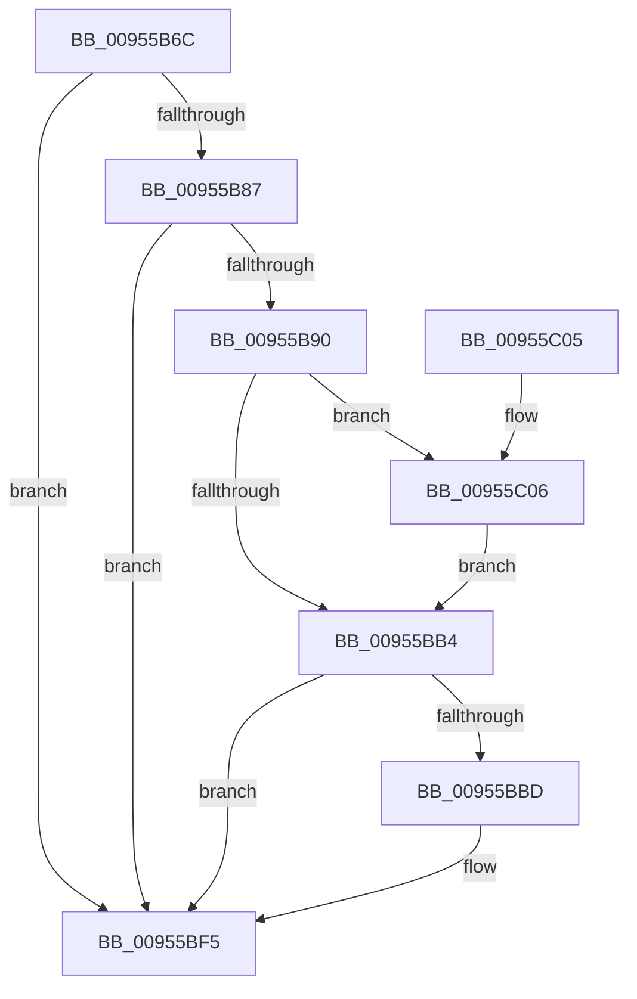

# PnpWatchdogTimerPause

- RVA: `0x00955B6C`–`0x00955C1F` (길이 `179` bytes)
- VA: `0x0000000140955B6C`
- 실행 섹션: `PAGE`
- PDB 이름 있음: `예`; PDB Function 태그: `아니요`
- unwind 정보 RVA: `0x0005DCDC`
- 디코드: `46`개 명령, `179/179` bytes 표시
- 미해석 바이트: `0` (있으면 어셈블리에 `.byte`로 보존)

> 이 문서는 커널 이미지의 기계어와 PDB 기호를 분석해 생성했습니다. 4번과 5번은 함수 원형과 자료형을 바이너리 사용 방식에서 추정한 C 해석이며 원본 소스 복구 결과는 아닙니다.

## 1. Dependencies

- 직접 호출 지점: **2**; 고유 호출 대상: **2**
- 직접 호출자로 확인된 함수: **2**
- RIP 상대 이미지 참조: **0**

### Outgoing calls
- `0x00955B9C` → [ExCancelTimer](../../text/3A/ExCancelTimer_function_003A01A0.md) (function, `0x003A01A0`)
- `0x00955C18` → [KeWaitForSingleObject](../../text/20/KeWaitForSingleObject_function_0020E6B0.md) (function, `0x0020E6B0`)

### Direct callers
- [PiUEventNotifyUserMode](PiUEventNotifyUserMode_function_00954CB4.md) at `0x00954EC5`
- [PnpDisableWatchdog](PnpDisableWatchdog_function_00955B00.md) at `0x00955B0D`

### Static image references
- 디코드된 RIP-relative 메모리 참조가 없습니다.

## 2. Other-region calls and transfers

- 다른 실행 섹션으로 향하는 call: **2**
  - `0x00955B9C` → [ExCancelTimer](../../text/3A/ExCancelTimer_function_003A01A0.md) (`PAGE` → `.text`)
  - `0x00955C18` → [KeWaitForSingleObject](../../text/20/KeWaitForSingleObject_function_0020E6B0.md) (`PAGE` → `.text`)
- 별도 외부 분기/꼬리 이동을 확인하지 못했습니다.

## 3. Assembly (complete function range)

```asm
00955B6C  48 89 5C 24 08                  mov qword ptr [rsp + 8], rbx
00955B71  48 89 74 24 10                  mov qword ptr [rsp + 0x10], rsi
00955B76  57                              push rdi
00955B77  48 83 EC 30                     sub rsp, 0x30
00955B7B  48 8B 79 78                     mov rdi, qword ptr [rcx + 0x78]
00955B7F  48 8B D9                        mov rbx, rcx
00955B82  48 85 FF                        test rdi, rdi
00955B85  74 6E                           je 0x140955bf5
00955B87  80 B9 8C 00 00 00 00            cmp byte ptr [rcx + 0x8c], 0
00955B8E  75 65                           jne 0x140955bf5
00955B90  8B B1 80 00 00 00               mov esi, dword ptr [rcx + 0x80]
00955B96  33 D2                           xor edx, edx
00955B98  48 8B 49 30                     mov rcx, qword ptr [rcx + 0x30]
00955B9C  E8 FF A5 A4 FF                  call 0x1403a01a0
00955BA1  48 83 63 78 00                  and qword ptr [rbx + 0x78], 0
00955BA6  83 A3 80 00 00 00 00            and dword ptr [rbx + 0x80], 0
00955BAD  8B 43 58                        mov eax, dword ptr [rbx + 0x58]
00955BB0  85 C0                           test eax, eax
00955BB2  7F 52                           jg 0x140955c06
00955BB4  83 BB 88 00 00 00 02            cmp dword ptr [rbx + 0x88], 2
00955BBB  7D 38                           jge 0x140955bf5
00955BBD  48 B9 08 00 00 00 80 F7 FF FF   movabs rcx, 0xfffff78000000008
00955BC7  48 B8 4B 59 86 38 D6 C5 6D 34   movabs rax, 0x346dc5d63886594b
00955BD1  48 8B 09                        mov rcx, qword ptr [rcx]
00955BD4  48 2B CF                        sub rcx, rdi
00955BD7  C6 83 8C 00 00 00 01            mov byte ptr [rbx + 0x8c], 1
00955BDE  48 F7 E1                        mul rcx
00955BE1  8B CE                           mov ecx, esi
00955BE3  48 C1 EA 0B                     shr rdx, 0xb
00955BE7  48 3B F2                        cmp rsi, rdx
00955BEA  0F 43 CA                        cmovae ecx, edx
00955BED  2B F1                           sub esi, ecx
00955BEF  89 B3 84 00 00 00               mov dword ptr [rbx + 0x84], esi
00955BF5  48 8B 5C 24 40                  mov rbx, qword ptr [rsp + 0x40]
00955BFA  48 8B 74 24 48                  mov rsi, qword ptr [rsp + 0x48]
00955BFF  48 83 C4 30                     add rsp, 0x30
00955C03  5F                              pop rdi
00955C04  C3                              ret
00955C05  CC                              int3
00955C06  48 83 64 24 20 00               and qword ptr [rsp + 0x20], 0
00955C0C  48 8D 4B 60                     lea rcx, [rbx + 0x60]
00955C10  45 33 C9                        xor r9d, r9d
00955C13  45 33 C0                        xor r8d, r8d
00955C16  33 D2                           xor edx, edx
00955C18  E8 93 8A 8B FF                  call 0x14020e6b0
00955C1D  EB 95                           jmp 0x140955bb4
```

## 4. C-style interpretation (structured pseudocode)

```c
__int64 __fastcall PnpWatchdogTimerPause(__int64 a1, int a2, int a3, int a4)
{
    __int64 result;
    __int64 v_rsi;
    __int64 v_rsp;
    unsigned __int64 v_stack_p10;
    unsigned __int64 v_stack_p20;
    unsigned __int64 v_stack_p8;

    v_stack_p8 = v_rbx;
    v_stack_p10 = v_rsi;
    v_rsp = (v_rsp) - (48);
    if (*(unsigned __int64 *)(a1 + 120) == 0) goto loc_00955BF5;
    if ((*(unsigned __int8 *)(a1 + 140)) != 0) goto loc_00955BF5;
    a2 = 0;
    result = ExCancelTimer(*(unsigned __int64 *)(a1 + 48), a2, a3, a4);
    if (condition_is_greater) goto loc_00955C06;
loc_00955BB4:
    v_rsi = (unsigned int)(*(unsigned int *)(a1 + 128));
    if ((*(unsigned int *)(a1 + 136)) < 2) {
        a1 = *(unsigned __int64 *)(*(unsigned __int64 *)(a1 + 48));
        a1 = (a1) - (*(unsigned __int64 *)(a1 + 120));
        *(unsigned __int8 *)(a1 + 140) = 1;
        a1 = (unsigned int)((unsigned int)(*(unsigned int *)(a1 + 128)));
        a2 = (a2) >> (11);
        if (((unsigned int)(*(unsigned int *)(a1 + 128))) >= a2) { a1 = a2; }
        v_rsi = (unsigned int)(((unsigned int)(*(unsigned int *)(a1 + 128))) - ((unsigned int)(a1)));
        *(unsigned int *)(a1 + 132) = (unsigned int)(v_rsi);
    }
    v_rsp = (v_rsp) + (48);
    return (unsigned int)(*(unsigned int *)(a1 + 88));
loc_00955C06:
    a4 = 0;
    a3 = 0;
    a2 = 0;
    result = KeWaitForSingleObject(v_stack_p8 + 96, a2, a3, a4);
    goto loc_00955BB4;
}
```

## 5. (Beta) C Style

```c
int64_t PnpWatchdogTimerPause(void *Arg1, int32_t Arg2, int32_t Arg3, int32_t Arg4)
{
    uint8_t *arg1 = (uint8_t *)Arg1;

    int64_t result;
    int64_t local_rsi;
    int64_t local_rsp;
    uint64_t v_stack_p10;
    uint64_t v_stack_p20;
    uint64_t v_stack_p8;

    v_stack_p8 = local_rbx;
    v_stack_p10 = local_rsi;
    local_rsp = (local_rsp) - (48);
    if (*(uint64_t *)(arg1 + 0x78) == 0) goto loc_00955BF5;
    if ((*(uint8_t *)(arg1 + 0x8C)) != 0) goto loc_00955BF5;
    Arg2 = 0;
    result = ExCancelTimer(*(uint64_t *)(arg1 + 0x30), Arg2, Arg3, Arg4);
    if (condition_is_greater) goto loc_00955C06;
loc_00955BB4:
    local_rsi = (uint32_t)(*(uint32_t *)(arg1 + 0x80));
    if ((*(uint32_t *)(arg1 + 0x88)) < 2) {
        Arg1 = *(uint64_t *)(*(uint64_t *)(arg1 + 0x30));
        Arg1 = (Arg1) - (*(uint64_t *)(arg1 + 0x78));
        *(uint8_t *)(arg1 + 0x8C) = 1;
        Arg1 = (uint32_t)((uint32_t)(*(uint32_t *)(arg1 + 0x80)));
        Arg2 = (Arg2) >> (11);
        if (((uint32_t)(*(uint32_t *)(arg1 + 0x80))) >= Arg2) { Arg1 = Arg2; }
        local_rsi = (uint32_t)(((uint32_t)(*(uint32_t *)(arg1 + 0x80))) - ((uint32_t)(Arg1)));
        *(uint32_t *)(arg1 + 0x84) = (uint32_t)(local_rsi);
    }
    local_rsp = (local_rsp) + (48);
    return (uint32_t)(*(uint32_t *)(arg1 + 0x58));
loc_00955C06:
    Arg4 = 0;
    Arg3 = 0;
    Arg2 = 0;
    result = KeWaitForSingleObject(v_stack_p8 + 96, Arg2, Arg3, Arg4);
    goto loc_00955BB4;
}
```

### 관측된 메모리 오프셋

구조체 형식이 확인되지 않은 접근은 인자 기준의 오프셋으로만 기록했습니다.

| 기준 인자 | 오프셋 표현 | 폭 (bit) | 접근 |
|---|---:|---:|---|
| `Arg1` | `+ 0x30` | `64` | `R` |
| `Arg1` | `+ 0x58` | `32` | `R` |
| `Arg1` | `+ 0x60` | `64` | `R` |
| `Arg1` | `+ 0x78` | `64` | `R` |
| `Arg1` | `+ 0x78` | `64` | `R/W` |
| `Arg1` | `+ 0x80` | `32` | `R` |
| `Arg1` | `+ 0x80` | `32` | `R/W` |
| `Arg1` | `+ 0x84` | `32` | `W` |
| `Arg1` | `+ 0x88` | `32` | `R` |
| `Arg1` | `+ 0x8C` | `8` | `R` |
| `Arg1` | `+ 0x8C` | `8` | `W` |

## 6. Execution-region graph

[열기: 2D/3D 그래프와 함수 탐색 컨트롤 패널](../../../control-panel.html?section=page&rva=0x00955B6C&view=graph)

- 2D 그래프는 위에서 아래로 흐르고, 3D 그래프는 빈 공간을 드래그해 회전합니다. Shift+드래그는 이동, 휠은 확대·축소, 함수 노드 선택은 대상 보고서 이동입니다.

### Static fallback


