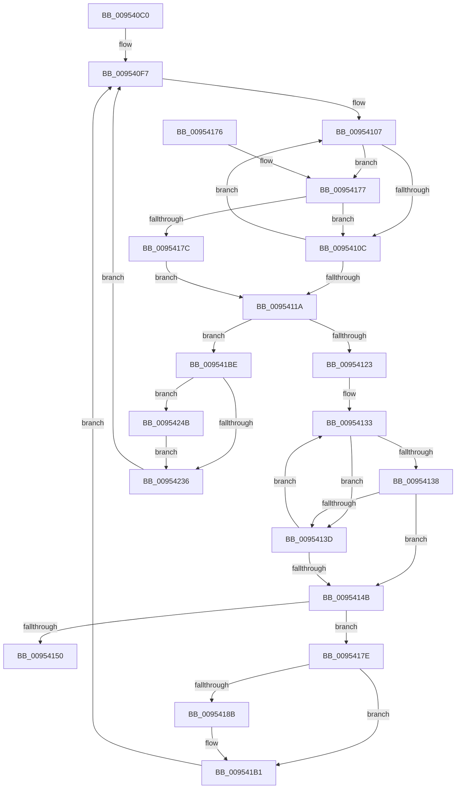

# PopWin32kActivatorWorker

- RVA: `0x009540C0`–`0x00954251` (길이 `401` bytes)
- VA: `0x00000001409540C0`
- 실행 섹션: `PAGE`
- PDB 이름 있음: `예`; PDB Function 태그: `아니요`
- unwind 정보 RVA: `0x0009216C`
- 디코드: `95`개 명령, `401/401` bytes 표시
- 미해석 바이트: `0` (있으면 어셈블리에 `.byte`로 보존)

> 이 문서는 커널 이미지의 기계어와 PDB 기호를 분석해 생성했습니다. 4번과 5번은 함수 원형과 자료형을 바이너리 사용 방식에서 추정한 C 해석이며 원본 소스 복구 결과는 아닙니다.

## 1. Dependencies

- 직접 호출 지점: **9**; 고유 호출 대상: **5**
- 직접 호출자로 확인된 함수: **0**
- RIP 상대 이미지 참조: **7**

### Outgoing calls
- `0x009540F2` → [PopAcquireRwLockExclusive](../../text/43/PopAcquireRwLockExclusive_function_00430B44.md) (function, `0x00430B44`)
- `0x00954157` → [PopOkayToQueueNextWorkItem](../../text/4A/PopOkayToQueueNextWorkItem_function_004AED54.md) (function, `0x004AED54`)
- `0x0095415F` → [PopReleaseRwLock](../../text/2D/PopReleaseRwLock_function_002DFBBC.md) (function, `0x002DFBBC`)
- `0x0095418E` → [PopReleaseRwLock](../../text/2D/PopReleaseRwLock_function_002DFBBC.md) (function, `0x002DFBBC`)
- `0x0095419B` → [Pdcv2ActivationClientDeactivate](Pdcv2ActivationClientDeactivate_function_009552E0.md) (function, `0x009552E0`)
- `0x009541AC` → [PopAcquireRwLockExclusive](../../text/43/PopAcquireRwLockExclusive_function_00430B44.md) (function, `0x00430B44`)
- `0x009541C1` → [PopReleaseRwLock](../../text/2D/PopReleaseRwLock_function_002DFBBC.md) (function, `0x002DFBBC`)
- `0x0095422D` → [Pdcv2ActivationClientActivate](Pdcv2ActivationClientActivate_function_00953C70.md) (function, `0x00953C70`)
- `0x00954239` → [PopAcquireRwLockExclusive](../../text/43/PopAcquireRwLockExclusive_function_00430B44.md) (function, `0x00430B44`)

### Direct callers
- 이 함수 시작 RVA로 연결되는 직접 call은 확인되지 않았습니다. 간접 호출은 완전히 역산할 수 없습니다.

### Static image references
- `0x009540D4` → RVA `0x00F0E840` (`.data`; read)
- `0x009540F9` → RVA `0x00F0E8D8` (`.data`; read)
- `0x00954100` → RVA `0x00F0E858` (`.data`; read)
- `0x00954150` → RVA `0x00F0E9F8` (`.data`; read)
- `0x009541C6` → RVA `0x00F0E850` (`.data`; read)
- `0x009541CD` → RVA `0x0000B2B0` (`.rdata`; read)
- `0x0095420B` → RVA `0x00B01CE0` (` ?? ::NNGAKEGL::`string'`; read)

## 2. Other-region calls and transfers

- 다른 실행 섹션으로 향하는 call: **7**
  - `0x009540F2` → [PopAcquireRwLockExclusive](../../text/43/PopAcquireRwLockExclusive_function_00430B44.md) (`PAGE` → `.text`)
  - `0x00954157` → [PopOkayToQueueNextWorkItem](../../text/4A/PopOkayToQueueNextWorkItem_function_004AED54.md) (`PAGE` → `.text`)
  - `0x0095415F` → [PopReleaseRwLock](../../text/2D/PopReleaseRwLock_function_002DFBBC.md) (`PAGE` → `.text`)
  - `0x0095418E` → [PopReleaseRwLock](../../text/2D/PopReleaseRwLock_function_002DFBBC.md) (`PAGE` → `.text`)
  - `0x009541AC` → [PopAcquireRwLockExclusive](../../text/43/PopAcquireRwLockExclusive_function_00430B44.md) (`PAGE` → `.text`)
  - `0x009541C1` → [PopReleaseRwLock](../../text/2D/PopReleaseRwLock_function_002DFBBC.md) (`PAGE` → `.text`)
  - `0x00954239` → [PopAcquireRwLockExclusive](../../text/43/PopAcquireRwLockExclusive_function_00430B44.md) (`PAGE` → `.text`)
- 별도 외부 분기/꼬리 이동을 확인하지 못했습니다.

## 3. Assembly (complete function range)

```asm
009540C0  48 8B C4                        mov rax, rsp
009540C3  48 89 58 08                     mov qword ptr [rax + 8], rbx
009540C7  48 89 68 18                     mov qword ptr [rax + 0x18], rbp
009540CB  57                              push rdi
009540CC  48 83 EC 70                     sub rsp, 0x70
009540D0  83 60 10 00                     and dword ptr [rax + 0x10], 0
009540D4  48 8D 2D 65 A7 5B 00            lea rbp, [rip + 0x5ba765]
009540DB  0F 57 C0                        xorps xmm0, xmm0
009540DE  33 C0                           xor eax, eax
009540E0  48 8B CD                        mov rcx, rbp
009540E3  48 89 44 24 60                  mov qword ptr [rsp + 0x60], rax
009540E8  0F 11 44 24 40                  movups xmmword ptr [rsp + 0x40], xmm0
009540ED  0F 11 44 24 50                  movups xmmword ptr [rsp + 0x50], xmm0
009540F2  E8 4D CA AD FF                  call 0x140430b44
009540F7  33 DB                           xor ebx, ebx
009540F9  48 8D 05 D8 A7 5B 00            lea rax, [rip + 0x5ba7d8]
00954100  48 8D 0D 51 A7 5B 00            lea rcx, [rip + 0x5ba751]
00954107  83 39 00                        cmp dword ptr [rcx], 0
0095410A  75 6B                           jne 0x140954177
0095410C  FF C3                           inc ebx
0095410E  48 83 C1 04                     add rcx, 4
00954112  48 FF C0                        inc rax
00954115  83 FB 20                        cmp ebx, 0x20
00954118  72 ED                           jb 0x140954107
0095411A  83 FB 20                        cmp ebx, 0x20
0095411D  0F 85 9B 00 00 00               jne 0x1409541be
00954123  33 C0                           xor eax, eax
00954125  48 8D 0D AC A7 5B 00            lea rcx, [rip + 0x5ba7ac]
0095412C  48 8D 15 25 A7 5B 00            lea rdx, [rip + 0x5ba725]
00954133  83 3A 00                        cmp dword ptr [rdx], 0
00954136  75 05                           jne 0x14095413d
00954138  80 39 00                        cmp byte ptr [rcx], 0
0095413B  75 0E                           jne 0x14095414b
0095413D  FF C0                           inc eax
0095413F  48 83 C2 04                     add rdx, 4
00954143  48 FF C1                        inc rcx
00954146  83 F8 20                        cmp eax, 0x20
00954149  72 E8                           jb 0x140954133
0095414B  83 F8 20                        cmp eax, 0x20
0095414E  75 2E                           jne 0x14095417e
00954150  48 8D 0D A1 A8 5B 00            lea rcx, [rip + 0x5ba8a1]
00954157  E8 F8 AB B5 FF                  call 0x1404aed54
0095415C  48 8B CD                        mov rcx, rbp
0095415F  E8 58 BA 98 FF                  call 0x1402dfbbc
00954164  4C 8D 5C 24 70                  lea r11, [rsp + 0x70]
00954169  49 8B 5B 10                     mov rbx, qword ptr [r11 + 0x10]
0095416D  49 8B 6B 20                     mov rbp, qword ptr [r11 + 0x20]
00954171  49 8B E3                        mov rsp, r11
00954174  5F                              pop rdi
00954175  C3                              ret
00954176  CC                              int3
00954177  80 38 00                        cmp byte ptr [rax], 0
0095417A  75 90                           jne 0x14095410c
0095417C  EB 9C                           jmp 0x14095411a
0095417E  48 83 BC C5 B8 00 00 00 00      cmp qword ptr [rbp + rax*8 + 0xb8], 0
00954187  8B D8                           mov ebx, eax
00954189  74 26                           je 0x1409541b1
0095418B  48 8B CD                        mov rcx, rbp
0095418E  E8 29 BA 98 FF                  call 0x1402dfbbc
00954193  48 8B 8C DD B8 00 00 00         mov rcx, qword ptr [rbp + rbx*8 + 0xb8]
0095419B  E8 40 11 00 00                  call 0x1409552e0
009541A0  48 83 A4 DD B8 00 00 00 00      and qword ptr [rbp + rbx*8 + 0xb8], 0
009541A9  48 8B CD                        mov rcx, rbp
009541AC  E8 93 C9 AD FF                  call 0x140430b44
009541B1  C6 84 2B 98 00 00 00 00         mov byte ptr [rbx + rbp + 0x98], 0
009541B9  E9 39 FF FF FF                  jmp 0x1409540f7
009541BE  48 8B CD                        mov rcx, rbp
009541C1  E8 F6 B9 98 FF                  call 0x1402dfbbc
009541C6  48 8B 0D 83 A6 5B 00            mov rcx, qword ptr [rip + 0x5ba683]
009541CD  48 8D 05 DC 70 6B FF            lea rax, [rip - 0x948f24]
009541D4  48 8B 04 D8                     mov rax, qword ptr [rax + rbx*8]
009541D8  48 8D BD B8 00 00 00            lea rdi, [rbp + 0xb8]
009541DF  48 83 64 24 48 00               and qword ptr [rsp + 0x48], 0
009541E5  48 8D 3C DF                     lea rdi, [rdi + rbx*8]
009541E9  48 89 44 24 50                  mov qword ptr [rsp + 0x50], rax
009541EE  48 8D 54 24 40                  lea rdx, [rsp + 0x40]
009541F3  48 8D 84 24 88 00 00 00         lea rax, [rsp + 0x88]
009541FB  C7 44 24 40 01 00 00 00         mov dword ptr [rsp + 0x40], 1
00954203  48 89 44 24 38                  mov qword ptr [rsp + 0x38], rax
00954208  0F 57 C0                        xorps xmm0, xmm0
0095420B  48 8D 05 CE DA 1A 00            lea rax, [rip + 0x1adace]
00954212  48 89 7C 24 30                  mov qword ptr [rsp + 0x30], rdi
00954217  4C 8B C3                        mov r8, rbx
0095421A  48 89 44 24 20                  mov qword ptr [rsp + 0x20], rax
0095421F  F3 0F 7F 44 24 58               movdqu xmmword ptr [rsp + 0x58], xmm0
00954225  C7 44 24 44 2C 01 00 00         mov dword ptr [rsp + 0x44], 0x12c
0095422D  E8 3E FA FF FF                  call 0x140953c70
00954232  85 C0                           test eax, eax
00954234  78 15                           js 0x14095424b
00954236  48 8B CD                        mov rcx, rbp
00954239  E8 06 C9 AD FF                  call 0x140430b44
0095423E  C6 84 2B 98 00 00 00 01         mov byte ptr [rbx + rbp + 0x98], 1
00954246  E9 AC FE FF FF                  jmp 0x1409540f7
0095424B  48 83 27 00                     and qword ptr [rdi], 0
0095424F  EB E5                           jmp 0x140954236
```

## 4. C-style interpretation (structured pseudocode)

```c
__int64 __fastcall PopWin32kActivatorWorker(void)
{
    __int64 result;
    __int64 v_rbx;
    __int64 v_rsp;
    unsigned __int64 v_stack_m18;
    unsigned __int64 v_stack_m20;
    unsigned __int64 v_stack_m28;
    unsigned int v_stack_m2C;
    unsigned __int64 v_stack_m30;
    unsigned __int64 v_stack_m38;
    unsigned __int64 v_stack_m40;
    unsigned __int64 v_stack_m50;
    unsigned __int64 v_stack_m8;
    unsigned __int64 v_stack_p18;

    *(unsigned __int64 *)(v_rsp + 8) = v_rbx;
    *(unsigned __int64 *)(v_rsp + 24) = v_rbp;
    v_rsp = (v_rsp) - (112);
    result = 0;
    v_stack_m18 = 0;
    v_stack_m38 = v_xmm0;
    v_stack_m28 = v_xmm0;
    result = PopAcquireRwLockExclusive(v_rip + 6006629, a2, a3, a4);
loc_009540F7:
    v_rbx = 0;
loc_00954107:
    if ((*(unsigned int *)(v_rip + 6006609)) != 0) goto loc_00954177;
loc_0095410C:
    v_rbx = (unsigned int)((v_rbx) + 1);
    a1 = (v_rip + 6006609) + (4);
    result = (v_rip + 6006744) + 1;
    if (((unsigned int)(v_rbx)) < 32) goto loc_00954107;
loc_0095411A:
    if (((unsigned int)(v_rbx)) != 32) goto loc_009541BE;
    result = 0;
loc_00954133:
    if ((*(unsigned int *)(v_rip + 6006565)) != 0) goto loc_0095413D;
    if ((*(unsigned __int8 *)(v_rip + 6006700)) != 0) goto loc_0095414B;
loc_0095413D:
    result = (unsigned int)((result) + 1);
    a2 = (v_rip + 6006565) + (4);
    a1 = (v_rip + 6006700) + 1;
    if (((unsigned int)(result)) < 32) goto loc_00954133;
loc_0095414B:
    if (((unsigned int)(result)) != 32) goto loc_0095417E;
    result = PopOkayToQueueNextWorkItem(v_rip + 6006945, a2, a3, a4);
    result = PopReleaseRwLock(v_rip + 6006629, a2, a3, a4);
    return result;
loc_00954177:
    if ((*(unsigned __int8 *)(result)) != 0) goto loc_0095410C;
    goto loc_0095411A;
loc_0095417E:
    if ((*(unsigned __int64 *)(*(unsigned __int64 *)(v_stack_m8 + 32) + result * 8 + 184)) != 0) {
        a1 = *(unsigned __int64 *)(v_stack_m8 + 32);
        result = PopReleaseRwLock(a1, a2, a3, a4);
        a1 = *(unsigned __int64 *)(*(unsigned __int64 *)(v_stack_m8 + 32) + (unsigned int)((unsigned int)(result)) * 8 + 184);
        result = Pdcv2ActivationClientDeactivate(a1, a2, a3, a4);
        a1 = *(unsigned __int64 *)(v_stack_m8 + 32);
        result = PopAcquireRwLockExclusive(a1, a2, a3, a4);
    }
    *(unsigned __int8 *)((unsigned int)((unsigned int)(result)) + *(unsigned __int64 *)(v_stack_m8 + 32) * 1 + 152) = 0;
    goto loc_009540F7;
loc_009541BE:
    result = PopReleaseRwLock(*(unsigned __int64 *)(v_stack_m8 + 32), a2, a3, a4);
    v_stack_m20 = *(unsigned __int64 *)(v_rip - 9735972 + (unsigned int)((unsigned int)(result)) * 8);
    v_stack_m30 = 1;
    v_stack_m38 = v_stack_p18;
    v_stack_m40 = *(unsigned __int64 *)(v_stack_m8 + 32) + 184 + (unsigned int)((unsigned int)(result)) * 8;
    v_stack_m50 = v_rip + 1759950;
    v_stack_m18 = v_xmm0;
    v_stack_m2C = 300;
    result = Pdcv2ActivationClientActivate(*(unsigned __int64 *)(v_rip + 6006403), v_stack_m30, (unsigned int)((unsigned int)(result)), a4);
    if (sign_flag) goto loc_0095424B;
loc_00954236:
    result = PopAcquireRwLockExclusive(*(unsigned __int64 *)(v_stack_m8 + 32), v_stack_m30, (unsigned int)((unsigned int)(result)), a4);
    *(unsigned __int8 *)((unsigned int)((unsigned int)(result)) + *(unsigned __int64 *)(v_stack_m8 + 32) * 1 + 152) = 1;
    goto loc_009540F7;
loc_0095424B:
    goto loc_00954236;
}
```

## 5. (Beta) C Style

```c
void PopWin32kActivatorWorker(void)
{
    int64_t result;
    int64_t local_rbx;
    int64_t local_rsp;
    uint64_t v_stack_m18;
    uint64_t v_stack_m20;
    uint64_t v_stack_m28;
    uint32_t v_stack_m2C;
    uint64_t v_stack_m30;
    uint64_t v_stack_m38;
    uint64_t v_stack_m40;
    uint64_t v_stack_m50;
    uint64_t v_stack_m8;
    uint64_t v_stack_p18;

    *(uint64_t *)(local_rsp + 0x8) = local_rbx;
    *(uint64_t *)(local_rsp + 0x18) = local_rbp;
    local_rsp = (local_rsp) - (112);
    result = 0;
    v_stack_m18 = 0;
    v_stack_m38 = v_xmm0;
    v_stack_m28 = v_xmm0;
    result = PopAcquireRwLockExclusive(v_rip + 6006629, a2, a3, a4);
loc_009540F7:
    local_rbx = 0;
loc_00954107:
    if ((*(uint32_t *)(v_rip + 0x5BA751)) != 0) goto loc_00954177;
loc_0095410C:
    local_rbx = (uint32_t)((local_rbx) + 1);
    a1 = (v_rip + 6006609) + (4);
    result = (v_rip + 6006744) + 1;
    if (((uint32_t)(local_rbx)) < 32) goto loc_00954107;
loc_0095411A:
    if (((uint32_t)(local_rbx)) != 32) goto loc_009541BE;
    result = 0;
loc_00954133:
    if ((*(uint32_t *)(v_rip + 0x5BA725)) != 0) goto loc_0095413D;
    if ((*(uint8_t *)(v_rip + 0x5BA7AC)) != 0) goto loc_0095414B;
loc_0095413D:
    result = (uint32_t)((result) + 1);
    a2 = (v_rip + 6006565) + (4);
    a1 = (v_rip + 6006700) + 1;
    if (((uint32_t)(result)) < 32) goto loc_00954133;
loc_0095414B:
    if (((uint32_t)(result)) != 32) goto loc_0095417E;
    result = PopOkayToQueueNextWorkItem(v_rip + 6006945, a2, a3, a4);
    result = PopReleaseRwLock(v_rip + 6006629, a2, a3, a4);
    return result;
loc_00954177:
    if ((*(uint8_t *)(result)) != 0) goto loc_0095410C;
    goto loc_0095411A;
loc_0095417E:
    if ((*(uint64_t *)(*(uint64_t *)(v_stack_m8 + 0x20) + result * 8 + 0xB8)) != 0) {
        a1 = *(uint64_t *)(v_stack_m8 + 0x20);
        result = PopReleaseRwLock(a1, a2, a3, a4);
        a1 = *(uint64_t *)(*(uint64_t *)(v_stack_m8 + 0x20) + (uint32_t)((uint32_t)(result)) * 8 + 0xB8);
        result = Pdcv2ActivationClientDeactivate(a1, a2, a3, a4);
        a1 = *(uint64_t *)(v_stack_m8 + 0x20);
        result = PopAcquireRwLockExclusive(a1, a2, a3, a4);
    }
    *(uint8_t *)((uint32_t)((uint32_t)(result)) + *(uint64_t *)(v_stack_m8 + 0x20) * 1 + 0x98) = 0;
    goto loc_009540F7;
loc_009541BE:
    result = PopReleaseRwLock(*(uint64_t *)(v_stack_m8 + 0x20), a2, a3, a4);
    v_stack_m20 = *(uint64_t *)(v_rip - 0x948F24 + (uint32_t)((uint32_t)(result)) * 8);
    v_stack_m30 = 1;
    v_stack_m38 = v_stack_p18;
    v_stack_m40 = *(uint64_t *)(v_stack_m8 + 0x20) + 184 + (uint32_t)((uint32_t)(result)) * 8;
    v_stack_m50 = v_rip + 1759950;
    v_stack_m18 = v_xmm0;
    v_stack_m2C = 300;
    result = Pdcv2ActivationClientActivate(*(uint64_t *)(v_rip + 0x5BA683), v_stack_m30, (uint32_t)((uint32_t)(result)), a4);
    if (sign_flag) goto loc_0095424B;
loc_00954236:
    result = PopAcquireRwLockExclusive(*(uint64_t *)(v_stack_m8 + 0x20), v_stack_m30, (uint32_t)((uint32_t)(result)), a4);
    *(uint8_t *)((uint32_t)((uint32_t)(result)) + *(uint64_t *)(v_stack_m8 + 0x20) * 1 + 0x98) = 1;
    goto loc_009540F7;
loc_0095424B:
    goto loc_00954236;
}
```

## 6. Execution-region graph

[열기: 2D/3D 그래프와 함수 탐색 컨트롤 패널](../../../control-panel.html?section=page&rva=0x009540C0&view=graph)

- 2D 그래프는 위에서 아래로 흐르고, 3D 그래프는 빈 공간을 드래그해 회전합니다. Shift+드래그는 이동, 휠은 확대·축소, 함수 노드 선택은 대상 보고서 이동입니다.

### Static fallback


