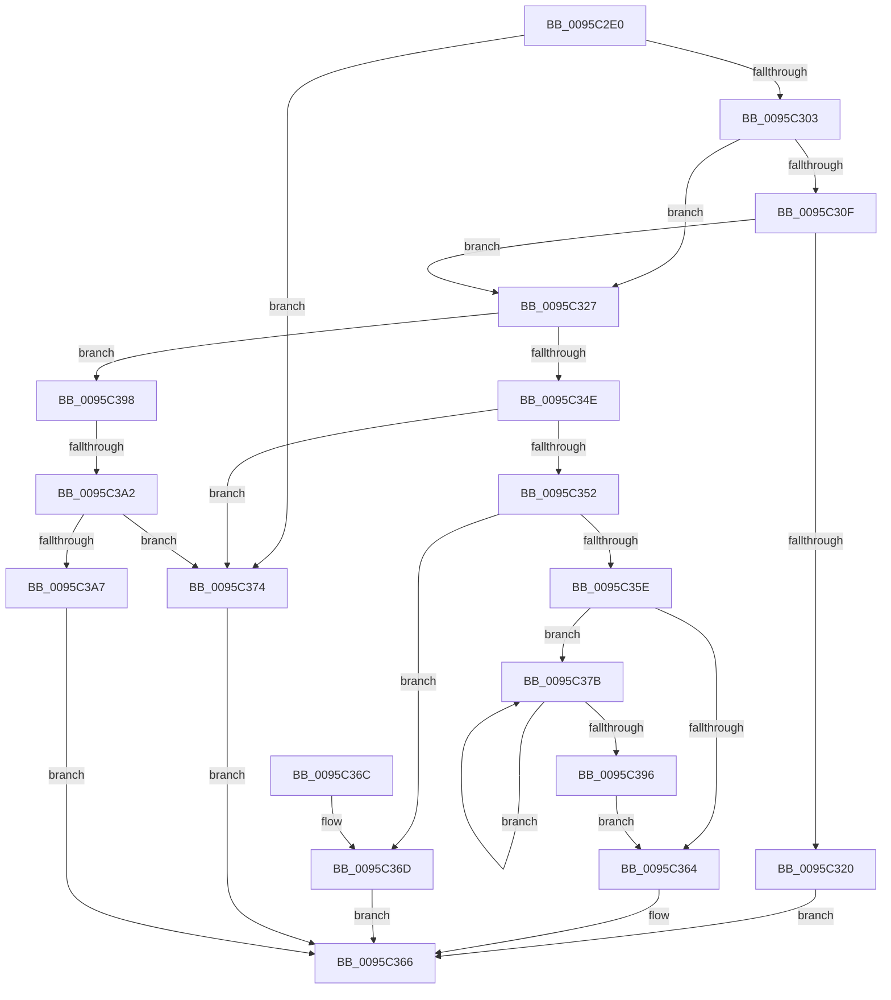

# RtlRunOnceComplete

- RVA: `0x0095C2E0`–`0x0095C3BE` (길이 `222` bytes)
- VA: `0x000000014095C2E0`
- 실행 섹션: `PAGE`
- PDB 이름 있음: `예`; PDB Function 태그: `예`
- unwind 정보 RVA: `0x00092CC0`
- 디코드: `73`개 명령, `222/222` bytes 표시
- 미해석 바이트: `0` (있으면 어셈블리에 `.byte`로 보존)

> 이 문서는 커널 이미지의 기계어와 PDB 기호를 분석해 생성했습니다. 4번과 5번은 함수 원형과 자료형을 바이너리 사용 방식에서 추정한 C 해석이며 원본 소스 복구 결과는 아닙니다.

## 1. Dependencies

- 직접 호출 지점: **1**; 고유 호출 대상: **1**
- 직접 호출자로 확인된 함수: **1**
- RIP 상대 이미지 참조: **0**

### Outgoing calls
- `0x0095C389` → [KeAlertThreadByThreadId](../../text/4C/KeAlertThreadByThreadId_function_004C3900.md) (function, `0x004C3900`)

### Direct callers
- [RtlRunOnceExecuteOnce](RtlRunOnceExecuteOnce_function_0095DC00.md) at `0x0095DCBE`
- [RtlRunOnceExecuteOnce](RtlRunOnceExecuteOnce_function_0095DC00.md) at `0x0095DCEC`

### Static image references
- 디코드된 RIP-relative 메모리 참조가 없습니다.

## 2. Other-region calls and transfers

- 다른 실행 섹션으로 향하는 call: **1**
  - `0x0095C389` → [KeAlertThreadByThreadId](../../text/4C/KeAlertThreadByThreadId_function_004C3900.md) (`PAGE` → `.text`)
- call이 아닌 외부 분기/꼬리 이동: **1**
  - `0x0095C39C` → [sub_00B27A8A](../B2/Unknown_function_00B27A8A.md) (`tail-transfer`)

## 3. Assembly (complete function range)

```asm
0095C2E0  40 53                           push rbx
0095C2E2  48 83 EC 20                     sub rsp, 0x20
0095C2E6  8D 42 FF                        lea eax, [rdx - 1]
0095C2E9  4D 8B D8                        mov r11, r8
0095C2EC  85 C2                           test edx, eax
0095C2EE  4C 8B D1                        mov r10, rcx
0095C2F1  41 0F 94 C1                     sete r9b
0095C2F5  F7 C2 F9 FF FF FF               test edx, 0xfffffff9
0095C2FB  0F 94 C0                        sete al
0095C2FE  44 84 C8                        test al, r9b
0095C301  74 71                           je 0x14095c374
0095C303  D1 EA                           shr edx, 1
0095C305  F7 D2                           not edx
0095C307  83 E2 03                        and edx, 3
0095C30A  4D 85 C0                        test r8, r8
0095C30D  74 18                           je 0x14095c327
0095C30F  41 F6 C3 03                     test r11b, 3
0095C313  0F 94 C1                        sete cl
0095C316  F6 C2 02                        test dl, 2
0095C319  0F 95 C0                        setne al
0095C31C  84 C8                           test al, cl
0095C31E  75 07                           jne 0x14095c327
0095C320  B8 F1 00 00 C0                  mov eax, 0xc00000f1
0095C325  EB 3F                           jmp 0x14095c366
0095C327  41 0F 0D 0A                     prefetchw byte ptr [r10]
0095C32B  49 8B 0A                        mov rcx, qword ptr [r10]
0095C32E  83 FA 02                        cmp edx, 2
0095C331  48 8B C1                        mov rax, rcx
0095C334  4D 1B C0                        sbb r8, r8
0095C337  49 83 E3 FC                     and r11, 0xfffffffffffffffc
0095C33B  49 F7 D0                        not r8
0095C33E  83 E0 03                        and eax, 3
0095C341  41 83 E0 02                     and r8d, 2
0095C345  4D 0B C3                        or r8, r11
0095C348  48 83 F8 01                     cmp rax, 1
0095C34C  75 4A                           jne 0x14095c398
0095C34E  84 D0                           test al, dl
0095C350  74 22                           je 0x14095c374
0095C352  4D 87 02                        xchg qword ptr [r10], r8
0095C355  41 8A C0                        mov al, r8b
0095C358  24 03                           and al, 3
0095C35A  3C 01                           cmp al, 1
0095C35C  75 0F                           jne 0x14095c36d
0095C35E  49 83 E0 FC                     and r8, 0xfffffffffffffffc
0095C362  75 17                           jne 0x14095c37b
0095C364  33 C0                           xor eax, eax
0095C366  48 83 C4 20                     add rsp, 0x20
0095C36A  5B                              pop rbx
0095C36B  C3                              ret
0095C36C  CC                              int3
0095C36D  B8 5A 00 00 C0                  mov eax, 0xc000005a
0095C372  EB F2                           jmp 0x14095c366
0095C374  B8 F0 00 00 C0                  mov eax, 0xc00000f0
0095C379  EB EB                           jmp 0x14095c366
0095C37B  49 8B 18                        mov rbx, qword ptr [r8]
0095C37E  49 8B 48 18                     mov rcx, qword ptr [r8 + 0x18]
0095C382  F0 41 0F BA 68 24 02            lock bts dword ptr [r8 + 0x24], 2
0095C389  E8 72 75 B6 FF                  call 0x1404c3900
0095C38E  4C 8B C3                        mov r8, rbx
0095C391  48 85 DB                        test rbx, rbx
0095C394  75 E5                           jne 0x14095c37b
0095C396  EB CC                           jmp 0x14095c364
0095C398  48 83 F8 03                     cmp rax, 3
0095C39C  0F 85 E8 B6 1C 00               jne 0x140b27a8a
0095C3A2  F6 C2 01                        test dl, 1
0095C3A5  75 CD                           jne 0x14095c374
0095C3A7  48 8B C1                        mov rax, rcx
0095C3AA  F0 4D 0F B1 02                  lock cmpxchg qword ptr [r10], r8
0095C3AF  48 2B C1                        sub rax, rcx
0095C3B2  48 F7 D8                        neg rax
0095C3B5  1B C0                           sbb eax, eax
0095C3B7  25 35 00 00 C0                  and eax, 0xc0000035
0095C3BC  EB A8                           jmp 0x14095c366
```

## 4. C-style interpretation (structured pseudocode)

```c
__int64 __fastcall RtlRunOnceComplete(__int64 a1, __int64 a2, __int64 a3)
{
    __int64 result;
    __int64 v_r11;
    __int64 v_rsp;

    v_rsp = (v_rsp) - (32);
    a4 = ((((unsigned int)(a2)) & ((unsigned int)(a2 - 1))) == 0) ? 1 : 0;
    result = ((((unsigned int)(a2)) & (0xFFFFFFF9ULL)) == 0) ? 1 : 0;
    if ((((unsigned __int8)(result)) & ((unsigned __int8)(a4))) == 0) goto loc_0095C374;
    a2 = (unsigned int)((a2) >> (1));
    a2 = (unsigned int)(~(a2));
    a2 = (unsigned int)((a2) & (3));
    if (a3 == 0) goto loc_0095C327;
    a1 = ((((unsigned __int8)(a3)) & (3)) == 0) ? 1 : 0;
    result = ((((unsigned __int8)(a2)) & (2)) != 0) ? 1 : 0;
    if ((((unsigned __int8)(result)) & ((unsigned __int8)(a1))) != 0) goto loc_0095C327;
    goto loc_0095C366;
loc_0095C327:
    v_r11 = (a3) & (-4);
    a3 = ~(a3);
    result = (unsigned int)((*(unsigned __int64 *)(a1)) & (3));
    a3 = (unsigned int)((a3) & (2));
    a3 = (a3) | (v_r11);
    if (result != 1) goto loc_0095C398;
    if ((((unsigned __int8)(result)) & ((unsigned __int8)(a2))) == 0) goto loc_0095C374;
    result = (unsigned __int8)(((unsigned __int8)(a3)) & (3));
    if (((unsigned __int8)(result)) != 1) goto loc_0095C36D;
    a3 = (a3) & (-4);
    if (condition_is_not_equal) goto loc_0095C37B;
loc_0095C364:
    result = 0;
loc_0095C366:
    v_rsp = (v_rsp) + (32);
    return result;
loc_0095C36D:
    goto loc_0095C366;
loc_0095C374:
    goto loc_0095C366;
loc_0095C37B:
    result = KeAlertThreadByThreadId(*(unsigned __int64 *)(a3 + 24), a2, a3, a4);
    if (*(unsigned __int64 *)(a3) != 0) goto loc_0095C37B;
    goto loc_0095C364;
loc_0095C398:
    if ((((unsigned __int8)(a2)) & (1)) != 0) goto loc_0095C374;
    result = (*(unsigned __int64 *)(a3 + 24)) - (*(unsigned __int64 *)(a3 + 24));
    result = -(result);
    result = (unsigned int)((result) & (0xC0000035ULL));
    goto loc_0095C366;
}
```

## 5. (Beta) C Style

```c
int64_t RtlRunOnceComplete(void *Arg1, void *Arg2, int64_t Arg3)
{
    uint8_t *arg1 = (uint8_t *)Arg1;
    uint8_t *arg2 = (uint8_t *)Arg2;

    int64_t result;
    int64_t local_r11;
    int64_t local_rsp;

    local_rsp = (local_rsp) - (32);
    a4 = ((((uint32_t)(Arg2)) & ((uint32_t)(Arg2 - 1))) == 0) ? 1 : 0;
    result = ((((uint32_t)(Arg2)) & (0xFFFFFFF9ULL)) == 0) ? 1 : 0;
    if ((((uint8_t)(result)) & ((uint8_t)(a4))) == 0) goto loc_0095C374;
    Arg2 = (uint32_t)((Arg2) >> (1));
    Arg2 = (uint32_t)(~(Arg2));
    Arg2 = (uint32_t)((Arg2) & (3));
    if (Arg3 == 0) goto loc_0095C327;
    Arg1 = ((((uint8_t)(Arg3)) & (3)) == 0) ? 1 : 0;
    result = ((((uint8_t)(Arg2)) & (2)) != 0) ? 1 : 0;
    if ((((uint8_t)(result)) & ((uint8_t)(Arg1))) != 0) goto loc_0095C327;
    goto loc_0095C366;
loc_0095C327:
    local_r11 = (Arg3) & (-4);
    Arg3 = ~(Arg3);
    result = (uint32_t)((*(uint64_t *)(arg1)) & (3));
    Arg3 = (uint32_t)((Arg3) & (2));
    Arg3 = (Arg3) | (local_r11);
    if (result != 1) goto loc_0095C398;
    if ((((uint8_t)(result)) & ((uint8_t)(Arg2))) == 0) goto loc_0095C374;
    result = (uint8_t)(((uint8_t)(Arg3)) & (3));
    if (((uint8_t)(result)) != 1) goto loc_0095C36D;
    Arg3 = (Arg3) & (-4);
    if (condition_is_not_equal) goto loc_0095C37B;
loc_0095C364:
    result = 0;
loc_0095C366:
    local_rsp = (local_rsp) + (32);
    return result;
loc_0095C36D:
    goto loc_0095C366;
loc_0095C374:
    goto loc_0095C366;
loc_0095C37B:
    result = KeAlertThreadByThreadId(*(uint64_t *)(Arg3 + 0x18), Arg2, Arg3, a4);
    if (*(uint64_t *)(Arg3) != 0) goto loc_0095C37B;
    goto loc_0095C364;
loc_0095C398:
    if ((((uint8_t)(Arg2)) & (1)) != 0) goto loc_0095C374;
    result = (*(uint64_t *)(Arg3 + 0x18)) - (*(uint64_t *)(Arg3 + 0x18));
    result = -(result);
    result = (uint32_t)((result) & (0xC0000035ULL));
    goto loc_0095C366;
}
```

### 관측된 메모리 오프셋

구조체 형식이 확인되지 않은 접근은 인자 기준의 오프셋으로만 기록했습니다.

| 기준 인자 | 오프셋 표현 | 폭 (bit) | 접근 |
|---|---:|---:|---|
| `Arg1` | `+ 0x0` | `8` | `R` |
| `Arg1` | `+ 0x0` | `64` | `R` |
| `Arg1` | `+ 0x0` | `64` | `R/W` |
| `Arg2` | `- 0x1` | `32` | `R` |

## 6. Execution-region graph

[열기: 2D/3D 그래프와 함수 탐색 컨트롤 패널](../../../control-panel.html?section=page&rva=0x0095C2E0&view=graph)

- 2D 그래프는 위에서 아래로 흐르고, 3D 그래프는 빈 공간을 드래그해 회전합니다. Shift+드래그는 이동, 휠은 확대·축소, 함수 노드 선택은 대상 보고서 이동입니다.

### Static fallback


