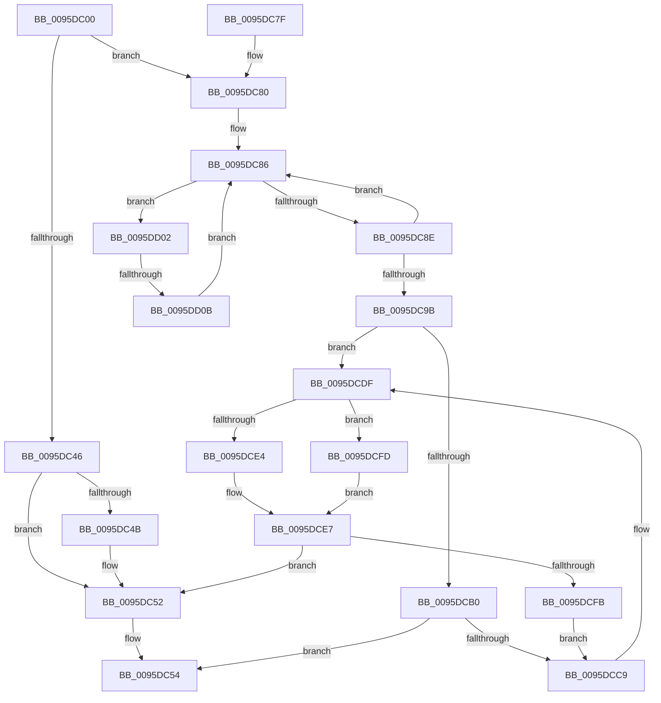

# RtlRunOnceExecuteOnce

- RVA: `0x0095DC00`–`0x0095DD1B` (길이 `283` bytes)
- VA: `0x000000014095DC00`
- 실행 섹션: `PAGE`
- PDB 이름 있음: `예`; PDB Function 태그: `예`
- unwind 정보 RVA: `0x00092E28`
- 디코드: `81`개 명령, `283/283` bytes 표시
- 미해석 바이트: `0` (있으면 어셈블리에 `.byte`로 보존)

> 이 문서는 커널 이미지의 기계어와 PDB 기호를 분석해 생성했습니다. 4번과 5번은 함수 원형과 자료형을 바이너리 사용 방식에서 추정한 C 해석이며 원본 소스 복구 결과는 아닙니다.

## 1. Dependencies

- 직접 호출 지점: **7**; 고유 호출 대상: **5**
- 직접 호출자로 확인된 함수: **10**
- RIP 상대 이미지 참조: **0**

### Outgoing calls
- `0x0095DC5D` → [KeLeaveCriticalRegionThread](../../text/25/KeLeaveCriticalRegionThread_function_0025EFF0.md) (function, `0x0025EFF0`)
- `0x0095DCA7` → [guard_dispatch_icall](../../text/6B/guard_dispatch_icall_function_006BAAD0.md) (function, `0x006BAAD0`)
- `0x0095DCBE` → [RtlRunOnceComplete](RtlRunOnceComplete_function_0095C2E0.md) (function, `0x0095C2E0`)
- `0x0095DCD2` → [KeLeaveCriticalRegionThread](../../text/25/KeLeaveCriticalRegionThread_function_0025EFF0.md) (function, `0x0025EFF0`)
- `0x0095DCD9` → [RtlRaiseStatus](../../text/2F/RtlRaiseStatus_function_002F6A50.md) (function, `0x002F6A50`)
- `0x0095DCEC` → [RtlRunOnceComplete](RtlRunOnceComplete_function_0095C2E0.md) (function, `0x0095C2E0`)
- `0x0095DD11` → [RtlpRunOnceWaitForInit](../79/RtlpRunOnceWaitForInit_function_00794AF8.md) (function, `0x00794AF8`)

### Direct callers
- [RtlpHpMetadataAlloc](../../text/2E/RtlpHpMetadataAlloc_function_002EC180.md) at `0x002EC44B`
- [LdrpInitMuiCrits](../../text/45/LdrpInitMuiCrits_function_00455B80.md) at `0x00455BAB`
- [ExPoolSetLimit](../../text/65/ExPoolSetLimit_function_00656498.md) at `0x00656500`
- [ExQueryBootEntropyInformation](../70/ExQueryBootEntropyInformation_function_00702E20.md) at `0x00702E3F`
- [ExpCheckTestsigningEnabled](../70/ExpCheckTestsigningEnabled_function_00704864.md) at `0x0070487C`
- [SdbGetIndex](SdbGetIndex_function_0095C3C4.md) at `0x0095C409`
- [ExCheckFullProcessInformationAccess](ExCheckFullProcessInformationAccess_function_0095D93C.md) at `0x0095D97A`
- [SdbpGetStringTableItemFromStringRef](SdbpGetStringTableItemFromStringRef_function_0095DA74.md) at `0x0095DAC5`
- [RtlpLogCapabilityCheckLatency](../A9/RtlpLogCapabilityCheckLatency_function_00A9D678.md) at `0x00A9D6C5`
- [ExpFirmwareAccessAppContainerCheck](../AB/ExpFirmwareAccessAppContainerCheck_function_00AB7AFC.md) at `0x00AB7C7C`

### Static image references
- 디코드된 RIP-relative 메모리 참조가 없습니다.

## 2. Other-region calls and transfers

- 다른 실행 섹션으로 향하는 call: **4**
  - `0x0095DC5D` → [KeLeaveCriticalRegionThread](../../text/25/KeLeaveCriticalRegionThread_function_0025EFF0.md) (`PAGE` → `.text`)
  - `0x0095DCA7` → [guard_dispatch_icall](../../text/6B/guard_dispatch_icall_function_006BAAD0.md) (`PAGE` → `.text`)
  - `0x0095DCD2` → [KeLeaveCriticalRegionThread](../../text/25/KeLeaveCriticalRegionThread_function_0025EFF0.md) (`PAGE` → `.text`)
  - `0x0095DCD9` → [RtlRaiseStatus](../../text/2F/RtlRaiseStatus_function_002F6A50.md) (`PAGE` → `.text`)
- call이 아닌 외부 분기/꼬리 이동: **1**
  - `0x0095DD05` → [sub_00B27B72](../B2/Unknown_function_00B27B72.md) (`tail-transfer`)

## 3. Assembly (complete function range)

```asm
0095DC00  48 8B C4                        mov rax, rsp
0095DC03  48 89 58 08                     mov qword ptr [rax + 8], rbx
0095DC07  48 89 68 10                     mov qword ptr [rax + 0x10], rbp
0095DC0B  48 89 70 18                     mov qword ptr [rax + 0x18], rsi
0095DC0F  48 89 78 20                     mov qword ptr [rax + 0x20], rdi
0095DC13  41 56                           push r14
0095DC15  48 83 EC 20                     sub rsp, 0x20
0095DC19  65 48 8B 04 25 88 01 00 00      mov rax, qword ptr gs:[0x188]
0095DC22  49 8B D9                        mov rbx, r9
0095DC25  49 8B F0                        mov rsi, r8
0095DC28  48 8B EA                        mov rbp, rdx
0095DC2B  48 8B F9                        mov rdi, rcx
0095DC2E  66 FF 88 E4 01 00 00            dec word ptr [rax + 0x1e4]
0095DC35  90                              nop
0095DC36  48 8B 01                        mov rax, qword ptr [rcx]
0095DC39  44 8A D0                        mov r10b, al
0095DC3C  41 80 E2 03                     and r10b, 3
0095DC40  41 80 FA 02                     cmp r10b, 2
0095DC44  75 3A                           jne 0x14095dc80
0095DC46  48 85 DB                        test rbx, rbx
0095DC49  74 07                           je 0x14095dc52
0095DC4B  48 83 E0 FC                     and rax, 0xfffffffffffffffc
0095DC4F  48 89 03                        mov qword ptr [rbx], rax
0095DC52  33 DB                           xor ebx, ebx
0095DC54  65 48 8B 0C 25 88 01 00 00      mov rcx, qword ptr gs:[0x188]
0095DC5D  E8 8E 13 90 FF                  call 0x14025eff0
0095DC62  48 8B 6C 24 38                  mov rbp, qword ptr [rsp + 0x38]
0095DC67  8B C3                           mov eax, ebx
0095DC69  48 8B 5C 24 30                  mov rbx, qword ptr [rsp + 0x30]
0095DC6E  48 8B 74 24 40                  mov rsi, qword ptr [rsp + 0x40]
0095DC73  48 8B 7C 24 48                  mov rdi, qword ptr [rsp + 0x48]
0095DC78  48 83 C4 20                     add rsp, 0x20
0095DC7C  41 5E                           pop r14
0095DC7E  C3                              ret
0095DC7F  CC                              int3
0095DC80  41 BE 01 00 00 00               mov r14d, 1
0095DC86  48 8B C8                        mov rcx, rax
0095DC89  83 E1 03                        and ecx, 3
0095DC8C  75 74                           jne 0x14095dd02
0095DC8E  48 8B C8                        mov rcx, rax
0095DC91  F0 4C 0F B1 37                  lock cmpxchg qword ptr [rdi], r14
0095DC96  48 3B C1                        cmp rax, rcx
0095DC99  75 EB                           jne 0x14095dc86
0095DC9B  4C 8B C3                        mov r8, rbx
0095DC9E  48 8B D6                        mov rdx, rsi
0095DCA1  48 8B CF                        mov rcx, rdi
0095DCA4  48 8B C5                        mov rax, rbp
0095DCA7  E8 24 CE D5 FF                  call 0x1406baad0
0095DCAC  85 C0                           test eax, eax
0095DCAE  75 2F                           jne 0x14095dcdf
0095DCB0  45 33 C0                        xor r8d, r8d
0095DCB3  8D 50 04                        lea edx, [rax + 4]
0095DCB6  48 8B CF                        mov rcx, rdi
0095DCB9  BB 01 00 00 C0                  mov ebx, 0xc0000001
0095DCBE  E8 1D E6 FF FF                  call 0x14095c2e0
0095DCC3  8B F8                           mov edi, eax
0095DCC5  85 C0                           test eax, eax
0095DCC7  79 8B                           jns 0x14095dc54
0095DCC9  65 48 8B 0C 25 88 01 00 00      mov rcx, qword ptr gs:[0x188]
0095DCD2  E8 19 13 90 FF                  call 0x14025eff0
0095DCD7  8B CF                           mov ecx, edi
0095DCD9  E8 72 8D 99 FF                  call 0x1402f6a50
0095DCDE  CC                              int3
0095DCDF  48 85 DB                        test rbx, rbx
0095DCE2  75 19                           jne 0x14095dcfd
0095DCE4  45 33 C0                        xor r8d, r8d
0095DCE7  33 D2                           xor edx, edx
0095DCE9  48 8B CF                        mov rcx, rdi
0095DCEC  E8 EF E5 FF FF                  call 0x14095c2e0
0095DCF1  8B F8                           mov edi, eax
0095DCF3  85 C0                           test eax, eax
0095DCF5  0F 89 57 FF FF FF               jns 0x14095dc52
0095DCFB  EB CC                           jmp 0x14095dcc9
0095DCFD  4C 8B 03                        mov r8, qword ptr [rbx]
0095DD00  EB E5                           jmp 0x14095dce7
0095DD02  49 3B CE                        cmp rcx, r14
0095DD05  0F 85 67 9E 1C 00               jne 0x140b27b72
0095DD0B  48 8B D7                        mov rdx, rdi
0095DD0E  48 8B C8                        mov rcx, rax
0095DD11  E8 E2 6D E3 FF                  call 0x140794af8
0095DD16  E9 6B FF FF FF                  jmp 0x14095dc86
```

## 4. C-style interpretation (structured pseudocode)

```c
__int64 __fastcall RtlRunOnceExecuteOnce(__int64 a1, __int64 a2, __int64 a3, __int64 a4)
{
    __int64 result;
    __int64 v_r10;
    __int64 v_rbx;
    __int64 v_rsp;
    unsigned __int64 v_stack_p10;
    unsigned __int64 v_stack_p18;
    unsigned __int64 v_stack_p20;
    unsigned __int64 v_stack_p8;

    *(unsigned __int64 *)(v_rsp + 8) = v_rbx;
    *(unsigned __int64 *)(v_rsp + 16) = v_rbp;
    *(unsigned __int64 *)(v_rsp + 24) = v_rsi;
    *(unsigned __int64 *)(v_rsp + 32) = v_rdi;
    v_rsp = (v_rsp) - (32);
    v_r10 = (unsigned __int8)(((unsigned __int8)(*(unsigned __int64 *)(a1))) & (3));
    if (((unsigned __int8)(v_r10)) != 2) goto loc_0095DC80;
    result = *(unsigned __int64 *)(a1);
    if (a4 != 0) {
        result = (*(unsigned __int64 *)(a1)) & (-4);
        *(unsigned __int64 *)(a4) = result;
    }
    v_rbx = 0;
loc_0095DC54:
    result = KeLeaveCriticalRegionThread(*(unsigned __int64 *)(gs_base + (0 + 392)), a2, a3, a4);
    v_rsp = (v_rsp) + (32);
    return 0;
loc_0095DC80:
loc_0095DC86:
    a1 = (unsigned int)((0) & (3));
    if (condition_is_not_equal) goto loc_0095DD02;
    if (0 != 0) goto loc_0095DC86;
    result = guard_dispatch_icall(v_stack_p20, v_stack_p18, v_stack_p8, a4);
    if ((unsigned int)(result) != 0) goto loc_0095DCDF;
    a3 = 0;
    result = RtlRunOnceComplete(v_stack_p20, result + 4, a3, a4);
    if (!sign_flag) goto loc_0095DC54;
loc_0095DCC9:
    result = KeLeaveCriticalRegionThread(*(unsigned __int64 *)(gs_base + (0 + 392)), result + 4, a3, a4);
    result = RtlRaiseStatus((unsigned int)((unsigned int)((unsigned int)((unsigned int)(result)))), result + 4, a3, a4);
loc_0095DCDF:
    if ((unsigned int)(0xC0000001ULL) != 0) goto loc_0095DCFD;
    a3 = 0;
loc_0095DCE7:
    a2 = 0;
    result = RtlRunOnceComplete((unsigned int)((unsigned int)(result)), a2, a3, a4);
    if (!sign_flag) goto loc_0095DC52;
    goto loc_0095DCC9;
loc_0095DCFD:
    goto loc_0095DCE7;
loc_0095DD02:
    result = RtlpRunOnceWaitForInit(result, (unsigned int)((unsigned int)(result)), *(unsigned __int64 *)((unsigned int)(0xC0000001ULL)), a4);
    goto loc_0095DC86;
}
```

## 5. (Beta) C Style

```c
int64_t RtlRunOnceExecuteOnce(void *Arg1, int64_t Arg2, int64_t Arg3, int64_t Arg4)
{
    uint8_t *arg1 = (uint8_t *)Arg1;

    int64_t result;
    int64_t local_r10;
    int64_t local_rbx;
    int64_t local_rsp;
    uint64_t v_stack_p10;
    uint64_t v_stack_p18;
    uint64_t v_stack_p20;
    uint64_t v_stack_p8;

    *(uint64_t *)(local_rsp + 0x8) = local_rbx;
    *(uint64_t *)(local_rsp + 0x10) = local_rbp;
    *(uint64_t *)(local_rsp + 0x18) = local_rsi;
    *(uint64_t *)(local_rsp + 0x20) = local_rdi;
    local_rsp = (local_rsp) - (32);
    local_r10 = (uint8_t)(((uint8_t)(*(uint64_t *)(arg1))) & (3));
    if (((uint8_t)(local_r10)) != 2) goto loc_0095DC80;
    result = *(uint64_t *)(arg1);
    if (Arg4 != 0) {
        result = (*(uint64_t *)(arg1)) & (-4);
        *(uint64_t *)(Arg4) = result;
    }
    local_rbx = 0;
loc_0095DC54:
    result = KeLeaveCriticalRegionThread(*(uint64_t *)(gs_base + (0 + 0x188)), Arg2, Arg3, Arg4);
    local_rsp = (local_rsp) + (32);
    return 0;
loc_0095DC80:
loc_0095DC86:
    Arg1 = (uint32_t)((0) & (3));
    if (condition_is_not_equal) goto loc_0095DD02;
    if (0 != 0) goto loc_0095DC86;
    result = guard_dispatch_icall(v_stack_p20, v_stack_p18, v_stack_p8, Arg4);
    if ((uint32_t)(result) != 0) goto loc_0095DCDF;
    Arg3 = 0;
    result = RtlRunOnceComplete(v_stack_p20, result + 4, Arg3, Arg4);
    if (!sign_flag) goto loc_0095DC54;
loc_0095DCC9:
    result = KeLeaveCriticalRegionThread(*(uint64_t *)(gs_base + (0 + 0x188)), result + 4, Arg3, Arg4);
    result = RtlRaiseStatus((uint32_t)((uint32_t)((uint32_t)((uint32_t)(result)))), result + 4, Arg3, Arg4);
loc_0095DCDF:
    if ((uint32_t)(0xC0000001ULL) != 0) goto loc_0095DCFD;
    Arg3 = 0;
loc_0095DCE7:
    Arg2 = 0;
    result = RtlRunOnceComplete((uint32_t)((uint32_t)(result)), Arg2, Arg3, Arg4);
    if (!sign_flag) goto loc_0095DC52;
    goto loc_0095DCC9;
loc_0095DCFD:
    goto loc_0095DCE7;
loc_0095DD02:
    result = RtlpRunOnceWaitForInit(result, (uint32_t)((uint32_t)(result)), *(uint64_t *)((uint32_t)(0xC0000001ULL)), Arg4);
    goto loc_0095DC86;
}
```

### 관측된 메모리 오프셋

구조체 형식이 확인되지 않은 접근은 인자 기준의 오프셋으로만 기록했습니다.

| 기준 인자 | 오프셋 표현 | 폭 (bit) | 접근 |
|---|---:|---:|---|
| `Arg1` | `+ 0x0` | `64` | `R` |

## 6. Execution-region graph

[열기: 2D/3D 그래프와 함수 탐색 컨트롤 패널](../../../control-panel.html?section=page&rva=0x0095DC00&view=graph)

- 2D 그래프는 위에서 아래로 흐르고, 3D 그래프는 빈 공간을 드래그해 회전합니다. Shift+드래그는 이동, 휠은 확대·축소, 함수 노드 선택은 대상 보고서 이동입니다.

### Static fallback


