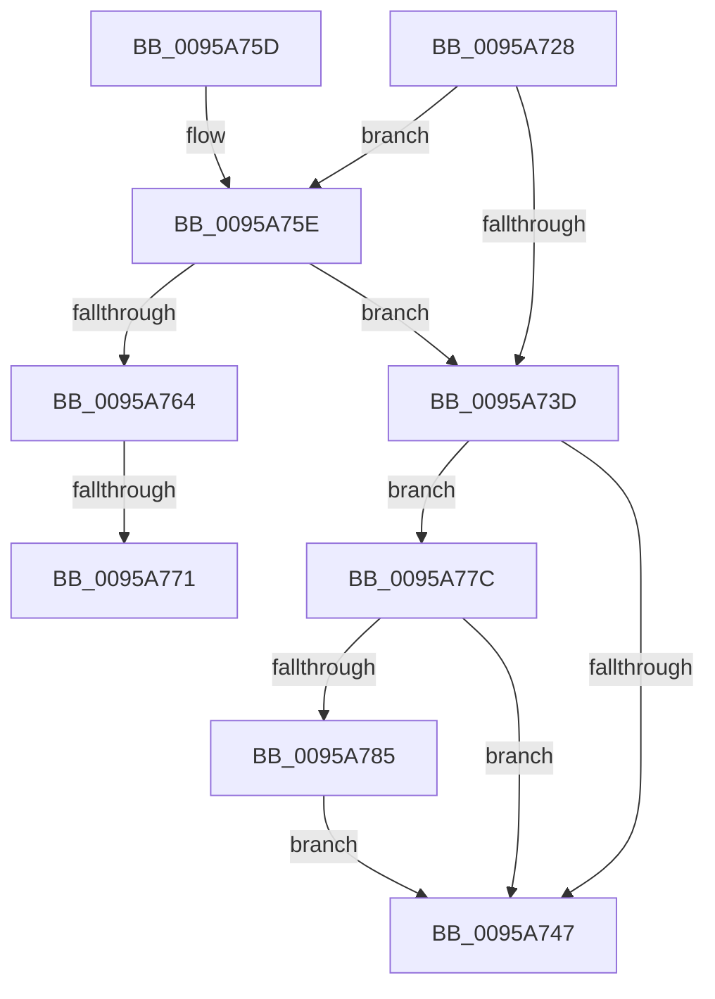

# SdbCloseDatabaseRead

- RVA: `0x0095A728`–`0x0095A795` (길이 `109` bytes)
- VA: `0x000000014095A728`
- 실행 섹션: `PAGE`
- PDB 이름 있음: `예`; PDB Function 태그: `예`
- unwind 정보 RVA: `0x000929B4`
- 디코드: `33`개 명령, `109/109` bytes 표시
- 미해석 바이트: `0` (있으면 어셈블리에 `.byte`로 보존)

> 이 문서는 커널 이미지의 기계어와 PDB 기호를 분석해 생성했습니다. 4번과 5번은 함수 원형과 자료형을 바이너리 사용 방식에서 추정한 C 해석이며 원본 소스 복구 결과는 아닙니다.

## 1. Dependencies

- 직접 호출 지점: **4**; 고유 호출 대상: **2**
- 직접 호출자로 확인된 함수: **4**
- RIP 상대 이미지 참조: **0**

### Outgoing calls
- `0x0095A74A` → [AslFileMappingDelete](AslFileMappingDelete_function_0095B728.md) (function, `0x0095B728`)
- `0x0095A752` → [AslFree](AslFree_function_0095B674.md) (function, `0x0095B674`)
- `0x0095A771` → [AslFree](AslFree_function_0095B674.md) (function, `0x0095B674`)
- `0x0095A785` → [AslFree](AslFree_function_0095B674.md) (function, `0x0095B674`)

### Direct callers
- [SdbpCloseLocalDatabaseEx](../81/SdbpCloseLocalDatabaseEx_function_00817624.md) at `0x00817673`
- [SdbpOpenCompressedDatabase](../81/SdbpOpenCompressedDatabase_function_00818524.md) at `0x0081866B`
- [SdbpOpenCompressedDatabase](../81/SdbpOpenCompressedDatabase_function_00818524.md) at `0x00818675`
- [SdbReleaseDatabase](SdbReleaseDatabase_function_0095B57C.md) at `0x0095B606`
- [SdbReleaseDatabase](SdbReleaseDatabase_function_0095B57C.md) at `0x0095B658`
- [SdbInitDatabaseInMemory](SdbInitDatabaseInMemory_function_0095BC5C.md) at `0x0095BD21`

### Static image references
- 디코드된 RIP-relative 메모리 참조가 없습니다.

## 2. Other-region calls and transfers

- 다른 실행 섹션으로 향하는 call: **0**
- call이 아닌 외부 분기/꼬리 이동: **2**
  - `0x0095A76B` → [sub_00B2765C](../B2/Unknown_function_00B2765C.md) (`tail-transfer`)
  - `0x0095A777` → [sub_00B2765C](../B2/Unknown_function_00B2765C.md) (`tail-transfer`)

## 3. Assembly (complete function range)

```asm
0095A728  40 53                           push rbx
0095A72A  48 83 EC 20                     sub rsp, 0x20
0095A72E  48 8B 81 50 0A 00 00            mov rax, qword ptr [rcx + 0xa50]
0095A735  48 8B D9                        mov rbx, rcx
0095A738  48 85 C0                        test rax, rax
0095A73B  75 21                           jne 0x14095a75e
0095A73D  8B 43 18                        mov eax, dword ptr [rbx + 0x18]
0095A740  83 E0 09                        and eax, 9
0095A743  3C 09                           cmp al, 9
0095A745  74 35                           je 0x14095a77c
0095A747  48 8B 0B                        mov rcx, qword ptr [rbx]
0095A74A  E8 D9 0F 00 00                  call 0x14095b728
0095A74F  48 8B D3                        mov rdx, rbx
0095A752  E8 1D 0F 00 00                  call 0x14095b674
0095A757  48 83 C4 20                     add rsp, 0x20
0095A75B  5B                              pop rbx
0095A75C  C3                              ret
0095A75D  CC                              int3
0095A75E  83 78 10 01                     cmp dword ptr [rax + 0x10], 1
0095A762  75 D9                           jne 0x14095a73d
0095A764  48 8B 50 08                     mov rdx, qword ptr [rax + 8]
0095A768  48 85 D2                        test rdx, rdx
0095A76B  0F 84 EB CE 1C 00               je 0x140b2765c
0095A771  E8 FE 0E 00 00                  call 0x14095b674
0095A776  90                              nop
0095A777  E9 E0 CE 1C 00                  jmp 0x140b2765c
0095A77C  48 8B 53 08                     mov rdx, qword ptr [rbx + 8]
0095A780  48 85 D2                        test rdx, rdx
0095A783  74 C2                           je 0x14095a747
0095A785  E8 EA 0E 00 00                  call 0x14095b674
0095A78A  48 83 63 08 00                  and qword ptr [rbx + 8], 0
0095A78F  83 63 14 00                     and dword ptr [rbx + 0x14], 0
0095A793  EB B2                           jmp 0x14095a747
```

## 4. C-style interpretation (structured pseudocode)

```c
__int64 __fastcall SdbCloseDatabaseRead(__int64 a1)
{
    __int64 result;
    __int64 v_rsp;

    v_rsp = (v_rsp) - (32);
    if (*(unsigned __int64 *)(a1 + 2640) != 0) goto loc_0095A75E;
loc_0095A73D:
    result = (unsigned int)(((unsigned int)(*(unsigned int *)(a1 + 24))) & (9));
    if (((unsigned __int8)(result)) == 9) goto loc_0095A77C;
loc_0095A747:
    result = AslFileMappingDelete(*(unsigned __int64 *)(a1), a2, a3, a4);
    result = AslFree(*(unsigned __int64 *)(a1), a1, a3, a4);
    v_rsp = (v_rsp) + (32);
    return result;
loc_0095A75E:
    if ((*(unsigned int *)(result + 16)) != 1) goto loc_0095A73D;
    result = AslFree(*(unsigned __int64 *)(a1), *(unsigned __int64 *)(result + 8), a3, a4);
loc_0095A77C:
    if (*(unsigned __int64 *)(a1 + 8) == 0) goto loc_0095A747;
    result = AslFree(*(unsigned __int64 *)(a1), *(unsigned __int64 *)(a1 + 8), a3, a4);
    goto loc_0095A747;
}
```

## 5. (Beta) C Style

```c
int64_t SdbCloseDatabaseRead(void *Arg1)
{
    uint8_t *arg1 = (uint8_t *)Arg1;

    int64_t result;
    int64_t local_rsp;

    local_rsp = (local_rsp) - (32);
    if (*(uint64_t *)(arg1 + 0xA50) != 0) goto loc_0095A75E;
loc_0095A73D:
    result = (uint32_t)(((uint32_t)(*(uint32_t *)(arg1 + 0x18))) & (9));
    if (((uint8_t)(result)) == 9) goto loc_0095A77C;
loc_0095A747:
    result = AslFileMappingDelete(*(uint64_t *)(arg1), a2, a3, a4);
    result = AslFree(*(uint64_t *)(arg1), Arg1, a3, a4);
    local_rsp = (local_rsp) + (32);
    return result;
loc_0095A75E:
    if ((*(uint32_t *)(result + 0x10)) != 1) goto loc_0095A73D;
    result = AslFree(*(uint64_t *)(arg1), *(uint64_t *)(result + 0x8), a3, a4);
loc_0095A77C:
    if (*(uint64_t *)(arg1 + 0x8) == 0) goto loc_0095A747;
    result = AslFree(*(uint64_t *)(arg1), *(uint64_t *)(arg1 + 0x8), a3, a4);
    goto loc_0095A747;
}
```

### 관측된 메모리 오프셋

구조체 형식이 확인되지 않은 접근은 인자 기준의 오프셋으로만 기록했습니다.

| 기준 인자 | 오프셋 표현 | 폭 (bit) | 접근 |
|---|---:|---:|---|
| `Arg1` | `+ 0x0` | `64` | `R` |
| `Arg1` | `+ 0x8` | `64` | `R` |
| `Arg1` | `+ 0x8` | `64` | `R/W` |
| `Arg1` | `+ 0x14` | `32` | `R/W` |
| `Arg1` | `+ 0x18` | `32` | `R` |
| `Arg1` | `+ 0xA50` | `64` | `R` |

## 6. Execution-region graph

[열기: 2D/3D 그래프와 함수 탐색 컨트롤 패널](../../../control-panel.html?section=page&rva=0x0095A728&view=graph)

- 2D 그래프는 위에서 아래로 흐르고, 3D 그래프는 빈 공간을 드래그해 회전합니다. Shift+드래그는 이동, 휠은 확대·축소, 함수 노드 선택은 대상 보고서 이동입니다.

### Static fallback


