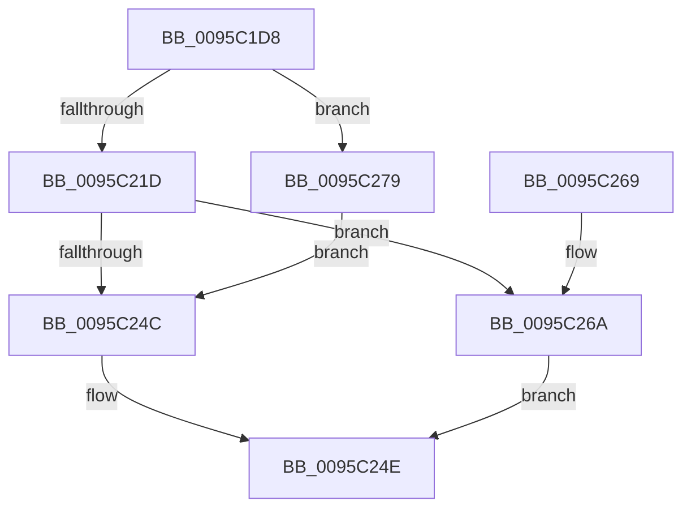

# SdbFindFirstStringIndexedTag

- RVA: `0x0095C1D8`–`0x0095C2A1` (길이 `201` bytes)
- VA: `0x000000014095C1D8`
- 실행 섹션: `PAGE`
- PDB 이름 있음: `예`; PDB Function 태그: `아니요`
- unwind 정보 RVA: `0x00092CA4`
- 디코드: `56`개 명령, `201/201` bytes 표시
- 미해석 바이트: `0` (있으면 어셈블리에 `.byte`로 보존)

> 이 문서는 커널 이미지의 기계어와 PDB 기호를 분석해 생성했습니다. 4번과 5번은 함수 원형과 자료형을 바이너리 사용 방식에서 추정한 C 해석이며 원본 소스 복구 결과는 아닙니다.

## 1. Dependencies

- 직접 호출 지점: **5**; 고유 호출 대상: **5**
- 직접 호출자로 확인된 함수: **3**
- RIP 상대 이미지 참조: **2**

### Outgoing calls
- `0x0095C20D` → [SdbGetIndex](SdbGetIndex_function_0095C3C4.md) (function, `0x0095C3C4`)
- `0x0095C22F` → [SdbMakeIndexKeyFromStringEx](SdbMakeIndexKeyFromStringEx_function_0095E9F4.md) (function, `0x0095E9F4`)
- `0x0095C243` → [SdbpGetFirstIndexedRecord](SdbpGetFirstIndexedRecord_function_0095C0C4.md) (function, `0x0095C0C4`)
- `0x0095C272` → [SdbpFindMatchingName](../A9/SdbpFindMatchingName_function_00A91508.md) (function, `0x00A91508`)
- `0x0095C29A` → [AslLogCallPrintf](AslLogCallPrintf_function_0095E4EC.md) (function, `0x0095E4EC`)

### Direct callers
- [SdbGetKShimTagRef](../81/SdbGetKShimTagRef_function_00813564.md) at `0x008135B8`
- [SdbGetKShimTagRef](../81/SdbGetKShimTagRef_function_00813564.md) at `0x008135FC`
- [SdbGetDatabaseMatchEx](SdbGetDatabaseMatchEx_function_0095BD7C.md) at `0x0095BDF8`
- [SdbpSearchDB](../AB/SdbpSearchDB_function_00AB3294.md) at `0x00AB34B6`
- [SdbpSearchDB](../AB/SdbpSearchDB_function_00AB3294.md) at `0x00AB35B4`

### Static image references
- `0x0095C27D` → RVA `0x00012BA0` (`.rdata`; read)
- `0x0095C28E` → RVA `0x00012BC0` (`.rdata`; read)

## 2. Other-region calls and transfers

- 다른 실행 섹션으로 향하는 call: **0**
- 별도 외부 분기/꼬리 이동을 확인하지 못했습니다.

## 3. Assembly (complete function range)

```asm
0095C1D8  48 8B C4                        mov rax, rsp
0095C1DB  48 89 58 08                     mov qword ptr [rax + 8], rbx
0095C1DF  48 89 68 10                     mov qword ptr [rax + 0x10], rbp
0095C1E3  48 89 70 18                     mov qword ptr [rax + 0x18], rsi
0095C1E7  48 89 78 20                     mov qword ptr [rax + 0x20], rdi
0095C1EB  41 56                           push r14
0095C1ED  48 83 EC 40                     sub rsp, 0x40
0095C1F1  83 60 E8 00                     and dword ptr [rax - 0x18], 0
0095C1F5  4D 8B F1                        mov r14, r9
0095C1F8  41 0F B7 F8                     movzx edi, r8w
0095C1FC  4C 8D 48 E8                     lea r9, [rax - 0x18]
0095C200  0F B7 EA                        movzx ebp, dx
0095C203  44 0F B7 C7                     movzx r8d, di
0095C207  0F B7 D5                        movzx edx, bp
0095C20A  48 8B F1                        mov rsi, rcx
0095C20D  E8 B2 01 00 00                  call 0x14095c3c4
0095C212  48 8B 5C 24 70                  mov rbx, qword ptr [rsp + 0x70]
0095C217  89 03                           mov dword ptr [rbx], eax
0095C219  85 C0                           test eax, eax
0095C21B  74 5C                           je 0x14095c279
0095C21D  8B 54 24 30                     mov edx, dword ptr [rsp + 0x30]
0095C221  49 8B CE                        mov rcx, r14
0095C224  89 53 14                        mov dword ptr [rbx + 0x14], edx
0095C227  66 89 7B 0C                     mov word ptr [rbx + 0xc], di
0095C22B  4C 89 73 20                     mov qword ptr [rbx + 0x20], r14
0095C22F  E8 C0 27 00 00                  call 0x14095e9f4
0095C234  8B 13                           mov edx, dword ptr [rbx]
0095C236  4C 8B CB                        mov r9, rbx
0095C239  4C 8B C0                        mov r8, rax
0095C23C  48 89 43 18                     mov qword ptr [rbx + 0x18], rax
0095C240  48 8B CE                        mov rcx, rsi
0095C243  E8 7C FE FF FF                  call 0x14095c0c4
0095C248  85 C0                           test eax, eax
0095C24A  75 1E                           jne 0x14095c26a
0095C24C  33 C0                           xor eax, eax
0095C24E  48 8B 5C 24 50                  mov rbx, qword ptr [rsp + 0x50]
0095C253  48 8B 6C 24 58                  mov rbp, qword ptr [rsp + 0x58]
0095C258  48 8B 74 24 60                  mov rsi, qword ptr [rsp + 0x60]
0095C25D  48 8B 7C 24 68                  mov rdi, qword ptr [rsp + 0x68]
0095C262  48 83 C4 40                     add rsp, 0x40
0095C266  41 5E                           pop r14
0095C268  C3                              ret
0095C269  CC                              int3
0095C26A  4C 8B C3                        mov r8, rbx
0095C26D  8B D0                           mov edx, eax
0095C26F  48 8B CE                        mov rcx, rsi
0095C272  E8 91 52 13 00                  call 0x140a91508
0095C277  EB D5                           jmp 0x14095c24e
0095C279  89 7C 24 28                     mov dword ptr [rsp + 0x28], edi
0095C27D  4C 8D 0D 1C 69 6B FF            lea r9, [rip - 0x9496e4]
0095C284  41 B8 F2 00 00 00               mov r8d, 0xf2
0095C28A  89 6C 24 20                     mov dword ptr [rsp + 0x20], ebp
0095C28E  48 8D 15 2B 69 6B FF            lea rdx, [rip - 0x9496d5]
0095C295  B9 01 00 00 00                  mov ecx, 1
0095C29A  E8 4D 22 00 00                  call 0x14095e4ec
0095C29F  EB AB                           jmp 0x14095c24c
```

## 4. C-style interpretation (structured pseudocode)

```c
__int64 __fastcall SdbFindFirstStringIndexedTag(__int64 a1, unsigned __int16 a2, unsigned __int16 a3, __int64 a4, __int64 a5)
{
    __int64 result;
    __int64 v_rsp;
    unsigned int v_stack_m18;
    unsigned __int64 v_stack_p10;
    unsigned __int64 v_stack_p18;
    unsigned __int64 v_stack_p20;
    unsigned int v_stack_p28;
    unsigned __int64 v_stack_p8;

    *(unsigned __int64 *)(v_rsp + 8) = v_rbx;
    *(unsigned __int64 *)(v_rsp + 16) = v_rbp;
    *(unsigned __int64 *)(v_rsp + 24) = v_rsi;
    *(unsigned __int64 *)(v_rsp + 32) = v_rdi;
    v_rsp = (v_rsp) - (64);
    result = SdbGetIndex(a1, a2, a3, v_rsp - 24);
    *(unsigned int *)(a5) = (unsigned int)(result);
    if ((unsigned int)(result) == 0) goto loc_0095C279;
    *(unsigned int *)(a5 + 20) = (unsigned int)((unsigned int)(v_stack_m18));
    *(unsigned __int16 *)(a5 + 12) = a3;
    *(unsigned __int64 *)(a5 + 32) = a4;
    result = SdbMakeIndexKeyFromStringEx(a4, (unsigned int)(v_stack_m18), a3, v_rsp - 24);
    *(unsigned __int64 *)(a5 + 24) = result;
    result = SdbpGetFirstIndexedRecord(a1, (unsigned int)(*(unsigned int *)(a5)), result, a5);
    if ((unsigned int)(result) != 0) goto loc_0095C26A;
loc_0095C24C:
    result = 0;
loc_0095C24E:
    v_rsp = (v_rsp) + (64);
    return result;
loc_0095C26A:
    result = SdbpFindMatchingName(v_stack_p18, 0, v_stack_p8, a5);
    goto loc_0095C24E;
loc_0095C279:
    v_stack_p28 = (unsigned int)(v_stack_p20);
    v_stack_p20 = (unsigned int)(v_stack_p10);
    result = AslLogCallPrintf(1, v_rip - 9737941, 242, v_rip - 9737956);
    goto loc_0095C24C;
}
```

## 5. (Beta) C Style

```c
int64_t SdbFindFirstStringIndexedTag(int64_t Arg1, uint16_t Arg2, uint16_t Arg3, int64_t Arg4, void *Arg5)
{
    uint8_t *arg5 = (uint8_t *)Arg5;

    int64_t result;
    int64_t local_rsp;
    uint32_t v_stack_m18;
    uint64_t v_stack_p10;
    uint64_t v_stack_p18;
    uint64_t v_stack_p20;
    uint32_t v_stack_p28;
    uint64_t v_stack_p8;

    *(uint64_t *)(local_rsp + 0x8) = local_rbx;
    *(uint64_t *)(local_rsp + 0x10) = local_rbp;
    *(uint64_t *)(local_rsp + 0x18) = local_rsi;
    *(uint64_t *)(local_rsp + 0x20) = local_rdi;
    local_rsp = (local_rsp) - (64);
    result = SdbGetIndex(Arg1, Arg2, Arg3, local_rsp - 24);
    *(uint32_t *)(arg5) = (uint32_t)(result);
    if ((uint32_t)(result) == 0) goto loc_0095C279;
    *(uint32_t *)(arg5 + 0x14) = (uint32_t)((uint32_t)(v_stack_m18));
    *(uint16_t *)(arg5 + 0xC) = Arg3;
    *(uint64_t *)(arg5 + 0x20) = Arg4;
    result = SdbMakeIndexKeyFromStringEx(Arg4, (uint32_t)(v_stack_m18), Arg3, local_rsp - 24);
    *(uint64_t *)(arg5 + 0x18) = result;
    result = SdbpGetFirstIndexedRecord(Arg1, (uint32_t)(*(uint32_t *)(arg5)), result, Arg5);
    if ((uint32_t)(result) != 0) goto loc_0095C26A;
loc_0095C24C:
    result = 0;
loc_0095C24E:
    local_rsp = (local_rsp) + (64);
    return result;
loc_0095C26A:
    result = SdbpFindMatchingName(v_stack_p18, 0, v_stack_p8, Arg5);
    goto loc_0095C24E;
loc_0095C279:
    v_stack_p28 = (uint32_t)(v_stack_p20);
    v_stack_p20 = (uint32_t)(v_stack_p10);
    result = AslLogCallPrintf(1, v_rip - 9737941, 242, v_rip - 9737956);
    goto loc_0095C24C;
}
```

### 관측된 메모리 오프셋

구조체 형식이 확인되지 않은 접근은 인자 기준의 오프셋으로만 기록했습니다.

| 기준 인자 | 오프셋 표현 | 폭 (bit) | 접근 |
|---|---:|---:|---|
| `Arg5` | `+ 0x0` | `32` | `R` |
| `Arg5` | `+ 0x0` | `32` | `W` |
| `Arg5` | `+ 0xC` | `16` | `W` |
| `Arg5` | `+ 0x14` | `32` | `W` |
| `Arg5` | `+ 0x18` | `64` | `W` |
| `Arg5` | `+ 0x20` | `64` | `W` |

## 6. Execution-region graph

[열기: 2D/3D 그래프와 함수 탐색 컨트롤 패널](../../../control-panel.html?section=page&rva=0x0095C1D8&view=graph)

- 2D 그래프는 위에서 아래로 흐르고, 3D 그래프는 빈 공간을 드래그해 회전합니다. Shift+드래그는 이동, 휠은 확대·축소, 함수 노드 선택은 대상 보고서 이동입니다.

### Static fallback


