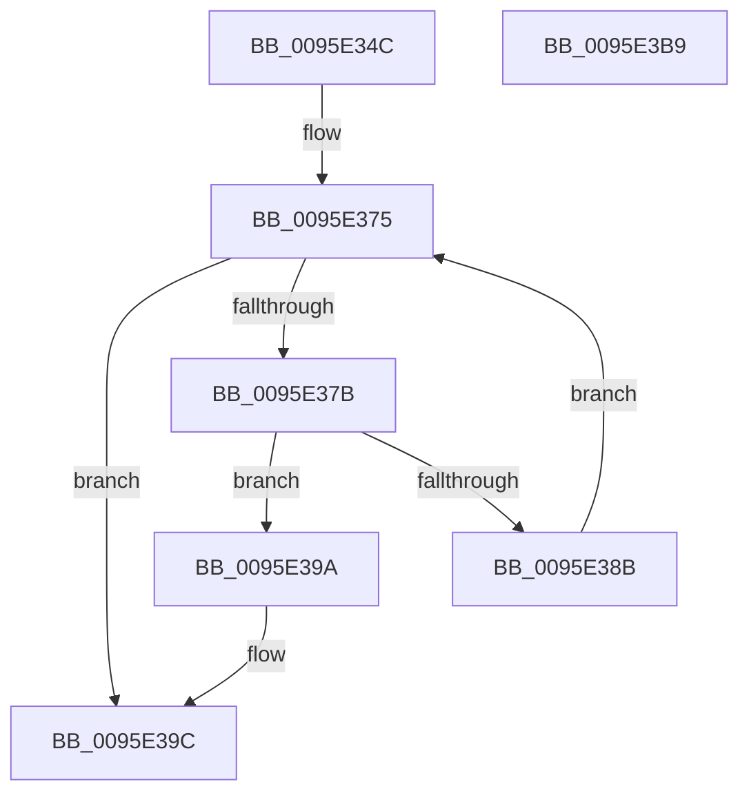

# SdbFindFirstTag

- RVA: `0x0095E34C`–`0x0095E3BA` (길이 `110` bytes)
- VA: `0x000000014095E34C`
- 실행 섹션: `PAGE`
- PDB 이름 있음: `예`; PDB Function 태그: `아니요`
- unwind 정보 RVA: `0x0005E6B4`
- 디코드: `35`개 명령, `110/110` bytes 표시
- 미해석 바이트: `0` (있으면 어셈블리에 `.byte`로 보존)

> 이 문서는 커널 이미지의 기계어와 PDB 기호를 분석해 생성했습니다. 4번과 5번은 함수 원형과 자료형을 바이너리 사용 방식에서 추정한 C 해석이며 원본 소스 복구 결과는 아닙니다.

## 1. Dependencies

- 직접 호출 지점: **3**; 고유 호출 대상: **3**
- 직접 호출자로 확인된 함수: **48**
- RIP 상대 이미지 참조: **0**

### Outgoing calls
- `0x0095E370` → [SdbGetFirstChild](SdbGetFirstChild_function_0095E610.md) (function, `0x0095E610`)
- `0x0095E380` → [SdbGetTagFromTagID](SdbGetTagFromTagID_function_0095E3C0.md) (function, `0x0095E3C0`)
- `0x0095E393` → [SdbGetNextChild](SdbGetNextChild_function_0095E520.md) (function, `0x0095E520`)

### Direct callers
- [SdbpCheckApplicationTypeAttributes](../../text/69/SdbpCheckApplicationTypeAttributes_function_0069C93C.md) at `0x0069C9E2`
- [KsepDbGetShimInfo](../74/KsepDbGetShimInfo_function_00748E94.md) at `0x00748F6A`
- [KsepDbGetShimInfo](../74/KsepDbGetShimInfo_function_00748E94.md) at `0x00748FCA`
- [KsepDbGetShimInfo](../74/KsepDbGetShimInfo_function_00748E94.md) at `0x00748FFA`
- [KsepDbReadKData](../74/KsepDbReadKData_function_0074923C.md) at `0x00749277`
- [KsepDbReadKData](../74/KsepDbReadKData_function_0074923C.md) at `0x007492A5`
- [KsepDbReadKData](../74/KsepDbReadKData_function_0074923C.md) at `0x007492CF`
- [KsepDbReadKData](../74/KsepDbReadKData_function_0074923C.md) at `0x00749328`
- [KsepDbReadKData](../74/KsepDbReadKData_function_0074923C.md) at `0x0074935D`
- [KsepDbReadKData](../74/KsepDbReadKData_function_0074923C.md) at `0x0074939D`
- [KsepDbReadKFlag](../74/KsepDbReadKFlag_function_00749404.md) at `0x0074942F`
- [KsepDbReadKFlag](../74/KsepDbReadKFlag_function_00749404.md) at `0x00749455`
- [SdbGetKShimTagRef](../81/SdbGetKShimTagRef_function_00813564.md) at `0x008135D0`
- [SdbQueryDataExTagID](../81/SdbQueryDataExTagID_function_008136E0.md) at `0x0081385B`
- [SdbQueryDataExTagID](../81/SdbQueryDataExTagID_function_008136E0.md) at `0x00813914`
- [SdbReadEntryInformation](../81/SdbReadEntryInformation_function_00813AEC.md) at `0x00813B7A`
- [SdbReadEntryInformation](../81/SdbReadEntryInformation_function_00813AEC.md) at `0x00813C30`
- [SdbpCheckContainment](../81/SdbpCheckContainment_function_00813D30.md) at `0x00813D6B`
- [SdbpCheckContainment](../81/SdbpCheckContainment_function_00813D30.md) at `0x00813D83`
- [SdbpCheckMatchingDevice](../81/SdbpCheckMatchingDevice_function_00813E20.md) at `0x00813E77`
- [SdbpCheckMatchingDir](../81/SdbpCheckMatchingDir_function_00813EF0.md) at `0x00813F26`
- [SdbpCheckMatchingFiles](../81/SdbpCheckMatchingFiles_function_00814080.md) at `0x008140C7`
- [SdbpCheckMatchingWildcardFiles](../81/SdbpCheckMatchingWildcardFiles_function_00814E30.md) at `0x00814EAA`
- [SdbpCheckSdbCapability](../81/SdbpCheckSdbCapability_function_00815570.md) at `0x008155A0`
- [SdbpFindFirstTagWithoutIndex](../81/SdbpFindFirstTagWithoutIndex_function_00815610.md) at `0x00815654`
- [SdbpFindFirstWildcardTagWithoutIndex](../81/SdbpFindFirstWildcardTagWithoutIndex_function_008156C8.md) at `0x0081570C`
- [SdbpFindNextTagWithoutIndex](../81/SdbpFindNextTagWithoutIndex_function_00815784.md) at `0x0081579C`
- [SdbpFindNextWildcardTagWithoutIndex](../81/SdbpFindNextWildcardTagWithoutIndex_function_00815800.md) at `0x00815818`
- [SdbpGetDeviceDWORD](../81/SdbpGetDeviceDWORD_function_008159B0.md) at `0x008159CD`
- [SdbpGetExeEntryFlags](../81/SdbpGetExeEntryFlags_function_00815A00.md) at `0x00815A36`
- [SdbpGetExeEntryFlags](../81/SdbpGetExeEntryFlags_function_00815A00.md) at `0x00815AB0`
- [SdbpGetExeEntryFlags](../81/SdbpGetExeEntryFlags_function_00815A00.md) at `0x00815AC8`
- [SdbpGetExeEntryFlags](../81/SdbpGetExeEntryFlags_function_00815A00.md) at `0x00815AF2`
- [SdbpGetMatchingTextAttributes](../81/SdbpGetMatchingTextAttributes_function_00815B38.md) at `0x00815B91`
- [SdbpGetMatchingTextAttributes](../81/SdbpGetMatchingTextAttributes_function_00815B38.md) at `0x00815BE8`
- [SdbpGetMatchingTextAttributes](../81/SdbpGetMatchingTextAttributes_function_00815B38.md) at `0x00815C79`
- [SdbpGetMatchingTextAttributes](../81/SdbpGetMatchingTextAttributes_function_00815B38.md) at `0x00815CC3`
- [SdbpGetRegistryMatchingAttributes](../81/SdbpGetRegistryMatchingAttributes_function_00815D5C.md) at `0x00815DE2`
- [SdbpGetRegistryMatchingAttributes](../81/SdbpGetRegistryMatchingAttributes_function_00815D5C.md) at `0x00815E27`
- [SdbpGetRegistryMatchingAttributes](../81/SdbpGetRegistryMatchingAttributes_function_00815D5C.md) at `0x00815E4A`
- [SdbpGetRegistryMatchingAttributes](../81/SdbpGetRegistryMatchingAttributes_function_00815D5C.md) at `0x00815ECB`
- [SdbpGetRegistryMatchingAttributes](../81/SdbpGetRegistryMatchingAttributes_function_00815D5C.md) at `0x00815F71`
- [SdbpGetRegistryMatchingAttributes](../81/SdbpGetRegistryMatchingAttributes_function_00815D5C.md) at `0x00815FAE`
- [SdbpGetRegistryMatchingAttributes](../81/SdbpGetRegistryMatchingAttributes_function_00815D5C.md) at `0x00816008`
- [SdbpMatchAcpi](../81/SdbpMatchAcpi_function_00816404.md) at `0x00816427`
- [SdbpMatchBios](../81/SdbpMatchBios_function_008164E0.md) at `0x00816503`
- [SdbpMatchCpu](../81/SdbpMatchCpu_function_00816578.md) at `0x0081659B`
- [SdbpMatchDeviceString](../81/SdbpMatchDeviceString_function_008166C4.md) at `0x008166E4`
- [SdbpMatchList](../81/SdbpMatchList_function_00816734.md) at `0x0081682A`
- [SdbpMatchList](../81/SdbpMatchList_function_00816734.md) at `0x00816849`
- [SdbpMatchOem](../81/SdbpMatchOem_function_008168C8.md) at `0x008168EB`
- [SdbpMatchOne](../81/SdbpMatchOne_function_00816980.md) at `0x008169EE`
- [SdbFindParentTagFromAncestors](../81/SdbFindParentTagFromAncestors_function_00816D98.md) at `0x00816DCE`
- [SdbpFindNextNamedTagHelper](../81/SdbpFindNextNamedTagHelper_function_00816DF8.md) at `0x00816E8D`
- [_SdbpFindTagFromAncestors](../81/_SdbpFindTagFromAncestors_function_00816F20.md) at `0x00816F60`
- [SdbpCheckAllAttributes](../81/SdbpCheckAllAttributes_function_008187EC.md) at `0x008188AE`
- [SdbMergeIsEntryUpdated](../81/SdbMergeIsEntryUpdated_function_00819158.md) at `0x0081922E`
- [SdbMergeIsEntryUpdated](../81/SdbMergeIsEntryUpdated_function_00819158.md) at `0x008192A2`
- [SdbMergeIsEntryUpdated](../81/SdbMergeIsEntryUpdated_function_00819158.md) at `0x008192B6`
- [SdbMergeIsEntryUpdated](../81/SdbMergeIsEntryUpdated_function_00819158.md) at `0x008192EC`
- [SdbMergeIsEntryUpdated](../81/SdbMergeIsEntryUpdated_function_00819158.md) at `0x0081930D`
- [SdbMergeIsEntryUpdated](../81/SdbMergeIsEntryUpdated_function_00819158.md) at `0x00819338`
- [SdbMergeIsEntryUpdated](../81/SdbMergeIsEntryUpdated_function_00819158.md) at `0x0081939A`
- [SdbMergeIsEntryUpdated](../81/SdbMergeIsEntryUpdated_function_00819158.md) at `0x008193BA`
- [SdbMergeIsEntryUpdated](../81/SdbMergeIsEntryUpdated_function_00819158.md) at `0x008194BE`
- [KsepDbGetDriverShimsInternal](KsepDbGetDriverShimsInternal_function_009597C4.md) at `0x00959875`
- [KsepDbGetDriverShimsInternal](KsepDbGetDriverShimsInternal_function_009597C4.md) at `0x009598C8`
- [KsepDbGetDriverShimsInternal](KsepDbGetDriverShimsInternal_function_009597C4.md) at `0x009598ED`
- [KsepDbGetDriverShimsInternal](KsepDbGetDriverShimsInternal_function_009597C4.md) at `0x0095992E`
- [KsepDbGetDriverShimsInternal](KsepDbGetDriverShimsInternal_function_009597C4.md) at `0x00959968`
- [KsepDbGetDriverShimsInternal](KsepDbGetDriverShimsInternal_function_009597C4.md) at `0x009599A2`
- [KsepDbGetDriverShimsInternal](KsepDbGetDriverShimsInternal_function_009597C4.md) at `0x009599D1`
- [SdbpFindNextIndexedWildCardTag](SdbpFindNextIndexedWildCardTag_function_0095A078.md) at `0x0095A158`
- [KsepDbCacheReadDeviceInternal](KsepDbCacheReadDeviceInternal_function_0095B774.md) at `0x0095B80B`
- [SdbGetDatabaseEdition](SdbGetDatabaseEdition_function_0095BBE4.md) at `0x0095BBFB`
- [SdbGetDatabaseEdition](SdbGetDatabaseEdition_function_0095BBE4.md) at `0x0095BC0F`
- [InitOnceScanIndexes](InitOnceScanIndexes_function_0095D4C0.md) at `0x0095D542`
- [InitOnceScanIndexes](InitOnceScanIndexes_function_0095D4C0.md) at `0x0095D56A`
- [InitOnceScanIndexes](InitOnceScanIndexes_function_0095D4C0.md) at `0x0095D5A2`
- [InitOnceScanIndexes](InitOnceScanIndexes_function_0095D4C0.md) at `0x0095D5DA`
- [InitOnceScanIndexes](InitOnceScanIndexes_function_0095D4C0.md) at `0x0095D60F`
- [SdbpFindFirstIndexedWildCardTag](SdbpFindFirstIndexedWildCardTag_function_0095DE58.md) at `0x0095DFA1`
- [SdbpMatchOsVersion](../A1/SdbpMatchOsVersion_function_00A18FC0.md) at `0x00A19038`
- [SdbpMatchOsVersion](../A1/SdbpMatchOsVersion_function_00A18FC0.md) at `0x00A1906B`
- [SdbpMatchOsVersion](../A1/SdbpMatchOsVersion_function_00A18FC0.md) at `0x00A190A8`
- [SdbGetDatabaseID](../A7/SdbGetDatabaseID_function_00A7EB20.md) at `0x00A7EB50`
- [SdbGetDatabaseID](../A7/SdbGetDatabaseID_function_00A7EB20.md) at `0x00A7EB64`
- [SdbpFindMatchingName](../A9/SdbpFindMatchingName_function_00A91508.md) at `0x00A91532`
- [InitOnceGetStringTableOffset](../A9/InitOnceGetStringTableOffset_function_00A97EA0.md) at `0x00A97ECC`
- [SdbpSearchDB](../AB/SdbpSearchDB_function_00AB3294.md) at `0x00AB3300`
- [SdbpSearchDB](../AB/SdbpSearchDB_function_00AB3294.md) at `0x00AB377B`
- [SdbpCheckForMatch](../AB/SdbpCheckForMatch_function_00AB37BC.md) at `0x00AB37F2`
- [SdbpCheckForMatch](../AB/SdbpCheckForMatch_function_00AB37BC.md) at `0x00AB387B`
- [SdbpFindFirstNamedTagHelper](../AD/SdbpFindFirstNamedTagHelper_function_00AD4D2C.md) at `0x00AD4D7B`
- [SdbpValidateAndApplyCompatFlags](../AF/SdbpValidateAndApplyCompatFlags_function_00AF93D8.md) at `0x00AF94E3`
- [sub_00B2789A](../B2/Unknown_function_00B2789A.md) at `0x00B278F2`

### Static image references
- 디코드된 RIP-relative 메모리 참조가 없습니다.

## 2. Other-region calls and transfers

- 다른 실행 섹션으로 향하는 call: **0**
- 별도 외부 분기/꼬리 이동을 확인하지 못했습니다.

## 3. Assembly (complete function range)

```asm
0095E34C  48 8B C4                        mov rax, rsp
0095E34F  48 89 58 08                     mov qword ptr [rax + 8], rbx
0095E353  48 89 68 10                     mov qword ptr [rax + 0x10], rbp
0095E357  48 89 70 18                     mov qword ptr [rax + 0x18], rsi
0095E35B  48 89 78 20                     mov qword ptr [rax + 0x20], rdi
0095E35F  41 56                           push r14
0095E361  48 83 EC 20                     sub rsp, 0x20
0095E365  33 FF                           xor edi, edi
0095E367  45 0F B7 F0                     movzx r14d, r8w
0095E36B  8B EA                           mov ebp, edx
0095E36D  48 8B F1                        mov rsi, rcx
0095E370  E8 9B 02 00 00                  call 0x14095e610
0095E375  8B D8                           mov ebx, eax
0095E377  85 C0                           test eax, eax
0095E379  74 21                           je 0x14095e39c
0095E37B  8B D0                           mov edx, eax
0095E37D  48 8B CE                        mov rcx, rsi
0095E380  E8 3B 00 00 00                  call 0x14095e3c0
0095E385  66 41 3B C6                     cmp ax, r14w
0095E389  74 0F                           je 0x14095e39a
0095E38B  44 8B C3                        mov r8d, ebx
0095E38E  8B D5                           mov edx, ebp
0095E390  48 8B CE                        mov rcx, rsi
0095E393  E8 88 01 00 00                  call 0x14095e520
0095E398  EB DB                           jmp 0x14095e375
0095E39A  8B FB                           mov edi, ebx
0095E39C  48 8B 5C 24 30                  mov rbx, qword ptr [rsp + 0x30]
0095E3A1  8B C7                           mov eax, edi
0095E3A3  48 8B 7C 24 48                  mov rdi, qword ptr [rsp + 0x48]
0095E3A8  48 8B 6C 24 38                  mov rbp, qword ptr [rsp + 0x38]
0095E3AD  48 8B 74 24 40                  mov rsi, qword ptr [rsp + 0x40]
0095E3B2  48 83 C4 20                     add rsp, 0x20
0095E3B6  41 5E                           pop r14
0095E3B8  C3                              ret
0095E3B9  CC                              int3
```

## 4. C-style interpretation (structured pseudocode)

```c
__int64 __fastcall SdbFindFirstTag(__int64 a1, int a2, unsigned __int16 a3)
{
    __int64 result;
    __int64 v_rdi;
    __int64 v_rsp;
    unsigned __int64 v_stack_p10;
    unsigned __int64 v_stack_p18;
    unsigned __int64 v_stack_p20;
    unsigned __int64 v_stack_p8;

    *(unsigned __int64 *)(v_rsp + 8) = v_rbx;
    *(unsigned __int64 *)(v_rsp + 16) = v_rbp;
    *(unsigned __int64 *)(v_rsp + 24) = v_rsi;
    *(unsigned __int64 *)(v_rsp + 32) = v_rdi;
    v_rsp = (v_rsp) - (32);
    v_rdi = 0;
    result = SdbGetFirstChild(a1, a2, a3, a4);
loc_0095E375:
    if ((unsigned int)(result) == 0) goto loc_0095E39C;
    result = SdbGetTagFromTagID(a1, (unsigned int)((unsigned int)(result)), a3, a4);
    if (((unsigned __int16)(result)) == a3) goto loc_0095E39A;
    result = SdbGetNextChild(a1, (unsigned int)((unsigned int)((unsigned int)(a2))), (unsigned int)((unsigned int)((unsigned int)((unsigned int)(result)))), a4);
    goto loc_0095E375;
loc_0095E39A:
loc_0095E39C:
    v_rsp = (v_rsp) + (32);
    return (unsigned int)((unsigned int)((unsigned int)((unsigned int)((unsigned int)((unsigned int)(result))))));
}
```

## 5. (Beta) C Style

```c
int64_t SdbFindFirstTag(int64_t Arg1, int32_t Arg2, uint16_t Arg3)
{
    int64_t result;
    int64_t local_rdi;
    int64_t local_rsp;
    uint64_t v_stack_p10;
    uint64_t v_stack_p18;
    uint64_t v_stack_p20;
    uint64_t v_stack_p8;

    *(uint64_t *)(local_rsp + 0x8) = local_rbx;
    *(uint64_t *)(local_rsp + 0x10) = local_rbp;
    *(uint64_t *)(local_rsp + 0x18) = local_rsi;
    *(uint64_t *)(local_rsp + 0x20) = local_rdi;
    local_rsp = (local_rsp) - (32);
    local_rdi = 0;
    result = SdbGetFirstChild(Arg1, Arg2, Arg3, a4);
loc_0095E375:
    if ((uint32_t)(result) == 0) goto loc_0095E39C;
    result = SdbGetTagFromTagID(Arg1, (uint32_t)((uint32_t)(result)), Arg3, a4);
    if (((uint16_t)(result)) == Arg3) goto loc_0095E39A;
    result = SdbGetNextChild(Arg1, (uint32_t)((uint32_t)((uint32_t)(Arg2))), (uint32_t)((uint32_t)((uint32_t)((uint32_t)(result)))), a4);
    goto loc_0095E375;
loc_0095E39A:
loc_0095E39C:
    local_rsp = (local_rsp) + (32);
    return (uint32_t)((uint32_t)((uint32_t)((uint32_t)((uint32_t)((uint32_t)(result))))));
}
```

## 6. Execution-region graph

[열기: 2D/3D 그래프와 함수 탐색 컨트롤 패널](../../../control-panel.html?section=page&rva=0x0095E34C&view=graph)

- 2D 그래프는 위에서 아래로 흐르고, 3D 그래프는 빈 공간을 드래그해 회전합니다. Shift+드래그는 이동, 휠은 확대·축소, 함수 노드 선택은 대상 보고서 이동입니다.

### Static fallback


