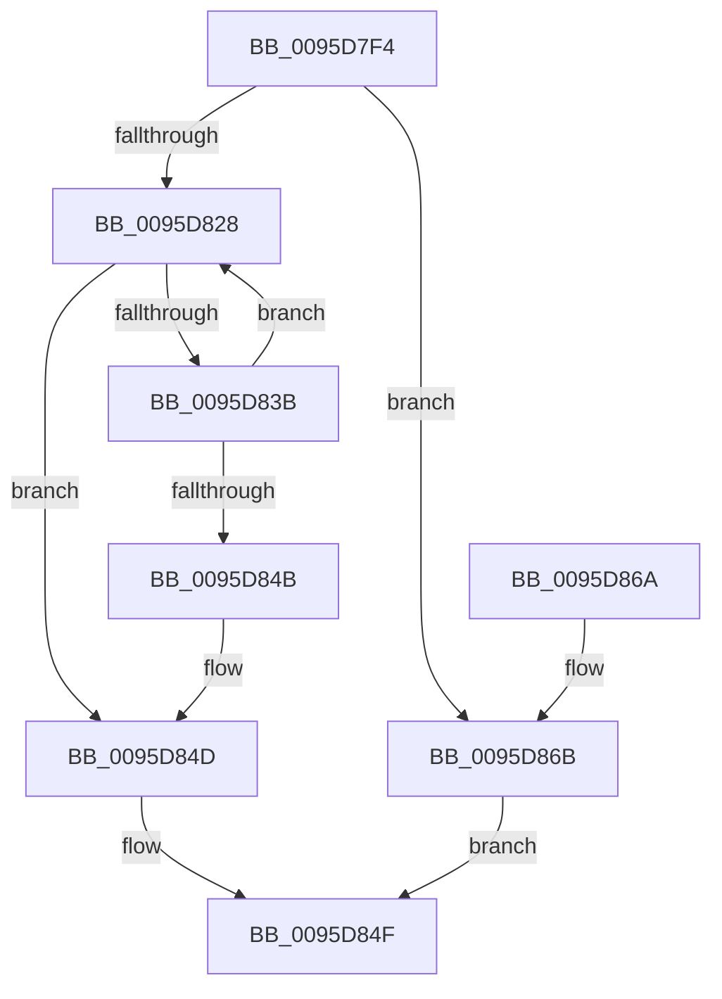

# SdbFindNextTag

- RVA: `0x0095D7F4`–`0x0095D891` (길이 `157` bytes)
- VA: `0x000000014095D7F4`
- 실행 섹션: `PAGE`
- PDB 이름 있음: `예`; PDB Function 태그: `아니요`
- unwind 정보 RVA: `0x00092DC0`
- 디코드: `46`개 명령, `157/157` bytes 표시
- 미해석 바이트: `0` (있으면 어셈블리에 `.byte`로 보존)

> 이 문서는 커널 이미지의 기계어와 PDB 기호를 분석해 생성했습니다. 4번과 5번은 함수 원형과 자료형을 바이너리 사용 방식에서 추정한 C 해석이며 원본 소스 복구 결과는 아닙니다.

## 1. Dependencies

- 직접 호출 지점: **4**; 고유 호출 대상: **3**
- 직접 호출자로 확인된 함수: **4**
- RIP 상대 이미지 참조: **2**

### Outgoing calls
- `0x0095D81A` → [SdbGetTagFromTagID](SdbGetTagFromTagID_function_0095E3C0.md) (function, `0x0095E3C0`)
- `0x0095D830` → [SdbGetNextChild](SdbGetNextChild_function_0095E520.md) (function, `0x0095E520`)
- `0x0095D840` → [SdbGetTagFromTagID](SdbGetTagFromTagID_function_0095E3C0.md) (function, `0x0095E3C0`)
- `0x0095D888` → [AslLogCallPrintf](AslLogCallPrintf_function_0095E4EC.md) (function, `0x0095E4EC`)

### Direct callers
- [SdbMergeIsEntryUpdated](../81/SdbMergeIsEntryUpdated_function_00819158.md) at `0x008192DD`
- [SdbMergeIsEntryUpdated](../81/SdbMergeIsEntryUpdated_function_00819158.md) at `0x00819380`
- [KsepDbGetDriverShimsInternal](KsepDbGetDriverShimsInternal_function_009597C4.md) at `0x0095988D`
- [KsepDbGetDriverShimsInternal](KsepDbGetDriverShimsInternal_function_009597C4.md) at `0x00959A1D`
- [InitOnceScanIndexes](InitOnceScanIndexes_function_0095D4C0.md) at `0x0095D636`
- [sub_00B2789A](../B2/Unknown_function_00B2789A.md) at `0x00B278E2`
- [sub_00B2789A](../B2/Unknown_function_00B2789A.md) at `0x00B2793F`

### Static image references
- `0x0095D86B` → RVA `0x00012680` (`.rdata`; read)
- `0x0095D87C` → RVA `0x00012670` (`.rdata`; read)

## 2. Other-region calls and transfers

- 다른 실행 섹션으로 향하는 call: **0**
- 별도 외부 분기/꼬리 이동을 확인하지 못했습니다.

## 3. Assembly (complete function range)

```asm
0095D7F4  48 8B C4                        mov rax, rsp
0095D7F7  48 89 58 08                     mov qword ptr [rax + 8], rbx
0095D7FB  48 89 68 10                     mov qword ptr [rax + 0x10], rbp
0095D7FF  48 89 70 18                     mov qword ptr [rax + 0x18], rsi
0095D803  48 89 78 20                     mov qword ptr [rax + 0x20], rdi
0095D807  41 56                           push r14
0095D809  48 83 EC 30                     sub rsp, 0x30
0095D80D  8B EA                           mov ebp, edx
0095D80F  41 8B D8                        mov ebx, r8d
0095D812  41 8B D0                        mov edx, r8d
0095D815  48 8B F1                        mov rsi, rcx
0095D818  33 FF                           xor edi, edi
0095D81A  E8 A1 0B 00 00                  call 0x14095e3c0
0095D81F  44 0F B7 F0                     movzx r14d, ax
0095D823  66 85 C0                        test ax, ax
0095D826  74 43                           je 0x14095d86b
0095D828  44 8B C3                        mov r8d, ebx
0095D82B  8B D5                           mov edx, ebp
0095D82D  48 8B CE                        mov rcx, rsi
0095D830  E8 EB 0C 00 00                  call 0x14095e520
0095D835  8B D8                           mov ebx, eax
0095D837  85 C0                           test eax, eax
0095D839  74 12                           je 0x14095d84d
0095D83B  8B D0                           mov edx, eax
0095D83D  48 8B CE                        mov rcx, rsi
0095D840  E8 7B 0B 00 00                  call 0x14095e3c0
0095D845  66 41 3B C6                     cmp ax, r14w
0095D849  75 DD                           jne 0x14095d828
0095D84B  8B FB                           mov edi, ebx
0095D84D  8B C7                           mov eax, edi
0095D84F  48 8B 5C 24 40                  mov rbx, qword ptr [rsp + 0x40]
0095D854  48 8B 6C 24 48                  mov rbp, qword ptr [rsp + 0x48]
0095D859  48 8B 74 24 50                  mov rsi, qword ptr [rsp + 0x50]
0095D85E  48 8B 7C 24 58                  mov rdi, qword ptr [rsp + 0x58]
0095D863  48 83 C4 30                     add rsp, 0x30
0095D867  41 5E                           pop r14
0095D869  C3                              ret
0095D86A  CC                              int3
0095D86B  4C 8D 0D 0E 4E 6B FF            lea r9, [rip - 0x94b1f2]
0095D872  89 5C 24 20                     mov dword ptr [rsp + 0x20], ebx
0095D876  41 B8 D8 00 00 00               mov r8d, 0xd8
0095D87C  48 8D 15 ED 4D 6B FF            lea rdx, [rip - 0x94b213]
0095D883  B9 01 00 00 00                  mov ecx, 1
0095D888  E8 5F 0C 00 00                  call 0x14095e4ec
0095D88D  33 C0                           xor eax, eax
0095D88F  EB BE                           jmp 0x14095d84f
```

## 4. C-style interpretation (structured pseudocode)

```c
__int64 __fastcall SdbFindNextTag(__int64 a1, int a2, int a3)
{
    __int64 result;
    __int64 v_rdi;
    __int64 v_rsp;
    unsigned __int64 v_stack_p10;
    unsigned __int64 v_stack_p18;
    unsigned __int64 v_stack_p20;
    unsigned __int64 v_stack_p8;

    *(unsigned __int64 *)(v_rsp + 8) = v_rbx;
    *(unsigned __int64 *)(v_rsp + 16) = v_rbp;
    *(unsigned __int64 *)(v_rsp + 24) = v_rsi;
    *(unsigned __int64 *)(v_rsp + 32) = v_rdi;
    v_rsp = (v_rsp) - (48);
    v_rdi = 0;
    result = SdbGetTagFromTagID(a1, (unsigned int)(a3), a3, a4);
    if ((unsigned __int16)(result) == 0) goto loc_0095D86B;
loc_0095D828:
    result = SdbGetNextChild(a1, (unsigned int)((unsigned int)((unsigned int)(a2))), (unsigned int)((unsigned int)((unsigned int)(a3))), a4);
    if ((unsigned int)(result) == 0) goto loc_0095D84D;
    result = SdbGetTagFromTagID(a1, (unsigned int)((unsigned int)(result)), (unsigned int)((unsigned int)((unsigned int)(a3))), a4);
    if (((unsigned __int16)(result)) != ((unsigned __int16)((unsigned __int16)(result)))) goto loc_0095D828;
loc_0095D84D:
loc_0095D84F:
    v_rsp = (v_rsp) + (48);
    return (unsigned int)((unsigned int)((unsigned int)((unsigned int)((unsigned int)((unsigned int)(result))))));
loc_0095D86B:
    v_stack_p20 = (unsigned int)(v_stack_p8);
    result = AslLogCallPrintf(1, v_rip - 9744915, 216, v_rip - 9744882);
    result = 0;
    goto loc_0095D84F;
}
```

## 5. (Beta) C Style

```c
int64_t SdbFindNextTag(int64_t Arg1, int32_t Arg2, int32_t Arg3)
{
    int64_t result;
    int64_t local_rdi;
    int64_t local_rsp;
    uint64_t v_stack_p10;
    uint64_t v_stack_p18;
    uint64_t v_stack_p20;
    uint64_t v_stack_p8;

    *(uint64_t *)(local_rsp + 0x8) = local_rbx;
    *(uint64_t *)(local_rsp + 0x10) = local_rbp;
    *(uint64_t *)(local_rsp + 0x18) = local_rsi;
    *(uint64_t *)(local_rsp + 0x20) = local_rdi;
    local_rsp = (local_rsp) - (48);
    local_rdi = 0;
    result = SdbGetTagFromTagID(Arg1, (uint32_t)(Arg3), Arg3, a4);
    if ((uint16_t)(result) == 0) goto loc_0095D86B;
loc_0095D828:
    result = SdbGetNextChild(Arg1, (uint32_t)((uint32_t)((uint32_t)(Arg2))), (uint32_t)((uint32_t)((uint32_t)(Arg3))), a4);
    if ((uint32_t)(result) == 0) goto loc_0095D84D;
    result = SdbGetTagFromTagID(Arg1, (uint32_t)((uint32_t)(result)), (uint32_t)((uint32_t)((uint32_t)(Arg3))), a4);
    if (((uint16_t)(result)) != ((uint16_t)((uint16_t)(result)))) goto loc_0095D828;
loc_0095D84D:
loc_0095D84F:
    local_rsp = (local_rsp) + (48);
    return (uint32_t)((uint32_t)((uint32_t)((uint32_t)((uint32_t)((uint32_t)(result))))));
loc_0095D86B:
    v_stack_p20 = (uint32_t)(v_stack_p8);
    result = AslLogCallPrintf(1, v_rip - 9744915, 216, v_rip - 9744882);
    result = 0;
    goto loc_0095D84F;
}
```

## 6. Execution-region graph

[열기: 2D/3D 그래프와 함수 탐색 컨트롤 패널](../../../control-panel.html?section=page&rva=0x0095D7F4&view=graph)

- 2D 그래프는 위에서 아래로 흐르고, 3D 그래프는 빈 공간을 드래그해 회전합니다. Shift+드래그는 이동, 휠은 확대·축소, 함수 노드 선택은 대상 보고서 이동입니다.

### Static fallback


