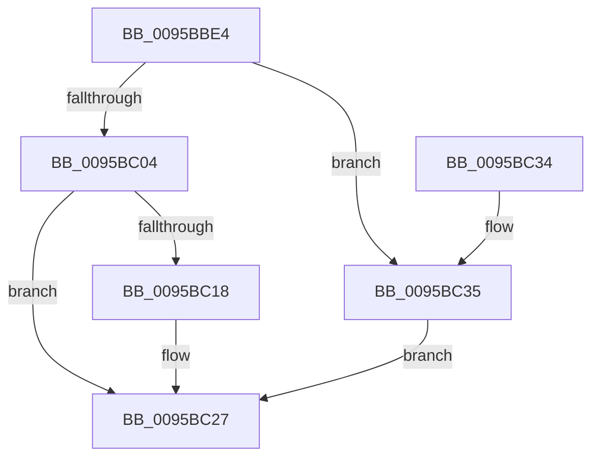

# SdbGetDatabaseEdition

- RVA: `0x0095BBE4`–`0x0095BC55` (길이 `113` bytes)
- VA: `0x000000014095BBE4`
- 실행 섹션: `PAGE`
- PDB 이름 있음: `예`; PDB Function 태그: `아니요`
- unwind 정보 RVA: `0x0005D368`
- 디코드: `33`개 명령, `113/113` bytes 표시
- 미해석 바이트: `0` (있으면 어셈블리에 `.byte`로 보존)

> 이 문서는 커널 이미지의 기계어와 PDB 기호를 분석해 생성했습니다. 4번과 5번은 함수 원형과 자료형을 바이너리 사용 방식에서 추정한 C 해석이며 원본 소스 복구 결과는 아닙니다.

## 1. Dependencies

- 직접 호출 지점: **4**; 고유 호출 대상: **3**
- 직접 호출자로 확인된 함수: **2**
- RIP 상대 이미지 참조: **2**

### Outgoing calls
- `0x0095BBFB` → [SdbFindFirstTag](SdbFindFirstTag_function_0095E34C.md) (function, `0x0095E34C`)
- `0x0095BC0F` → [SdbFindFirstTag](SdbFindFirstTag_function_0095E34C.md) (function, `0x0095E34C`)
- `0x0095BC20` → [SdbReadDWORDTag](SdbReadDWORDTag_function_0095D408.md) (function, `0x0095D408`)
- `0x0095BC4E` → [AslLogCallPrintf](AslLogCallPrintf_function_0095E4EC.md) (function, `0x0095E4EC`)

### Direct callers
- [KsepSdbBootInitialize](../74/KsepSdbBootInitialize_function_0074A7EC.md) at `0x0074A8FA`
- [KsepSdbMapToMemory](KsepSdbMapToMemory_function_0095B81C.md) at `0x0095B9D0`

### Static image references
- `0x0095BC35` → RVA `0x00012B58` (`.rdata`; read)
- `0x0095BC42` → RVA `0x00012B88` (`.rdata`; read)

## 2. Other-region calls and transfers

- 다른 실행 섹션으로 향하는 call: **0**
- 별도 외부 분기/꼬리 이동을 확인하지 못했습니다.

## 3. Assembly (complete function range)

```asm
0095BBE4  48 89 5C 24 08                  mov qword ptr [rsp + 8], rbx
0095BBE9  57                              push rdi
0095BBEA  48 83 EC 20                     sub rsp, 0x20
0095BBEE  33 D2                           xor edx, edx
0095BBF0  41 B8 01 70 00 00               mov r8d, 0x7001
0095BBF6  48 8B F9                        mov rdi, rcx
0095BBF9  33 DB                           xor ebx, ebx
0095BBFB  E8 4C 27 00 00                  call 0x14095e34c
0095BC00  85 C0                           test eax, eax
0095BC02  74 31                           je 0x14095bc35
0095BC04  41 B8 55 40 00 00               mov r8d, 0x4055
0095BC0A  8B D0                           mov edx, eax
0095BC0C  48 8B CF                        mov rcx, rdi
0095BC0F  E8 38 27 00 00                  call 0x14095e34c
0095BC14  85 C0                           test eax, eax
0095BC16  74 0F                           je 0x14095bc27
0095BC18  45 33 C0                        xor r8d, r8d
0095BC1B  8B D0                           mov edx, eax
0095BC1D  48 8B CF                        mov rcx, rdi
0095BC20  E8 E3 17 00 00                  call 0x14095d408
0095BC25  8B D8                           mov ebx, eax
0095BC27  8B C3                           mov eax, ebx
0095BC29  48 8B 5C 24 30                  mov rbx, qword ptr [rsp + 0x30]
0095BC2E  48 83 C4 20                     add rsp, 0x20
0095BC32  5F                              pop rdi
0095BC33  C3                              ret
0095BC34  CC                              int3
0095BC35  4C 8D 0D 1C 6F 6B FF            lea r9, [rip - 0x9490e4]
0095BC3C  41 B8 DE 02 00 00               mov r8d, 0x2de
0095BC42  48 8D 15 3F 6F 6B FF            lea rdx, [rip - 0x9490c1]
0095BC49  B9 01 00 00 00                  mov ecx, 1
0095BC4E  E8 99 28 00 00                  call 0x14095e4ec
0095BC53  EB D2                           jmp 0x14095bc27
```

## 4. C-style interpretation (structured pseudocode)

```c
__int64 __fastcall SdbGetDatabaseEdition(__int64 a1, int a2)
{
    __int64 result;
    __int64 v_rbx;
    __int64 v_rsp;
    unsigned __int64 v_stack_p8;

    v_stack_p8 = v_rbx;
    v_rsp = (v_rsp) - (32);
    a2 = 0;
    v_rbx = 0;
    result = SdbFindFirstTag(a1, a2, (unsigned int)(0x7001ULL), a4);
    if ((unsigned int)(result) == 0) goto loc_0095BC35;
    result = SdbFindFirstTag(a1, (unsigned int)((unsigned int)(result)), (unsigned int)(0x4055ULL), a4);
    if ((unsigned int)(result) != 0) {
        a3 = 0;
        a2 = (unsigned int)(result);
        a1 = a1;
        result = SdbReadDWORDTag(a1, a2, a3, a4);
        v_rbx = (unsigned int)(result);
    }
    v_rsp = (v_rsp) + (32);
    return (unsigned int)((unsigned int)(v_rbx));
loc_0095BC35:
    result = AslLogCallPrintf(1, v_rip - 9736385, 734, v_rip - 9736420);
    goto loc_0095BC27;
}
```

## 5. (Beta) C Style

```c
int64_t SdbGetDatabaseEdition(int64_t Arg1, int32_t Arg2)
{
    int64_t result;
    int64_t local_rbx;
    int64_t local_rsp;
    uint64_t v_stack_p8;

    v_stack_p8 = local_rbx;
    local_rsp = (local_rsp) - (32);
    Arg2 = 0;
    local_rbx = 0;
    result = SdbFindFirstTag(Arg1, Arg2, (uint32_t)(0x7001ULL), a4);
    if ((uint32_t)(result) == 0) goto loc_0095BC35;
    result = SdbFindFirstTag(Arg1, (uint32_t)((uint32_t)(result)), (uint32_t)(0x4055ULL), a4);
    if ((uint32_t)(result) != 0) {
        a3 = 0;
        Arg2 = (uint32_t)(result);
        Arg1 = Arg1;
        result = SdbReadDWORDTag(Arg1, Arg2, a3, a4);
        local_rbx = (uint32_t)(result);
    }
    local_rsp = (local_rsp) + (32);
    return (uint32_t)((uint32_t)(local_rbx));
loc_0095BC35:
    result = AslLogCallPrintf(1, v_rip - 9736385, 734, v_rip - 9736420);
    goto loc_0095BC27;
}
```

## 6. Execution-region graph

[열기: 2D/3D 그래프와 함수 탐색 컨트롤 패널](../../../control-panel.html?section=page&rva=0x0095BBE4&view=graph)

- 2D 그래프는 위에서 아래로 흐르고, 3D 그래프는 빈 공간을 드래그해 회전합니다. Shift+드래그는 이동, 휠은 확대·축소, 함수 노드 선택은 대상 보고서 이동입니다.

### Static fallback


