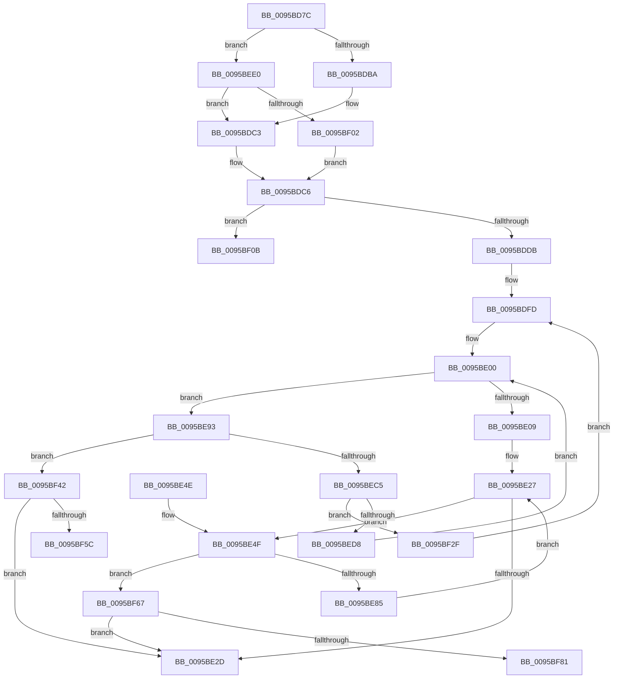

# SdbGetDatabaseMatchEx

- RVA: `0x0095BD7C`–`0x0095BF8C` (길이 `528` bytes)
- VA: `0x000000014095BD7C`
- 실행 섹션: `PAGE`
- PDB 이름 있음: `예`; PDB Function 태그: `예`
- unwind 정보 RVA: `0x00092C1C`
- 디코드: `141`개 명령, `528/528` bytes 표시
- 미해석 바이트: `0` (있으면 어셈블리에 `.byte`로 보존)

> 이 문서는 커널 이미지의 기계어와 PDB 기호를 분석해 생성했습니다. 4번과 5번은 함수 원형과 자료형을 바이너리 사용 방식에서 추정한 C 해석이며 원본 소스 복구 결과는 아닙니다.

## 1. Dependencies

- 직접 호출 지점: **11**; 고유 호출 대상: **9**
- 직접 호출자로 확인된 함수: **2**
- RIP 상대 이미지 참조: **0**

### Outgoing calls
- `0x0095BDF8` → [SdbFindFirstStringIndexedTag](SdbFindFirstStringIndexedTag_function_0095C1D8.md) (function, `0x0095C1D8`)
- `0x0095BE22` → [SdbpFindFirstIndexedWildCardTag](SdbpFindFirstIndexedWildCardTag_function_0095DE58.md) (function, `0x0095DE58`)
- `0x0095BE78` → [SdbpCheckKObject](SdbpCheckKObject_function_00959F04.md) (function, `0x00959F04`)
- `0x0095BE8C` → [SdbpFindNextIndexedWildCardTag](SdbpFindNextIndexedWildCardTag_function_0095A078.md) (function, `0x0095A078`)
- `0x0095BEBC` → [SdbpCheckKObject](SdbpCheckKObject_function_00959F04.md) (function, `0x00959F04`)
- `0x0095BECF` → [SdbpGetNextIndexedRecord](../A9/SdbpGetNextIndexedRecord_function_00A91608.md) (function, `0x00A91608`)
- `0x0095BEF1` → [wcsrchr](../../text/50/wcsrchr_function_00501E50.md) (function, `0x00501E50`)
- `0x0095BF24` → [SdbpFindFirstTagWithoutIndex](../81/SdbpFindFirstTagWithoutIndex_function_00815610.md) (function, `0x00815610`)
- `0x0095BF38` → [SdbpFindMatchingName](../A9/SdbpFindMatchingName_function_00A91508.md) (function, `0x00A91508`)
- `0x0095BF4F` → [SdbTagIDToTagRef](../81/SdbTagIDToTagRef_function_0081710C.md) (function, `0x0081710C`)
- `0x0095BF74` → [SdbTagIDToTagRef](../81/SdbTagIDToTagRef_function_0081710C.md) (function, `0x0081710C`)

### Direct callers
- [KsepDbGetDriverShimsInternal](KsepDbGetDriverShimsInternal_function_009597C4.md) at `0x00959823`
- [KsepDbCacheReadDeviceInternal](KsepDbCacheReadDeviceInternal_function_0095B774.md) at `0x0095B7BD`

### Static image references
- 디코드된 RIP-relative 메모리 참조가 없습니다.

## 2. Other-region calls and transfers

- 다른 실행 섹션으로 향하는 call: **1**
  - `0x0095BEF1` → [wcsrchr](../../text/50/wcsrchr_function_00501E50.md) (`PAGE` → `.text`)
- call이 아닌 외부 분기/꼬리 이동: **3**
  - `0x0095BF2A` → [sub_00B27968](../B2/Unknown_function_00B27968.md) (`tail-transfer`)
  - `0x0095BF62` → [sub_00B27968 + 0xF5](../B2/Unknown_function_00B27968.md) (`tail-transfer`)
  - `0x0095BF87` → [sub_00B27968 + 0xF5](../B2/Unknown_function_00B27968.md) (`tail-transfer`)

## 3. Assembly (complete function range)

```asm
0095BD7C  48 89 5C 24 08                  mov qword ptr [rsp + 8], rbx
0095BD81  48 89 74 24 18                  mov qword ptr [rsp + 0x18], rsi
0095BD86  48 89 7C 24 20                  mov qword ptr [rsp + 0x20], rdi
0095BD8B  55                              push rbp
0095BD8C  41 54                           push r12
0095BD8E  41 55                           push r13
0095BD90  41 56                           push r14
0095BD92  41 57                           push r15
0095BD94  48 8B EC                        mov rbp, rsp
0095BD97  48 83 EC 70                     sub rsp, 0x70
0095BD9B  33 C0                           xor eax, eax
0095BD9D  0F 57 C0                        xorps xmm0, xmm0
0095BDA0  48 89 45 F0                     mov qword ptr [rbp - 0x10], rax
0095BDA4  49 8B F8                        mov rdi, r8
0095BDA7  48 8B F1                        mov rsi, rcx
0095BDAA  0F 11 45 D0                     movups xmmword ptr [rbp - 0x30], xmm0
0095BDAE  0F 11 45 E0                     movups xmmword ptr [rbp - 0x20], xmm0
0095BDB2  85 D2                           test edx, edx
0095BDB4  0F 84 26 01 00 00               je 0x14095bee0
0095BDBA  41 BF 1A 70 00 00               mov r15d, 0x701a
0095BDC0  45 33 E4                        xor r12d, r12d
0095BDC3  48 8B DF                        mov rbx, rdi
0095BDC6  83 65 38 00                     and dword ptr [rbp + 0x38], 0
0095BDCA  48 8B 7E 10                     mov rdi, qword ptr [rsi + 0x10]
0095BDCE  4C 8B 6D 60                     mov r13, qword ptr [rbp + 0x60]
0095BDD2  48 85 FF                        test rdi, rdi
0095BDD5  0F 85 30 01 00 00               jne 0x14095bf0b
0095BDDB  48 8B 7E 08                     mov rdi, qword ptr [rsi + 8]
0095BDDF  48 8D 45 D0                     lea rax, [rbp - 0x30]
0095BDE3  48 8B CF                        mov rcx, rdi
0095BDE6  48 89 44 24 20                  mov qword ptr [rsp + 0x20], rax
0095BDEB  41 B8 01 60 00 00               mov r8d, 0x6001
0095BDF1  4C 8B CB                        mov r9, rbx
0095BDF4  41 0F B7 D7                     movzx edx, r15w
0095BDF8  E8 DB 03 00 00                  call 0x14095c1d8
0095BDFD  44 8B F0                        mov r14d, eax
0095BE00  45 85 F6                        test r14d, r14d
0095BE03  0F 85 8A 00 00 00               jne 0x14095be93
0095BE09  48 8D 45 D0                     lea rax, [rbp - 0x30]
0095BE0D  41 B8 0B 60 00 00               mov r8d, 0x600b
0095BE13  4C 8B CB                        mov r9, rbx
0095BE16  48 89 44 24 20                  mov qword ptr [rsp + 0x20], rax
0095BE1B  41 0F B7 D7                     movzx edx, r15w
0095BE1F  48 8B CF                        mov rcx, rdi
0095BE22  E8 31 20 00 00                  call 0x14095de58
0095BE27  8B D8                           mov ebx, eax
0095BE29  85 C0                           test eax, eax
0095BE2B  75 22                           jne 0x14095be4f
0095BE2D  8B 45 38                        mov eax, dword ptr [rbp + 0x38]
0095BE30  4C 8D 5C 24 70                  lea r11, [rsp + 0x70]
0095BE35  49 8B 5B 30                     mov rbx, qword ptr [r11 + 0x30]
0095BE39  49 8B 73 40                     mov rsi, qword ptr [r11 + 0x40]
0095BE3D  49 8B 7B 48                     mov rdi, qword ptr [r11 + 0x48]
0095BE41  49 8B E3                        mov rsp, r11
0095BE44  41 5F                           pop r15
0095BE46  41 5E                           pop r14
0095BE48  41 5D                           pop r13
0095BE4A  41 5C                           pop r12
0095BE4C  5D                              pop rbp
0095BE4D  C3                              ret
0095BE4E  CC                              int3
0095BE4F  48 8B 45 58                     mov rax, qword ptr [rbp + 0x58]
0095BE53  4D 8B CC                        mov r9, r12
0095BE56  4C 89 6C 24 38                  mov qword ptr [rsp + 0x38], r13
0095BE5B  44 8B C3                        mov r8d, ebx
0095BE5E  48 89 44 24 30                  mov qword ptr [rsp + 0x30], rax
0095BE63  48 8B D7                        mov rdx, rdi
0095BE66  48 8B 45 50                     mov rax, qword ptr [rbp + 0x50]
0095BE6A  48 8B CE                        mov rcx, rsi
0095BE6D  48 89 44 24 28                  mov qword ptr [rsp + 0x28], rax
0095BE72  48 83 4C 24 20 FF               or qword ptr [rsp + 0x20], 0xffffffffffffffff
0095BE78  E8 87 E0 FF FF                  call 0x140959f04
0095BE7D  85 C0                           test eax, eax
0095BE7F  0F 85 E2 00 00 00               jne 0x14095bf67
0095BE85  48 8D 55 D0                     lea rdx, [rbp - 0x30]
0095BE89  48 8B CF                        mov rcx, rdi
0095BE8C  E8 E7 E1 FF FF                  call 0x14095a078
0095BE91  EB 94                           jmp 0x14095be27
0095BE93  48 8B 45 58                     mov rax, qword ptr [rbp + 0x58]
0095BE97  4D 8B CC                        mov r9, r12
0095BE9A  4C 89 6C 24 38                  mov qword ptr [rsp + 0x38], r13
0095BE9F  45 8B C6                        mov r8d, r14d
0095BEA2  48 89 44 24 30                  mov qword ptr [rsp + 0x30], rax
0095BEA7  48 8B D7                        mov rdx, rdi
0095BEAA  48 8B 45 50                     mov rax, qword ptr [rbp + 0x50]
0095BEAE  48 8B CE                        mov rcx, rsi
0095BEB1  48 89 44 24 28                  mov qword ptr [rsp + 0x28], rax
0095BEB6  48 83 4C 24 20 FF               or qword ptr [rsp + 0x20], 0xffffffffffffffff
0095BEBC  E8 43 E0 FF FF                  call 0x140959f04
0095BEC1  85 C0                           test eax, eax
0095BEC3  75 7D                           jne 0x14095bf42
0095BEC5  8B 55 D0                        mov edx, dword ptr [rbp - 0x30]
0095BEC8  4C 8D 45 D0                     lea r8, [rbp - 0x30]
0095BECC  48 8B CF                        mov rcx, rdi
0095BECF  E8 34 57 13 00                  call 0x140a91608
0095BED4  85 C0                           test eax, eax
0095BED6  75 57                           jne 0x14095bf2f
0095BED8  45 33 F6                        xor r14d, r14d
0095BEDB  E9 20 FF FF FF                  jmp 0x14095be00
0095BEE0  BA 5C 00 00 00                  mov edx, 0x5c
0095BEE5  48 8B CF                        mov rcx, rdi
0095BEE8  41 BF 1C 70 00 00               mov r15d, 0x701c
0095BEEE  4C 8B E7                        mov r12, rdi
0095BEF1  E8 5A 5F BA FF                  call 0x140501e50
0095BEF6  48 8B D8                        mov rbx, rax
0095BEF9  48 85 C0                        test rax, rax
0095BEFC  0F 84 C1 FE FF FF               je 0x14095bdc3
0095BF02  48 83 C3 02                     add rbx, 2
0095BF06  E9 BB FE FF FF                  jmp 0x14095bdc6
0095BF0B  48 8D 45 D0                     lea rax, [rbp - 0x30]
0095BF0F  41 B8 01 60 00 00               mov r8d, 0x6001
0095BF15  4C 8B CB                        mov r9, rbx
0095BF18  48 89 44 24 20                  mov qword ptr [rsp + 0x20], rax
0095BF1D  41 0F B7 D7                     movzx edx, r15w
0095BF21  48 8B CF                        mov rcx, rdi
0095BF24  E8 E7 96 EB FF                  call 0x140815610
0095BF29  90                              nop
0095BF2A  E9 39 BA 1C 00                  jmp 0x140b27968
0095BF2F  4C 8D 45 D0                     lea r8, [rbp - 0x30]
0095BF33  8B D0                           mov edx, eax
0095BF35  48 8B CF                        mov rcx, rdi
0095BF38  E8 CB 55 13 00                  call 0x140a91508
0095BF3D  E9 BB FE FF FF                  jmp 0x14095bdfd
0095BF42  4C 8D 4D 38                     lea r9, [rbp + 0x38]
0095BF46  45 8B C6                        mov r8d, r14d
0095BF49  48 8B D7                        mov rdx, rdi
0095BF4C  48 8B CE                        mov rcx, rsi
0095BF4F  E8 B8 B1 EB FF                  call 0x14081710c
0095BF54  85 C0                           test eax, eax
0095BF56  0F 85 D1 FE FF FF               jne 0x14095be2d
0095BF5C  41 B8 C9 1A 00 00               mov r8d, 0x1ac9
0095BF62  E9 F6 BA 1C 00                  jmp 0x140b27a5d
0095BF67  4C 8D 4D 38                     lea r9, [rbp + 0x38]
0095BF6B  44 8B C3                        mov r8d, ebx
0095BF6E  48 8B D7                        mov rdx, rdi
0095BF71  48 8B CE                        mov rcx, rsi
0095BF74  E8 93 B1 EB FF                  call 0x14081710c
0095BF79  85 C0                           test eax, eax
0095BF7B  0F 85 AC FE FF FF               jne 0x14095be2d
0095BF81  41 B8 E2 1A 00 00               mov r8d, 0x1ae2
0095BF87  E9 D1 BA 1C 00                  jmp 0x140b27a5d
```

## 4. C-style interpretation (structured pseudocode)

```c
__int64 __fastcall SdbGetDatabaseMatchEx(__int64 a1, int a2, __int64 a3, __int64 a4, __int64 a5, __int64 a6, __int64 a7)
{
    __int64 result;
    __int64 v_r12;
    __int64 v_r14;
    __int64 v_rbx;
    __int64 v_rsp;
    unsigned __int64 v_stack_m28;
    unsigned __int64 v_stack_m38;
    unsigned __int64 v_stack_m40;
    unsigned __int64 v_stack_m48;
    unsigned __int64 v_stack_m50;
    unsigned __int64 v_stack_m58;
    unsigned __int64 v_stack_m78;
    unsigned int v_stack_p10;
    unsigned __int64 v_stack_p18;
    unsigned __int64 v_stack_p20;
    unsigned __int64 v_stack_p8;

    v_stack_p8 = v_rbx;
    v_stack_p18 = v_rsi;
    v_stack_p20 = v_rdi;
    v_rsp = (v_rsp) - (112);
    result = 0;
    v_stack_m38 = 0;
    v_stack_m58 = v_xmm0;
    v_stack_m48 = v_xmm0;
    if (a2 == 0) goto loc_0095BEE0;
    v_r12 = 0;
loc_0095BDC3:
loc_0095BDC6:
    if (*(unsigned __int64 *)(a1 + 16) != 0) goto loc_0095BF0B;
    v_stack_m78 = v_stack_m58;
    result = SdbFindFirstStringIndexedTag(*(unsigned __int64 *)(a1 + 8), (unsigned __int16)((unsigned int)(0x701AULL)), (unsigned int)(0x6001ULL), a3);
loc_0095BDFD:
loc_0095BE00:
    if ((unsigned int)((unsigned int)((unsigned int)(result))) != 0) goto loc_0095BE93;
    v_stack_m78 = v_stack_m58;
    result = SdbpFindFirstIndexedWildCardTag(*(unsigned __int64 *)(a1 + 8), (unsigned __int16)((unsigned int)(0x701AULL)), (unsigned int)(0x600BULL), a3);
loc_0095BE27:
    if ((unsigned int)(result) != 0) goto loc_0095BE4F;
loc_0095BE2D:
    return (unsigned int)(v_stack_p10);
loc_0095BE4F:
    v_stack_m38 = a7;
    v_stack_m40 = a6;
    v_stack_m48 = a5;
    result = SdbpCheckKObject(*(unsigned __int64 *)(v_stack_m28 + 64), *(unsigned __int64 *)(v_stack_m28 + 72), (unsigned int)((unsigned int)(*(unsigned __int64 *)(v_stack_m28 + 48))), 0);
    if ((unsigned int)(result) != 0) goto loc_0095BF67;
    result = SdbpFindNextIndexedWildCardTag(*(unsigned __int64 *)(v_stack_m28 + 72), v_stack_m58, (unsigned int)((unsigned int)(*(unsigned __int64 *)(v_stack_m28 + 48))), 0);
    goto loc_0095BE27;
loc_0095BE93:
    v_stack_m38 = a7;
    v_stack_m40 = a6;
    v_stack_m48 = a5;
    result = SdbpCheckKObject(*(unsigned __int64 *)(v_stack_m28 + 64), *(unsigned __int64 *)(v_stack_m28 + 72), (unsigned int)((unsigned int)((unsigned int)((unsigned int)(result)))), 0);
    if ((unsigned int)(result) != 0) goto loc_0095BF42;
    result = SdbpGetNextIndexedRecord(*(unsigned __int64 *)(v_stack_m28 + 72), (unsigned int)(v_stack_m58), v_stack_m58, 0);
    if ((unsigned int)(result) != 0) goto loc_0095BF2F;
    v_r14 = 0;
    goto loc_0095BE00;
loc_0095BEE0:
    result = wcsrchr(*(unsigned __int64 *)(v_stack_m28 + 72), 92, v_stack_m58, 0);
    if (result == 0) goto loc_0095BDC3;
    v_rbx = (result) + (2);
    goto loc_0095BDC6;
loc_0095BF0B:
    v_stack_m50 = v_stack_m58;
    result = SdbpFindFirstTagWithoutIndex(*(unsigned __int64 *)(v_stack_m28 + 72), (unsigned __int16)((unsigned int)(0x701CULL)), (unsigned int)(0x6001ULL), v_rbx);
loc_0095BF2F:
    result = SdbpFindMatchingName(*(unsigned __int64 *)(v_stack_m28 + 72), (unsigned int)((unsigned int)(result)), v_stack_m58, v_rbx);
    goto loc_0095BDFD;
loc_0095BF42:
    result = SdbTagIDToTagRef(*(unsigned __int64 *)(v_stack_m28 + 64), *(unsigned __int64 *)(v_stack_m28 + 72), 0, v_stack_p10);
    if ((unsigned int)(result) != 0) goto loc_0095BE2D;
loc_0095BF67:
    result = SdbTagIDToTagRef(*(unsigned __int64 *)(v_stack_m28 + 64), *(unsigned __int64 *)(v_stack_m28 + 72), (unsigned int)((unsigned int)(v_rbx)), v_stack_p10);
    if ((unsigned int)(result) != 0) goto loc_0095BE2D;
}
```

## 5. (Beta) C Style

```c
int64_t SdbGetDatabaseMatchEx(void *Arg1, int32_t Arg2, int64_t Arg3, int64_t Arg4, int64_t Arg5, int64_t Arg6, int64_t Arg7)
{
    uint8_t *arg1 = (uint8_t *)Arg1;

    int64_t result;
    int64_t local_r12;
    int64_t local_r14;
    int64_t local_rbx;
    int64_t local_rsp;
    uint64_t v_stack_m28;
    uint64_t v_stack_m38;
    uint64_t v_stack_m40;
    uint64_t v_stack_m48;
    uint64_t v_stack_m50;
    uint64_t v_stack_m58;
    uint64_t v_stack_m78;
    uint32_t v_stack_p10;
    uint64_t v_stack_p18;
    uint64_t v_stack_p20;
    uint64_t v_stack_p8;

    v_stack_p8 = local_rbx;
    v_stack_p18 = local_rsi;
    v_stack_p20 = local_rdi;
    local_rsp = (local_rsp) - (112);
    result = 0;
    v_stack_m38 = 0;
    v_stack_m58 = v_xmm0;
    v_stack_m48 = v_xmm0;
    if (Arg2 == 0) goto loc_0095BEE0;
    local_r12 = 0;
loc_0095BDC3:
loc_0095BDC6:
    if (*(uint64_t *)(arg1 + 0x10) != 0) goto loc_0095BF0B;
    v_stack_m78 = v_stack_m58;
    result = SdbFindFirstStringIndexedTag(*(uint64_t *)(arg1 + 0x8), (uint16_t)((uint32_t)(0x701AULL)), (uint32_t)(0x6001ULL), Arg3);
loc_0095BDFD:
loc_0095BE00:
    if ((uint32_t)((uint32_t)((uint32_t)(result))) != 0) goto loc_0095BE93;
    v_stack_m78 = v_stack_m58;
    result = SdbpFindFirstIndexedWildCardTag(*(uint64_t *)(arg1 + 0x8), (uint16_t)((uint32_t)(0x701AULL)), (uint32_t)(0x600BULL), Arg3);
loc_0095BE27:
    if ((uint32_t)(result) != 0) goto loc_0095BE4F;
loc_0095BE2D:
    return (uint32_t)(v_stack_p10);
loc_0095BE4F:
    v_stack_m38 = Arg7;
    v_stack_m40 = Arg6;
    v_stack_m48 = Arg5;
    result = SdbpCheckKObject(*(uint64_t *)(v_stack_m28 + 0x40), *(uint64_t *)(v_stack_m28 + 0x48), (uint32_t)((uint32_t)(*(uint64_t *)(v_stack_m28 + 0x30))), 0);
    if ((uint32_t)(result) != 0) goto loc_0095BF67;
    result = SdbpFindNextIndexedWildCardTag(*(uint64_t *)(v_stack_m28 + 0x48), v_stack_m58, (uint32_t)((uint32_t)(*(uint64_t *)(v_stack_m28 + 0x30))), 0);
    goto loc_0095BE27;
loc_0095BE93:
    v_stack_m38 = Arg7;
    v_stack_m40 = Arg6;
    v_stack_m48 = Arg5;
    result = SdbpCheckKObject(*(uint64_t *)(v_stack_m28 + 0x40), *(uint64_t *)(v_stack_m28 + 0x48), (uint32_t)((uint32_t)((uint32_t)((uint32_t)(result)))), 0);
    if ((uint32_t)(result) != 0) goto loc_0095BF42;
    result = SdbpGetNextIndexedRecord(*(uint64_t *)(v_stack_m28 + 0x48), (uint32_t)(v_stack_m58), v_stack_m58, 0);
    if ((uint32_t)(result) != 0) goto loc_0095BF2F;
    local_r14 = 0;
    goto loc_0095BE00;
loc_0095BEE0:
    result = wcsrchr(*(uint64_t *)(v_stack_m28 + 0x48), 92, v_stack_m58, 0);
    if (result == 0) goto loc_0095BDC3;
    local_rbx = (result) + (2);
    goto loc_0095BDC6;
loc_0095BF0B:
    v_stack_m50 = v_stack_m58;
    result = SdbpFindFirstTagWithoutIndex(*(uint64_t *)(v_stack_m28 + 0x48), (uint16_t)((uint32_t)(0x701CULL)), (uint32_t)(0x6001ULL), local_rbx);
loc_0095BF2F:
    result = SdbpFindMatchingName(*(uint64_t *)(v_stack_m28 + 0x48), (uint32_t)((uint32_t)(result)), v_stack_m58, local_rbx);
    goto loc_0095BDFD;
loc_0095BF42:
    result = SdbTagIDToTagRef(*(uint64_t *)(v_stack_m28 + 0x40), *(uint64_t *)(v_stack_m28 + 0x48), 0, v_stack_p10);
    if ((uint32_t)(result) != 0) goto loc_0095BE2D;
loc_0095BF67:
    result = SdbTagIDToTagRef(*(uint64_t *)(v_stack_m28 + 0x40), *(uint64_t *)(v_stack_m28 + 0x48), (uint32_t)((uint32_t)(local_rbx)), v_stack_p10);
    if ((uint32_t)(result) != 0) goto loc_0095BE2D;
}
```

### 관측된 메모리 오프셋

구조체 형식이 확인되지 않은 접근은 인자 기준의 오프셋으로만 기록했습니다.

| 기준 인자 | 오프셋 표현 | 폭 (bit) | 접근 |
|---|---:|---:|---|
| `Arg1` | `+ 0x8` | `64` | `R` |
| `Arg1` | `+ 0x10` | `64` | `R` |

## 6. Execution-region graph

[열기: 2D/3D 그래프와 함수 탐색 컨트롤 패널](../../../control-panel.html?section=page&rva=0x0095BD7C&view=graph)

- 2D 그래프는 위에서 아래로 흐르고, 3D 그래프는 빈 공간을 드래그해 회전합니다. Shift+드래그는 이동, 휠은 확대·축소, 함수 노드 선택은 대상 보고서 이동입니다.

### Static fallback


