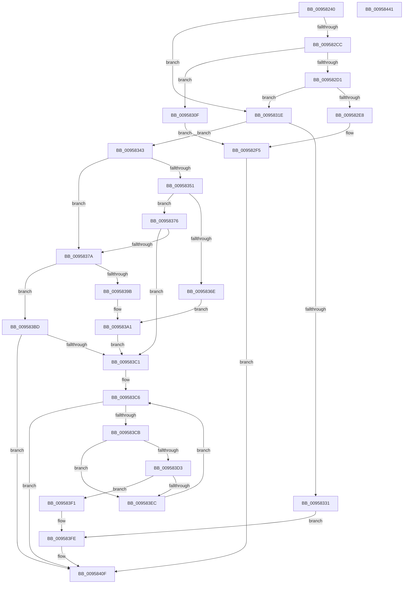

# SdbGetDatabaseMatch

- RVA: `0x00958240`–`0x00958442` (길이 `514` bytes)
- VA: `0x0000000140958240`
- 실행 섹션: `PAGE`
- PDB 이름 있음: `예`; PDB Function 태그: `아니요`
- unwind 정보 RVA: `0x00092640`
- 디코드: `135`개 명령, `514/514` bytes 표시
- 미해석 바이트: `0` (있으면 어셈블리에 `.byte`로 보존)

> 이 문서는 커널 이미지의 기계어와 PDB 기호를 분석해 생성했습니다. 4번과 5번은 함수 원형과 자료형을 바이너리 사용 방식에서 추정한 C 해석이며 원본 소스 복구 결과는 아닙니다.

## 1. Dependencies

- 직접 호출 지점: **14**; 고유 호출 대상: **10**
- 직접 호출자로 확인된 함수: **1**
- RIP 상대 이미지 참조: **7**

### Outgoing calls
- `0x00958275` → [memset](../../text/6C/memset_function_006C6C40.md) (function, `0x006C6C40`)
- `0x00958286` → [memset](../../text/6C/memset_function_006C6C40.md) (function, `0x006C6C40`)
- `0x009582C3` → [AslFileMappingCreate](AslFileMappingCreate_function_00958448.md) (function, `0x00958448`)
- `0x009582DF` → [AslFileMappingCreateFromImageView](../81/AslFileMappingCreateFromImageView_function_0081A49C.md) (function, `0x0081A49C`)
- `0x00958305` → [AslLogCallPrintf](AslLogCallPrintf_function_0095E4EC.md) (function, `0x0095E4EC`)
- `0x00958328` → [SdbpCreateSearchDBContext](../A9/SdbpCreateSearchDBContext_function_00A9D544.md) (function, `0x00A9D544`)
- `0x00958365` → [SdbpSearchDB](../AB/SdbpSearchDB_function_00AB3294.md) (function, `0x00AB3294`)
- `0x00958392` → [SdbpSearchDB](../AB/SdbpSearchDB_function_00AB3294.md) (function, `0x00AB3294`)
- `0x009583B4` → [AslLogCallPrintf](AslLogCallPrintf_function_0095E4EC.md) (function, `0x0095E4EC`)
- `0x009583E3` → [SdbTagIDToTagRef](../81/SdbTagIDToTagRef_function_0081710C.md) (function, `0x0081710C`)
- `0x0095840A` → [AslLogCallPrintf](AslLogCallPrintf_function_0095E4EC.md) (function, `0x0095E4EC`)
- `0x00958414` → [SdbpReleaseSearchDBContext](SdbpReleaseSearchDBContext_function_00958118.md) (function, `0x00958118`)
- `0x0095841E` → [AslFileMappingDelete](AslFileMappingDelete_function_0095B728.md) (function, `0x0095B728`)
- `0x0095842E` → [_security_check_cookie](../../text/6A/_security_check_cookie_function_006AC640.md) (function, `0x006AC640`)

### Direct callers
- [PiIsDriverBlocked](../99/PiIsDriverBlocked_function_0099C254.md) at `0x0099C2AC`

### Static image references
- `0x00958253` → RVA `0x00E0A740` (`.data`; read)
- `0x009582E8` → RVA `0x0003CB40` (`.rdata`; read)
- `0x009582F5` → RVA `0x0003CB28` (`.rdata`; read)
- `0x0095830F` → RVA `0x0003CAF8` (`.rdata`; read)
- `0x00958331` → RVA `0x0003CAD0` (`.rdata`; read)
- `0x009583A1` → RVA `0x0003CAA0` (`.rdata`; read)
- `0x009583F1` → RVA `0x0003CFE8` (`.rdata`; read)

## 2. Other-region calls and transfers

- 다른 실행 섹션으로 향하는 call: **3**
  - `0x00958275` → [memset](../../text/6C/memset_function_006C6C40.md) (`PAGE` → `.text`)
  - `0x00958286` → [memset](../../text/6C/memset_function_006C6C40.md) (`PAGE` → `.text`)
  - `0x0095842E` → [_security_check_cookie](../../text/6A/_security_check_cookie_function_006AC640.md) (`PAGE` → `.text`)
- 별도 외부 분기/꼬리 이동을 확인하지 못했습니다.

## 3. Assembly (complete function range)

```asm
00958240  40 55                           push rbp
00958242  53                              push rbx
00958243  56                              push rsi
00958244  57                              push rdi
00958245  41 56                           push r14
00958247  48 8D 6C 24 C0                  lea rbp, [rsp - 0x40]
0095824C  48 81 EC 40 01 00 00            sub rsp, 0x140
00958253  48 8B 05 E6 24 4B 00            mov rax, qword ptr [rip + 0x4b24e6]
0095825A  48 33 C4                        xor rax, rsp
0095825D  48 89 45 30                     mov qword ptr [rbp + 0x30], rax
00958261  48 8B FA                        mov rdi, rdx
00958264  48 8B F1                        mov rsi, rcx
00958267  33 D2                           xor edx, edx
00958269  48 8D 4C 24 44                  lea rcx, [rsp + 0x44]
0095826E  49 8B D9                        mov rbx, r9
00958271  44 8D 42 64                     lea r8d, [rdx + 0x64]
00958275  E8 C6 E9 D6 FF                  call 0x1406c6c40
0095827A  33 D2                           xor edx, edx
0095827C  48 8D 4D B0                     lea rcx, [rbp - 0x50]
00958280  41 B8 80 00 00 00               mov r8d, 0x80
00958286  E8 B5 E9 D6 FF                  call 0x1406c6c40
0095828B  48 83 64 24 38 00               and qword ptr [rsp + 0x38], 0
00958291  B8 0A 00 00 00                  mov eax, 0xa
00958296  83 64 24 30 00                  and dword ptr [rsp + 0x30], 0
0095829B  4C 8B CB                        mov r9, rbx
0095829E  4C 8B B5 90 00 00 00            mov r14, qword ptr [rbp + 0x90]
009582A5  48 85 DB                        test rbx, rbx
009582A8  48 8B D7                        mov rdx, rdi
009582AB  4C 89 74 24 20                  mov qword ptr [rsp + 0x20], r14
009582B0  8D 48 10                        lea ecx, [rax + 0x10]
009582B3  0F 45 C1                        cmovne eax, ecx
009582B6  49 83 C8 FF                     or r8, 0xffffffffffffffff
009582BA  48 8D 4C 24 38                  lea rcx, [rsp + 0x38]
009582BF  89 44 24 40                     mov dword ptr [rsp + 0x40], eax
009582C3  E8 80 01 00 00                  call 0x140958448
009582C8  85 C0                           test eax, eax
009582CA  79 52                           jns 0x14095831e
009582CC  48 85 DB                        test rbx, rbx
009582CF  74 3E                           je 0x14095830f
009582D1  4D 8B CE                        mov r9, r14
009582D4  48 8D 4C 24 38                  lea rcx, [rsp + 0x38]
009582D9  4C 8B C3                        mov r8, rbx
009582DC  48 8B D7                        mov rdx, rdi
009582DF  E8 B8 21 EC FF                  call 0x14081a49c
009582E4  85 C0                           test eax, eax
009582E6  79 36                           jns 0x14095831e
009582E8  4C 8D 0D 51 48 6E FF            lea r9, [rip - 0x91b7af]
009582EF  41 B8 31 17 00 00               mov r8d, 0x1731
009582F5  48 8D 15 2C 48 6E FF            lea rdx, [rip - 0x91b7d4]
009582FC  89 44 24 20                     mov dword ptr [rsp + 0x20], eax
00958300  B9 01 00 00 00                  mov ecx, 1
00958305  E8 E2 61 00 00                  call 0x14095e4ec
0095830A  E9 00 01 00 00                  jmp 0x14095840f
0095830F  4C 8D 0D E2 47 6E FF            lea r9, [rip - 0x91b81e]
00958316  41 B8 39 17 00 00               mov r8d, 0x1739
0095831C  EB D7                           jmp 0x1409582f5
0095831E  48 8B 54 24 38                  mov rdx, qword ptr [rsp + 0x38]
00958323  48 8D 4C 24 40                  lea rcx, [rsp + 0x40]
00958328  E8 17 52 14 00                  call 0x140a9d544
0095832D  85 C0                           test eax, eax
0095832F  75 12                           jne 0x140958343
00958331  4C 8D 0D 98 47 6E FF            lea r9, [rip - 0x91b868]
00958338  41 B8 42 17 00 00               mov r8d, 0x1742
0095833E  E9 BB 00 00 00                  jmp 0x1409583fe
00958343  48 8B 7E 10                     mov rdi, qword ptr [rsi + 0x10]
00958347  BB 10 00 00 00                  mov ebx, 0x10
0095834C  48 85 FF                        test rdi, rdi
0095834F  74 29                           je 0x14095837a
00958351  48 8D 45 B0                     lea rax, [rbp - 0x50]
00958355  48 8B D7                        mov rdx, rdi
00958358  4C 8D 4C 24 40                  lea r9, [rsp + 0x40]
0095835D  48 89 44 24 20                  mov qword ptr [rsp + 0x20], rax
00958362  48 8B CE                        mov rcx, rsi
00958365  E8 2A AF 15 00                  call 0x140ab3294
0095836A  3B C3                           cmp eax, ebx
0095836C  76 08                           jbe 0x140958376
0095836E  41 B8 55 17 00 00               mov r8d, 0x1755
00958374  EB 2B                           jmp 0x1409583a1
00958376  85 C0                           test eax, eax
00958378  75 47                           jne 0x1409583c1
0095837A  48 8B 7E 08                     mov rdi, qword ptr [rsi + 8]
0095837E  48 8D 45 B0                     lea rax, [rbp - 0x50]
00958382  48 8B D7                        mov rdx, rdi
00958385  48 89 44 24 20                  mov qword ptr [rsp + 0x20], rax
0095838A  4C 8D 4C 24 40                  lea r9, [rsp + 0x40]
0095838F  48 8B CE                        mov rcx, rsi
00958392  E8 FD AE 15 00                  call 0x140ab3294
00958397  3B C3                           cmp eax, ebx
00958399  76 22                           jbe 0x1409583bd
0095839B  41 B8 68 17 00 00               mov r8d, 0x1768
009583A1  4C 8D 0D F8 46 6E FF            lea r9, [rip - 0x91b908]
009583A8  B9 01 00 00 00                  mov ecx, 1
009583AD  48 8D 15 74 47 6E FF            lea rdx, [rip - 0x91b88c]
009583B4  E8 33 61 00 00                  call 0x14095e4ec
009583B9  8B C3                           mov eax, ebx
009583BB  EB 04                           jmp 0x1409583c1
009583BD  85 C0                           test eax, eax
009583BF  74 4E                           je 0x14095840f
009583C1  FF C8                           dec eax
009583C3  48 63 D8                        movsxd rbx, eax
009583C6  48 85 DB                        test rbx, rbx
009583C9  78 44                           js 0x14095840f
009583CB  8B 44 DD B4                     mov eax, dword ptr [rbp + rbx*8 - 0x4c]
009583CF  A8 02                           test al, 2
009583D1  75 19                           jne 0x1409583ec
009583D3  44 8B 44 DD B0                  mov r8d, dword ptr [rbp + rbx*8 - 0x50]
009583D8  4C 8D 4C 24 30                  lea r9, [rsp + 0x30]
009583DD  48 8B D7                        mov rdx, rdi
009583E0  48 8B CE                        mov rcx, rsi
009583E3  E8 24 ED EB FF                  call 0x14081710c
009583E8  85 C0                           test eax, eax
009583EA  74 05                           je 0x1409583f1
009583EC  48 FF CB                        dec rbx
009583EF  EB D5                           jmp 0x1409583c6
009583F1  4C 8D 0D F0 4B 6E FF            lea r9, [rip - 0x91b410]
009583F8  41 B8 7C 17 00 00               mov r8d, 0x177c
009583FE  48 8D 15 23 47 6E FF            lea rdx, [rip - 0x91b8dd]
00958405  B9 01 00 00 00                  mov ecx, 1
0095840A  E8 DD 60 00 00                  call 0x14095e4ec
0095840F  48 8D 4C 24 40                  lea rcx, [rsp + 0x40]
00958414  E8 FF FC FF FF                  call 0x140958118
00958419  48 8B 4C 24 38                  mov rcx, qword ptr [rsp + 0x38]
0095841E  E8 05 33 00 00                  call 0x14095b728
00958423  8B 44 24 30                     mov eax, dword ptr [rsp + 0x30]
00958427  48 8B 4D 30                     mov rcx, qword ptr [rbp + 0x30]
0095842B  48 33 CC                        xor rcx, rsp
0095842E  E8 0D 42 D5 FF                  call 0x1406ac640
00958433  48 81 C4 40 01 00 00            add rsp, 0x140
0095843A  41 5E                           pop r14
0095843C  5F                              pop rdi
0095843D  5E                              pop rsi
0095843E  5B                              pop rbx
0095843F  5D                              pop rbp
00958440  C3                              ret
00958441  CC                              int3
```

## 4. C-style interpretation (structured pseudocode)

```c
__int64 __fastcall SdbGetDatabaseMatch(__int64 a1, __int64 a2, __int64 a3, __int64 a4, __int64 a5)
{
    __int64 result;
    __int64 v_rbx;
    __int64 v_rsp;
    unsigned __int64 v_stack_m124;
    unsigned int v_stack_m128;
    unsigned __int64 v_stack_m130;
    unsigned int v_stack_m138;
    unsigned __int64 v_stack_m148;
    unsigned __int64 v_stack_m38;
    unsigned __int64 v_stack_m68;
    unsigned __int64 v_stack_mB8;

    v_rsp = (v_rsp) - (320);
    result = (*(unsigned __int64 *)(v_rip + 4924646)) ^ (v_rsp);
    v_stack_m38 = result;
    a2 = 0;
    result = memset(v_stack_m124, a2, a2 + 100, a4);
    a2 = 0;
    result = memset(v_stack_mB8, a2, 128, a4);
    v_stack_m148 = a5;
    result = 10;
    if (a4 != 0) { result = (unsigned int)(10 + 16); }
    a3 = (128) | (-1);
    v_stack_m128 = (unsigned int)(result);
    result = AslFileMappingCreate(v_stack_m130, 0, a3, a4);
    if (!sign_flag) goto loc_0095831E;
    if (a4 == 0) goto loc_0095830F;
    result = AslFileMappingCreateFromImageView(v_stack_m130, 0, a4, a5);
    if (!sign_flag) goto loc_0095831E;
loc_009582F5:
    v_stack_m148 = (unsigned int)(result);
    result = AslLogCallPrintf(1, v_rip - 9549780, (unsigned int)(0x1731ULL), v_rip - 9549743);
    goto loc_0095840F;
loc_0095830F:
    goto loc_009582F5;
loc_0095831E:
    result = SdbpCreateSearchDBContext(v_stack_m128, v_stack_m130, (unsigned int)(0x1739ULL), v_rip - 9549854);
    if ((unsigned int)(result) != 0) goto loc_00958343;
    goto loc_009583FE;
loc_00958343:
    if (*(unsigned __int64 *)(a1 + 16) == 0) goto loc_0095837A;
    v_stack_m148 = v_stack_mB8;
    result = SdbpSearchDB(a1, *(unsigned __int64 *)(a1 + 16), (unsigned int)(0x1742ULL), v_stack_m128);
    if (((unsigned int)(result)) <= 16) goto loc_00958376;
    goto loc_009583A1;
loc_00958376:
    if ((unsigned int)(result) != 0) goto loc_009583C1;
loc_0095837A:
    v_stack_m148 = v_stack_mB8;
    result = SdbpSearchDB(a1, *(unsigned __int64 *)(a1 + 8), (unsigned int)(0x1755ULL), v_stack_m128);
    if (((unsigned int)(result)) <= 16) goto loc_009583BD;
loc_009583A1:
    result = AslLogCallPrintf(1, v_rip - 9549964, (unsigned int)(0x1768ULL), v_rip - 9550088);
    goto loc_009583C1;
loc_009583BD:
    if (16 == 0) goto loc_0095840F;
loc_009583C1:
    result = (unsigned int)((16) - 1);
loc_009583C6:
    if (sign_flag) goto loc_0095840F;
    if ((((unsigned __int8)((unsigned int)(*(unsigned int *)(v_stack_m68 + (int)((unsigned int)(result)) * 8 - 76)))) & (2)) != 0) goto loc_009583EC;
    result = SdbTagIDToTagRef(a1, *(unsigned __int64 *)(a1 + 8), (unsigned int)(*(unsigned int *)(v_stack_m68 + (int)((unsigned int)(result)) * 8 - 80)), v_stack_m138);
    if ((unsigned int)(result) == 0) goto loc_009583F1;
loc_009583EC:
    v_rbx = ((int)((unsigned int)(result))) - 1;
    goto loc_009583C6;
loc_009583F1:
loc_009583FE:
    result = AslLogCallPrintf(1, v_rip - 9550045, (unsigned int)(0x177CULL), v_rip - 9548816);
loc_0095840F:
    result = SdbpReleaseSearchDBContext(v_stack_m128, v_rip - 9550045, (unsigned int)(0x177CULL), v_rip - 9548816);
    result = AslFileMappingDelete(v_stack_m130, v_rip - 9550045, (unsigned int)(0x177CULL), v_rip - 9548816);
    a1 = (v_stack_m38) ^ (v_rsp);
    result = _security_check_cookie(a1, v_rip - 9550045, (unsigned int)(0x177CULL), v_rip - 9548816);
    v_rsp = (v_rsp) + (320);
    return result;
}
```

## 5. (Beta) C Style

```c
int64_t SdbGetDatabaseMatch(void *Arg1, int64_t Arg2, int64_t Arg3, int64_t Arg4, int64_t Arg5)
{
    uint8_t *arg1 = (uint8_t *)Arg1;

    int64_t result;
    int64_t local_rbx;
    int64_t local_rsp;
    uint64_t v_stack_m124;
    uint32_t v_stack_m128;
    uint64_t v_stack_m130;
    uint32_t v_stack_m138;
    uint64_t v_stack_m148;
    uint64_t v_stack_m38;
    uint64_t v_stack_m68;
    uint64_t v_stack_mB8;

    local_rsp = (local_rsp) - (320);
    result = (*(uint64_t *)(v_rip + 0x4B24E6)) ^ (local_rsp);
    v_stack_m38 = result;
    Arg2 = 0;
    result = memset(v_stack_m124, Arg2, Arg2 + 100, Arg4);
    Arg2 = 0;
    result = memset(v_stack_mB8, Arg2, 128, Arg4);
    v_stack_m148 = Arg5;
    result = 10;
    if (Arg4 != 0) { result = (uint32_t)(10 + 16); }
    Arg3 = (128) | (-1);
    v_stack_m128 = (uint32_t)(result);
    result = AslFileMappingCreate(v_stack_m130, 0, Arg3, Arg4);
    if (!sign_flag) goto loc_0095831E;
    if (Arg4 == 0) goto loc_0095830F;
    result = AslFileMappingCreateFromImageView(v_stack_m130, 0, Arg4, Arg5);
    if (!sign_flag) goto loc_0095831E;
loc_009582F5:
    v_stack_m148 = (uint32_t)(result);
    result = AslLogCallPrintf(1, v_rip - 9549780, (uint32_t)(0x1731ULL), v_rip - 9549743);
    goto loc_0095840F;
loc_0095830F:
    goto loc_009582F5;
loc_0095831E:
    result = SdbpCreateSearchDBContext(v_stack_m128, v_stack_m130, (uint32_t)(0x1739ULL), v_rip - 9549854);
    if ((uint32_t)(result) != 0) goto loc_00958343;
    goto loc_009583FE;
loc_00958343:
    if (*(uint64_t *)(arg1 + 0x10) == 0) goto loc_0095837A;
    v_stack_m148 = v_stack_mB8;
    result = SdbpSearchDB(Arg1, *(uint64_t *)(arg1 + 0x10), (uint32_t)(0x1742ULL), v_stack_m128);
    if (((uint32_t)(result)) <= 16) goto loc_00958376;
    goto loc_009583A1;
loc_00958376:
    if ((uint32_t)(result) != 0) goto loc_009583C1;
loc_0095837A:
    v_stack_m148 = v_stack_mB8;
    result = SdbpSearchDB(Arg1, *(uint64_t *)(arg1 + 0x8), (uint32_t)(0x1755ULL), v_stack_m128);
    if (((uint32_t)(result)) <= 16) goto loc_009583BD;
loc_009583A1:
    result = AslLogCallPrintf(1, v_rip - 9549964, (uint32_t)(0x1768ULL), v_rip - 9550088);
    goto loc_009583C1;
loc_009583BD:
    if (16 == 0) goto loc_0095840F;
loc_009583C1:
    result = (uint32_t)((16) - 1);
loc_009583C6:
    if (sign_flag) goto loc_0095840F;
    if ((((uint8_t)((uint32_t)(*(uint32_t *)(v_stack_m68 + (int32_t)((uint32_t)(result)) * 8 - 0x4C)))) & (2)) != 0) goto loc_009583EC;
    result = SdbTagIDToTagRef(Arg1, *(uint64_t *)(arg1 + 0x8), (uint32_t)(*(uint32_t *)(v_stack_m68 + (int32_t)((uint32_t)(result)) * 8 - 0x50)), v_stack_m138);
    if ((uint32_t)(result) == 0) goto loc_009583F1;
loc_009583EC:
    local_rbx = ((int32_t)((uint32_t)(result))) - 1;
    goto loc_009583C6;
loc_009583F1:
loc_009583FE:
    result = AslLogCallPrintf(1, v_rip - 9550045, (uint32_t)(0x177CULL), v_rip - 9548816);
loc_0095840F:
    result = SdbpReleaseSearchDBContext(v_stack_m128, v_rip - 9550045, (uint32_t)(0x177CULL), v_rip - 9548816);
    result = AslFileMappingDelete(v_stack_m130, v_rip - 9550045, (uint32_t)(0x177CULL), v_rip - 9548816);
    Arg1 = (v_stack_m38) ^ (local_rsp);
    result = _security_check_cookie(Arg1, v_rip - 9550045, (uint32_t)(0x177CULL), v_rip - 9548816);
    local_rsp = (local_rsp) + (320);
    return result;
}
```

### 관측된 메모리 오프셋

구조체 형식이 확인되지 않은 접근은 인자 기준의 오프셋으로만 기록했습니다.

| 기준 인자 | 오프셋 표현 | 폭 (bit) | 접근 |
|---|---:|---:|---|
| `Arg1` | `+ 0x8` | `64` | `R` |
| `Arg1` | `+ 0x10` | `64` | `R` |

## 6. Execution-region graph

[열기: 2D/3D 그래프와 함수 탐색 컨트롤 패널](../../../control-panel.html?section=page&rva=0x00958240&view=graph)

- 2D 그래프는 위에서 아래로 흐르고, 3D 그래프는 빈 공간을 드래그해 회전합니다. Shift+드래그는 이동, 휠은 확대·축소, 함수 노드 선택은 대상 보고서 이동입니다.

### Static fallback


