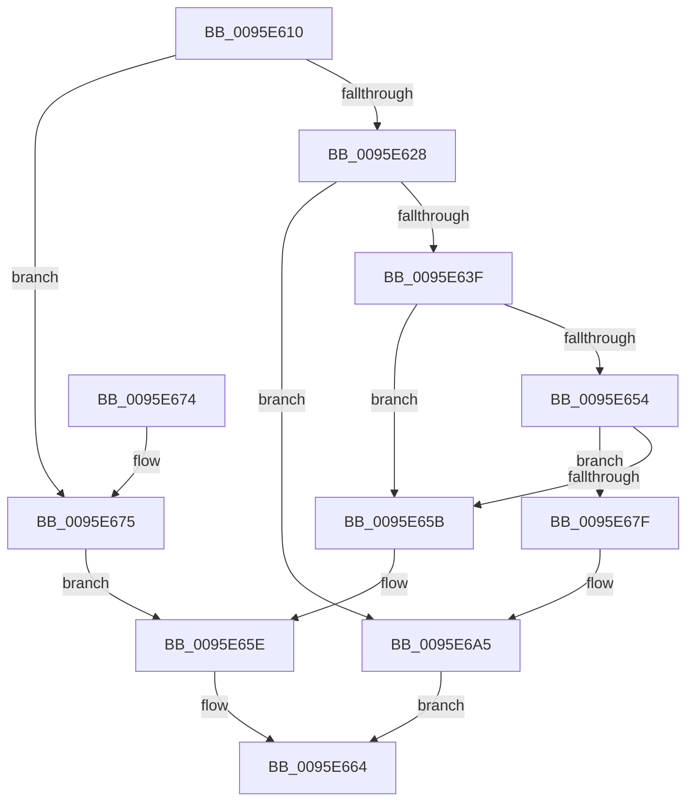

# SdbGetFirstChild

- RVA: `0x0095E610`–`0x0095E6A9` (길이 `153` bytes)
- VA: `0x000000014095E610`
- 실행 섹션: `PAGE`
- PDB 이름 있음: `예`; PDB Function 태그: `아니요`
- unwind 정보 RVA: `0x0005FE7C`
- 디코드: `46`개 명령, `153/153` bytes 표시
- 미해석 바이트: `0` (있으면 어셈블리에 `.byte`로 보존)

> 이 문서는 커널 이미지의 기계어와 PDB 기호를 분석해 생성했습니다. 4번과 5번은 함수 원형과 자료형을 바이너리 사용 방식에서 추정한 C 해석이며 원본 소스 복구 결과는 아닙니다.

## 1. Dependencies

- 직접 호출 지점: **4**; 고유 호출 대상: **4**
- 직접 호출자로 확인된 함수: **3**
- RIP 상대 이미지 참조: **2**

### Outgoing calls
- `0x0095E628` → [SdbGetTagFromTagID](SdbGetTagFromTagID_function_0095E3C0.md) (function, `0x0095E3C0`)
- `0x0095E644` → [SdbpGetNextTagId](SdbpGetNextTagId_function_0095D740.md) (function, `0x0095D740`)
- `0x0095E64B` → [Feature_SdbValidateRootTagsOnOpen__private_IsEnabledDeviceUsageNoInline](../../text/49/Feature_SdbValidateRootTagsOnOpen__private_IsEnabledDeviceUsageNoInline_function_00494B18.md) (function, `0x00494B18`)
- `0x0095E6A0` → [AslLogCallPrintf](AslLogCallPrintf_function_0095E4EC.md) (function, `0x0095E4EC`)

### Direct callers
- [SdbpMatchList](../81/SdbpMatchList_function_00816734.md) at `0x00816778`
- [SdbFindFirstTag](SdbFindFirstTag_function_0095E34C.md) at `0x0095E370`
- [SdbpFindFirstNamedTagHelper](../AD/SdbpFindFirstNamedTagHelper_function_00AD4D2C.md) at `0x00AD4D53`

### Static image references
- `0x0095E683` → RVA `0x0003B9E0` (`.rdata`; read)
- `0x0095E694` → RVA `0x0003B9C8` (`.rdata`; read)

## 2. Other-region calls and transfers

- 다른 실행 섹션으로 향하는 call: **1**
  - `0x0095E64B` → [Feature_SdbValidateRootTagsOnOpen__private_IsEnabledDeviceUsageNoInline](../../text/49/Feature_SdbValidateRootTagsOnOpen__private_IsEnabledDeviceUsageNoInline_function_00494B18.md) (`PAGE` → `.text`)
- 별도 외부 분기/꼬리 이동을 확인하지 못했습니다.

## 3. Assembly (complete function range)

```asm
0095E610  48 89 5C 24 08                  mov qword ptr [rsp + 8], rbx
0095E615  48 89 74 24 10                  mov qword ptr [rsp + 0x10], rsi
0095E61A  57                              push rdi
0095E61B  48 83 EC 30                     sub rsp, 0x30
0095E61F  8B DA                           mov ebx, edx
0095E621  48 8B F9                        mov rdi, rcx
0095E624  85 D2                           test edx, edx
0095E626  74 4D                           je 0x14095e675
0095E628  E8 93 FD FF FF                  call 0x14095e3c0
0095E62D  B9 00 F0 00 00                  mov ecx, 0xf000
0095E632  66 23 C1                        and ax, cx
0095E635  B9 00 70 00 00                  mov ecx, 0x7000
0095E63A  66 3B C1                        cmp ax, cx
0095E63D  75 66                           jne 0x14095e6a5
0095E63F  8B D3                           mov edx, ebx
0095E641  48 8B CF                        mov rcx, rdi
0095E644  E8 F7 F0 FF FF                  call 0x14095d740
0095E649  8B F0                           mov esi, eax
0095E64B  E8 C8 64 B3 FF                  call 0x140494b18
0095E650  85 C0                           test eax, eax
0095E652  74 07                           je 0x14095e65b
0095E654  8B 47 14                        mov eax, dword ptr [rdi + 0x14]
0095E657  3B F0                           cmp esi, eax
0095E659  77 24                           ja 0x14095e67f
0095E65B  83 C3 06                        add ebx, 6
0095E65E  3B DE                           cmp ebx, esi
0095E660  1B C0                           sbb eax, eax
0095E662  23 C3                           and eax, ebx
0095E664  48 8B 5C 24 40                  mov rbx, qword ptr [rsp + 0x40]
0095E669  48 8B 74 24 48                  mov rsi, qword ptr [rsp + 0x48]
0095E66E  48 83 C4 30                     add rsp, 0x30
0095E672  5F                              pop rdi
0095E673  C3                              ret
0095E674  CC                              int3
0095E675  8B 71 14                        mov esi, dword ptr [rcx + 0x14]
0095E678  BB 0C 00 00 00                  mov ebx, 0xc
0095E67D  EB DF                           jmp 0x14095e65e
0095E67F  89 44 24 28                     mov dword ptr [rsp + 0x28], eax
0095E683  4C 8D 0D 56 D3 6D FF            lea r9, [rip - 0x922caa]
0095E68A  41 B8 44 0C 00 00               mov r8d, 0xc44
0095E690  89 5C 24 20                     mov dword ptr [rsp + 0x20], ebx
0095E694  48 8D 15 2D D3 6D FF            lea rdx, [rip - 0x922cd3]
0095E69B  B9 02 00 00 00                  mov ecx, 2
0095E6A0  E8 47 FE FF FF                  call 0x14095e4ec
0095E6A5  33 C0                           xor eax, eax
0095E6A7  EB BB                           jmp 0x14095e664
```

## 4. C-style interpretation (structured pseudocode)

```c
__int64 __fastcall SdbGetFirstChild(__int64 a1, int a2)
{
    __int64 result;
    __int64 v_rbx;
    __int64 v_rsp;
    unsigned __int64 v_stack_p10;
    unsigned int v_stack_p20;
    unsigned int v_stack_p28;
    unsigned __int64 v_stack_p8;

    v_stack_p8 = v_rbx;
    v_stack_p10 = v_rsi;
    v_rsp = (v_rsp) - (48);
    if (a2 == 0) goto loc_0095E675;
    result = SdbGetTagFromTagID(a1, a2, a3, a4);
    result = (unsigned __int16)((result) & ((unsigned __int16)((unsigned int)(0xF000ULL))));
    if (((unsigned __int16)(result)) != ((unsigned __int16)((unsigned int)(0x7000ULL)))) goto loc_0095E6A5;
    result = SdbpGetNextTagId(a1, (unsigned int)((unsigned int)((unsigned int)(a2))), a3, a4);
    result = Feature_SdbValidateRootTagsOnOpen__private_IsEnabledDeviceUsageNoInline(a1, (unsigned int)((unsigned int)((unsigned int)(a2))), a3, a4);
    if ((unsigned int)(result) == 0) goto loc_0095E65B;
    if (((unsigned int)((unsigned int)((unsigned int)(result)))) > ((unsigned int)((unsigned int)(*(unsigned int *)(a1 + 20))))) goto loc_0095E67F;
loc_0095E65B:
    v_rbx = (unsigned int)(((unsigned int)(a2)) + (6));
loc_0095E65E:
    result = (unsigned int)(((unsigned int)(*(unsigned int *)(a1 + 20))) & ((unsigned int)(v_rbx)));
loc_0095E664:
    v_rsp = (v_rsp) + (48);
    return result;
loc_0095E675:
    goto loc_0095E65E;
loc_0095E67F:
    v_stack_p28 = (unsigned int)(result);
    v_stack_p20 = 12;
    result = AslLogCallPrintf(2, v_rip - 9579731, (unsigned int)(0xC44ULL), v_rip - 9579690);
loc_0095E6A5:
    result = 0;
    goto loc_0095E664;
}
```

## 5. (Beta) C Style

```c
int64_t SdbGetFirstChild(void *Arg1, int32_t Arg2)
{
    uint8_t *arg1 = (uint8_t *)Arg1;

    int64_t result;
    int64_t local_rbx;
    int64_t local_rsp;
    uint64_t v_stack_p10;
    uint32_t v_stack_p20;
    uint32_t v_stack_p28;
    uint64_t v_stack_p8;

    v_stack_p8 = local_rbx;
    v_stack_p10 = local_rsi;
    local_rsp = (local_rsp) - (48);
    if (Arg2 == 0) goto loc_0095E675;
    result = SdbGetTagFromTagID(Arg1, Arg2, a3, a4);
    result = (uint16_t)((result) & ((uint16_t)((uint32_t)(0xF000ULL))));
    if (((uint16_t)(result)) != ((uint16_t)((uint32_t)(0x7000ULL)))) goto loc_0095E6A5;
    result = SdbpGetNextTagId(Arg1, (uint32_t)((uint32_t)((uint32_t)(Arg2))), a3, a4);
    result = Feature_SdbValidateRootTagsOnOpen__private_IsEnabledDeviceUsageNoInline(Arg1, (uint32_t)((uint32_t)((uint32_t)(Arg2))), a3, a4);
    if ((uint32_t)(result) == 0) goto loc_0095E65B;
    if (((uint32_t)((uint32_t)((uint32_t)(result)))) > ((uint32_t)((uint32_t)(*(uint32_t *)(arg1 + 0x14))))) goto loc_0095E67F;
loc_0095E65B:
    local_rbx = (uint32_t)(((uint32_t)(Arg2)) + (6));
loc_0095E65E:
    result = (uint32_t)(((uint32_t)(*(uint32_t *)(arg1 + 0x14))) & ((uint32_t)(local_rbx)));
loc_0095E664:
    local_rsp = (local_rsp) + (48);
    return result;
loc_0095E675:
    goto loc_0095E65E;
loc_0095E67F:
    v_stack_p28 = (uint32_t)(result);
    v_stack_p20 = 12;
    result = AslLogCallPrintf(2, v_rip - 9579731, (uint32_t)(0xC44ULL), v_rip - 9579690);
loc_0095E6A5:
    result = 0;
    goto loc_0095E664;
}
```

### 관측된 메모리 오프셋

구조체 형식이 확인되지 않은 접근은 인자 기준의 오프셋으로만 기록했습니다.

| 기준 인자 | 오프셋 표현 | 폭 (bit) | 접근 |
|---|---:|---:|---|
| `Arg1` | `+ 0x14` | `32` | `R` |

## 6. Execution-region graph

[열기: 2D/3D 그래프와 함수 탐색 컨트롤 패널](../../../control-panel.html?section=page&rva=0x0095E610&view=graph)

- 2D 그래프는 위에서 아래로 흐르고, 3D 그래프는 빈 공간을 드래그해 회전합니다. Shift+드래그는 이동, 휠은 확대·축소, 함수 노드 선택은 대상 보고서 이동입니다.

### Static fallback


