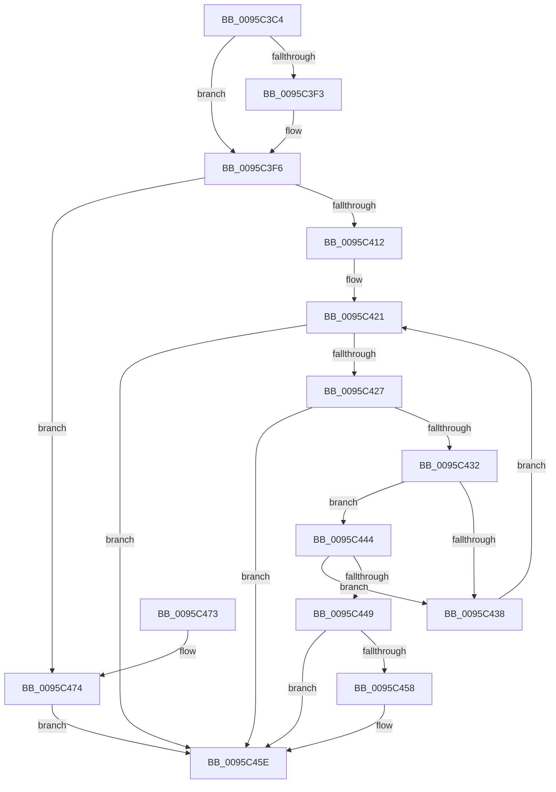

# SdbGetIndex

- RVA: `0x0095C3C4`–`0x0095C498` (길이 `212` bytes)
- VA: `0x000000014095C3C4`
- 실행 섹션: `PAGE`
- PDB 이름 있음: `예`; PDB Function 태그: `아니요`
- unwind 정보 RVA: `0x00092CDC`
- 디코드: `62`개 명령, `212/212` bytes 표시
- 미해석 바이트: `0` (있으면 어셈블리에 `.byte`로 보존)

> 이 문서는 커널 이미지의 기계어와 PDB 기호를 분석해 생성했습니다. 4번과 5번은 함수 원형과 자료형을 바이너리 사용 방식에서 추정한 C 해석이며 원본 소스 복구 결과는 아닙니다.

## 1. Dependencies

- 직접 호출 지점: **2**; 고유 호출 대상: **2**
- 직접 호출자로 확인된 함수: **3**
- RIP 상대 이미지 참조: **3**

### Outgoing calls
- `0x0095C409` → [RtlRunOnceExecuteOnce](RtlRunOnceExecuteOnce_function_0095DC00.md) (function, `0x0095DC00`)
- `0x0095C491` → [AslLogCallPrintf](AslLogCallPrintf_function_0095E4EC.md) (function, `0x0095E4EC`)

### Direct callers
- [SdbFindFirstStringIndexedTag](SdbFindFirstStringIndexedTag_function_0095C1D8.md) at `0x0095C20D`
- [SdbpFindFirstIndexedWildCardTag](SdbpFindFirstIndexedWildCardTag_function_0095DE58.md) at `0x0095DEE4`
- [SdbpSearchDB](../AB/SdbpSearchDB_function_00AB3294.md) at `0x00AB3342`
- [SdbpSearchDB](../AB/SdbpSearchDB_function_00AB3294.md) at `0x00AB3490`
- [SdbpSearchDB](../AB/SdbpSearchDB_function_00AB3294.md) at `0x00AB3589`
- [SdbpSearchDB](../AB/SdbpSearchDB_function_00AB3294.md) at `0x00AB367E`

### Static image references
- `0x0095C402` → RVA `0x0095D4C0` (`InitOnceScanIndexes`; read)
- `0x0095C474` → RVA `0x00012958` (`.rdata`; read)
- `0x0095C485` → RVA `0x00012998` (`.rdata`; read)

## 2. Other-region calls and transfers

- 다른 실행 섹션으로 향하는 call: **0**
- 별도 외부 분기/꼬리 이동을 확인하지 못했습니다.

## 3. Assembly (complete function range)

```asm
0095C3C4  48 89 5C 24 10                  mov qword ptr [rsp + 0x10], rbx
0095C3C9  48 89 6C 24 18                  mov qword ptr [rsp + 0x18], rbp
0095C3CE  56                              push rsi
0095C3CF  57                              push rdi
0095C3D0  41 56                           push r14
0095C3D2  48 83 EC 30                     sub rsp, 0x30
0095C3D6  45 33 F6                        xor r14d, r14d
0095C3D9  41 0F B7 F0                     movzx esi, r8w
0095C3DD  4C 89 74 24 50                  mov qword ptr [rsp + 0x50], r14
0095C3E2  49 8B D9                        mov rbx, r9
0095C3E5  0F B7 EA                        movzx ebp, dx
0095C3E8  4C 8B C1                        mov r8, rcx
0095C3EB  41 8B FE                        mov edi, r14d
0095C3EE  4D 85 C9                        test r9, r9
0095C3F1  74 03                           je 0x14095c3f6
0095C3F3  45 89 31                        mov dword ptr [r9], r14d
0095C3F6  48 81 C1 38 0A 00 00            add rcx, 0xa38
0095C3FD  4C 8D 4C 24 50                  lea r9, [rsp + 0x50]
0095C402  48 8D 15 B7 10 00 00            lea rdx, [rip + 0x10b7]
0095C409  E8 F2 17 00 00                  call 0x14095dc00
0095C40E  85 C0                           test eax, eax
0095C410  78 62                           js 0x14095c474
0095C412  48 8B 54 24 50                  mov rdx, qword ptr [rsp + 0x50]
0095C417  45 8B C6                        mov r8d, r14d
0095C41A  49 8B CE                        mov rcx, r14
0095C41D  48 8D 42 06                     lea rax, [rdx + 6]
0095C421  48 83 F9 40                     cmp rcx, 0x40
0095C425  7D 37                           jge 0x14095c45e
0095C427  44 0F B7 48 FE                  movzx r9d, word ptr [rax - 2]
0095C42C  66 45 85 C9                     test r9w, r9w
0095C430  74 2C                           je 0x14095c45e
0095C432  66 44 3B CD                     cmp r9w, bp
0095C436  74 0C                           je 0x14095c444
0095C438  41 FF C0                        inc r8d
0095C43B  48 FF C1                        inc rcx
0095C43E  48 83 C0 28                     add rax, 0x28
0095C442  EB DD                           jmp 0x14095c421
0095C444  66 39 30                        cmp word ptr [rax], si
0095C447  75 EF                           jne 0x14095c438
0095C449  49 63 C0                        movsxd rax, r8d
0095C44C  48 8D 0C 80                     lea rcx, [rax + rax*4]
0095C450  8B 3C CA                        mov edi, dword ptr [rdx + rcx*8]
0095C453  48 85 DB                        test rbx, rbx
0095C456  74 06                           je 0x14095c45e
0095C458  8B 4C CA 20                     mov ecx, dword ptr [rdx + rcx*8 + 0x20]
0095C45C  89 0B                           mov dword ptr [rbx], ecx
0095C45E  48 8B 5C 24 58                  mov rbx, qword ptr [rsp + 0x58]
0095C463  8B C7                           mov eax, edi
0095C465  48 8B 6C 24 60                  mov rbp, qword ptr [rsp + 0x60]
0095C46A  48 83 C4 30                     add rsp, 0x30
0095C46E  41 5E                           pop r14
0095C470  5F                              pop rdi
0095C471  5E                              pop rsi
0095C472  C3                              ret
0095C473  CC                              int3
0095C474  4C 8D 0D DD 64 6B FF            lea r9, [rip - 0x949b23]
0095C47B  89 44 24 20                     mov dword ptr [rsp + 0x20], eax
0095C47F  41 B8 31 05 00 00               mov r8d, 0x531
0095C485  48 8D 15 0C 65 6B FF            lea rdx, [rip - 0x949af4]
0095C48C  B9 01 00 00 00                  mov ecx, 1
0095C491  E8 56 20 00 00                  call 0x14095e4ec
0095C496  EB C6                           jmp 0x14095c45e
```

## 4. C-style interpretation (structured pseudocode)

```c
__int64 __fastcall SdbGetIndex(__int64 a1, unsigned __int16 a2, unsigned __int16 a3, __int64 a4)
{
    __int64 result;
    __int64 v_r14;
    __int64 v_rsp;
    unsigned __int64 v_stack_p10;
    unsigned __int64 v_stack_p18;
    unsigned int v_stack_p20;
    unsigned __int64 v_stack_p8;

    v_stack_p10 = v_rbx;
    v_stack_p18 = v_rbp;
    v_rsp = (v_rsp) - (48);
    v_r14 = 0;
    v_stack_p8 = 0;
    if (a4 != 0) {
        *(unsigned int *)(a4) = 0;
    }
    a1 = (a1) + (0xA38ULL);
    result = RtlRunOnceExecuteOnce(a1, v_rip + 4279, a1, v_stack_p8);
    if (sign_flag) goto loc_0095C474;
loc_0095C421:
    if (0 >= 64) goto loc_0095C45E;
    if ((unsigned __int16)(*(unsigned __int16 *)(v_stack_p8 + 6 - 2)) == 0) goto loc_0095C45E;
    if (((unsigned __int16)(*(unsigned __int16 *)(v_stack_p8 + 6 - 2))) == a2) goto loc_0095C444;
loc_0095C438:
    a3 = (unsigned int)((0) + 1);
    a1 = (0) + 1;
    result = (v_stack_p8 + 6) + (40);
    goto loc_0095C421;
loc_0095C444:
    if ((*(unsigned __int16 *)(result)) != a3) goto loc_0095C438;
    if (a4 != 0) {
        a1 = *(unsigned int *)(v_stack_p8 + (int)(a3) + (int)(a3) * 4 * 8 + 32);
        *(unsigned int *)(a4) = (unsigned int)(a1);
    }
    v_rsp = (v_rsp) + (48);
    return (unsigned int)((unsigned int)((unsigned int)(*(unsigned int *)(v_stack_p8 + (int)(a3) + (int)(a3) * 4 * 8))));
loc_0095C474:
    v_stack_p20 = (unsigned int)((unsigned int)((unsigned int)((unsigned int)(*(unsigned int *)(v_stack_p8 + (int)(a3) + (int)(a3) * 4 * 8)))));
    result = AslLogCallPrintf(1, v_rip - 9738996, (unsigned int)(0x531ULL), v_rip - 9739043);
    goto loc_0095C45E;
}
```

## 5. (Beta) C Style

```c
int64_t SdbGetIndex(int64_t Arg1, uint16_t Arg2, uint16_t Arg3, int64_t Arg4)
{
    int64_t result;
    int64_t local_r14;
    int64_t local_rsp;
    uint64_t v_stack_p10;
    uint64_t v_stack_p18;
    uint32_t v_stack_p20;
    uint64_t v_stack_p8;

    v_stack_p10 = local_rbx;
    v_stack_p18 = local_rbp;
    local_rsp = (local_rsp) - (48);
    local_r14 = 0;
    v_stack_p8 = 0;
    if (Arg4 != 0) {
        *(uint32_t *)(Arg4) = 0;
    }
    Arg1 = (Arg1) + (0xA38ULL);
    result = RtlRunOnceExecuteOnce(Arg1, v_rip + 4279, Arg1, v_stack_p8);
    if (sign_flag) goto loc_0095C474;
loc_0095C421:
    if (0 >= 64) goto loc_0095C45E;
    if ((uint16_t)(*(uint16_t *)(v_stack_p8 + 0x6 - 0x2)) == 0) goto loc_0095C45E;
    if (((uint16_t)(*(uint16_t *)(v_stack_p8 + 0x6 - 0x2))) == Arg2) goto loc_0095C444;
loc_0095C438:
    Arg3 = (uint32_t)((0) + 1);
    Arg1 = (0) + 1;
    result = (v_stack_p8 + 6) + (40);
    goto loc_0095C421;
loc_0095C444:
    if ((*(uint16_t *)(result)) != Arg3) goto loc_0095C438;
    if (Arg4 != 0) {
        Arg1 = *(uint32_t *)(v_stack_p8 + (int32_t)(Arg3) + (int32_t)(Arg3) * 4 * 8 + 0x20);
        *(uint32_t *)(Arg4) = (uint32_t)(Arg1);
    }
    local_rsp = (local_rsp) + (48);
    return (uint32_t)((uint32_t)((uint32_t)(*(uint32_t *)(v_stack_p8 + (int32_t)(Arg3) + (int32_t)(Arg3) * 4 * 8))));
loc_0095C474:
    v_stack_p20 = (uint32_t)((uint32_t)((uint32_t)((uint32_t)(*(uint32_t *)(v_stack_p8 + (int32_t)(Arg3) + (int32_t)(Arg3) * 4 * 8)))));
    result = AslLogCallPrintf(1, v_rip - 9738996, (uint32_t)(0x531ULL), v_rip - 9739043);
    goto loc_0095C45E;
}
```

## 6. Execution-region graph

[열기: 2D/3D 그래프와 함수 탐색 컨트롤 패널](../../../control-panel.html?section=page&rva=0x0095C3C4&view=graph)

- 2D 그래프는 위에서 아래로 흐르고, 3D 그래프는 빈 공간을 드래그해 회전합니다. Shift+드래그는 이동, 휠은 확대·축소, 함수 노드 선택은 대상 보고서 이동입니다.

### Static fallback


