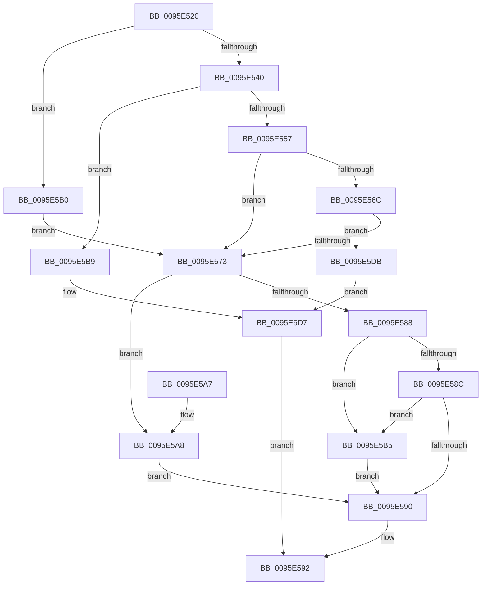

# SdbGetNextChild

- RVA: `0x0095E520`–`0x0095E607` (길이 `231` bytes)
- VA: `0x000000014095E520`
- 실행 섹션: `PAGE`
- PDB 이름 있음: `예`; PDB Function 태그: `아니요`
- unwind 정보 RVA: `0x00092F1C`
- 디코드: `69`개 명령, `231/231` bytes 표시
- 미해석 바이트: `0` (있으면 어셈블리에 `.byte`로 보존)

> 이 문서는 커널 이미지의 기계어와 PDB 기호를 분석해 생성했습니다. 4번과 5번은 함수 원형과 자료형을 바이너리 사용 방식에서 추정한 C 해석이며 원본 소스 복구 결과는 아닙니다.

## 1. Dependencies

- 직접 호출 지점: **7**; 고유 호출 대상: **4**
- 직접 호출자로 확인된 함수: **5**
- RIP 상대 이미지 참조: **3**

### Outgoing calls
- `0x0095E540` → [SdbGetTagFromTagID](SdbGetTagFromTagID_function_0095E3C0.md) (function, `0x0095E3C0`)
- `0x0095E55C` → [SdbpGetNextTagId](SdbpGetNextTagId_function_0095D740.md) (function, `0x0095D740`)
- `0x0095E563` → [Feature_SdbValidateRootTagsOnOpen__private_IsEnabledDeviceUsageNoInline](../../text/49/Feature_SdbValidateRootTagsOnOpen__private_IsEnabledDeviceUsageNoInline_function_00494B18.md) (function, `0x00494B18`)
- `0x0095E578` → [SdbpGetNextTagId](SdbpGetNextTagId_function_0095D740.md) (function, `0x0095D740`)
- `0x0095E57F` → [Feature_SdbValidateRootTagsOnOpen__private_IsEnabledDeviceUsageNoInline](../../text/49/Feature_SdbValidateRootTagsOnOpen__private_IsEnabledDeviceUsageNoInline_function_00494B18.md) (function, `0x00494B18`)
- `0x0095E5D2` → [AslLogCallPrintf](AslLogCallPrintf_function_0095E4EC.md) (function, `0x0095E4EC`)
- `0x0095E600` → [AslLogCallPrintf](AslLogCallPrintf_function_0095E4EC.md) (function, `0x0095E4EC`)

### Direct callers
- [SdbpMatchList](../81/SdbpMatchList_function_00816734.md) at `0x008167E3`
- [SdbpFindNextNamedTagHelper](../81/SdbpFindNextNamedTagHelper_function_00816DF8.md) at `0x00816E65`
- [SdbFindNextTag](SdbFindNextTag_function_0095D7F4.md) at `0x0095D830`
- [SdbFindFirstTag](SdbFindFirstTag_function_0095E34C.md) at `0x0095E393`
- [SdbpFindFirstNamedTagHelper](../AD/SdbpFindFirstNamedTagHelper_function_00AD4D2C.md) at `0x00AD4DC7`

### Static image references
- `0x0095E5B9` → RVA `0x00012AB0` (`.rdata`; read)
- `0x0095E5C6` → RVA `0x00012AA0` (`.rdata`; read)
- `0x0095E5DF` → RVA `0x0003BEA0` (`.rdata`; read)

## 2. Other-region calls and transfers

- 다른 실행 섹션으로 향하는 call: **2**
  - `0x0095E563` → [Feature_SdbValidateRootTagsOnOpen__private_IsEnabledDeviceUsageNoInline](../../text/49/Feature_SdbValidateRootTagsOnOpen__private_IsEnabledDeviceUsageNoInline_function_00494B18.md) (`PAGE` → `.text`)
  - `0x0095E57F` → [Feature_SdbValidateRootTagsOnOpen__private_IsEnabledDeviceUsageNoInline](../../text/49/Feature_SdbValidateRootTagsOnOpen__private_IsEnabledDeviceUsageNoInline_function_00494B18.md) (`PAGE` → `.text`)
- 별도 외부 분기/꼬리 이동을 확인하지 못했습니다.

## 3. Assembly (complete function range)

```asm
0095E520  48 89 5C 24 08                  mov qword ptr [rsp + 8], rbx
0095E525  48 89 6C 24 10                  mov qword ptr [rsp + 0x10], rbp
0095E52A  48 89 74 24 18                  mov qword ptr [rsp + 0x18], rsi
0095E52F  57                              push rdi
0095E530  48 83 EC 40                     sub rsp, 0x40
0095E534  41 8B E8                        mov ebp, r8d
0095E537  8B F2                           mov esi, edx
0095E539  48 8B D9                        mov rbx, rcx
0095E53C  85 D2                           test edx, edx
0095E53E  74 70                           je 0x14095e5b0
0095E540  E8 7B FE FF FF                  call 0x14095e3c0
0095E545  B9 00 F0 00 00                  mov ecx, 0xf000
0095E54A  66 23 C1                        and ax, cx
0095E54D  B9 00 70 00 00                  mov ecx, 0x7000
0095E552  66 3B C1                        cmp ax, cx
0095E555  75 62                           jne 0x14095e5b9
0095E557  8B D6                           mov edx, esi
0095E559  48 8B CB                        mov rcx, rbx
0095E55C  E8 DF F1 FF FF                  call 0x14095d740
0095E561  8B F8                           mov edi, eax
0095E563  E8 B0 65 B3 FF                  call 0x140494b18
0095E568  85 C0                           test eax, eax
0095E56A  74 07                           je 0x14095e573
0095E56C  8B 43 14                        mov eax, dword ptr [rbx + 0x14]
0095E56F  3B F8                           cmp edi, eax
0095E571  77 68                           ja 0x14095e5db
0095E573  8B D5                           mov edx, ebp
0095E575  48 8B CB                        mov rcx, rbx
0095E578  E8 C3 F1 FF FF                  call 0x14095d740
0095E57D  8B D8                           mov ebx, eax
0095E57F  E8 94 65 B3 FF                  call 0x140494b18
0095E584  85 C0                           test eax, eax
0095E586  74 20                           je 0x14095e5a8
0095E588  3B DF                           cmp ebx, edi
0095E58A  73 29                           jae 0x14095e5b5
0095E58C  3B DD                           cmp ebx, ebp
0095E58E  76 25                           jbe 0x14095e5b5
0095E590  8B C3                           mov eax, ebx
0095E592  48 8B 5C 24 50                  mov rbx, qword ptr [rsp + 0x50]
0095E597  48 8B 6C 24 58                  mov rbp, qword ptr [rsp + 0x58]
0095E59C  48 8B 74 24 60                  mov rsi, qword ptr [rsp + 0x60]
0095E5A1  48 83 C4 40                     add rsp, 0x40
0095E5A5  5F                              pop rdi
0095E5A6  C3                              ret
0095E5A7  CC                              int3
0095E5A8  3B DF                           cmp ebx, edi
0095E5AA  1B C0                           sbb eax, eax
0095E5AC  23 D8                           and ebx, eax
0095E5AE  EB E0                           jmp 0x14095e590
0095E5B0  8B 79 14                        mov edi, dword ptr [rcx + 0x14]
0095E5B3  EB BE                           jmp 0x14095e573
0095E5B5  33 DB                           xor ebx, ebx
0095E5B7  EB D7                           jmp 0x14095e590
0095E5B9  4C 8D 0D F0 44 6B FF            lea r9, [rip - 0x94bb10]
0095E5C0  41 B8 6D 0C 00 00               mov r8d, 0xc6d
0095E5C6  48 8D 15 D3 44 6B FF            lea rdx, [rip - 0x94bb2d]
0095E5CD  B9 01 00 00 00                  mov ecx, 1
0095E5D2  E8 15 FF FF FF                  call 0x14095e4ec
0095E5D7  33 C0                           xor eax, eax
0095E5D9  EB B7                           jmp 0x14095e592
0095E5DB  89 44 24 30                     mov dword ptr [rsp + 0x30], eax
0095E5DF  4C 8D 0D BA D8 6D FF            lea r9, [rip - 0x922746]
0095E5E6  89 6C 24 28                     mov dword ptr [rsp + 0x28], ebp
0095E5EA  48 8D 15 AF 44 6B FF            lea rdx, [rip - 0x94bb51]
0095E5F1  41 B8 7B 0C 00 00               mov r8d, 0xc7b
0095E5F7  89 74 24 20                     mov dword ptr [rsp + 0x20], esi
0095E5FB  B9 02 00 00 00                  mov ecx, 2
0095E600  E8 E7 FE FF FF                  call 0x14095e4ec
0095E605  EB D0                           jmp 0x14095e5d7
```

## 4. C-style interpretation (structured pseudocode)

```c
__int64 __fastcall SdbGetNextChild(__int64 a1, int a2, int a3)
{
    __int64 result;
    __int64 v_rbx;
    __int64 v_rsp;
    unsigned __int64 v_stack_p10;
    unsigned __int64 v_stack_p18;
    unsigned int v_stack_p20;
    unsigned int v_stack_p28;
    unsigned int v_stack_p30;
    unsigned __int64 v_stack_p8;

    v_stack_p8 = v_rbx;
    v_stack_p10 = v_rbp;
    v_stack_p18 = v_rsi;
    v_rsp = (v_rsp) - (64);
    if (a2 == 0) goto loc_0095E5B0;
    result = SdbGetTagFromTagID(a1, a2, a3, a4);
    result = (unsigned __int16)((result) & ((unsigned __int16)((unsigned int)(0xF000ULL))));
    if (((unsigned __int16)(result)) != ((unsigned __int16)((unsigned int)(0x7000ULL)))) goto loc_0095E5B9;
    result = SdbpGetNextTagId(a1, (unsigned int)((unsigned int)((unsigned int)(a2))), a3, a4);
    result = Feature_SdbValidateRootTagsOnOpen__private_IsEnabledDeviceUsageNoInline(a1, (unsigned int)((unsigned int)((unsigned int)(a2))), a3, a4);
    if ((unsigned int)(result) == 0) goto loc_0095E573;
    if (((unsigned int)((unsigned int)((unsigned int)(result)))) > ((unsigned int)((unsigned int)(*(unsigned int *)(a1 + 20))))) goto loc_0095E5DB;
loc_0095E573:
    result = SdbpGetNextTagId(a1, (unsigned int)((unsigned int)((unsigned int)(a3))), a3, a4);
    result = Feature_SdbValidateRootTagsOnOpen__private_IsEnabledDeviceUsageNoInline(a1, (unsigned int)((unsigned int)((unsigned int)(a3))), a3, a4);
    if ((unsigned int)(result) == 0) goto loc_0095E5A8;
    if (((unsigned int)((unsigned int)((unsigned int)(result)))) >= ((unsigned int)((unsigned int)((unsigned int)(result))))) goto loc_0095E5B5;
    if (((unsigned int)((unsigned int)((unsigned int)(result)))) <= ((unsigned int)((unsigned int)(a3)))) goto loc_0095E5B5;
loc_0095E590:
loc_0095E592:
    v_rsp = (v_rsp) + (64);
    return (unsigned int)((unsigned int)((unsigned int)((unsigned int)(result))));
loc_0095E5A8:
    v_rbx = (unsigned int)((v_stack_p8) & ((unsigned int)((unsigned int)((unsigned int)((unsigned int)((unsigned int)(result)))))));
    goto loc_0095E590;
loc_0095E5B0:
    goto loc_0095E573;
loc_0095E5B5:
    v_rbx = 0;
    goto loc_0095E590;
loc_0095E5B9:
    result = AslLogCallPrintf(1, v_rip - 9747245, (unsigned int)(0xC6DULL), v_rip - 9747216);
loc_0095E5D7:
    result = 0;
    goto loc_0095E592;
loc_0095E5DB:
    v_stack_p30 = 0;
    v_stack_p28 = (unsigned int)(v_stack_p10);
    v_stack_p20 = (unsigned int)(v_stack_p18);
    result = AslLogCallPrintf(2, v_rip - 9747281, (unsigned int)(0xC7BULL), v_rip - 9578310);
    goto loc_0095E5D7;
}
```

## 5. (Beta) C Style

```c
int64_t SdbGetNextChild(void *Arg1, int32_t Arg2, int32_t Arg3)
{
    uint8_t *arg1 = (uint8_t *)Arg1;

    int64_t result;
    int64_t local_rbx;
    int64_t local_rsp;
    uint64_t v_stack_p10;
    uint64_t v_stack_p18;
    uint32_t v_stack_p20;
    uint32_t v_stack_p28;
    uint32_t v_stack_p30;
    uint64_t v_stack_p8;

    v_stack_p8 = local_rbx;
    v_stack_p10 = local_rbp;
    v_stack_p18 = local_rsi;
    local_rsp = (local_rsp) - (64);
    if (Arg2 == 0) goto loc_0095E5B0;
    result = SdbGetTagFromTagID(Arg1, Arg2, Arg3, a4);
    result = (uint16_t)((result) & ((uint16_t)((uint32_t)(0xF000ULL))));
    if (((uint16_t)(result)) != ((uint16_t)((uint32_t)(0x7000ULL)))) goto loc_0095E5B9;
    result = SdbpGetNextTagId(Arg1, (uint32_t)((uint32_t)((uint32_t)(Arg2))), Arg3, a4);
    result = Feature_SdbValidateRootTagsOnOpen__private_IsEnabledDeviceUsageNoInline(Arg1, (uint32_t)((uint32_t)((uint32_t)(Arg2))), Arg3, a4);
    if ((uint32_t)(result) == 0) goto loc_0095E573;
    if (((uint32_t)((uint32_t)((uint32_t)(result)))) > ((uint32_t)((uint32_t)(*(uint32_t *)(arg1 + 0x14))))) goto loc_0095E5DB;
loc_0095E573:
    result = SdbpGetNextTagId(Arg1, (uint32_t)((uint32_t)((uint32_t)(Arg3))), Arg3, a4);
    result = Feature_SdbValidateRootTagsOnOpen__private_IsEnabledDeviceUsageNoInline(Arg1, (uint32_t)((uint32_t)((uint32_t)(Arg3))), Arg3, a4);
    if ((uint32_t)(result) == 0) goto loc_0095E5A8;
    if (((uint32_t)((uint32_t)((uint32_t)(result)))) >= ((uint32_t)((uint32_t)((uint32_t)(result))))) goto loc_0095E5B5;
    if (((uint32_t)((uint32_t)((uint32_t)(result)))) <= ((uint32_t)((uint32_t)(Arg3)))) goto loc_0095E5B5;
loc_0095E590:
loc_0095E592:
    local_rsp = (local_rsp) + (64);
    return (uint32_t)((uint32_t)((uint32_t)((uint32_t)(result))));
loc_0095E5A8:
    local_rbx = (uint32_t)((v_stack_p8) & ((uint32_t)((uint32_t)((uint32_t)((uint32_t)((uint32_t)(result)))))));
    goto loc_0095E590;
loc_0095E5B0:
    goto loc_0095E573;
loc_0095E5B5:
    local_rbx = 0;
    goto loc_0095E590;
loc_0095E5B9:
    result = AslLogCallPrintf(1, v_rip - 9747245, (uint32_t)(0xC6DULL), v_rip - 9747216);
loc_0095E5D7:
    result = 0;
    goto loc_0095E592;
loc_0095E5DB:
    v_stack_p30 = 0;
    v_stack_p28 = (uint32_t)(v_stack_p10);
    v_stack_p20 = (uint32_t)(v_stack_p18);
    result = AslLogCallPrintf(2, v_rip - 9747281, (uint32_t)(0xC7BULL), v_rip - 9578310);
    goto loc_0095E5D7;
}
```

### 관측된 메모리 오프셋

구조체 형식이 확인되지 않은 접근은 인자 기준의 오프셋으로만 기록했습니다.

| 기준 인자 | 오프셋 표현 | 폭 (bit) | 접근 |
|---|---:|---:|---|
| `Arg1` | `+ 0x14` | `32` | `R` |

## 6. Execution-region graph

[열기: 2D/3D 그래프와 함수 탐색 컨트롤 패널](../../../control-panel.html?section=page&rva=0x0095E520&view=graph)

- 2D 그래프는 위에서 아래로 흐르고, 3D 그래프는 빈 공간을 드래그해 회전합니다. Shift+드래그는 이동, 휠은 확대·축소, 함수 노드 선택은 대상 보고서 이동입니다.

### Static fallback


