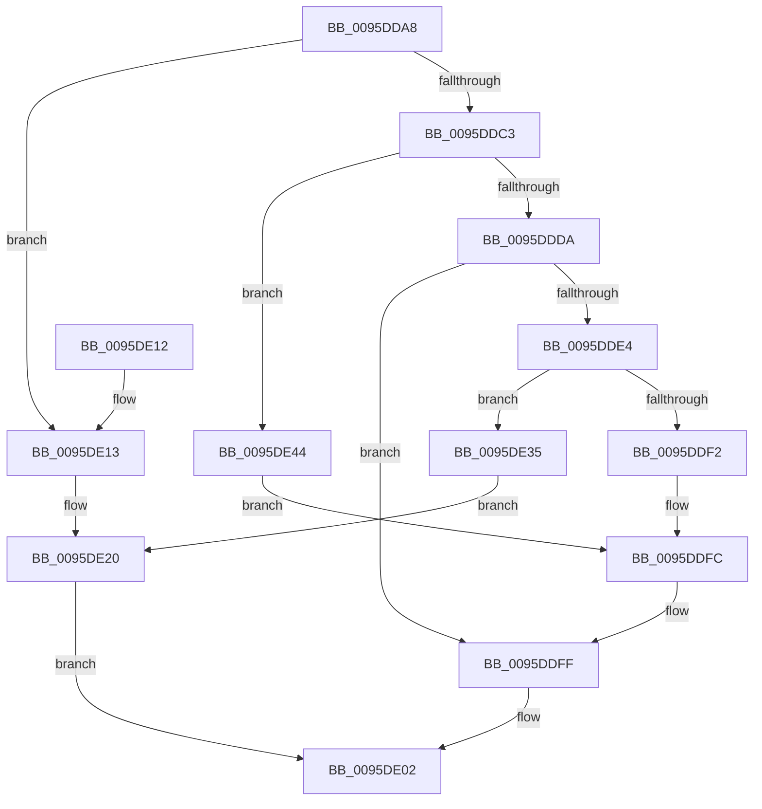

# SdbGetStringTagPtr

- RVA: `0x0095DDA8`–`0x0095DE50` (길이 `168` bytes)
- VA: `0x000000014095DDA8`
- 실행 섹션: `PAGE`
- PDB 이름 있음: `예`; PDB Function 태그: `아니요`
- unwind 정보 RVA: `0x00092E64`
- 디코드: `48`개 명령, `168/168` bytes 표시
- 미해석 바이트: `0` (있으면 어셈블리에 `.byte`로 보존)

> 이 문서는 커널 이미지의 기계어와 PDB 기호를 분석해 생성했습니다. 4번과 5번은 함수 원형과 자료형을 바이너리 사용 방식에서 추정한 C 해석이며 원본 소스 복구 결과는 아닙니다.

## 1. Dependencies

- 직접 호출 지점: **5**; 고유 호출 대상: **5**
- 직접 호출자로 확인된 함수: **24**
- RIP 상대 이미지 참조: **3**

### Outgoing calls
- `0x0095DDC3` → [SdbGetTagFromTagID](SdbGetTagFromTagID_function_0095E3C0.md) (function, `0x0095E3C0`)
- `0x0095DDE9` → [SdbpReadStringRef](SdbpReadStringRef_function_0095E7A0.md) (function, `0x0095E7A0`)
- `0x0095DDF7` → [SdbpGetMappedStringFromTable](SdbpGetMappedStringFromTable_function_0095DA0C.md) (function, `0x0095DA0C`)
- `0x0095DE2C` → [AslLogCallPrintf](AslLogCallPrintf_function_0095E4EC.md) (function, `0x0095E4EC`)
- `0x0095DE49` → [SdbpGetMappedTagData](SdbpGetMappedTagData_function_0095DD24.md) (function, `0x0095DD24`)

### Direct callers
- [SdbpCheckApplicationTypeAttributes](../../text/69/SdbpCheckApplicationTypeAttributes_function_0069C93C.md) at `0x0069CAF1`
- [SdbpCheckApplicationTypeAttributes](../../text/69/SdbpCheckApplicationTypeAttributes_function_0069C93C.md) at `0x0069CC03`
- [SdbpCheckApplicationTypeAttributes](../../text/69/SdbpCheckApplicationTypeAttributes_function_0069C93C.md) at `0x0069CC24`
- [KsepDbGetSdbString](../74/KsepDbGetSdbString_function_00748E60.md) at `0x00748E69`
- [KsepDbReadKData](../74/KsepDbReadKData_function_0074923C.md) at `0x00749289`
- [KsepDbReadKData](../74/KsepDbReadKData_function_0074923C.md) at `0x007492D9`
- [KsepDbReadKFlag](../74/KsepDbReadKFlag_function_00749404.md) at `0x0074943D`
- [SdbQueryDataExTagID](../81/SdbQueryDataExTagID_function_008136E0.md) at `0x00813A00`
- [SdbpCheckContainment](../81/SdbpCheckContainment_function_00813D30.md) at `0x00813DA6`
- [SdbpCheckMatchingDevice](../81/SdbpCheckMatchingDevice_function_00813E20.md) at `0x00813E94`
- [SdbpCheckMatchingDir](../81/SdbpCheckMatchingDir_function_00813EF0.md) at `0x00813F38`
- [SdbpCheckMatchingFiles](../81/SdbpCheckMatchingFiles_function_00814080.md) at `0x008140D9`
- [SdbpCheckMatchingWildcardFiles](../81/SdbpCheckMatchingWildcardFiles_function_00814E30.md) at `0x00814EBC`
- [SdbpCheckSdbCapability](../81/SdbpCheckSdbCapability_function_00815570.md) at `0x008155AE`
- [SdbpGetMatchingTextAttributes](../81/SdbpGetMatchingTextAttributes_function_00815B38.md) at `0x00815BC2`
- [SdbpGetRegistryMatchingAttributes](../81/SdbpGetRegistryMatchingAttributes_function_00815D5C.md) at `0x00815E02`
- [SdbpGetRegistryMatchingAttributes](../81/SdbpGetRegistryMatchingAttributes_function_00815D5C.md) at `0x00815E35`
- [SdbpGetRegistryMatchingAttributes](../81/SdbpGetRegistryMatchingAttributes_function_00815D5C.md) at `0x00816025`
- [SdbpMatchDeviceString](../81/SdbpMatchDeviceString_function_008166C4.md) at `0x008166F7`
- [SdbpMatchList](../81/SdbpMatchList_function_00816734.md) at `0x00816857`
- [SdbpFindNextNamedTagHelper](../81/SdbpFindNextNamedTagHelper_function_00816DF8.md) at `0x00816E9D`
- [SdbpCheckAllAttributes](../81/SdbpCheckAllAttributes_function_008187EC.md) at `0x008188EF`
- [SdbMergeIsEntryUpdated](../81/SdbMergeIsEntryUpdated_function_00819158.md) at `0x00819481`
- [SdbpMergeAreTagValuesEqual](../81/SdbpMergeAreTagValuesEqual_function_00819524.md) at `0x0081965B`
- [SdbpMergeAreTagValuesEqual](../81/SdbpMergeAreTagValuesEqual_function_00819524.md) at `0x00819668`
- [SdbpFindNextIndexedWildCardTag](SdbpFindNextIndexedWildCardTag_function_0095A078.md) at `0x0095A166`
- [SdbpFindFirstIndexedWildCardTag](SdbpFindFirstIndexedWildCardTag_function_0095DE58.md) at `0x0095DFAF`
- [SdbpFindMatchingName](../A9/SdbpFindMatchingName_function_00A91508.md) at `0x00A91546`
- [SdbpSearchDB](../AB/SdbpSearchDB_function_00AB3294.md) at `0x00AB3789`
- [SdbpFindFirstNamedTagHelper](../AD/SdbpFindFirstNamedTagHelper_function_00AD4D2C.md) at `0x00AD4D89`

### Static image references
- `0x0095DE13` → RVA `0x000125E8` (`.rdata`; read)
- `0x0095DE20` → RVA `0x00012940` (`.rdata`; read)
- `0x0095DE35` → RVA `0x00012928` (`.rdata`; read)

## 2. Other-region calls and transfers

- 다른 실행 섹션으로 향하는 call: **0**
- 별도 외부 분기/꼬리 이동을 확인하지 못했습니다.

## 3. Assembly (complete function range)

```asm
0095DDA8  48 89 5C 24 08                  mov qword ptr [rsp + 8], rbx
0095DDAD  48 89 74 24 10                  mov qword ptr [rsp + 0x10], rsi
0095DDB2  57                              push rdi
0095DDB3  48 83 EC 20                     sub rsp, 0x20
0095DDB7  33 DB                           xor ebx, ebx
0095DDB9  8B F2                           mov esi, edx
0095DDBB  48 8B F9                        mov rdi, rcx
0095DDBE  48 85 C9                        test rcx, rcx
0095DDC1  74 50                           je 0x14095de13
0095DDC3  E8 F8 05 00 00                  call 0x14095e3c0
0095DDC8  B9 00 F0 00 00                  mov ecx, 0xf000
0095DDCD  66 23 C1                        and ax, cx
0095DDD0  B9 00 80 00 00                  mov ecx, 0x8000
0095DDD5  66 3B C1                        cmp ax, cx
0095DDD8  74 6A                           je 0x14095de44
0095DDDA  B9 00 60 00 00                  mov ecx, 0x6000
0095DDDF  66 3B C1                        cmp ax, cx
0095DDE2  75 1B                           jne 0x14095ddff
0095DDE4  8B D6                           mov edx, esi
0095DDE6  48 8B CF                        mov rcx, rdi
0095DDE9  E8 B2 09 00 00                  call 0x14095e7a0
0095DDEE  85 C0                           test eax, eax
0095DDF0  74 43                           je 0x14095de35
0095DDF2  8B D0                           mov edx, eax
0095DDF4  48 8B CF                        mov rcx, rdi
0095DDF7  E8 10 FC FF FF                  call 0x14095da0c
0095DDFC  48 8B D8                        mov rbx, rax
0095DDFF  48 8B C3                        mov rax, rbx
0095DE02  48 8B 5C 24 30                  mov rbx, qword ptr [rsp + 0x30]
0095DE07  48 8B 74 24 38                  mov rsi, qword ptr [rsp + 0x38]
0095DE0C  48 83 C4 20                     add rsp, 0x20
0095DE10  5F                              pop rdi
0095DE11  C3                              ret
0095DE12  CC                              int3
0095DE13  4C 8D 0D CE 47 6B FF            lea r9, [rip - 0x94b832]
0095DE1A  41 B8 D2 02 00 00               mov r8d, 0x2d2
0095DE20  48 8D 15 19 4B 6B FF            lea rdx, [rip - 0x94b4e7]
0095DE27  B9 01 00 00 00                  mov ecx, 1
0095DE2C  E8 BB 06 00 00                  call 0x14095e4ec
0095DE31  33 C0                           xor eax, eax
0095DE33  EB CD                           jmp 0x14095de02
0095DE35  4C 8D 0D EC 4A 6B FF            lea r9, [rip - 0x94b514]
0095DE3C  41 B8 E6 02 00 00               mov r8d, 0x2e6
0095DE42  EB DC                           jmp 0x14095de20
0095DE44  8B D6                           mov edx, esi
0095DE46  48 8B CF                        mov rcx, rdi
0095DE49  E8 D6 FE FF FF                  call 0x14095dd24
0095DE4E  EB AC                           jmp 0x14095ddfc
```

## 4. C-style interpretation (structured pseudocode)

```c
__int64 __fastcall SdbGetStringTagPtr(__int64 a1, int a2)
{
    __int64 result;
    __int64 v_rbx;
    __int64 v_rsp;
    unsigned __int64 v_stack_p10;
    unsigned __int64 v_stack_p8;

    v_stack_p8 = v_rbx;
    v_stack_p10 = v_rsi;
    v_rsp = (v_rsp) - (32);
    v_rbx = 0;
    if (a1 == 0) goto loc_0095DE13;
    result = SdbGetTagFromTagID(a1, a2, a3, a4);
    result = (unsigned __int16)((result) & ((unsigned __int16)((unsigned int)(0xF000ULL))));
    if (((unsigned __int16)(result)) == ((unsigned __int16)((unsigned int)(0x8000ULL)))) goto loc_0095DE44;
    if (((unsigned __int16)(result)) != ((unsigned __int16)((unsigned int)(0x6000ULL)))) goto loc_0095DDFF;
    result = SdbpReadStringRef(a1, (unsigned int)((unsigned int)((unsigned int)(a2))), a3, a4);
    if ((unsigned int)(result) == 0) goto loc_0095DE35;
    result = SdbpGetMappedStringFromTable(a1, (unsigned int)((unsigned int)(result)), a3, a4);
loc_0095DDFC:
loc_0095DDFF:
loc_0095DE02:
    v_rsp = (v_rsp) + (32);
    return result;
loc_0095DE13:
loc_0095DE20:
    result = AslLogCallPrintf(1, v_rip - 9745639, 722, v_rip - 9746482);
    result = 0;
    goto loc_0095DE02;
loc_0095DE35:
    goto loc_0095DE20;
loc_0095DE44:
    result = SdbpGetMappedTagData(a1, (unsigned int)((unsigned int)(v_stack_p10)), 742, v_rip - 9745684);
    goto loc_0095DDFC;
}
```

## 5. (Beta) C Style

```c
int64_t SdbGetStringTagPtr(int64_t Arg1, int32_t Arg2)
{
    int64_t result;
    int64_t local_rbx;
    int64_t local_rsp;
    uint64_t v_stack_p10;
    uint64_t v_stack_p8;

    v_stack_p8 = local_rbx;
    v_stack_p10 = local_rsi;
    local_rsp = (local_rsp) - (32);
    local_rbx = 0;
    if (Arg1 == 0) goto loc_0095DE13;
    result = SdbGetTagFromTagID(Arg1, Arg2, a3, a4);
    result = (uint16_t)((result) & ((uint16_t)((uint32_t)(0xF000ULL))));
    if (((uint16_t)(result)) == ((uint16_t)((uint32_t)(0x8000ULL)))) goto loc_0095DE44;
    if (((uint16_t)(result)) != ((uint16_t)((uint32_t)(0x6000ULL)))) goto loc_0095DDFF;
    result = SdbpReadStringRef(Arg1, (uint32_t)((uint32_t)((uint32_t)(Arg2))), a3, a4);
    if ((uint32_t)(result) == 0) goto loc_0095DE35;
    result = SdbpGetMappedStringFromTable(Arg1, (uint32_t)((uint32_t)(result)), a3, a4);
loc_0095DDFC:
loc_0095DDFF:
loc_0095DE02:
    local_rsp = (local_rsp) + (32);
    return result;
loc_0095DE13:
loc_0095DE20:
    result = AslLogCallPrintf(1, v_rip - 9745639, 722, v_rip - 9746482);
    result = 0;
    goto loc_0095DE02;
loc_0095DE35:
    goto loc_0095DE20;
loc_0095DE44:
    result = SdbpGetMappedTagData(Arg1, (uint32_t)((uint32_t)(v_stack_p10)), 742, v_rip - 9745684);
    goto loc_0095DDFC;
}
```

## 6. Execution-region graph

[열기: 2D/3D 그래프와 함수 탐색 컨트롤 패널](../../../control-panel.html?section=page&rva=0x0095DDA8&view=graph)

- 2D 그래프는 위에서 아래로 흐르고, 3D 그래프는 빈 공간을 드래그해 회전합니다. Shift+드래그는 이동, 휠은 확대·축소, 함수 노드 선택은 대상 보고서 이동입니다.

### Static fallback


