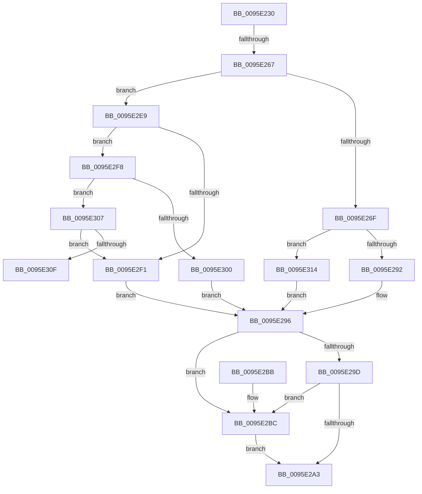

# SdbGetTagDataSize

- RVA: `0x0095E230`–`0x0095E344` (길이 `276` bytes)
- VA: `0x000000014095E230`
- 실행 섹션: `PAGE`
- PDB 이름 있음: `예`; PDB Function 태그: `예`
- unwind 정보 RVA: `0x00092ED0`
- 디코드: `65`개 명령, `276/276` bytes 표시
- 미해석 바이트: `0` (있으면 어셈블리에 `.byte`로 보존)

> 이 문서는 커널 이미지의 기계어와 PDB 기호를 분석해 생성했습니다. 4번과 5번은 함수 원형과 자료형을 바이너리 사용 방식에서 추정한 C 해석이며 원본 소스 복구 결과는 아닙니다.

## 1. Dependencies

- 직접 호출 지점: **5**; 고유 호출 대상: **4**
- 직접 호출자로 확인된 함수: **11**
- RIP 상대 이미지 참조: **2**

### Outgoing calls
- `0x0095E24A` → [SdbGetTagFromTagID](SdbGetTagFromTagID_function_0095E3C0.md) (function, `0x0095E3C0`)
- `0x0095E25A` → [Feature_SdbValidateRootTagsOnOpen__private_IsEnabledDeviceUsageNoInline](../../text/49/Feature_SdbValidateRootTagsOnOpen__private_IsEnabledDeviceUsageNoInline_function_00494B18.md) (function, `0x00494B18`)
- `0x0095E285` → [SdbpReadMappedData](SdbpReadMappedData_function_0095E460.md) (function, `0x0095E460`)
- `0x0095E2DD` → [AslLogCallPrintf](AslLogCallPrintf_function_0095E4EC.md) (function, `0x0095E4EC`)
- `0x0095E33A` → [AslLogCallPrintf](AslLogCallPrintf_function_0095E4EC.md) (function, `0x0095E4EC`)

### Direct callers
- [KsepDbReadKData](../74/KsepDbReadKData_function_0074923C.md) at `0x007493C5`
- [SdbQueryDataExTagID](../81/SdbQueryDataExTagID_function_008136E0.md) at `0x008139CD`
- [SdbpGetMatchingTextAttributes](../81/SdbpGetMatchingTextAttributes_function_00815B38.md) at `0x00815C09`
- [SdbpGetRegistryMatchingAttributes](../81/SdbpGetRegistryMatchingAttributes_function_00815D5C.md) at `0x00815FF1`
- [SdbMergeIsEntryUpdated](../81/SdbMergeIsEntryUpdated_function_00819158.md) at `0x0081943C`
- [SdbpMergeAreTagValuesEqual](../81/SdbpMergeAreTagValuesEqual_function_00819524.md) at `0x008195AC`
- [SdbpMergeAreTagValuesEqual](../81/SdbpMergeAreTagValuesEqual_function_00819524.md) at `0x008195B8`
- [SdbpGetIndex](SdbpGetIndex_function_0095BF94.md) at `0x0095BFBF`
- [SdbpGetFirstIndexedRecord](SdbpGetFirstIndexedRecord_function_0095C0C4.md) at `0x0095C0FB`
- [SdbpGetNextTagId](SdbpGetNextTagId_function_0095D740.md) at `0x0095D770`
- [SdbpGetNextTagId](SdbpGetNextTagId_function_0095D740.md) at `0x0095D791`
- [SdbpReadTagData](SdbpReadTagData_function_0095E170.md) at `0x0095E194`
- [SdbpGetNextIndexedRecord](../A9/SdbpGetNextIndexedRecord_function_00A91608.md) at `0x00A9165A`

### Static image references
- `0x0095E2BC` → RVA `0x00012568` (`.rdata`; read)
- `0x0095E2D1` → RVA `0x00012588` (`.rdata`; read)

## 2. Other-region calls and transfers

- 다른 실행 섹션으로 향하는 call: **1**
  - `0x0095E25A` → [Feature_SdbValidateRootTagsOnOpen__private_IsEnabledDeviceUsageNoInline](../../text/49/Feature_SdbValidateRootTagsOnOpen__private_IsEnabledDeviceUsageNoInline_function_00494B18.md) (`PAGE` → `.text`)
- call이 아닌 외부 분기/꼬리 이동: **2**
  - `0x0095E261` → [sub_00B27B86 + 0x77](../B2/Unknown_function_00B27B86.md) (`tail-transfer`)
  - `0x0095E30F` → [sub_00B27B86](../B2/Unknown_function_00B27B86.md) (`tail-transfer`)

## 3. Assembly (complete function range)

```asm
0095E230  48 89 5C 24 08                  mov qword ptr [rsp + 8], rbx
0095E235  48 89 6C 24 18                  mov qword ptr [rsp + 0x18], rbp
0095E23A  48 89 74 24 20                  mov qword ptr [rsp + 0x20], rsi
0095E23F  41 56                           push r14
0095E241  48 83 EC 30                     sub rsp, 0x30
0095E245  8B F2                           mov esi, edx
0095E247  4C 8B F1                        mov r14, rcx
0095E24A  E8 71 01 00 00                  call 0x14095e3c0
0095E24F  0F B7 E8                        movzx ebp, ax
0095E252  8B DD                           mov ebx, ebp
0095E254  81 E3 00 F0 00 00               and ebx, 0xf000
0095E25A  E8 B9 68 B3 FF                  call 0x140494b18
0095E25F  85 C0                           test eax, eax
0095E261  0F 84 96 99 1C 00               je 0x140b27bfd
0095E267  81 FB 00 90 00 00               cmp ebx, 0x9000
0095E26D  75 7A                           jne 0x14095e2e9
0095E26F  83 64 24 48 00                  and dword ptr [rsp + 0x48], 0
0095E274  8D 56 02                        lea edx, [rsi + 2]
0095E277  41 B9 04 00 00 00               mov r9d, 4
0095E27D  4C 8D 44 24 48                  lea r8, [rsp + 0x48]
0095E282  49 8B CE                        mov rcx, r14
0095E285  E8 D6 01 00 00                  call 0x14095e460
0095E28A  85 C0                           test eax, eax
0095E28C  0F 84 82 00 00 00               je 0x14095e314
0095E292  8B 5C 24 48                     mov ebx, dword ptr [rsp + 0x48]
0095E296  8D 04 33                        lea eax, [rbx + rsi]
0095E299  3B C3                           cmp eax, ebx
0095E29B  72 1F                           jb 0x14095e2bc
0095E29D  41 3B 46 14                     cmp eax, dword ptr [r14 + 0x14]
0095E2A1  77 19                           ja 0x14095e2bc
0095E2A3  8B C3                           mov eax, ebx
0095E2A5  48 8B 5C 24 40                  mov rbx, qword ptr [rsp + 0x40]
0095E2AA  48 8B 6C 24 50                  mov rbp, qword ptr [rsp + 0x50]
0095E2AF  48 8B 74 24 58                  mov rsi, qword ptr [rsp + 0x58]
0095E2B4  48 83 C4 30                     add rsp, 0x30
0095E2B8  41 5E                           pop r14
0095E2BA  C3                              ret
0095E2BB  CC                              int3
0095E2BC  4C 8D 0D A5 42 6B FF            lea r9, [rip - 0x94bd5b]
0095E2C3  C7 44 24 20 95 00 00 C0         mov dword ptr [rsp + 0x20], 0xc0000095
0095E2CB  41 B8 49 01 00 00               mov r8d, 0x149
0095E2D1  48 8D 15 B0 42 6B FF            lea rdx, [rip - 0x94bd50]
0095E2D8  B9 01 00 00 00                  mov ecx, 1
0095E2DD  E8 0A 02 00 00                  call 0x14095e4ec
0095E2E2  BB 00 00 00 20                  mov ebx, 0x20000000
0095E2E7  EB BA                           jmp 0x14095e2a3
0095E2E9  81 FB 00 40 00 00               cmp ebx, 0x4000
0095E2EF  75 07                           jne 0x14095e2f8
0095E2F1  BB 04 00 00 00                  mov ebx, 4
0095E2F6  EB 9E                           jmp 0x14095e296
0095E2F8  81 FB 00 30 00 00               cmp ebx, 0x3000
0095E2FE  75 07                           jne 0x14095e307
0095E300  BB 02 00 00 00                  mov ebx, 2
0095E305  EB 8F                           jmp 0x14095e296
0095E307  81 FB 00 60 00 00               cmp ebx, 0x6000
0095E30D  74 E2                           je 0x14095e2f1
0095E30F  E9 72 98 1C 00                  jmp 0x140b27b86
0095E314  4C 8D 0D 4D 42 6B FF            lea r9, [rip - 0x94bdb3]
0095E31B  C7 44 24 20 23 00 00 C0         mov dword ptr [rsp + 0x20], 0xc0000023
0095E323  41 B8 37 01 00 00               mov r8d, 0x137
0095E329  48 8D 15 58 42 6B FF            lea rdx, [rip - 0x94bda8]
0095E330  B9 01 00 00 00                  mov ecx, 1
0095E335  BB 00 00 00 20                  mov ebx, 0x20000000
0095E33A  E8 AD 01 00 00                  call 0x14095e4ec
0095E33F  E9 52 FF FF FF                  jmp 0x14095e296
```

## 4. C-style interpretation (structured pseudocode)

```c
__int64 __fastcall SdbGetTagDataSize(__int64 a1, int a2)
{
    __int64 result;
    __int64 v_rbx;
    __int64 v_rsp;
    unsigned int v_stack_p10;
    unsigned __int64 v_stack_p18;
    unsigned __int64 v_stack_p20;
    unsigned __int64 v_stack_p8;

    v_stack_p8 = v_rbx;
    v_stack_p18 = v_rbp;
    v_stack_p20 = v_rsi;
    v_rsp = (v_rsp) - (48);
    result = SdbGetTagFromTagID(a1, a2, a3, a4);
    v_rbx = (unsigned int)(((unsigned int)((unsigned int)((unsigned __int16)(result)))) & (0xF000ULL));
    result = Feature_SdbValidateRootTagsOnOpen__private_IsEnabledDeviceUsageNoInline(a1, a2, a3, a4);
    if (((unsigned int)(v_rbx)) != 0x9000ULL) goto loc_0095E2E9;
    result = SdbpReadMappedData(a1, (unsigned int)(a2) + 2, v_stack_p10, 4);
    if ((unsigned int)(result) == 0) goto loc_0095E314;
loc_0095E296:
    if (((unsigned int)((unsigned int)(v_stack_p10) + (unsigned int)(a2) * 1)) < ((unsigned int)((unsigned int)(v_stack_p10)))) goto loc_0095E2BC;
    if (((unsigned int)((unsigned int)(v_stack_p10) + (unsigned int)(a2) * 1)) > (*(unsigned int *)(a1 + 20))) goto loc_0095E2BC;
loc_0095E2A3:
    v_rsp = (v_rsp) + (48);
    return (unsigned int)((unsigned int)((unsigned int)(v_stack_p10)));
loc_0095E2BC:
    v_stack_p20 = 0xC0000095ULL;
    result = AslLogCallPrintf(1, v_rip - 9747792, 329, v_rip - 9747803);
    goto loc_0095E2A3;
loc_0095E2E9:
    if (((unsigned int)((unsigned int)(0x20000000ULL))) != 0x4000ULL) goto loc_0095E2F8;
loc_0095E2F1:
    goto loc_0095E296;
loc_0095E2F8:
    if (4 != 0x3000ULL) goto loc_0095E307;
    goto loc_0095E296;
loc_0095E307:
    if (2 == 0x6000ULL) goto loc_0095E2F1;
loc_0095E314:
    v_stack_p20 = 0xC0000023ULL;
    result = AslLogCallPrintf(1, v_rip - 9747880, 311, v_rip - 9747891);
    goto loc_0095E296;
}
```

## 5. (Beta) C Style

```c
int64_t SdbGetTagDataSize(void *Arg1, void *Arg2)
{
    uint8_t *arg1 = (uint8_t *)Arg1;
    uint8_t *arg2 = (uint8_t *)Arg2;

    int64_t result;
    int64_t local_rbx;
    int64_t local_rsp;
    uint32_t v_stack_p10;
    uint64_t v_stack_p18;
    uint64_t v_stack_p20;
    uint64_t v_stack_p8;

    v_stack_p8 = local_rbx;
    v_stack_p18 = local_rbp;
    v_stack_p20 = local_rsi;
    local_rsp = (local_rsp) - (48);
    result = SdbGetTagFromTagID(Arg1, Arg2, a3, a4);
    local_rbx = (uint32_t)(((uint32_t)((uint32_t)((uint16_t)(result)))) & (0xF000ULL));
    result = Feature_SdbValidateRootTagsOnOpen__private_IsEnabledDeviceUsageNoInline(Arg1, Arg2, a3, a4);
    if (((uint32_t)(local_rbx)) != 0x9000ULL) goto loc_0095E2E9;
    result = SdbpReadMappedData(Arg1, (uint32_t)(Arg2) + 2, v_stack_p10, 4);
    if ((uint32_t)(result) == 0) goto loc_0095E314;
loc_0095E296:
    if (((uint32_t)((uint32_t)(v_stack_p10) + (uint32_t)(Arg2) * 1)) < ((uint32_t)((uint32_t)(v_stack_p10)))) goto loc_0095E2BC;
    if (((uint32_t)((uint32_t)(v_stack_p10) + (uint32_t)(Arg2) * 1)) > (*(uint32_t *)(arg1 + 0x14))) goto loc_0095E2BC;
loc_0095E2A3:
    local_rsp = (local_rsp) + (48);
    return (uint32_t)((uint32_t)((uint32_t)(v_stack_p10)));
loc_0095E2BC:
    v_stack_p20 = 0xC0000095ULL;
    result = AslLogCallPrintf(1, v_rip - 9747792, 329, v_rip - 9747803);
    goto loc_0095E2A3;
loc_0095E2E9:
    if (((uint32_t)((uint32_t)(0x20000000ULL))) != 0x4000ULL) goto loc_0095E2F8;
loc_0095E2F1:
    goto loc_0095E296;
loc_0095E2F8:
    if (4 != 0x3000ULL) goto loc_0095E307;
    goto loc_0095E296;
loc_0095E307:
    if (2 == 0x6000ULL) goto loc_0095E2F1;
loc_0095E314:
    v_stack_p20 = 0xC0000023ULL;
    result = AslLogCallPrintf(1, v_rip - 9747880, 311, v_rip - 9747891);
    goto loc_0095E296;
}
```

### 관측된 메모리 오프셋

구조체 형식이 확인되지 않은 접근은 인자 기준의 오프셋으로만 기록했습니다.

| 기준 인자 | 오프셋 표현 | 폭 (bit) | 접근 |
|---|---:|---:|---|
| `Arg1` | `+ 0x14` | `32` | `R` |
| `Arg2` | `+ 0x2` | `32` | `R` |

## 6. Execution-region graph

[열기: 2D/3D 그래프와 함수 탐색 컨트롤 패널](../../../control-panel.html?section=page&rva=0x0095E230&view=graph)

- 2D 그래프는 위에서 아래로 흐르고, 3D 그래프는 빈 공간을 드래그해 회전합니다. Shift+드래그는 이동, 휠은 확대·축소, 함수 노드 선택은 대상 보고서 이동입니다.

### Static fallback


