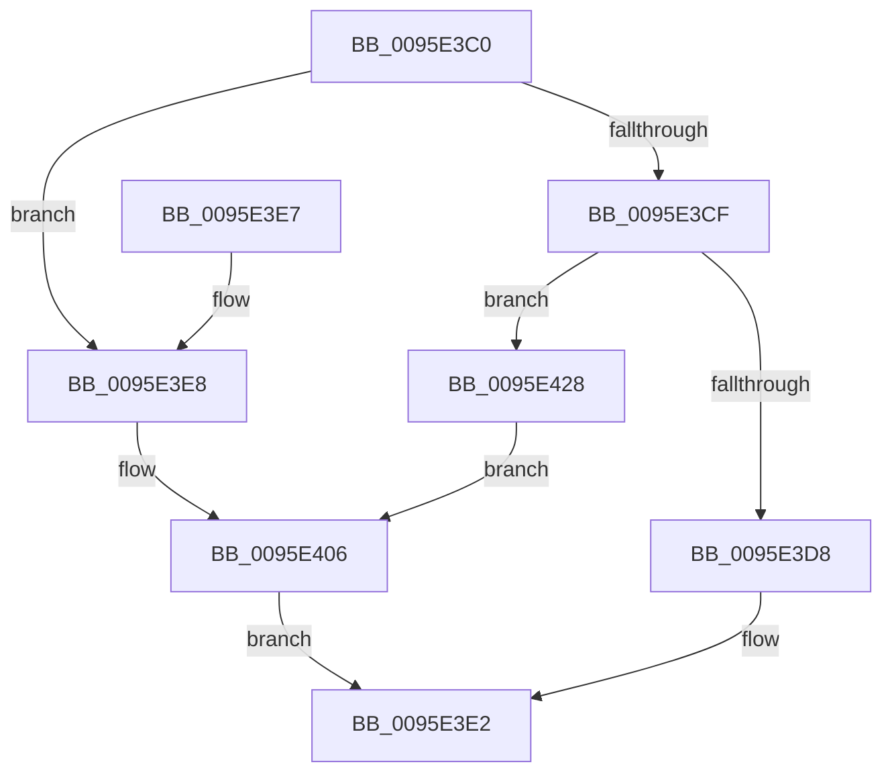

# SdbGetTagFromTagID

- RVA: `0x0095E3C0`–`0x0095E459` (길이 `153` bytes)
- VA: `0x000000014095E3C0`
- 실행 섹션: `PAGE`
- PDB 이름 있음: `예`; PDB Function 태그: `아니요`
- unwind 정보 RVA: `0x00092EF8`
- 디코드: `35`개 명령, `153/153` bytes 표시
- 미해석 바이트: `0` (있으면 어셈블리에 `.byte`로 보존)

> 이 문서는 커널 이미지의 기계어와 PDB 기호를 분석해 생성했습니다. 4번과 5번은 함수 원형과 자료형을 바이너리 사용 방식에서 추정한 C 해석이며 원본 소스 복구 결과는 아닙니다.

## 1. Dependencies

- 직접 호출 지점: **3**; 고유 호출 대상: **1**
- 직접 호출자로 확인된 함수: **27**
- RIP 상대 이미지 참조: **5**

### Outgoing calls
- `0x0095E401` → [AslLogCallPrintf](AslLogCallPrintf_function_0095E4EC.md) (function, `0x0095E4EC`)
- `0x0095E41F` → [AslLogCallPrintf](AslLogCallPrintf_function_0095E4EC.md) (function, `0x0095E4EC`)
- `0x0095E452` → [AslLogCallPrintf](AslLogCallPrintf_function_0095E4EC.md) (function, `0x0095E4EC`)

### Direct callers
- [SdbpCheckApplicationTypeAttributes](../../text/69/SdbpCheckApplicationTypeAttributes_function_0069C93C.md) at `0x0069CA69`
- [SdbpCheckPackageAttributes](../81/SdbpCheckPackageAttributes_function_00815380.md) at `0x0081539D`
- [SdbpCheckPackageAttributes](../81/SdbpCheckPackageAttributes_function_00815380.md) at `0x008153B9`
- [SdbpFindNextNamedTagHelper](../81/SdbpFindNextNamedTagHelper_function_00816DF8.md) at `0x00816E27`
- [SdbpFindNextNamedTagHelper](../81/SdbpFindNextNamedTagHelper_function_00816DF8.md) at `0x00816E79`
- [SdbGetBinaryTagData](../81/SdbGetBinaryTagData_function_00816F8C.md) at `0x00816F9B`
- [SdbGetBinaryTagData](../81/SdbGetBinaryTagData_function_00816F8C.md) at `0x00816FB7`
- [SdbReadQWORDTag](../81/SdbReadQWORDTag_function_0081706C.md) at `0x00817088`
- [SdbReadQWORDTag](../81/SdbReadQWORDTag_function_0081706C.md) at `0x008170A4`
- [SdbpIsEntryIdAvailableInOtherDb](../81/SdbpIsEntryIdAvailableInOtherDb_function_008173D4.md) at `0x008173FE`
- [SdbMergeIsEntryUpdated](../81/SdbMergeIsEntryUpdated_function_00819158.md) at `0x008191C8`
- [SdbpMergeAreTagValuesEqual](../81/SdbpMergeAreTagValuesEqual_function_00819524.md) at `0x00819559`
- [SdbpMergeAreTagValuesEqual](../81/SdbpMergeAreTagValuesEqual_function_00819524.md) at `0x00819566`
- [SdbpGetIndex](SdbpGetIndex_function_0095BF94.md) at `0x0095BFAB`
- [SdbpGetFirstIndexedRecord](SdbpGetFirstIndexedRecord_function_0095C0C4.md) at `0x0095C0E7`
- [SdbReadDWORDTag](SdbReadDWORDTag_function_0095D408.md) at `0x0095D424`
- [SdbReadDWORDTag](SdbReadDWORDTag_function_0095D408.md) at `0x0095D46C`
- [InitOnceScanIndexes](InitOnceScanIndexes_function_0095D4C0.md) at `0x0095D520`
- [SdbpGetNextTagId](SdbpGetNextTagId_function_0095D740.md) at `0x0095D754`
- [SdbFindNextTag](SdbFindNextTag_function_0095D7F4.md) at `0x0095D81A`
- [SdbFindNextTag](SdbFindNextTag_function_0095D7F4.md) at `0x0095D840`
- [SdbReadWORDTag](SdbReadWORDTag_function_0095D898.md) at `0x0095D8B6`
- [SdbReadWORDTag](SdbReadWORDTag_function_0095D898.md) at `0x0095D901`
- [SdbpGetStringTableItemFromStringRef](SdbpGetStringTableItemFromStringRef_function_0095DA74.md) at `0x0095DAF4`
- [SdbGetStringTagPtr](SdbGetStringTagPtr_function_0095DDA8.md) at `0x0095DDC3`
- [SdbGetTagDataSize](SdbGetTagDataSize_function_0095E230.md) at `0x0095E24A`
- [SdbFindFirstTag](SdbFindFirstTag_function_0095E34C.md) at `0x0095E380`
- [SdbGetNextChild](SdbGetNextChild_function_0095E520.md) at `0x0095E540`
- [SdbGetFirstChild](SdbGetFirstChild_function_0095E610.md) at `0x0095E628`
- [SdbpReadStringRef](SdbpReadStringRef_function_0095E7A0.md) at `0x0095E7B4`
- [SdbpReadStringRef](SdbpReadStringRef_function_0095E7A0.md) at `0x0095E7F4`
- [SdbReadBinaryTag](../A7/SdbReadBinaryTag_function_00A7EC28.md) at `0x00A7EC47`
- [SdbReadBinaryTag](../A7/SdbReadBinaryTag_function_00A7EC28.md) at `0x00A7EC79`
- [SdbpGetNextIndexedRecord](../A9/SdbpGetNextIndexedRecord_function_00A91608.md) at `0x00A91629`
- [SdbpFindMatcher](../AB/SdbpFindMatcher_function_00AB0434.md) at `0x00AB0454`
- [SdbpFindFirstNamedTagHelper](../AD/SdbpFindFirstNamedTagHelper_function_00AD4D2C.md) at `0x00AD4D67`
- [sub_00B46D4A](../B4/Unknown_function_00B46D4A.md) at `0x00B46D5B`
- [sub_00B46D4A](../B4/Unknown_function_00B46D4A.md) at `0x00B46D68`

### Static image references
- `0x0095E3E8` → RVA `0x000123E0` (`.rdata`; read)
- `0x0095E3F5` → RVA `0x00012428` (`.rdata`; read)
- `0x0095E406` → RVA `0x00012458` (`.rdata`; read)
- `0x0095E413` → RVA `0x00012440` (`.rdata`; read)
- `0x0095E42D` → RVA `0x0003B460` (`.rdata`; read)

## 2. Other-region calls and transfers

- 다른 실행 섹션으로 향하는 call: **0**
- 별도 외부 분기/꼬리 이동을 확인하지 못했습니다.

## 3. Assembly (complete function range)

```asm
0095E3C0  48 83 EC 48                     sub rsp, 0x48
0095E3C4  48 8B C1                        mov rax, rcx
0095E3C7  8D 4A 02                        lea ecx, [rdx + 2]
0095E3CA  83 F9 02                        cmp ecx, 2
0095E3CD  72 19                           jb 0x14095e3e8
0095E3CF  44 8B 40 14                     mov r8d, dword ptr [rax + 0x14]
0095E3D3  44 3B C1                        cmp r8d, ecx
0095E3D6  72 50                           jb 0x14095e428
0095E3D8  48 8B 40 08                     mov rax, qword ptr [rax + 8]
0095E3DC  8B CA                           mov ecx, edx
0095E3DE  0F B7 04 01                     movzx eax, word ptr [rcx + rax]
0095E3E2  48 83 C4 48                     add rsp, 0x48
0095E3E6  C3                              ret
0095E3E7  CC                              int3
0095E3E8  4C 8D 0D F1 3F 6B FF            lea r9, [rip - 0x94c00f]
0095E3EF  41 B8 47 03 00 00               mov r8d, 0x347
0095E3F5  48 8D 15 2C 40 6B FF            lea rdx, [rip - 0x94bfd4]
0095E3FC  B9 01 00 00 00                  mov ecx, 1
0095E401  E8 E6 00 00 00                  call 0x14095e4ec
0095E406  4C 8D 0D 4B 40 6B FF            lea r9, [rip - 0x94bfb5]
0095E40D  41 B8 DE 0B 00 00               mov r8d, 0xbde
0095E413  48 8D 15 26 40 6B FF            lea rdx, [rip - 0x94bfda]
0095E41A  B9 01 00 00 00                  mov ecx, 1
0095E41F  E8 C8 00 00 00                  call 0x14095e4ec
0095E424  33 C0                           xor eax, eax
0095E426  EB BA                           jmp 0x14095e3e2
0095E428  44 89 44 24 30                  mov dword ptr [rsp + 0x30], r8d
0095E42D  4C 8D 0D 2C D0 6D FF            lea r9, [rip - 0x922fd4]
0095E434  C7 44 24 28 02 00 00 00         mov dword ptr [rsp + 0x28], 2
0095E43C  41 B8 4C 03 00 00               mov r8d, 0x34c
0095E442  89 54 24 20                     mov dword ptr [rsp + 0x20], edx
0095E446  B9 01 00 00 00                  mov ecx, 1
0095E44B  48 8D 15 D6 3F 6B FF            lea rdx, [rip - 0x94c02a]
0095E452  E8 95 00 00 00                  call 0x14095e4ec
0095E457  EB AD                           jmp 0x14095e406
```

## 4. C-style interpretation (structured pseudocode)

```c
__int64 __fastcall SdbGetTagFromTagID(__int64 a1, __int64 a2)
{
    __int64 result;
    __int64 v_rsp;
    unsigned int v_stack_p20;
    unsigned int v_stack_p28;
    unsigned int v_stack_p30;

    v_rsp = (v_rsp) - (72);
    if (((unsigned int)(a2 + 2)) < 2) goto loc_0095E3E8;
    if (((unsigned int)((unsigned int)(*(unsigned int *)(a1 + 20)))) < ((unsigned int)(a2 + 2))) goto loc_0095E428;
loc_0095E3E2:
    v_rsp = (v_rsp) + (72);
    return *(unsigned __int16 *)((unsigned int)((unsigned int)(a2)) + *(unsigned __int64 *)(a1 + 8) * 1);
loc_0095E3E8:
    result = AslLogCallPrintf(1, v_rip - 9748436, 839, v_rip - 9748495);
loc_0095E406:
    result = AslLogCallPrintf(1, v_rip - 9748442, (unsigned int)(0xBDEULL), v_rip - 9748405);
    result = 0;
    goto loc_0095E3E2;
loc_0095E428:
    v_stack_p30 = (unsigned int)((unsigned int)(0xBDEULL));
    v_stack_p28 = 2;
    v_stack_p20 = (unsigned int)(v_rip - 9748442);
    result = AslLogCallPrintf(1, v_rip - 9748522, 844, v_rip - 9580500);
    goto loc_0095E406;
}
```

## 5. (Beta) C Style

```c
int64_t SdbGetTagFromTagID(void *Arg1, void *Arg2)
{
    uint8_t *arg1 = (uint8_t *)Arg1;
    uint8_t *arg2 = (uint8_t *)Arg2;

    int64_t result;
    int64_t local_rsp;
    uint32_t v_stack_p20;
    uint32_t v_stack_p28;
    uint32_t v_stack_p30;

    local_rsp = (local_rsp) - (72);
    if (((uint32_t)(Arg2 + 2)) < 2) goto loc_0095E3E8;
    if (((uint32_t)((uint32_t)(*(uint32_t *)(arg1 + 0x14)))) < ((uint32_t)(Arg2 + 2))) goto loc_0095E428;
loc_0095E3E2:
    local_rsp = (local_rsp) + (72);
    return *(uint16_t *)((uint32_t)((uint32_t)(arg2)) + *(uint64_t *)(arg1 + 0x8) * 1);
loc_0095E3E8:
    result = AslLogCallPrintf(1, v_rip - 9748436, 839, v_rip - 9748495);
loc_0095E406:
    result = AslLogCallPrintf(1, v_rip - 9748442, (uint32_t)(0xBDEULL), v_rip - 9748405);
    result = 0;
    goto loc_0095E3E2;
loc_0095E428:
    v_stack_p30 = (uint32_t)((uint32_t)(0xBDEULL));
    v_stack_p28 = 2;
    v_stack_p20 = (uint32_t)(v_rip - 9748442);
    result = AslLogCallPrintf(1, v_rip - 9748522, 844, v_rip - 9580500);
    goto loc_0095E406;
}
```

### 관측된 메모리 오프셋

구조체 형식이 확인되지 않은 접근은 인자 기준의 오프셋으로만 기록했습니다.

| 기준 인자 | 오프셋 표현 | 폭 (bit) | 접근 |
|---|---:|---:|---|
| `Arg1` | `+ 0x8` | `64` | `R` |
| `Arg1` | `+ 0x14` | `32` | `R` |
| `Arg2` | `+ 0x0 + rax*1` | `16` | `R` |
| `Arg2` | `+ 0x2` | `32` | `R` |

## 6. Execution-region graph

[열기: 2D/3D 그래프와 함수 탐색 컨트롤 패널](../../../control-panel.html?section=page&rva=0x0095E3C0&view=graph)

- 2D 그래프는 위에서 아래로 흐르고, 3D 그래프는 빈 공간을 드래그해 회전합니다. Shift+드래그는 이동, 휠은 확대·축소, 함수 노드 선택은 대상 보고서 이동입니다.

### Static fallback


