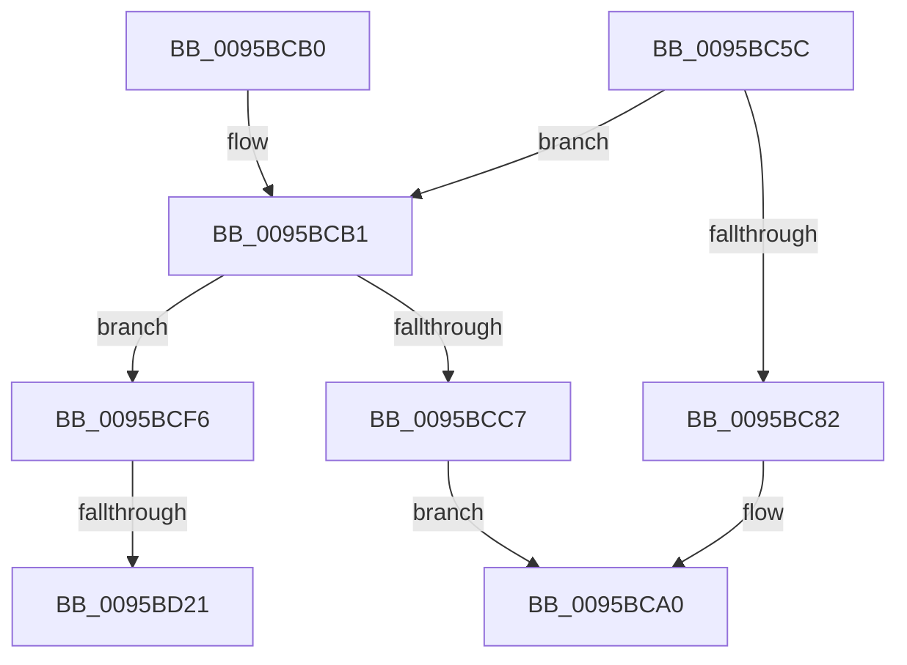

# SdbInitDatabaseInMemory

- RVA: `0x0095BC5C`–`0x0095BD2C` (길이 `208` bytes)
- VA: `0x000000014095BC5C`
- 실행 섹션: `PAGE`
- PDB 이름 있음: `예`; PDB Function 태그: `예`
- unwind 정보 RVA: `0x00092BF8`
- 디코드: `51`개 명령, `208/208` bytes 표시
- 미해석 바이트: `0` (있으면 어셈블리에 `.byte`로 보존)

> 이 문서는 커널 이미지의 기계어와 PDB 기호를 분석해 생성했습니다. 4번과 5번은 함수 원형과 자료형을 바이너리 사용 방식에서 추정한 C 해석이며 원본 소스 복구 결과는 아닙니다.

## 1. Dependencies

- 직접 호출 지점: **6**; 고유 호출 대상: **5**
- 직접 호출자로 확인된 함수: **4**
- RIP 상대 이미지 참조: **3**

### Outgoing calls
- `0x0095BC75` → [AslAlloc](AslAlloc_function_0095BD34.md) (function, `0x0095BD34`)
- `0x0095BC99` → [AslLogCallPrintf](AslLogCallPrintf_function_0095E4EC.md) (function, `0x0095E4EC`)
- `0x0095BCB9` → [SdbpOpenDatabaseInMemory](SdbpOpenDatabaseInMemory_function_0095A574.md) (function, `0x0095A574`)
- `0x0095BCEC` → [SdbpInitializeMatchers](SdbpInitializeMatchers_function_0095A500.md) (function, `0x0095A500`)
- `0x0095BD0F` → [AslLogCallPrintf](AslLogCallPrintf_function_0095E4EC.md) (function, `0x0095E4EC`)
- `0x0095BD21` → [SdbCloseDatabaseRead](SdbCloseDatabaseRead_function_0095A728.md) (function, `0x0095A728`)

### Direct callers
- [PpBootDDBHelper](../72/PpBootDDBHelper_function_0072E1CC.md) at `0x0072E284`
- [KsepSdbBootInitialize](../74/KsepSdbBootInitialize_function_0074A7EC.md) at `0x0074A888`
- [KsepSdbMapToMemory](KsepSdbMapToMemory_function_0095B81C.md) at `0x0095B99D`
- [sub_00B2CFB8](../B2/Unknown_function_00B2CFB8.md) at `0x00B2D05A`

### Static image references
- `0x0095BC82` → RVA `0x00012698` (`.rdata`; read)
- `0x0095BC8F` → RVA `0x000126B8` (`.rdata`; read)
- `0x0095BCF6` → RVA `0x0003BAE8` (`.rdata`; read)

## 2. Other-region calls and transfers

- 다른 실행 섹션으로 향하는 call: **0**
- call이 아닌 외부 분기/꼬리 이동: **2**
  - `0x0095BD1B` → [sub_00B2795A](../B2/Unknown_function_00B2795A.md) (`tail-transfer`)
  - `0x0095BD27` → [sub_00B2795A](../B2/Unknown_function_00B2795A.md) (`tail-transfer`)

## 3. Assembly (complete function range)

```asm
0095BC5C  48 89 5C 24 08                  mov qword ptr [rsp + 8], rbx
0095BC61  48 89 74 24 10                  mov qword ptr [rsp + 0x10], rsi
0095BC66  57                              push rdi
0095BC67  48 83 EC 20                     sub rsp, 0x20
0095BC6B  8B FA                           mov edi, edx
0095BC6D  48 8B F1                        mov rsi, rcx
0095BC70  BA F8 06 00 00                  mov edx, 0x6f8
0095BC75  E8 BA 00 00 00                  call 0x14095bd34
0095BC7A  48 8B D8                        mov rbx, rax
0095BC7D  48 85 C0                        test rax, rax
0095BC80  75 2F                           jne 0x14095bcb1
0095BC82  4C 8D 0D 0F 6A 6B FF            lea r9, [rip - 0x9495f1]
0095BC89  41 B8 01 0B 00 00               mov r8d, 0xb01
0095BC8F  48 8D 15 22 6A 6B FF            lea rdx, [rip - 0x9495de]
0095BC96  8D 48 01                        lea ecx, [rax + 1]
0095BC99  E8 4E 28 00 00                  call 0x14095e4ec
0095BC9E  33 C0                           xor eax, eax
0095BCA0  48 8B 5C 24 30                  mov rbx, qword ptr [rsp + 0x30]
0095BCA5  48 8B 74 24 38                  mov rsi, qword ptr [rsp + 0x38]
0095BCAA  48 83 C4 20                     add rsp, 0x20
0095BCAE  5F                              pop rdi
0095BCAF  C3                              ret
0095BCB0  CC                              int3
0095BCB1  45 33 C0                        xor r8d, r8d
0095BCB4  8B D7                           mov edx, edi
0095BCB6  48 8B CE                        mov rcx, rsi
0095BCB9  E8 B6 E8 FF FF                  call 0x14095a574
0095BCBE  48 89 43 08                     mov qword ptr [rbx + 8], rax
0095BCC2  48 85 C0                        test rax, rax
0095BCC5  74 2F                           je 0x14095bcf6
0095BCC7  C7 43 20 01 00 00 00            mov dword ptr [rbx + 0x20], 1
0095BCCE  48 8B CB                        mov rcx, rbx
0095BCD1  C7 43 24 01 00 00 00            mov dword ptr [rbx + 0x24], 1
0095BCD8  C7 43 40 02 00 00 00            mov dword ptr [rbx + 0x40], 2
0095BCDF  48 89 43 38                     mov qword ptr [rbx + 0x38], rax
0095BCE3  0F 10 40 1C                     movups xmm0, xmmword ptr [rax + 0x1c]
0095BCE7  F3 0F 7F 43 28                  movdqu xmmword ptr [rbx + 0x28], xmm0
0095BCEC  E8 0F E8 FF FF                  call 0x14095a500
0095BCF1  48 8B C3                        mov rax, rbx
0095BCF4  EB AA                           jmp 0x14095bca0
0095BCF6  4C 8D 0D EB FD 6D FF            lea r9, [rip - 0x920215]
0095BCFD  41 B8 0A 0B 00 00               mov r8d, 0xb0a
0095BD03  48 8D 15 AE 69 6B FF            lea rdx, [rip - 0x949652]
0095BD0A  B9 01 00 00 00                  mov ecx, 1
0095BD0F  E8 D8 27 00 00                  call 0x14095e4ec
0095BD14  48 8B 4B 08                     mov rcx, qword ptr [rbx + 8]
0095BD18  48 85 C9                        test rcx, rcx
0095BD1B  0F 84 39 BC 1C 00               je 0x140b2795a
0095BD21  E8 02 EA FF FF                  call 0x14095a728
0095BD26  90                              nop
0095BD27  E9 2E BC 1C 00                  jmp 0x140b2795a
```

## 4. C-style interpretation (structured pseudocode)

```c
__int64 __fastcall SdbInitDatabaseInMemory(__int64 a1, int a2)
{
    __int64 result;
    __int64 v_rsp;
    unsigned __int64 v_stack_p10;
    unsigned __int64 v_stack_p8;

    v_stack_p8 = v_rbx;
    v_stack_p10 = v_rsi;
    v_rsp = (v_rsp) - (32);
    result = AslAlloc(a1, (unsigned int)(0x6F8ULL), a3, a4);
    if (result != 0) goto loc_0095BCB1;
    result = AslLogCallPrintf(result + 1, v_rip - 9737694, (unsigned int)(0xB01ULL), v_rip - 9737713);
    result = 0;
loc_0095BCA0:
    v_rsp = (v_rsp) + (32);
    return result;
loc_0095BCB1:
    a3 = 0;
    result = SdbpOpenDatabaseInMemory(v_stack_p10, (unsigned int)((unsigned int)((unsigned int)(a2))), a3, v_rip - 9737713);
    *(unsigned __int64 *)(v_stack_p8 + 8) = result;
    if (result == 0) goto loc_0095BCF6;
    *(unsigned int *)(v_stack_p8 + 32) = 1;
    *(unsigned int *)(v_stack_p8 + 36) = 1;
    *(unsigned int *)(v_stack_p8 + 64) = 2;
    *(unsigned __int64 *)(v_stack_p8 + 56) = result;
    *(unsigned __int64 *)(v_stack_p8 + 40) = v_xmm0;
    result = SdbpInitializeMatchers(v_stack_p8, (unsigned int)((unsigned int)((unsigned int)(a2))), a3, v_rip - 9737713);
    goto loc_0095BCA0;
loc_0095BCF6:
    result = AslLogCallPrintf(1, v_rip - 9737810, (unsigned int)(0xB0AULL), v_rip - 9568789);
    result = SdbCloseDatabaseRead(*(unsigned __int64 *)(v_stack_p8 + 8), v_rip - 9737810, (unsigned int)(0xB0AULL), v_rip - 9568789);
}
```

## 5. (Beta) C Style

```c
int64_t SdbInitDatabaseInMemory(int64_t Arg1, int32_t Arg2)
{
    int64_t result;
    int64_t local_rsp;
    uint64_t v_stack_p10;
    uint64_t v_stack_p8;

    v_stack_p8 = local_rbx;
    v_stack_p10 = local_rsi;
    local_rsp = (local_rsp) - (32);
    result = AslAlloc(Arg1, (uint32_t)(0x6F8ULL), a3, a4);
    if (result != 0) goto loc_0095BCB1;
    result = AslLogCallPrintf(result + 1, v_rip - 9737694, (uint32_t)(0xB01ULL), v_rip - 9737713);
    result = 0;
loc_0095BCA0:
    local_rsp = (local_rsp) + (32);
    return result;
loc_0095BCB1:
    a3 = 0;
    result = SdbpOpenDatabaseInMemory(v_stack_p10, (uint32_t)((uint32_t)((uint32_t)(Arg2))), a3, v_rip - 9737713);
    *(uint64_t *)(v_stack_p8 + 0x8) = result;
    if (result == 0) goto loc_0095BCF6;
    *(uint32_t *)(v_stack_p8 + 0x20) = 1;
    *(uint32_t *)(v_stack_p8 + 0x24) = 1;
    *(uint32_t *)(v_stack_p8 + 0x40) = 2;
    *(uint64_t *)(v_stack_p8 + 0x38) = result;
    *(uint64_t *)(v_stack_p8 + 0x28) = v_xmm0;
    result = SdbpInitializeMatchers(v_stack_p8, (uint32_t)((uint32_t)((uint32_t)(Arg2))), a3, v_rip - 9737713);
    goto loc_0095BCA0;
loc_0095BCF6:
    result = AslLogCallPrintf(1, v_rip - 9737810, (uint32_t)(0xB0AULL), v_rip - 9568789);
    result = SdbCloseDatabaseRead(*(uint64_t *)(v_stack_p8 + 0x8), v_rip - 9737810, (uint32_t)(0xB0AULL), v_rip - 9568789);
}
```

## 6. Execution-region graph

[열기: 2D/3D 그래프와 함수 탐색 컨트롤 패널](../../../control-panel.html?section=page&rva=0x0095BC5C&view=graph)

- 2D 그래프는 위에서 아래로 흐르고, 3D 그래프는 빈 공간을 드래그해 회전합니다. Shift+드래그는 이동, 휠은 확대·축소, 함수 노드 선택은 대상 보고서 이동입니다.

### Static fallback


