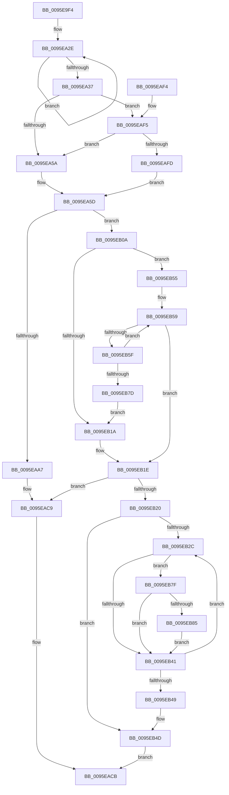

# SdbMakeIndexKeyFromStringEx

- RVA: `0x0095E9F4`–`0x0095EB8F` (길이 `411` bytes)
- VA: `0x000000014095E9F4`
- 실행 섹션: `PAGE`
- PDB 이름 있음: `예`; PDB Function 태그: `아니요`
- unwind 정보 RVA: `0x00092F68`
- 디코드: `115`개 명령, `411/411` bytes 표시
- 미해석 바이트: `0` (있으면 어셈블리에 `.byte`로 보존)

> 이 문서는 커널 이미지의 기계어와 PDB 기호를 분석해 생성했습니다. 4번과 5번은 함수 원형과 자료형을 바이너리 사용 방식에서 추정한 C 해석이며 원본 소스 복구 결과는 아닙니다.

## 1. Dependencies

- 직접 호출 지점: **5**; 고유 호출 대상: **5**
- 직접 호출자로 확인된 함수: **2**
- RIP 상대 이미지 참조: **3**

### Outgoing calls
- `0x0095EA61` → [RtlInitUnicodeString](../../text/42/RtlInitUnicodeString_function_0042A780.md) (function, `0x0042A780`)
- `0x0095EA81` → [RtlCopyUnicodeString](../../text/3F/RtlCopyUnicodeString_function_003FEF30.md) (function, `0x003FEF30`)
- `0x0095EA9E` → [RtlUpcaseUnicodeString](../96/RtlUpcaseUnicodeString_function_00960780.md) (function, `0x00960780`)
- `0x0095EAC4` → [AslLogCallPrintf](AslLogCallPrintf_function_0095E4EC.md) (function, `0x0095E4EC`)
- `0x0095EAD2` → [_security_check_cookie](../../text/6A/_security_check_cookie_function_006AC640.md) (function, `0x006AC640`)

### Direct callers
- [SdbMergeIsEntryUpdated](../81/SdbMergeIsEntryUpdated_function_00819158.md) at `0x00819490`
- [SdbFindFirstStringIndexedTag](SdbFindFirstStringIndexedTag_function_0095C1D8.md) at `0x0095C22F`

### Static image references
- `0x0095EA13` → RVA `0x00E0A740` (`.data`; read)
- `0x0095EAA7` → RVA `0x000125C0` (`.rdata`; read)
- `0x0095EAB9` → RVA `0x000125A0` (`.rdata`; read)

## 2. Other-region calls and transfers

- 다른 실행 섹션으로 향하는 call: **3**
  - `0x0095EA61` → [RtlInitUnicodeString](../../text/42/RtlInitUnicodeString_function_0042A780.md) (`PAGE` → `.text`)
  - `0x0095EA81` → [RtlCopyUnicodeString](../../text/3F/RtlCopyUnicodeString_function_003FEF30.md) (`PAGE` → `.text`)
  - `0x0095EAD2` → [_security_check_cookie](../../text/6A/_security_check_cookie_function_006AC640.md) (`PAGE` → `.text`)
- 별도 외부 분기/꼬리 이동을 확인하지 못했습니다.

## 3. Assembly (complete function range)

```asm
0095E9F4  48 8B C4                        mov rax, rsp
0095E9F7  48 89 58 10                     mov qword ptr [rax + 0x10], rbx
0095E9FB  48 89 70 18                     mov qword ptr [rax + 0x18], rsi
0095E9FF  48 89 78 20                     mov qword ptr [rax + 0x20], rdi
0095EA03  55                              push rbp
0095EA04  41 56                           push r14
0095EA06  41 57                           push r15
0095EA08  48 8D 68 A1                     lea rbp, [rax - 0x5f]
0095EA0C  48 81 EC 90 00 00 00            sub rsp, 0x90
0095EA13  48 8B 05 26 BD 4A 00            mov rax, qword ptr [rip + 0x4abd26]
0095EA1A  48 33 C4                        xor rax, rsp
0095EA1D  48 89 45 37                     mov qword ptr [rbp + 0x37], rax
0095EA21  48 83 C8 FF                     or rax, 0xffffffffffffffff
0095EA25  48 8D 7D 0E                     lea rdi, [rbp + 0xe]
0095EA29  33 DB                           xor ebx, ebx
0095EA2B  48 8B F1                        mov rsi, rcx
0095EA2E  48 FF C0                        inc rax
0095EA31  66 39 1C 41                     cmp word ptr [rcx + rax*2], bx
0095EA35  75 F7                           jne 0x14095ea2e
0095EA37  0F 57 C0                        xorps xmm0, xmm0
0095EA3A  4C 8D 75 17                     lea r14, [rbp + 0x17]
0095EA3E  83 E2 02                        and edx, 2
0095EA41  0F 57 C9                        xorps xmm1, xmm1
0095EA44  0F 11 45 F7                     movups xmmword ptr [rbp - 9], xmm0
0095EA48  0F 11 4D E7                     movups xmmword ptr [rbp - 0x19], xmm1
0095EA4C  0F 11 45 07                     movups xmmword ptr [rbp + 7], xmm0
0095EA50  48 83 F8 08                     cmp rax, 8
0095EA54  0F 87 9B 00 00 00               ja 0x14095eaf5
0095EA5A  48 8B D6                        mov rdx, rsi
0095EA5D  48 8D 4D F7                     lea rcx, [rbp - 9]
0095EA61  E8 1A BD AC FF                  call 0x14042a780
0095EA66  48 8D 45 27                     lea rax, [rbp + 0x27]
0095EA6A  41 BF 10 00 00 00               mov r15d, 0x10
0095EA70  48 8D 55 F7                     lea rdx, [rbp - 9]
0095EA74  48 89 45 EF                     mov qword ptr [rbp - 0x11], rax
0095EA78  48 8D 4D E7                     lea rcx, [rbp - 0x19]
0095EA7C  66 44 89 7D E9                  mov word ptr [rbp - 0x17], r15w
0095EA81  E8 AA 04 AA FF                  call 0x1403fef30
0095EA86  48 8D 45 17                     lea rax, [rbp + 0x17]
0095EA8A  66 44 89 7D 09                  mov word ptr [rbp + 9], r15w
0095EA8F  45 33 C0                        xor r8d, r8d
0095EA92  48 89 45 0F                     mov qword ptr [rbp + 0xf], rax
0095EA96  48 8D 55 E7                     lea rdx, [rbp - 0x19]
0095EA9A  48 8D 4D 07                     lea rcx, [rbp + 7]
0095EA9E  E8 DD 1C 00 00                  call 0x140960780
0095EAA3  85 C0                           test eax, eax
0095EAA5  79 63                           jns 0x14095eb0a
0095EAA7  4C 8D 0D 12 3B 6B FF            lea r9, [rip - 0x94c4ee]
0095EAAE  48 89 74 24 20                  mov qword ptr [rsp + 0x20], rsi
0095EAB3  41 B8 C4 05 00 00               mov r8d, 0x5c4
0095EAB9  48 8D 15 E0 3A 6B FF            lea rdx, [rip - 0x94c520]
0095EAC0  41 8D 4F F1                     lea ecx, [r15 - 0xf]
0095EAC4  E8 23 FA FF FF                  call 0x14095e4ec
0095EAC9  33 C0                           xor eax, eax
0095EACB  48 8B 4D 37                     mov rcx, qword ptr [rbp + 0x37]
0095EACF  48 33 CC                        xor rcx, rsp
0095EAD2  E8 69 DB D4 FF                  call 0x1406ac640
0095EAD7  4C 8D 9C 24 90 00 00 00         lea r11, [rsp + 0x90]
0095EADF  49 8B 5B 28                     mov rbx, qword ptr [r11 + 0x28]
0095EAE3  49 8B 73 30                     mov rsi, qword ptr [r11 + 0x30]
0095EAE7  49 8B 7B 38                     mov rdi, qword ptr [r11 + 0x38]
0095EAEB  49 8B E3                        mov rsp, r11
0095EAEE  41 5F                           pop r15
0095EAF0  41 5E                           pop r14
0095EAF2  5D                              pop rbp
0095EAF3  C3                              ret
0095EAF4  CC                              int3
0095EAF5  85 D2                           test edx, edx
0095EAF7  0F 84 5D FF FF FF               je 0x14095ea5a
0095EAFD  48 8D 51 F0                     lea rdx, [rcx - 0x10]
0095EB01  48 8D 14 42                     lea rdx, [rdx + rax*2]
0095EB05  E9 53 FF FF FF                  jmp 0x14095ea5d
0095EB0A  44 0F B7 45 07                  movzx r8d, word ptr [rbp + 7]
0095EB0F  4C 8B CB                        mov r9, rbx
0095EB12  49 D1 E8                        shr r8, 1
0095EB15  49 8B D0                        mov rdx, r8
0095EB18  75 3B                           jne 0x14095eb55
0095EB1A  48 83 FA 08                     cmp rdx, 8
0095EB1E  77 A9                           ja 0x14095eac9
0095EB20  48 89 5D 07                     mov qword ptr [rbp + 7], rbx
0095EB24  48 8B C3                        mov rax, rbx
0095EB27  48 85 D2                        test rdx, rdx
0095EB2A  74 21                           je 0x14095eb4d
0095EB2C  41 0F B7 0E                     movzx ecx, word ptr [r14]
0095EB30  4D 8D 76 02                     lea r14, [r14 + 2]
0095EB34  88 0F                           mov byte ptr [rdi], cl
0095EB36  48 FF CF                        dec rdi
0095EB39  66 C1 E9 08                     shr cx, 8
0095EB3D  84 C9                           test cl, cl
0095EB3F  75 3E                           jne 0x14095eb7f
0095EB41  48 FF C0                        inc rax
0095EB44  48 3B C2                        cmp rax, rdx
0095EB47  72 E3                           jb 0x14095eb2c
0095EB49  48 8B 5D 07                     mov rbx, qword ptr [rbp + 7]
0095EB4D  48 8B C3                        mov rax, rbx
0095EB50  E9 76 FF FF FF                  jmp 0x14095eacb
0095EB55  4C 8B 55 0F                     mov r10, qword ptr [rbp + 0xf]
0095EB59  48 83 FA 08                     cmp rdx, 8
0095EB5D  73 BF                           jae 0x14095eb1e
0095EB5F  4B 8D 04 09                     lea rax, [r9 + r9]
0095EB63  49 FF C1                        inc r9
0095EB66  42 8A 4C 10 01                  mov cl, byte ptr [rax + r10 + 1]
0095EB6B  48 8D 42 01                     lea rax, [rdx + 1]
0095EB6F  84 C9                           test cl, cl
0095EB71  48 0F 44 C2                     cmove rax, rdx
0095EB75  48 8B D0                        mov rdx, rax
0095EB78  4D 3B C8                        cmp r9, r8
0095EB7B  72 DC                           jb 0x14095eb59
0095EB7D  EB 9B                           jmp 0x14095eb1a
0095EB7F  48 83 F8 07                     cmp rax, 7
0095EB83  73 BC                           jae 0x14095eb41
0095EB85  88 0F                           mov byte ptr [rdi], cl
0095EB87  48 FF CF                        dec rdi
0095EB8A  48 FF C0                        inc rax
0095EB8D  EB B2                           jmp 0x14095eb41
```

## 4. C-style interpretation (structured pseudocode)

```c
__int64 __fastcall SdbMakeIndexKeyFromStringEx(__int64 a1, int a2, int a3)
{
    __int64 result;
    __int64 v_rbx;
    __int64 v_rdi;
    __int64 v_rsp;
    unsigned __int64 v_stack_m18;
    unsigned __int64 v_stack_m88;

    *(unsigned __int64 *)(v_rsp + 16) = v_rbx;
    *(unsigned __int64 *)(v_rsp + 24) = v_rsi;
    *(unsigned __int64 *)(v_rsp + 32) = v_rdi;
    v_rsp = (v_rsp) - (144);
    result = (*(unsigned __int64 *)(v_rip + 4898086)) ^ (v_rsp);
    *(unsigned __int64 *)(v_rsp - 95 + 55) = result;
    result = (result) | (-1);
    v_rbx = 0;
loc_0095EA2E:
    result = (result) + 1;
    if ((*(unsigned __int16 *)(a1 + result * 2)) != 0) goto loc_0095EA2E;
    a2 = (unsigned int)((a2) & (2));
    *(unsigned __int64 *)(v_rsp - 95 - 9) = v_xmm0;
    *(unsigned __int64 *)(v_rsp - 95 - 25) = v_xmm1;
    *(unsigned __int64 *)(v_rsp - 95 + 7) = v_xmm0;
    if (result > 8) goto loc_0095EAF5;
loc_0095EA5A:
loc_0095EA5D:
    result = RtlInitUnicodeString(v_rsp - 95 - 9, a1, a3, a4);
    *(unsigned __int64 *)(v_rsp - 95 - 17) = v_rsp - 95 + 39;
    *(unsigned __int16 *)(v_rsp - 95 - 23) = 16;
    result = RtlCopyUnicodeString(v_rsp - 95 - 25, v_rsp - 95 - 9, a3, a4);
    *(unsigned __int16 *)(v_rsp - 95 + 9) = 16;
    a3 = 0;
    *(unsigned __int64 *)(v_rsp - 95 + 15) = v_rsp - 95 + 23;
    result = RtlUpcaseUnicodeString(v_rsp - 95 + 7, v_rsp - 95 - 25, a3, a4);
    if (!sign_flag) goto loc_0095EB0A;
    v_stack_m88 = a1;
    result = AslLogCallPrintf(16 - 15, v_rip - 9749792, (unsigned int)(0x5C4ULL), v_rip - 9749742);
loc_0095EAC9:
    result = 0;
loc_0095EACB:
    a1 = (*(unsigned __int64 *)(v_rsp - 95 + 55)) ^ (v_rsp);
    result = _security_check_cookie(a1, v_rip - 9749792, (unsigned int)(0x5C4ULL), v_rip - 9749742);
    return result;
loc_0095EAF5:
    if ((unsigned int)(v_rip - 9749792) == 0) goto loc_0095EA5A;
    goto loc_0095EA5D;
loc_0095EB0A:
    a3 = (*(unsigned __int16 *)(v_rsp - 95 + 7)) >> (1);
    if (condition_is_not_equal) goto loc_0095EB55;
loc_0095EB1A:
loc_0095EB1E:
    if (a3 > 8) goto loc_0095EAC9;
    *(unsigned __int64 *)(v_rsp - 95 + 7) = *(unsigned __int64 *)(v_stack_m18 + 40);
    if (a3 == 0) goto loc_0095EB4D;
loc_0095EB2C:
    *(unsigned __int8 *)(*(unsigned __int64 *)(v_stack_m18 + 56)) = (unsigned __int8)(*(unsigned __int16 *)(v_rsp - 95 + 23));
    v_rdi = (*(unsigned __int64 *)(v_stack_m18 + 56)) - 1;
    a1 = (unsigned __int16)((*(unsigned __int16 *)(v_rsp - 95 + 23)) >> (8));
    if ((unsigned __int8)(a1) != 0) goto loc_0095EB7F;
loc_0095EB41:
    result = (*(unsigned __int64 *)(v_stack_m18 + 40)) + 1;
    if (result < a3) goto loc_0095EB2C;
loc_0095EB4D:
    goto loc_0095EACB;
loc_0095EB55:
loc_0095EB59:
    if (a3 >= 8) goto loc_0095EB1E;
    a4 = (*(unsigned __int64 *)(v_stack_m18 + 40)) + 1;
    result = a3 + 1;
    if ((unsigned __int8)(*(unsigned __int8 *)(*(unsigned __int64 *)(v_stack_m18 + 40) + *(unsigned __int64 *)(v_stack_m18 + 40) * 1 + *(unsigned __int64 *)(v_rsp - 95 + 15) * 1 + 1)) == 0) { result = a3; }
    if (a4 < a3) goto loc_0095EB59;
    goto loc_0095EB1A;
loc_0095EB7F:
    if (result >= 7) goto loc_0095EB41;
    *(unsigned __int8 *)(v_rdi) = (unsigned __int8)(*(unsigned __int8 *)(*(unsigned __int64 *)(v_stack_m18 + 40) + *(unsigned __int64 *)(v_stack_m18 + 40) * 1 + *(unsigned __int64 *)(v_rsp - 95 + 15) * 1 + 1));
    v_rdi = (v_rdi) - 1;
    result = (result) + 1;
    goto loc_0095EB41;
}
```

## 5. (Beta) C Style

```c
int64_t SdbMakeIndexKeyFromStringEx(void *Arg1, int32_t Arg2, int32_t Arg3)
{
    uint8_t *arg1 = (uint8_t *)Arg1;

    int64_t result;
    int64_t local_rbx;
    int64_t local_rdi;
    int64_t local_rsp;
    uint64_t v_stack_m18;
    uint64_t v_stack_m88;

    *(uint64_t *)(local_rsp + 0x10) = local_rbx;
    *(uint64_t *)(local_rsp + 0x18) = local_rsi;
    *(uint64_t *)(local_rsp + 0x20) = local_rdi;
    local_rsp = (local_rsp) - (144);
    result = (*(uint64_t *)(v_rip + 0x4ABD26)) ^ (local_rsp);
    *(uint64_t *)(local_rsp - 0x5F + 0x37) = result;
    result = (result) | (-1);
    local_rbx = 0;
loc_0095EA2E:
    result = (result) + 1;
    if ((*(uint16_t *)(arg1 + result * 2)) != 0) goto loc_0095EA2E;
    Arg2 = (uint32_t)((Arg2) & (2));
    *(uint64_t *)(local_rsp - 0x5F - 0x9) = v_xmm0;
    *(uint64_t *)(local_rsp - 0x5F - 0x19) = v_xmm1;
    *(uint64_t *)(local_rsp - 0x5F + 0x7) = v_xmm0;
    if (result > 8) goto loc_0095EAF5;
loc_0095EA5A:
loc_0095EA5D:
    result = RtlInitUnicodeString(local_rsp - 95 - 9, Arg1, Arg3, a4);
    *(uint64_t *)(local_rsp - 0x5F - 0x11) = local_rsp - 95 + 39;
    *(uint16_t *)(local_rsp - 0x5F - 0x17) = 16;
    result = RtlCopyUnicodeString(local_rsp - 95 - 25, local_rsp - 95 - 9, Arg3, a4);
    *(uint16_t *)(local_rsp - 0x5F + 0x9) = 16;
    Arg3 = 0;
    *(uint64_t *)(local_rsp - 0x5F + 0xF) = local_rsp - 95 + 23;
    result = RtlUpcaseUnicodeString(local_rsp - 95 + 7, local_rsp - 95 - 25, Arg3, a4);
    if (!sign_flag) goto loc_0095EB0A;
    v_stack_m88 = Arg1;
    result = AslLogCallPrintf(16 - 15, v_rip - 9749792, (uint32_t)(0x5C4ULL), v_rip - 9749742);
loc_0095EAC9:
    result = 0;
loc_0095EACB:
    Arg1 = (*(uint64_t *)(local_rsp - 0x5F + 0x37)) ^ (local_rsp);
    result = _security_check_cookie(Arg1, v_rip - 9749792, (uint32_t)(0x5C4ULL), v_rip - 9749742);
    return result;
loc_0095EAF5:
    if ((uint32_t)(v_rip - 9749792) == 0) goto loc_0095EA5A;
    goto loc_0095EA5D;
loc_0095EB0A:
    Arg3 = (*(uint16_t *)(local_rsp - 0x5F + 0x7)) >> (1);
    if (condition_is_not_equal) goto loc_0095EB55;
loc_0095EB1A:
loc_0095EB1E:
    if (Arg3 > 8) goto loc_0095EAC9;
    *(uint64_t *)(local_rsp - 0x5F + 0x7) = *(uint64_t *)(v_stack_m18 + 0x28);
    if (Arg3 == 0) goto loc_0095EB4D;
loc_0095EB2C:
    *(uint8_t *)(*(uint64_t *)(v_stack_m18 + 0x38)) = (uint8_t)(*(uint16_t *)(local_rsp - 0x5F + 0x17));
    local_rdi = (*(uint64_t *)(v_stack_m18 + 0x38)) - 1;
    Arg1 = (uint16_t)((*(uint16_t *)(local_rsp - 0x5F + 0x17)) >> (8));
    if ((uint8_t)(Arg1) != 0) goto loc_0095EB7F;
loc_0095EB41:
    result = (*(uint64_t *)(v_stack_m18 + 0x28)) + 1;
    if (result < Arg3) goto loc_0095EB2C;
loc_0095EB4D:
    goto loc_0095EACB;
loc_0095EB55:
loc_0095EB59:
    if (Arg3 >= 8) goto loc_0095EB1E;
    a4 = (*(uint64_t *)(v_stack_m18 + 0x28)) + 1;
    result = Arg3 + 1;
    if ((uint8_t)(*(uint8_t *)(*(uint64_t *)(v_stack_m18 + 0x28) + *(uint64_t *)(v_stack_m18 + 0x28) * 1 + *(uint64_t *)(local_rsp - 0x5F + 0xF) * 1 + 0x1)) == 0) { result = Arg3; }
    if (a4 < Arg3) goto loc_0095EB59;
    goto loc_0095EB1A;
loc_0095EB7F:
    if (result >= 7) goto loc_0095EB41;
    *(uint8_t *)(local_rdi) = (uint8_t)(*(uint8_t *)(*(uint64_t *)(v_stack_m18 + 0x28) + *(uint64_t *)(v_stack_m18 + 0x28) * 1 + *(uint64_t *)(local_rsp - 0x5F + 0xF) * 1 + 0x1));
    local_rdi = (local_rdi) - 1;
    result = (result) + 1;
    goto loc_0095EB41;
}
```

### 관측된 메모리 오프셋

구조체 형식이 확인되지 않은 접근은 인자 기준의 오프셋으로만 기록했습니다.

| 기준 인자 | 오프셋 표현 | 폭 (bit) | 접근 |
|---|---:|---:|---|
| `Arg1` | `- 0x10` | `64` | `R` |
| `Arg1` | `+ 0x0 + rax*2` | `16` | `R` |
| `Arg1` | `+ 0x0 + rax*2` | `64` | `R` |

## 6. Execution-region graph

[열기: 2D/3D 그래프와 함수 탐색 컨트롤 패널](../../../control-panel.html?section=page&rva=0x0095E9F4&view=graph)

- 2D 그래프는 위에서 아래로 흐르고, 3D 그래프는 빈 공간을 드래그해 회전합니다. Shift+드래그는 이동, 휠은 확대·축소, 함수 노드 선택은 대상 보고서 이동입니다.

### Static fallback


