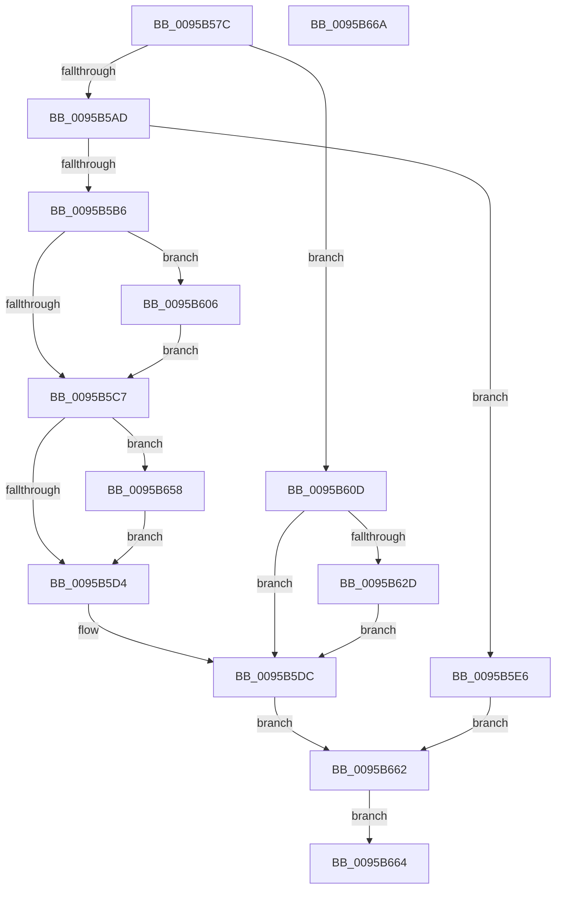

# SdbReleaseDatabase

- RVA: `0x0095B57C`–`0x0095B66B` (길이 `239` bytes)
- VA: `0x000000014095B57C`
- 실행 섹션: `PAGE`
- PDB 이름 있음: `예`; PDB Function 태그: `아니요`
- unwind 정보 RVA: `0x00092B38`
- 디코드: `56`개 명령, `239/239` bytes 표시
- 미해석 바이트: `0` (있으면 어셈블리에 `.byte`로 보존)

> 이 문서는 커널 이미지의 기계어와 PDB 기호를 분석해 생성했습니다. 4번과 5번은 함수 원형과 자료형을 바이너리 사용 방식에서 추정한 C 해석이며 원본 소스 복구 결과는 아닙니다.

## 1. Dependencies

- 직접 호출 지점: **8**; 고유 호출 대상: **5**
- 직접 호출자로 확인된 함수: **4**
- RIP 상대 이미지 참조: **4**

### Outgoing calls
- `0x0095B59E` → [AslLogCallPrintf](AslLogCallPrintf_function_0095E4EC.md) (function, `0x0095E4EC`)
- `0x0095B5B9` → [SdbpCleanupLocalDatabaseSupport](SdbpCleanupLocalDatabaseSupport_function_0095B6D8.md) (function, `0x0095B6D8`)
- `0x0095B5D7` → [SdbpCleanupUserSDBCache](SdbpCleanupUserSDBCache_function_0095B69C.md) (function, `0x0095B69C`)
- `0x0095B5DF` → [AslFree](AslFree_function_0095B674.md) (function, `0x0095B674`)
- `0x0095B5FF` → [AslLogCallPrintf](AslLogCallPrintf_function_0095E4EC.md) (function, `0x0095E4EC`)
- `0x0095B606` → [SdbCloseDatabaseRead](SdbCloseDatabaseRead_function_0095A728.md) (function, `0x0095A728`)
- `0x0095B651` → [AslLogCallPrintf](AslLogCallPrintf_function_0095E4EC.md) (function, `0x0095E4EC`)
- `0x0095B658` → [SdbCloseDatabaseRead](SdbCloseDatabaseRead_function_0095A728.md) (function, `0x0095A728`)

### Direct callers
- [PpReleaseBootDDB](../72/PpReleaseBootDDB_function_0072E324.md) at `0x0072E355`
- [PpReleaseBootDDB](../72/PpReleaseBootDDB_function_0072E324.md) at `0x0072E38D`
- [KsepSdbBootRelease](../74/KsepSdbBootRelease_function_0074A924.md) at `0x0074A935`
- [KsepSdbUnmapFromMemory](KsepSdbUnmapFromMemory_function_0095B504.md) at `0x0095B515`
- [PiReleaseDDB](../99/PiReleaseDDB_function_0099C4F4.md) at `0x0099C530`

### Static image references
- `0x0095B585` → RVA `0x000123D4` (`.rdata`; read)
- `0x0095B592` → RVA `0x00012718` (`.rdata`; read)
- `0x0095B5E6` → RVA `0x000126D0` (`.rdata`; read)
- `0x0095B638` → RVA `0x0003B090` (`.rdata`; read)

## 2. Other-region calls and transfers

- 다른 실행 섹션으로 향하는 call: **0**
- 별도 외부 분기/꼬리 이동을 확인하지 못했습니다.

## 3. Assembly (complete function range)

```asm
0095B57C  40 53                           push rbx
0095B57E  48 83 EC 70                     sub rsp, 0x70
0095B582  48 8B D9                        mov rbx, rcx
0095B585  4C 8D 0D 48 6E 6B FF            lea r9, [rip - 0x9491b8]
0095B58C  41 B8 A1 00 00 00               mov r8d, 0xa1
0095B592  48 8D 15 7F 71 6B FF            lea rdx, [rip - 0x948e81]
0095B599  B9 03 00 00 00                  mov ecx, 3
0095B59E  E8 49 2F 00 00                  call 0x14095e4ec
0095B5A3  90                              nop
0095B5A4  83 BB E8 06 00 00 00            cmp dword ptr [rbx + 0x6e8], 0
0095B5AB  75 60                           jne 0x14095b60d
0095B5AD  83 BB F0 06 00 00 00            cmp dword ptr [rbx + 0x6f0], 0
0095B5B4  7F 30                           jg 0x14095b5e6
0095B5B6  48 8B CB                        mov rcx, rbx
0095B5B9  E8 1A 01 00 00                  call 0x14095b6d8
0095B5BE  48 8B 4B 08                     mov rcx, qword ptr [rbx + 8]
0095B5C2  48 85 C9                        test rcx, rcx
0095B5C5  75 3F                           jne 0x14095b606
0095B5C7  48 8B 4B 10                     mov rcx, qword ptr [rbx + 0x10]
0095B5CB  48 85 C9                        test rcx, rcx
0095B5CE  0F 85 84 00 00 00               jne 0x14095b658
0095B5D4  48 8B CB                        mov rcx, rbx
0095B5D7  E8 C0 00 00 00                  call 0x14095b69c
0095B5DC  48 8B D3                        mov rdx, rbx
0095B5DF  E8 90 00 00 00                  call 0x14095b674
0095B5E4  EB 7C                           jmp 0x14095b662
0095B5E6  4C 8D 0D E3 70 6B FF            lea r9, [rip - 0x948f1d]
0095B5ED  41 B8 C0 00 00 00               mov r8d, 0xc0
0095B5F3  48 8D 15 1E 71 6B FF            lea rdx, [rip - 0x948ee2]
0095B5FA  B9 01 00 00 00                  mov ecx, 1
0095B5FF  E8 E8 2E 00 00                  call 0x14095e4ec
0095B604  EB 5C                           jmp 0x14095b662
0095B606  E8 1D F1 FF FF                  call 0x14095a728
0095B60B  EB BA                           jmp 0x14095b5c7
0095B60D  48 8B 8B F0 06 00 00            mov rcx, qword ptr [rbx + 0x6f0]
0095B614  BA F0 06 00 00                  mov edx, 0x6f0
0095B619  83 C8 FF                        or eax, 0xffffffff
0095B61C  F0 0F C1 04 11                  lock xadd dword ptr [rcx + rdx], eax
0095B621  83 E8 01                        sub eax, 1
0095B624  89 84 24 80 00 00 00            mov dword ptr [rsp + 0x80], eax
0095B62B  79 AF                           jns 0x14095b5dc
0095B62D  48 8B 83 F0 06 00 00            mov rax, qword ptr [rbx + 0x6f0]
0095B634  F0 FF 04 10                     lock inc dword ptr [rax + rdx]
0095B638  4C 8D 0D 51 FA 6D FF            lea r9, [rip - 0x9205af]
0095B63F  41 B8 B2 00 00 00               mov r8d, 0xb2
0095B645  48 8D 15 CC 70 6B FF            lea rdx, [rip - 0x948f34]
0095B64C  B9 01 00 00 00                  mov ecx, 1
0095B651  E8 96 2E 00 00                  call 0x14095e4ec
0095B656  EB 84                           jmp 0x14095b5dc
0095B658  E8 CB F0 FF FF                  call 0x14095a728
0095B65D  E9 72 FF FF FF                  jmp 0x14095b5d4
0095B662  EB 00                           jmp 0x14095b664
0095B664  48 83 C4 70                     add rsp, 0x70
0095B668  5B                              pop rbx
0095B669  C3                              ret
0095B66A  CC                              int3
```

## 4. C-style interpretation (structured pseudocode)

```c
__int64 __fastcall SdbReleaseDatabase(__int64 a1)
{
    __int64 result;
    __int64 v_rsp;
    unsigned int v_stack_p8;

    v_rsp = (v_rsp) - (112);
    result = AslLogCallPrintf(3, v_rip - 9735809, 161, v_rip - 9736632);
    if ((*(unsigned int *)(a1 + 1768)) != 0) goto loc_0095B60D;
    if ((*(unsigned int *)(a1 + 1776)) > 0) goto loc_0095B5E6;
    result = SdbpCleanupLocalDatabaseSupport(a1, v_rip - 9735809, 161, v_rip - 9736632);
    if (*(unsigned __int64 *)(a1 + 8) != 0) goto loc_0095B606;
loc_0095B5C7:
    if (*(unsigned __int64 *)(a1 + 16) != 0) goto loc_0095B658;
loc_0095B5D4:
    result = SdbpCleanupUserSDBCache(a1, v_rip - 9735809, 161, v_rip - 9736632);
loc_0095B5DC:
    result = AslFree(a1, a1, 161, v_rip - 9736632);
    goto loc_0095B662;
loc_0095B5E6:
    result = AslLogCallPrintf(1, v_rip - 9735906, 192, v_rip - 9735965);
    goto loc_0095B662;
loc_0095B606:
    result = SdbCloseDatabaseRead(1, v_rip - 9735906, 192, v_rip - 9735965);
    goto loc_0095B5C7;
loc_0095B60D:
    result = (unsigned int)((result) | (0xFFFFFFFFULL));
    result = (unsigned int)((result) - (1));
    v_stack_p8 = (unsigned int)(result);
    if (!sign_flag) goto loc_0095B5DC;
    result = AslLogCallPrintf(1, v_rip - 9735988, 178, v_rip - 9569711);
    goto loc_0095B5DC;
loc_0095B658:
    result = SdbCloseDatabaseRead(1, v_rip - 9735988, 178, v_rip - 9569711);
    goto loc_0095B5D4;
loc_0095B662:
    goto loc_0095B664;
loc_0095B664:
    v_rsp = (v_rsp) + (112);
    return result;
}
```

## 5. (Beta) C Style

```c
int64_t SdbReleaseDatabase(void *Arg1)
{
    uint8_t *arg1 = (uint8_t *)Arg1;

    int64_t result;
    int64_t local_rsp;
    uint32_t v_stack_p8;

    local_rsp = (local_rsp) - (112);
    result = AslLogCallPrintf(3, v_rip - 9735809, 161, v_rip - 9736632);
    if ((*(uint32_t *)(arg1 + 0x6E8)) != 0) goto loc_0095B60D;
    if ((*(uint32_t *)(arg1 + 0x6F0)) > 0) goto loc_0095B5E6;
    result = SdbpCleanupLocalDatabaseSupport(Arg1, v_rip - 9735809, 161, v_rip - 9736632);
    if (*(uint64_t *)(arg1 + 0x8) != 0) goto loc_0095B606;
loc_0095B5C7:
    if (*(uint64_t *)(arg1 + 0x10) != 0) goto loc_0095B658;
loc_0095B5D4:
    result = SdbpCleanupUserSDBCache(Arg1, v_rip - 9735809, 161, v_rip - 9736632);
loc_0095B5DC:
    result = AslFree(Arg1, Arg1, 161, v_rip - 9736632);
    goto loc_0095B662;
loc_0095B5E6:
    result = AslLogCallPrintf(1, v_rip - 9735906, 192, v_rip - 9735965);
    goto loc_0095B662;
loc_0095B606:
    result = SdbCloseDatabaseRead(1, v_rip - 9735906, 192, v_rip - 9735965);
    goto loc_0095B5C7;
loc_0095B60D:
    result = (uint32_t)((result) | (0xFFFFFFFFULL));
    result = (uint32_t)((result) - (1));
    v_stack_p8 = (uint32_t)(result);
    if (!sign_flag) goto loc_0095B5DC;
    result = AslLogCallPrintf(1, v_rip - 9735988, 178, v_rip - 9569711);
    goto loc_0095B5DC;
loc_0095B658:
    result = SdbCloseDatabaseRead(1, v_rip - 9735988, 178, v_rip - 9569711);
    goto loc_0095B5D4;
loc_0095B662:
    goto loc_0095B664;
loc_0095B664:
    local_rsp = (local_rsp) + (112);
    return result;
}
```

### 관측된 메모리 오프셋

구조체 형식이 확인되지 않은 접근은 인자 기준의 오프셋으로만 기록했습니다.

| 기준 인자 | 오프셋 표현 | 폭 (bit) | 접근 |
|---|---:|---:|---|
| `Arg1` | `+ 0x8` | `64` | `R` |
| `Arg1` | `+ 0x10` | `64` | `R` |
| `Arg1` | `+ 0x6E8` | `32` | `R` |
| `Arg1` | `+ 0x6F0` | `32` | `R` |
| `Arg1` | `+ 0x6F0` | `64` | `R` |

## 6. Execution-region graph

[열기: 2D/3D 그래프와 함수 탐색 컨트롤 패널](../../../control-panel.html?section=page&rva=0x0095B57C&view=graph)

- 2D 그래프는 위에서 아래로 흐르고, 3D 그래프는 빈 공간을 드래그해 회전합니다. Shift+드래그는 이동, 휠은 확대·축소, 함수 노드 선택은 대상 보고서 이동입니다.

### Static fallback


