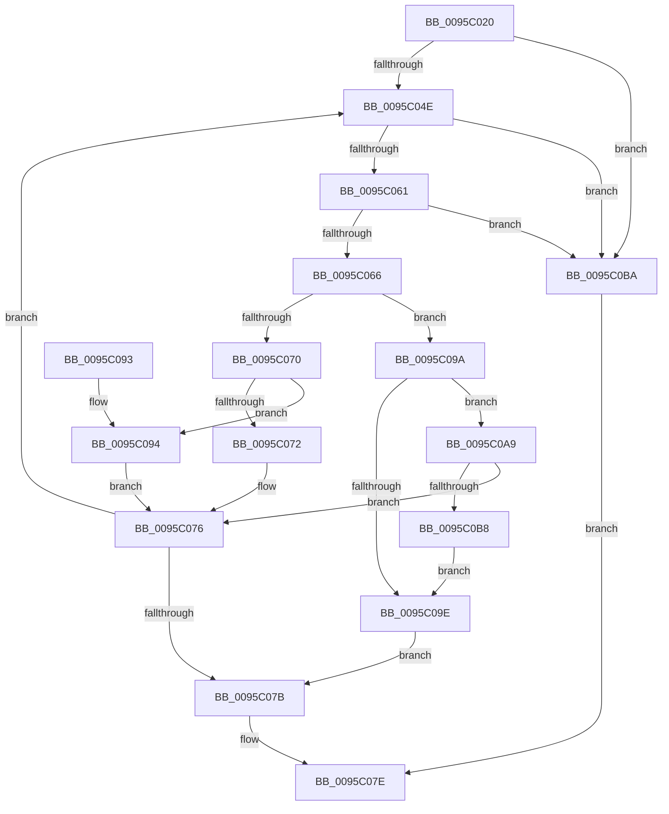

# SdbpBinarySearchFirst

- RVA: `0x0095C020`–`0x0095C0BE` (길이 `158` bytes)
- VA: `0x000000014095C020`
- 실행 섹션: `PAGE`
- PDB 이름 있음: `예`; PDB Function 태그: `아니요`
- unwind 정보 RVA: `0x00092C60`
- 디코드: `51`개 명령, `158/158` bytes 표시
- 미해석 바이트: `0` (있으면 어셈블리에 `.byte`로 보존)

> 이 문서는 커널 이미지의 기계어와 PDB 기호를 분석해 생성했습니다. 4번과 5번은 함수 원형과 자료형을 바이너리 사용 방식에서 추정한 C 해석이며 원본 소스 복구 결과는 아닙니다.

## 1. Dependencies

- 직접 호출 지점: **0**; 고유 호출 대상: **0**
- 직접 호출자로 확인된 함수: **1**
- RIP 상대 이미지 참조: **0**

### Outgoing calls
- 직접 디코드된 call 명령이 없습니다.

### Direct callers
- [SdbpGetFirstIndexedRecord](SdbpGetFirstIndexedRecord_function_0095C0C4.md) at `0x0095C13E`

### Static image references
- 디코드된 RIP-relative 메모리 참조가 없습니다.

## 2. Other-region calls and transfers

- 다른 실행 섹션으로 향하는 call: **0**
- 별도 외부 분기/꼬리 이동을 확인하지 못했습니다.

## 3. Assembly (complete function range)

```asm
0095C020  48 8B C4                        mov rax, rsp
0095C023  48 89 58 08                     mov qword ptr [rax + 8], rbx
0095C027  48 89 70 10                     mov qword ptr [rax + 0x10], rsi
0095C02B  48 89 78 18                     mov qword ptr [rax + 0x18], rdi
0095C02F  4C 89 70 20                     mov qword ptr [rax + 0x20], r14
0095C033  41 83 09 FF                     or dword ptr [r9], 0xffffffff
0095C037  44 8D 5A FF                     lea r11d, [rdx - 1]
0095C03B  45 33 D2                        xor r10d, r10d
0095C03E  49 8B F8                        mov rdi, r8
0095C041  8B F2                           mov esi, edx
0095C043  4C 8B F1                        mov r14, rcx
0095C046  41 8B DA                        mov ebx, r10d
0095C049  45 85 DB                        test r11d, r11d
0095C04C  78 6C                           js 0x14095c0ba
0095C04E  41 8D 04 1B                     lea eax, [r11 + rbx]
0095C052  B9 02 00 00 00                  mov ecx, 2
0095C057  99                              cdq
0095C058  F7 F9                           idiv ecx
0095C05A  4C 63 C0                        movsxd r8, eax
0095C05D  85 C0                           test eax, eax
0095C05F  78 59                           js 0x14095c0ba
0095C061  44 3B C6                        cmp r8d, esi
0095C064  73 54                           jae 0x14095c0ba
0095C066  4B 8D 0C 40                     lea rcx, [r8 + r8*2]
0095C06A  49 3B 3C 8E                     cmp rdi, qword ptr [r14 + rcx*4]
0095C06E  74 2A                           je 0x14095c09a
0095C070  73 22                           jae 0x14095c094
0095C072  45 8D 58 FF                     lea r11d, [r8 - 1]
0095C076  44 3B DB                        cmp r11d, ebx
0095C079  7D D3                           jge 0x14095c04e
0095C07B  41 8B C2                        mov eax, r10d
0095C07E  48 8B 5C 24 08                  mov rbx, qword ptr [rsp + 8]
0095C083  48 8B 74 24 10                  mov rsi, qword ptr [rsp + 0x10]
0095C088  48 8B 7C 24 18                  mov rdi, qword ptr [rsp + 0x18]
0095C08D  4C 8B 74 24 20                  mov r14, qword ptr [rsp + 0x20]
0095C092  C3                              ret
0095C093  CC                              int3
0095C094  41 8D 58 01                     lea ebx, [r8 + 1]
0095C098  EB DC                           jmp 0x14095c076
0095C09A  85 C0                           test eax, eax
0095C09C  75 0B                           jne 0x14095c0a9
0095C09E  41 BA 01 00 00 00               mov r10d, 1
0095C0A4  45 89 01                        mov dword ptr [r9], r8d
0095C0A7  EB D2                           jmp 0x14095c07b
0095C0A9  4B 8D 0C 40                     lea rcx, [r8 + r8*2]
0095C0AD  45 8D 58 FF                     lea r11d, [r8 - 1]
0095C0B1  49 39 7C 8E F4                  cmp qword ptr [r14 + rcx*4 - 0xc], rdi
0095C0B6  74 BE                           je 0x14095c076
0095C0B8  EB E4                           jmp 0x14095c09e
0095C0BA  33 C0                           xor eax, eax
0095C0BC  EB C0                           jmp 0x14095c07e
```

## 4. C-style interpretation (structured pseudocode)

```c
__int64 __fastcall SdbpBinarySearchFirst(__int64 a1, __int64 a2, __int64 a3, __int64 a4)
{
    __int64 result;
    __int64 v_r10;
    unsigned __int64 v_stack_p10;
    unsigned __int64 v_stack_p18;
    unsigned __int64 v_stack_p20;
    unsigned __int64 v_stack_p8;

    *(unsigned __int64 *)(v_rsp + 8) = v_rbx;
    *(unsigned __int64 *)(v_rsp + 16) = v_rsi;
    *(unsigned __int64 *)(v_rsp + 24) = v_rdi;
    *(unsigned __int64 *)(v_rsp + 32) = v_r14;
    v_r10 = 0;
    if (sign_flag) goto loc_0095C0BA;
loc_0095C04E:
    if (sign_flag) goto loc_0095C0BA;
    if (((unsigned int)((int)((unsigned int)(a2 - 1 + 0 * 1)))) >= ((unsigned int)((unsigned int)((unsigned int)(a2))))) goto loc_0095C0BA;
    if (a3 == (*(unsigned __int64 *)(a1 + (int)((unsigned int)(a2 - 1 + 0 * 1)) + (int)((unsigned int)(a2 - 1 + 0 * 1)) * 2 * 4))) goto loc_0095C09A;
    if (a3 >= (*(unsigned __int64 *)(a1 + (int)((unsigned int)(a2 - 1 + 0 * 1)) + (int)((unsigned int)(a2 - 1 + 0 * 1)) * 2 * 4))) goto loc_0095C094;
loc_0095C076:
    if (((unsigned int)((int)((unsigned int)(a2 - 1 + 0 * 1)) - 1)) >= 0) goto loc_0095C04E;
loc_0095C07B:
loc_0095C07E:
    return 0;
loc_0095C094:
    goto loc_0095C076;
loc_0095C09A:
    if (0 != 0) goto loc_0095C0A9;
loc_0095C09E:
    *(unsigned int *)(a4) = (unsigned int)((int)((unsigned int)(a2 - 1 + 0 * 1)));
    goto loc_0095C07B;
loc_0095C0A9:
    if ((*(unsigned __int64 *)(v_stack_p20 + (int)((unsigned int)(a2 - 1 + 0 * 1)) + (int)((unsigned int)(a2 - 1 + 0 * 1)) * 2 * 4 - 12)) == v_stack_p18) goto loc_0095C076;
    goto loc_0095C09E;
loc_0095C0BA:
    result = 0;
    goto loc_0095C07E;
}
```

## 5. (Beta) C Style

```c
int64_t SdbpBinarySearchFirst(void *Arg1, void *Arg2, int64_t Arg3, void *Arg4)
{
    uint8_t *arg1 = (uint8_t *)Arg1;
    uint8_t *arg2 = (uint8_t *)Arg2;
    uint8_t *arg4 = (uint8_t *)Arg4;

    int64_t result;
    int64_t local_r10;
    uint64_t v_stack_p10;
    uint64_t v_stack_p18;
    uint64_t v_stack_p20;
    uint64_t v_stack_p8;

    *(uint64_t *)(local_rsp + 0x8) = local_rbx;
    *(uint64_t *)(local_rsp + 0x10) = local_rsi;
    *(uint64_t *)(local_rsp + 0x18) = local_rdi;
    *(uint64_t *)(local_rsp + 0x20) = local_r14;
    local_r10 = 0;
    if (sign_flag) goto loc_0095C0BA;
loc_0095C04E:
    if (sign_flag) goto loc_0095C0BA;
    if (((uint32_t)((int32_t)((uint32_t)(Arg2 - 1 + 0 * 1)))) >= ((uint32_t)((uint32_t)((uint32_t)(Arg2))))) goto loc_0095C0BA;
    if (Arg3 == (*(uint64_t *)(arg1 + (int32_t)((uint32_t)(arg2 - 0x1 + 0x0 * 1)) + (int32_t)((uint32_t)(arg2 - 0x1 + 0x0 * 1)) * 2 * 4))) goto loc_0095C09A;
    if (Arg3 >= (*(uint64_t *)(arg1 + (int32_t)((uint32_t)(arg2 - 0x1 + 0x0 * 1)) + (int32_t)((uint32_t)(arg2 - 0x1 + 0x0 * 1)) * 2 * 4))) goto loc_0095C094;
loc_0095C076:
    if (((uint32_t)((int32_t)((uint32_t)(Arg2 - 1 + 0 * 1)) - 1)) >= 0) goto loc_0095C04E;
loc_0095C07B:
loc_0095C07E:
    return 0;
loc_0095C094:
    goto loc_0095C076;
loc_0095C09A:
    if (0 != 0) goto loc_0095C0A9;
loc_0095C09E:
    *(uint32_t *)(arg4) = (uint32_t)((int32_t)((uint32_t)(Arg2 - 1 + 0 * 1)));
    goto loc_0095C07B;
loc_0095C0A9:
    if ((*(uint64_t *)(v_stack_p20 + (int32_t)((uint32_t)(arg2 - 0x1 + 0x0 * 1)) + (int32_t)((uint32_t)(arg2 - 0x1 + 0x0 * 1)) * 2 * 4 - 0xC)) == v_stack_p18) goto loc_0095C076;
    goto loc_0095C09E;
loc_0095C0BA:
    result = 0;
    goto loc_0095C07E;
}
```

### 관측된 메모리 오프셋

구조체 형식이 확인되지 않은 접근은 인자 기준의 오프셋으로만 기록했습니다.

| 기준 인자 | 오프셋 표현 | 폭 (bit) | 접근 |
|---|---:|---:|---|
| `Arg1` | `- 0xC + rcx*4` | `64` | `R` |
| `Arg1` | `+ 0x0 + rcx*4` | `64` | `R` |
| `Arg2` | `- 0x1` | `32` | `R` |
| `Arg4` | `+ 0x0` | `32` | `R/W` |
| `Arg4` | `+ 0x0` | `32` | `W` |

## 6. Execution-region graph

[열기: 2D/3D 그래프와 함수 탐색 컨트롤 패널](../../../control-panel.html?section=page&rva=0x0095C020&view=graph)

- 2D 그래프는 위에서 아래로 흐르고, 3D 그래프는 빈 공간을 드래그해 회전합니다. Shift+드래그는 이동, 휠은 확대·축소, 함수 노드 선택은 대상 보고서 이동입니다.

### Static fallback


