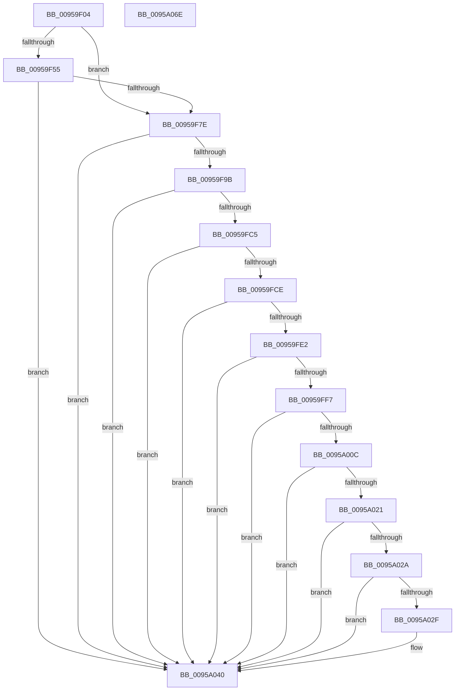

# SdbpCheckKObject

- RVA: `0x00959F04`–`0x0095A06F` (길이 `363` bytes)
- VA: `0x0000000140959F04`
- 실행 섹션: `PAGE`
- PDB 이름 있음: `예`; PDB Function 태그: `아니요`
- unwind 정보 RVA: `0x000928F0`
- 디코드: `112`개 명령, `363/363` bytes 표시
- 미해석 바이트: `0` (있으면 어셈블리에 `.byte`로 보존)

> 이 문서는 커널 이미지의 기계어와 PDB 기호를 분석해 생성했습니다. 4번과 5번은 함수 원형과 자료형을 바이너리 사용 방식에서 추정한 C 해석이며 원본 소스 복구 결과는 아닙니다.

## 1. Dependencies

- 직접 호출 지점: **11**; 고유 호출 대상: **11**
- 직접 호출자로 확인된 함수: **2**
- RIP 상대 이미지 참조: **0**

### Outgoing calls
- `0x00959F36` → [memset](../../text/6C/memset_function_006C6C40.md) (function, `0x006C6C40`)
- `0x00959F6D` → [AslFileMappingCreate](AslFileMappingCreate_function_00958448.md) (function, `0x00958448`)
- `0x00959F8C` → [SdbpCreateSearchDBContext](../A9/SdbpCreateSearchDBContext_function_00A9D544.md) (function, `0x00A9D544`)
- `0x00959FBA` → [SdbpCheckForMatch](../AB/SdbpCheckForMatch_function_00AB37BC.md) (function, `0x00AB37BC`)
- `0x00959FD7` → [SdbpMatchAcpi](../81/SdbpMatchAcpi_function_00816404.md) (function, `0x00816404`)
- `0x00959FEC` → [SdbpMatchOem](../81/SdbpMatchOem_function_008168C8.md) (function, `0x008168C8`)
- `0x0095A001` → [SdbpMatchBios](../81/SdbpMatchBios_function_008164E0.md) (function, `0x008164E0`)
- `0x0095A016` → [SdbpMatchCpu](../81/SdbpMatchCpu_function_00816578.md) (function, `0x00816578`)
- `0x0095A035` → [SdbpIsEntryIdAvailableInOtherDb](../81/SdbpIsEntryIdAvailableInOtherDb_function_008173D4.md) (function, `0x008173D4`)
- `0x0095A044` → [SdbpReleaseSearchDBContext](SdbpReleaseSearchDBContext_function_00958118.md) (function, `0x00958118`)
- `0x0095A04C` → [AslFileMappingDelete](AslFileMappingDelete_function_0095B728.md) (function, `0x0095B728`)

### Direct callers
- [SdbGetDatabaseMatchEx](SdbGetDatabaseMatchEx_function_0095BD7C.md) at `0x0095BE78`
- [SdbGetDatabaseMatchEx](SdbGetDatabaseMatchEx_function_0095BD7C.md) at `0x0095BEBC`
- [sub_00B27968](../B2/Unknown_function_00B27968.md) at `0x00B27998`
- [sub_00B27968](../B2/Unknown_function_00B27968.md) at `0x00B27A26`

### Static image references
- 디코드된 RIP-relative 메모리 참조가 없습니다.

## 2. Other-region calls and transfers

- 다른 실행 섹션으로 향하는 call: **1**
  - `0x00959F36` → [memset](../../text/6C/memset_function_006C6C40.md) (`PAGE` → `.text`)
- 별도 외부 분기/꼬리 이동을 확인하지 못했습니다.

## 3. Assembly (complete function range)

```asm
00959F04  48 89 5C 24 10                  mov qword ptr [rsp + 0x10], rbx
00959F09  55                              push rbp
00959F0A  56                              push rsi
00959F0B  57                              push rdi
00959F0C  41 54                           push r12
00959F0E  41 55                           push r13
00959F10  41 56                           push r14
00959F12  41 57                           push r15
00959F14  48 8D 6C 24 F9                  lea rbp, [rsp - 7]
00959F19  48 81 EC B0 00 00 00            sub rsp, 0xb0
00959F20  4C 8B F2                        mov r14, rdx
00959F23  45 8B F8                        mov r15d, r8d
00959F26  33 D2                           xor edx, edx
00959F28  4C 8B E9                        mov r13, rcx
00959F2B  48 8D 4D 97                     lea rcx, [rbp - 0x69]
00959F2F  49 8B F9                        mov rdi, r9
00959F32  44 8D 42 68                     lea r8d, [rdx + 0x68]
00959F36  E8 05 CD D6 FF                  call 0x1406c6c40
00959F3B  45 33 E4                        xor r12d, r12d
00959F3E  44 89 65 47                     mov dword ptr [rbp + 0x47], r12d
00959F42  41 8B DC                        mov ebx, r12d
00959F45  44 89 65 5F                     mov dword ptr [rbp + 0x5f], r12d
00959F49  41 8B F4                        mov esi, r12d
00959F4C  4C 89 65 87                     mov qword ptr [rbp - 0x79], r12
00959F50  48 85 FF                        test rdi, rdi
00959F53  74 29                           je 0x140959f7e
00959F55  48 8B 45 77                     mov rax, qword ptr [rbp + 0x77]
00959F59  48 8D 4D 87                     lea rcx, [rbp - 0x79]
00959F5D  4C 8B 4D 6F                     mov r9, qword ptr [rbp + 0x6f]
00959F61  48 8B D7                        mov rdx, rdi
00959F64  4C 8B 45 67                     mov r8, qword ptr [rbp + 0x67]
00959F68  48 89 44 24 20                  mov qword ptr [rsp + 0x20], rax
00959F6D  E8 D6 E4 FF FF                  call 0x140958448
00959F72  48 8B 75 87                     mov rsi, qword ptr [rbp - 0x79]
00959F76  85 C0                           test eax, eax
00959F78  0F 88 C2 00 00 00               js 0x14095a040
00959F7E  48 8B D6                        mov rdx, rsi
00959F81  C7 45 97 1A 00 00 00            mov dword ptr [rbp - 0x69], 0x1a
00959F88  48 8D 4D 97                     lea rcx, [rbp - 0x69]
00959F8C  E8 B3 35 14 00                  call 0x140a9d544
00959F91  8B D8                           mov ebx, eax
00959F93  85 C0                           test eax, eax
00959F95  0F 84 A5 00 00 00               je 0x14095a040
00959F9B  48 8D 45 47                     lea rax, [rbp + 0x47]
00959F9F  45 8B C7                        mov r8d, r15d
00959FA2  48 89 44 24 28                  mov qword ptr [rsp + 0x28], rax
00959FA7  4C 8D 4D 97                     lea r9, [rbp - 0x69]
00959FAB  48 8D 45 5F                     lea rax, [rbp + 0x5f]
00959FAF  49 8B D6                        mov rdx, r14
00959FB2  49 8B CD                        mov rcx, r13
00959FB5  48 89 44 24 20                  mov qword ptr [rsp + 0x20], rax
00959FBA  E8 FD 97 15 00                  call 0x140ab37bc
00959FBF  8B D8                           mov ebx, eax
00959FC1  85 C0                           test eax, eax
00959FC3  74 7B                           je 0x14095a040
00959FC5  48 8B 7D 7F                     mov rdi, qword ptr [rbp + 0x7f]
00959FC9  48 85 FF                        test rdi, rdi
00959FCC  74 72                           je 0x14095a040
00959FCE  4C 8B 07                        mov r8, qword ptr [rdi]
00959FD1  41 8B D7                        mov edx, r15d
00959FD4  49 8B CE                        mov rcx, r14
00959FD7  E8 28 C4 EB FF                  call 0x140816404
00959FDC  8B D8                           mov ebx, eax
00959FDE  85 C0                           test eax, eax
00959FE0  74 5E                           je 0x14095a040
00959FE2  4C 8B 47 08                     mov r8, qword ptr [rdi + 8]
00959FE6  41 8B D7                        mov edx, r15d
00959FE9  49 8B CE                        mov rcx, r14
00959FEC  E8 D7 C8 EB FF                  call 0x1408168c8
00959FF1  8B D8                           mov ebx, eax
00959FF3  85 C0                           test eax, eax
00959FF5  74 49                           je 0x14095a040
00959FF7  4C 8B 47 10                     mov r8, qword ptr [rdi + 0x10]
00959FFB  41 8B D7                        mov edx, r15d
00959FFE  49 8B CE                        mov rcx, r14
0095A001  E8 DA C4 EB FF                  call 0x1408164e0
0095A006  8B D8                           mov ebx, eax
0095A008  85 C0                           test eax, eax
0095A00A  74 34                           je 0x14095a040
0095A00C  4C 8B 47 18                     mov r8, qword ptr [rdi + 0x18]
0095A010  41 8B D7                        mov edx, r15d
0095A013  49 8B CE                        mov rcx, r14
0095A016  E8 5D C5 EB FF                  call 0x140816578
0095A01B  8B D8                           mov ebx, eax
0095A01D  85 C0                           test eax, eax
0095A01F  74 1F                           je 0x14095a040
0095A021  49 8B 55 10                     mov rdx, qword ptr [r13 + 0x10]
0095A025  48 85 D2                        test rdx, rdx
0095A028  74 16                           je 0x14095a040
0095A02A  49 3B D6                        cmp rdx, r14
0095A02D  74 11                           je 0x14095a040
0095A02F  45 8B C7                        mov r8d, r15d
0095A032  49 8B CE                        mov rcx, r14
0095A035  E8 9A D3 EB FF                  call 0x1408173d4
0095A03A  85 C0                           test eax, eax
0095A03C  41 0F 45 DC                     cmovne ebx, r12d
0095A040  48 8D 4D 97                     lea rcx, [rbp - 0x69]
0095A044  E8 CF E0 FF FF                  call 0x140958118
0095A049  48 8B CE                        mov rcx, rsi
0095A04C  E8 D7 16 00 00                  call 0x14095b728
0095A051  8B C3                           mov eax, ebx
0095A053  48 8B 9C 24 F8 00 00 00         mov rbx, qword ptr [rsp + 0xf8]
0095A05B  48 81 C4 B0 00 00 00            add rsp, 0xb0
0095A062  41 5F                           pop r15
0095A064  41 5E                           pop r14
0095A066  41 5D                           pop r13
0095A068  41 5C                           pop r12
0095A06A  5F                              pop rdi
0095A06B  5E                              pop rsi
0095A06C  5D                              pop rbp
0095A06D  C3                              ret
0095A06E  CC                              int3
```

## 4. C-style interpretation (structured pseudocode)

```c
__int64 __fastcall SdbpCheckKObject(__int64 a1, __int64 a2, int a3, __int64 a4, __int64 a5, __int64 a6, __int64 a7, __int64 a8)
{
    __int64 result;
    __int64 v_r12;
    __int64 v_rbx;
    __int64 v_rsp;
    unsigned __int64 v_stack_m3F;
    unsigned __int64 v_stack_mA8;
    unsigned __int64 v_stack_mB8;
    unsigned __int64 v_stack_mC0;
    unsigned __int64 v_stack_mC8;
    unsigned __int64 v_stack_p10;
    unsigned int v_stack_p20;
    unsigned int v_stack_p8;

    v_stack_p10 = v_rbx;
    v_rsp = (v_rsp) - (176);
    a2 = 0;
    result = memset(v_stack_mA8, a2, a2 + 104, a4);
    v_r12 = 0;
    v_stack_p8 = 0;
    v_stack_p20 = 0;
    v_stack_mB8 = 0;
    if (a4 == 0) goto loc_00959F7E;
    v_stack_mC8 = a7;
    result = AslFileMappingCreate(v_stack_mB8, a4, a5, a6);
    if (sign_flag) goto loc_0095A040;
loc_00959F7E:
    v_stack_mA8 = 26;
    result = SdbpCreateSearchDBContext(v_stack_mA8, v_stack_mB8, a5, a6);
    if ((unsigned int)(result) == 0) goto loc_0095A040;
    v_stack_mC0 = v_stack_p8;
    v_stack_mC8 = v_stack_p20;
    result = SdbpCheckForMatch(a1, 0, (unsigned int)((unsigned int)((unsigned int)(a3))), v_stack_mA8);
    if ((unsigned int)(result) == 0) goto loc_0095A040;
    if (a8 == 0) goto loc_0095A040;
    result = SdbpMatchAcpi(0, (unsigned int)((unsigned int)((unsigned int)(a3))), *(unsigned __int64 *)(a8), v_stack_mA8);
    if ((unsigned int)(result) == 0) goto loc_0095A040;
    result = SdbpMatchOem(0, (unsigned int)((unsigned int)((unsigned int)(a3))), *(unsigned __int64 *)(a8 + 8), v_stack_mA8);
    if ((unsigned int)(result) == 0) goto loc_0095A040;
    result = SdbpMatchBios(0, (unsigned int)((unsigned int)((unsigned int)(a3))), *(unsigned __int64 *)(a8 + 16), v_stack_mA8);
    if ((unsigned int)(result) == 0) goto loc_0095A040;
    result = SdbpMatchCpu(0, (unsigned int)((unsigned int)((unsigned int)(a3))), *(unsigned __int64 *)(a8 + 24), v_stack_mA8);
    if ((unsigned int)(result) == 0) goto loc_0095A040;
    if (*(unsigned __int64 *)(a1 + 16) == 0) goto loc_0095A040;
    v_rbx = (unsigned int)((unsigned int)(result));
    if ((*(unsigned __int64 *)(a1 + 16)) != 0) {
        a3 = (unsigned int)((unsigned int)(a3));
        a1 = 0;
        result = SdbpIsEntryIdAvailableInOtherDb(a1, *(unsigned __int64 *)(a1 + 16), a3, v_stack_mA8);
        v_rbx = (unsigned int)((unsigned int)(result));
        if ((unsigned int)(result) != 0) { v_rbx = 0; }
    }
    result = SdbpReleaseSearchDBContext(v_stack_mA8, *(unsigned __int64 *)(a1 + 16), a3, v_stack_mA8);
    result = AslFileMappingDelete(v_stack_mB8, *(unsigned __int64 *)(a1 + 16), a3, v_stack_mA8);
    v_rsp = (v_rsp) + (176);
    return (unsigned int)((unsigned int)(v_rbx));
}
```

## 5. (Beta) C Style

```c
int64_t SdbpCheckKObject(void *Arg1, int64_t Arg2, int32_t Arg3, int64_t Arg4, int64_t Arg5, int64_t Arg6, int64_t Arg7, int64_t Arg8)
{
    uint8_t *arg1 = (uint8_t *)Arg1;

    int64_t result;
    int64_t local_r12;
    int64_t local_rbx;
    int64_t local_rsp;
    uint64_t v_stack_m3F;
    uint64_t v_stack_mA8;
    uint64_t v_stack_mB8;
    uint64_t v_stack_mC0;
    uint64_t v_stack_mC8;
    uint64_t v_stack_p10;
    uint32_t v_stack_p20;
    uint32_t v_stack_p8;

    v_stack_p10 = local_rbx;
    local_rsp = (local_rsp) - (176);
    Arg2 = 0;
    result = memset(v_stack_mA8, Arg2, Arg2 + 104, Arg4);
    local_r12 = 0;
    v_stack_p8 = 0;
    v_stack_p20 = 0;
    v_stack_mB8 = 0;
    if (Arg4 == 0) goto loc_00959F7E;
    v_stack_mC8 = Arg7;
    result = AslFileMappingCreate(v_stack_mB8, Arg4, Arg5, Arg6);
    if (sign_flag) goto loc_0095A040;
loc_00959F7E:
    v_stack_mA8 = 26;
    result = SdbpCreateSearchDBContext(v_stack_mA8, v_stack_mB8, Arg5, Arg6);
    if ((uint32_t)(result) == 0) goto loc_0095A040;
    v_stack_mC0 = v_stack_p8;
    v_stack_mC8 = v_stack_p20;
    result = SdbpCheckForMatch(Arg1, 0, (uint32_t)((uint32_t)((uint32_t)(Arg3))), v_stack_mA8);
    if ((uint32_t)(result) == 0) goto loc_0095A040;
    if (Arg8 == 0) goto loc_0095A040;
    result = SdbpMatchAcpi(0, (uint32_t)((uint32_t)((uint32_t)(Arg3))), *(uint64_t *)(Arg8), v_stack_mA8);
    if ((uint32_t)(result) == 0) goto loc_0095A040;
    result = SdbpMatchOem(0, (uint32_t)((uint32_t)((uint32_t)(Arg3))), *(uint64_t *)(Arg8 + 0x8), v_stack_mA8);
    if ((uint32_t)(result) == 0) goto loc_0095A040;
    result = SdbpMatchBios(0, (uint32_t)((uint32_t)((uint32_t)(Arg3))), *(uint64_t *)(Arg8 + 0x10), v_stack_mA8);
    if ((uint32_t)(result) == 0) goto loc_0095A040;
    result = SdbpMatchCpu(0, (uint32_t)((uint32_t)((uint32_t)(Arg3))), *(uint64_t *)(Arg8 + 0x18), v_stack_mA8);
    if ((uint32_t)(result) == 0) goto loc_0095A040;
    if (*(uint64_t *)(arg1 + 0x10) == 0) goto loc_0095A040;
    local_rbx = (uint32_t)((uint32_t)(result));
    if ((*(uint64_t *)(arg1 + 0x10)) != 0) {
        Arg3 = (uint32_t)((uint32_t)(Arg3));
        Arg1 = 0;
        result = SdbpIsEntryIdAvailableInOtherDb(Arg1, *(uint64_t *)(arg1 + 0x10), Arg3, v_stack_mA8);
        local_rbx = (uint32_t)((uint32_t)(result));
        if ((uint32_t)(result) != 0) { local_rbx = 0; }
    }
    result = SdbpReleaseSearchDBContext(v_stack_mA8, *(uint64_t *)(arg1 + 0x10), Arg3, v_stack_mA8);
    result = AslFileMappingDelete(v_stack_mB8, *(uint64_t *)(arg1 + 0x10), Arg3, v_stack_mA8);
    local_rsp = (local_rsp) + (176);
    return (uint32_t)((uint32_t)(local_rbx));
}
```

### 관측된 메모리 오프셋

구조체 형식이 확인되지 않은 접근은 인자 기준의 오프셋으로만 기록했습니다.

| 기준 인자 | 오프셋 표현 | 폭 (bit) | 접근 |
|---|---:|---:|---|
| `Arg1` | `+ 0x10` | `64` | `R` |

## 6. Execution-region graph

[열기: 2D/3D 그래프와 함수 탐색 컨트롤 패널](../../../control-panel.html?section=page&rva=0x00959F04&view=graph)

- 2D 그래프는 위에서 아래로 흐르고, 3D 그래프는 빈 공간을 드래그해 회전합니다. Shift+드래그는 이동, 휠은 확대·축소, 함수 노드 선택은 대상 보고서 이동입니다.

### Static fallback


