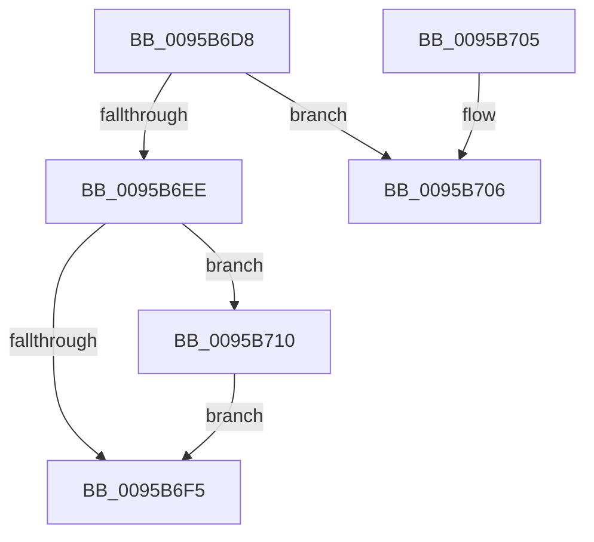

# SdbpCleanupLocalDatabaseSupport

- RVA: `0x0095B6D8`–`0x0095B720` (길이 `72` bytes)
- VA: `0x000000014095B6D8`
- 실행 섹션: `PAGE`
- PDB 이름 있음: `예`; PDB Function 태그: `예`
- unwind 정보 RVA: `0x000682BC`
- 디코드: `20`개 명령, `72/72` bytes 표시
- 미해석 바이트: `0` (있으면 어셈블리에 `.byte`로 보존)

> 이 문서는 커널 이미지의 기계어와 PDB 기호를 분석해 생성했습니다. 4번과 5번은 함수 원형과 자료형을 바이너리 사용 방식에서 추정한 C 해석이며 원본 소스 복구 결과는 아닙니다.

## 1. Dependencies

- 직접 호출 지점: **1**; 고유 호출 대상: **1**
- 직접 호출자로 확인된 함수: **1**
- RIP 상대 이미지 참조: **0**

### Outgoing calls
- `0x0095B719` → [SdbpCloseLocalDatabaseEx](../81/SdbpCloseLocalDatabaseEx_function_00817624.md) (function, `0x00817624`)

### Direct callers
- [SdbReleaseDatabase](SdbReleaseDatabase_function_0095B57C.md) at `0x0095B5B9`

### Static image references
- 디코드된 RIP-relative 메모리 참조가 없습니다.

## 2. Other-region calls and transfers

- 다른 실행 섹션으로 향하는 call: **0**
- call이 아닌 외부 분기/꼬리 이동: **1**
  - `0x0095B70B` → [sub_00B2786A](../B2/Unknown_function_00B2786A.md) (`tail-transfer`)

## 3. Assembly (complete function range)

```asm
0095B6D8  48 89 5C 24 08                  mov qword ptr [rsp + 8], rbx
0095B6DD  57                              push rdi
0095B6DE  48 83 EC 20                     sub rsp, 0x20
0095B6E2  F7 41 24 F8 FF 00 00            test dword ptr [rcx + 0x24], 0xfff8
0095B6E9  48 8B F9                        mov rdi, rcx
0095B6EC  75 18                           jne 0x14095b706
0095B6EE  48 83 7F 18 00                  cmp qword ptr [rdi + 0x18], 0
0095B6F3  75 1B                           jne 0x14095b710
0095B6F5  48 8B 5C 24 30                  mov rbx, qword ptr [rsp + 0x30]
0095B6FA  B8 01 00 00 00                  mov eax, 1
0095B6FF  48 83 C4 20                     add rsp, 0x20
0095B703  5F                              pop rdi
0095B704  C3                              ret
0095B705  CC                              int3
0095B706  BB 03 00 00 00                  mov ebx, 3
0095B70B  E9 5A C1 1C 00                  jmp 0x140b2786a
0095B710  41 B8 01 00 00 00               mov r8d, 1
0095B716  48 8B CF                        mov rcx, rdi
0095B719  E8 06 BF EB FF                  call 0x140817624
0095B71E  EB D5                           jmp 0x14095b6f5
```

## 4. C-style interpretation (structured pseudocode)

```c
__int64 __fastcall SdbpCleanupLocalDatabaseSupport(__int64 a1)
{
    __int64 result;
    __int64 v_rsp;
    unsigned __int64 v_stack_p8;

    v_stack_p8 = v_rbx;
    v_rsp = (v_rsp) - (32);
    if (((*(unsigned int *)(a1 + 36)) & (0xFFF8ULL)) != 0) goto loc_0095B706;
    if ((*(unsigned __int64 *)(a1 + 24)) != 0) goto loc_0095B710;
loc_0095B6F5:
    v_rsp = (v_rsp) + (32);
    return 1;
loc_0095B706:
loc_0095B710:
    result = SdbpCloseLocalDatabaseEx(a1, a2, 1, a4);
    goto loc_0095B6F5;
}
```

## 5. (Beta) C Style

```c
int64_t SdbpCleanupLocalDatabaseSupport(void *Arg1)
{
    uint8_t *arg1 = (uint8_t *)Arg1;

    int64_t result;
    int64_t local_rsp;
    uint64_t v_stack_p8;

    v_stack_p8 = local_rbx;
    local_rsp = (local_rsp) - (32);
    if (((*(uint32_t *)(arg1 + 0x24)) & (0xFFF8ULL)) != 0) goto loc_0095B706;
    if ((*(uint64_t *)(arg1 + 0x18)) != 0) goto loc_0095B710;
loc_0095B6F5:
    local_rsp = (local_rsp) + (32);
    return 1;
loc_0095B706:
loc_0095B710:
    result = SdbpCloseLocalDatabaseEx(Arg1, a2, 1, a4);
    goto loc_0095B6F5;
}
```

### 관측된 메모리 오프셋

구조체 형식이 확인되지 않은 접근은 인자 기준의 오프셋으로만 기록했습니다.

| 기준 인자 | 오프셋 표현 | 폭 (bit) | 접근 |
|---|---:|---:|---|
| `Arg1` | `+ 0x18` | `64` | `R` |
| `Arg1` | `+ 0x24` | `32` | `R` |

## 6. Execution-region graph

[열기: 2D/3D 그래프와 함수 탐색 컨트롤 패널](../../../control-panel.html?section=page&rva=0x0095B6D8&view=graph)

- 2D 그래프는 위에서 아래로 흐르고, 3D 그래프는 빈 공간을 드래그해 회전합니다. Shift+드래그는 이동, 휠은 확대·축소, 함수 노드 선택은 대상 보고서 이동입니다.

### Static fallback


