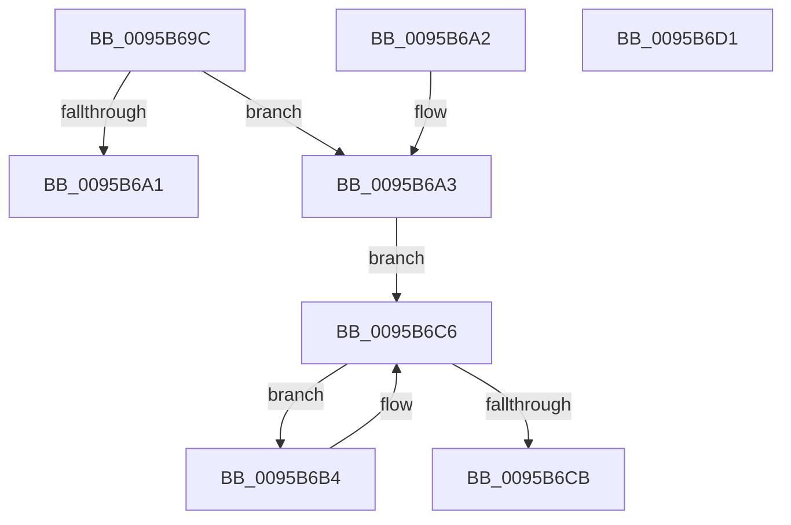

# SdbpCleanupUserSDBCache

- RVA: `0x0095B69C`–`0x0095B6D2` (길이 `54` bytes)
- VA: `0x000000014095B69C`
- 실행 섹션: `PAGE`
- PDB 이름 있음: `예`; PDB Function 태그: `아니요`
- unwind 정보 RVA: `0x00092B68`
- 디코드: `19`개 명령, `54/54` bytes 표시
- 미해석 바이트: `0` (있으면 어셈블리에 `.byte`로 보존)

> 이 문서는 커널 이미지의 기계어와 PDB 기호를 분석해 생성했습니다. 4번과 5번은 함수 원형과 자료형을 바이너리 사용 방식에서 추정한 C 해석이며 원본 소스 복구 결과는 아닙니다.

## 1. Dependencies

- 직접 호출 지점: **1**; 고유 호출 대상: **1**
- 직접 호출자로 확인된 함수: **1**
- RIP 상대 이미지 참조: **0**

### Outgoing calls
- `0x0095B6BA` → [SdbpRemoveSDBLookupEntry](SdbpRemoveSDBLookupEntry_function_0095A6D8.md) (function, `0x0095A6D8`)

### Direct callers
- [SdbReleaseDatabase](SdbReleaseDatabase_function_0095B57C.md) at `0x0095B5D7`

### Static image references
- 디코드된 RIP-relative 메모리 참조가 없습니다.

## 2. Other-region calls and transfers

- 다른 실행 섹션으로 향하는 call: **0**
- 별도 외부 분기/꼬리 이동을 확인하지 못했습니다.

## 3. Assembly (complete function range)

```asm
0095B69C  48 85 C9                        test rcx, rcx
0095B69F  75 02                           jne 0x14095b6a3
0095B6A1  C3                              ret
0095B6A2  CC                              int3
0095B6A3  53                              push rbx
0095B6A4  48 83 EC 20                     sub rsp, 0x20
0095B6A8  48 8B 81 40 02 00 00            mov rax, qword ptr [rcx + 0x240]
0095B6AF  48 8B D9                        mov rbx, rcx
0095B6B2  EB 12                           jmp 0x14095b6c6
0095B6B4  48 8B D0                        mov rdx, rax
0095B6B7  48 8B CB                        mov rcx, rbx
0095B6BA  E8 19 F0 FF FF                  call 0x14095a6d8
0095B6BF  48 8B 83 40 02 00 00            mov rax, qword ptr [rbx + 0x240]
0095B6C6  48 85 C0                        test rax, rax
0095B6C9  75 E9                           jne 0x14095b6b4
0095B6CB  48 83 C4 20                     add rsp, 0x20
0095B6CF  5B                              pop rbx
0095B6D0  C3                              ret
0095B6D1  CC                              int3
```

## 4. C-style interpretation (structured pseudocode)

```c
__int64 __fastcall SdbpCleanupUserSDBCache(__int64 a1)
{
    __int64 result;
    __int64 v_rsp;

    if (a1 != 0) goto loc_0095B6A3;
    return result;
loc_0095B6A3:
    v_rsp = (v_rsp) - (32);
    goto loc_0095B6C6;
loc_0095B6B4:
    result = SdbpRemoveSDBLookupEntry(a1, *(unsigned __int64 *)(a1 + 576), a3, a4);
loc_0095B6C6:
    if (*(unsigned __int64 *)(a1 + 576) != 0) goto loc_0095B6B4;
    v_rsp = (v_rsp) + (32);
    return *(unsigned __int64 *)(a1 + 576);
}
```

## 5. (Beta) C Style

```c
int64_t SdbpCleanupUserSDBCache(int64_t Arg1)
{
    int64_t result;
    int64_t local_rsp;

    if (Arg1 != 0) goto loc_0095B6A3;
    return result;
loc_0095B6A3:
    local_rsp = (local_rsp) - (32);
    goto loc_0095B6C6;
loc_0095B6B4:
    result = SdbpRemoveSDBLookupEntry(Arg1, *(uint64_t *)(Arg1 + 0x240), a3, a4);
loc_0095B6C6:
    if (*(uint64_t *)(Arg1 + 0x240) != 0) goto loc_0095B6B4;
    local_rsp = (local_rsp) + (32);
    return *(uint64_t *)(Arg1 + 0x240);
}
```

## 6. Execution-region graph

[열기: 2D/3D 그래프와 함수 탐색 컨트롤 패널](../../../control-panel.html?section=page&rva=0x0095B69C&view=graph)

- 2D 그래프는 위에서 아래로 흐르고, 3D 그래프는 빈 공간을 드래그해 회전합니다. Shift+드래그는 이동, 휠은 확대·축소, 함수 노드 선택은 대상 보고서 이동입니다.

### Static fallback


