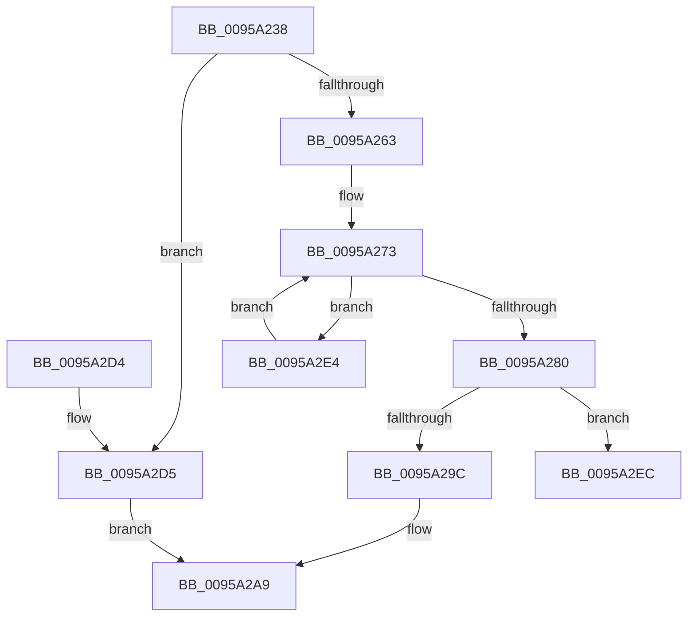

# SdbpCreateSearchPathPartsFromPath

- RVA: `0x0095A238`–`0x0095A2F7` (길이 `191` bytes)
- VA: `0x000000014095A238`
- 실행 섹션: `PAGE`
- PDB 이름 있음: `예`; PDB Function 태그: `예`
- unwind 정보 RVA: `0x00092934`
- 디코드: `56`개 명령, `191/191` bytes 표시
- 미해석 바이트: `0` (있으면 어셈블리에 `.byte`로 보존)

> 이 문서는 커널 이미지의 기계어와 PDB 기호를 분석해 생성했습니다. 4번과 5번은 함수 원형과 자료형을 바이너리 사용 방식에서 추정한 C 해석이며 원본 소스 복구 결과는 아닙니다.

## 1. Dependencies

- 직접 호출 지점: **3**; 고유 호출 대상: **3**
- 직접 호출자로 확인된 함수: **1**
- RIP 상대 이미지 참조: **3**

### Outgoing calls
- `0x0095A276` → [wcschr](../../text/50/wcschr_function_00501A60.md) (function, `0x00501A60`)
- `0x0095A28F` → [AslAlloc](AslAlloc_function_0095BD34.md) (function, `0x0095BD34`)
- `0x0095A2B5` → [AslLogCallPrintf](AslLogCallPrintf_function_0095E4EC.md) (function, `0x0095E4EC`)

### Direct callers
- [SdbpInitializeSearchDBContext](../81/SdbpInitializeSearchDBContext_function_00816210.md) at `0x0081631D`

### Static image references
- `0x0095A29C` → RVA `0x00012730` (`.rdata`; read)
- `0x0095A2A9` → RVA `0x00012758` (`.rdata`; read)
- `0x0095A2D5` → RVA `0x0003BE80` (`.rdata`; read)

## 2. Other-region calls and transfers

- 다른 실행 섹션으로 향하는 call: **1**
  - `0x0095A276` → [wcschr](../../text/50/wcschr_function_00501A60.md) (`PAGE` → `.text`)
- call이 아닌 외부 분기/꼬리 이동: **1**
  - `0x0095A2F2` → [sub_00B275E6](../B2/Unknown_function_00B275E6.md) (`tail-transfer`)

## 3. Assembly (complete function range)

```asm
0095A238  48 89 5C 24 10                  mov qword ptr [rsp + 0x10], rbx
0095A23D  48 89 74 24 18                  mov qword ptr [rsp + 0x18], rsi
0095A242  57                              push rdi
0095A243  41 54                           push r12
0095A245  41 55                           push r13
0095A247  41 56                           push r14
0095A249  41 57                           push r15
0095A24B  48 83 EC 20                     sub rsp, 0x20
0095A24F  45 33 E4                        xor r12d, r12d
0095A252  4C 8B F2                        mov r14, rdx
0095A255  48 8B F9                        mov rdi, rcx
0095A258  45 8B FC                        mov r15d, r12d
0095A25B  41 8B DC                        mov ebx, r12d
0095A25E  48 85 C9                        test rcx, rcx
0095A261  74 72                           je 0x14095a2d5
0095A263  66 44 39 21                     cmp word ptr [rcx], r12w
0095A267  45 8D 6C 24 3B                  lea r13d, [r12 + 0x3b]
0095A26C  41 8B F4                        mov esi, r12d
0095A26F  40 0F 95 C6                     setne sil
0095A273  41 8B D5                        mov edx, r13d
0095A276  E8 E5 77 BA FF                  call 0x140501a60
0095A27B  48 85 C0                        test rax, rax
0095A27E  75 64                           jne 0x14095a2e4
0095A280  8D 46 FF                        lea eax, [rsi - 1]
0095A283  48 8D 14 40                     lea rdx, [rax + rax*2]
0095A287  48 C1 E2 04                     shl rdx, 4
0095A28B  48 83 C2 38                     add rdx, 0x38
0095A28F  E8 A0 1A 00 00                  call 0x14095bd34
0095A294  4C 8B C0                        mov r8, rax
0095A297  48 85 C0                        test rax, rax
0095A29A  75 50                           jne 0x14095a2ec
0095A29C  4C 8D 0D 8D 84 6B FF            lea r9, [rip - 0x947b73]
0095A2A3  41 B8 D1 0C 00 00               mov r8d, 0xcd1
0095A2A9  48 8D 15 A8 84 6B FF            lea rdx, [rip - 0x947b58]
0095A2B0  B9 01 00 00 00                  mov ecx, 1
0095A2B5  E8 32 42 00 00                  call 0x14095e4ec
0095A2BA  33 C0                           xor eax, eax
0095A2BC  48 8B 5C 24 58                  mov rbx, qword ptr [rsp + 0x58]
0095A2C1  48 8B 74 24 60                  mov rsi, qword ptr [rsp + 0x60]
0095A2C6  48 83 C4 20                     add rsp, 0x20
0095A2CA  41 5F                           pop r15
0095A2CC  41 5E                           pop r14
0095A2CE  41 5D                           pop r13
0095A2D0  41 5C                           pop r12
0095A2D2  5F                              pop rdi
0095A2D3  C3                              ret
0095A2D4  CC                              int3
0095A2D5  4C 8D 0D A4 1B 6E FF            lea r9, [rip - 0x91e45c]
0095A2DC  41 B8 B4 0C 00 00               mov r8d, 0xcb4
0095A2E2  EB C5                           jmp 0x14095a2a9
0095A2E4  FF C6                           inc esi
0095A2E6  48 8D 48 02                     lea rcx, [rax + 2]
0095A2EA  EB 87                           jmp 0x14095a273
0095A2EC  89 30                           mov dword ptr [rax], esi
0095A2EE  48 83 C8 FF                     or rax, 0xffffffffffffffff
0095A2F2  E9 EF D2 1C 00                  jmp 0x140b275e6
```

## 4. C-style interpretation (structured pseudocode)

```c
__int64 __fastcall SdbpCreateSearchPathPartsFromPath(__int64 a1, __int64 a2)
{
    __int64 result;
    __int64 v_r12;
    __int64 v_rsi;
    __int64 v_rsp;
    unsigned __int64 v_stack_p10;
    unsigned __int64 v_stack_p18;

    v_stack_p10 = v_rbx;
    v_stack_p18 = v_rsi;
    v_rsp = (v_rsp) - (32);
    v_r12 = 0;
    if (a1 == 0) goto loc_0095A2D5;
    v_rsi = ((*(unsigned __int16 *)(a1)) != 0) ? 1 : 0;
loc_0095A273:
    result = wcschr(a1, (unsigned int)((unsigned int)(v_r12 + 59)), a3, a4);
    if (result != 0) goto loc_0095A2E4;
    a2 = (v_rsi - 1 + v_rsi - 1 * 2) << (4);
    a2 = (a2) + (56);
    result = AslAlloc(a1, a2, a3, a4);
    if (result != 0) goto loc_0095A2EC;
loc_0095A2A9:
    result = AslLogCallPrintf(1, v_rip - 9730904, (unsigned int)(0xCD1ULL), v_rip - 9730931);
    result = 0;
    v_rsp = (v_rsp) + (32);
    return result;
loc_0095A2D5:
    goto loc_0095A2A9;
loc_0095A2E4:
    v_rsi = (unsigned int)((v_stack_p18) + 1);
    goto loc_0095A273;
loc_0095A2EC:
    *(unsigned int *)(result) = (unsigned int)(v_rsi);
    result = (result) | (-1);
}
```

## 5. (Beta) C Style

```c
int64_t SdbpCreateSearchPathPartsFromPath(int64_t Arg1, int64_t Arg2)
{
    int64_t result;
    int64_t local_r12;
    int64_t local_rsi;
    int64_t local_rsp;
    uint64_t v_stack_p10;
    uint64_t v_stack_p18;

    v_stack_p10 = local_rbx;
    v_stack_p18 = local_rsi;
    local_rsp = (local_rsp) - (32);
    local_r12 = 0;
    if (Arg1 == 0) goto loc_0095A2D5;
    local_rsi = ((*(uint16_t *)(Arg1)) != 0) ? 1 : 0;
loc_0095A273:
    result = wcschr(Arg1, (uint32_t)((uint32_t)(local_r12 + 59)), a3, a4);
    if (result != 0) goto loc_0095A2E4;
    Arg2 = (local_rsi - 1 + local_rsi - 1 * 2) << (4);
    Arg2 = (Arg2) + (56);
    result = AslAlloc(Arg1, Arg2, a3, a4);
    if (result != 0) goto loc_0095A2EC;
loc_0095A2A9:
    result = AslLogCallPrintf(1, v_rip - 9730904, (uint32_t)(0xCD1ULL), v_rip - 9730931);
    result = 0;
    local_rsp = (local_rsp) + (32);
    return result;
loc_0095A2D5:
    goto loc_0095A2A9;
loc_0095A2E4:
    local_rsi = (uint32_t)((v_stack_p18) + 1);
    goto loc_0095A273;
loc_0095A2EC:
    *(uint32_t *)(result) = (uint32_t)(local_rsi);
    result = (result) | (-1);
}
```

## 6. Execution-region graph

[열기: 2D/3D 그래프와 함수 탐색 컨트롤 패널](../../../control-panel.html?section=page&rva=0x0095A238&view=graph)

- 2D 그래프는 위에서 아래로 흐르고, 3D 그래프는 빈 공간을 드래그해 회전합니다. Shift+드래그는 이동, 휠은 확대·축소, 함수 노드 선택은 대상 보고서 이동입니다.

### Static fallback


