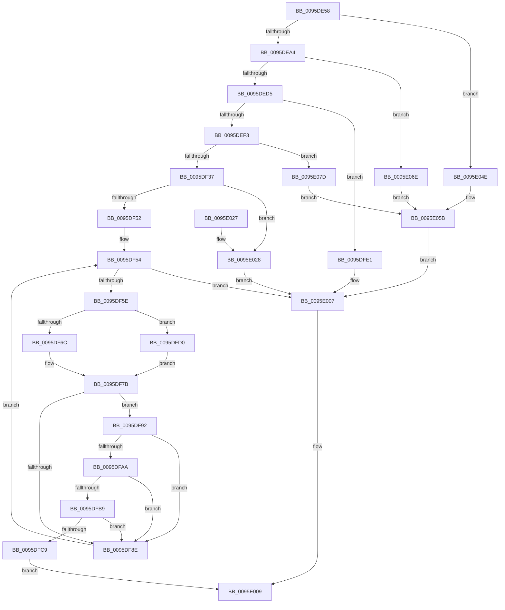

# SdbpFindFirstIndexedWildCardTag

- RVA: `0x0095DE58`–`0x0095E08C` (길이 `564` bytes)
- VA: `0x000000014095DE58`
- 실행 섹션: `PAGE`
- PDB 이름 있음: `예`; PDB Function 태그: `아니요`
- unwind 정보 RVA: `0x00092E78`
- 디코드: `147`개 명령, `564/564` bytes 표시
- 미해석 바이트: `0` (있으면 어셈블리에 `.byte`로 보존)

> 이 문서는 커널 이미지의 기계어와 PDB 기호를 분석해 생성했습니다. 4번과 5번은 함수 원형과 자료형을 바이너리 사용 방식에서 추정한 C 해석이며 원본 소스 복구 결과는 아닙니다.

## 1. Dependencies

- 직접 호출 지점: **14**; 고유 호출 대상: **11**
- 직접 호출자로 확인된 함수: **2**
- RIP 상대 이미지 참조: **7**

### Outgoing calls
- `0x0095DEE4` → [SdbGetIndex](SdbGetIndex_function_0095C3C4.md) (function, `0x0095C3C4`)
- `0x0095DF11` → [memset](../../text/6C/memset_function_006C6C40.md) (function, `0x006C6C40`)
- `0x0095DF2A` → [AslStringUpcaseToMultiByteN](AslStringUpcaseToMultiByteN_function_0095965C.md) (function, `0x0095965C`)
- `0x0095DF41` → [SdbpGetIndex](SdbpGetIndex_function_0095BF94.md) (function, `0x0095BF94`)
- `0x0095DF71` → [SdbpKeyToAnsiString](SdbpKeyToAnsiString_function_0095C2A8.md) (function, `0x0095C2A8`)
- `0x0095DF85` → [AslStringPatternMatchExA](AslStringPatternMatchExA_function_0095E0A0.md) (function, `0x0095E0A0`)
- `0x0095DFA1` → [SdbFindFirstTag](SdbFindFirstTag_function_0095E34C.md) (function, `0x0095E34C`)
- `0x0095DFAF` → [SdbGetStringTagPtr](SdbGetStringTagPtr_function_0095DDA8.md) (function, `0x0095DDA8`)
- `0x0095DFC0` → [AslStringPatternMatchExW](AslStringPatternMatchExW_function_0095E850.md) (function, `0x0095E850`)
- `0x0095DFD5` → [SdbpKeyToAnsiString](SdbpKeyToAnsiString_function_0095C2A8.md) (function, `0x0095C2A8`)
- `0x0095E002` → [AslLogCallPrintf](AslLogCallPrintf_function_0095E4EC.md) (function, `0x0095E4EC`)
- `0x0095E010` → [_security_check_cookie](../../text/6A/_security_check_cookie_function_006AC640.md) (function, `0x006AC640`)
- `0x0095E047` → [AslLogCallPrintf](AslLogCallPrintf_function_0095E4EC.md) (function, `0x0095E4EC`)
- `0x0095E067` → [AslLogCallPrintf](AslLogCallPrintf_function_0095E4EC.md) (function, `0x0095E4EC`)

### Direct callers
- [SdbGetDatabaseMatchEx](SdbGetDatabaseMatchEx_function_0095BD7C.md) at `0x0095BE22`
- [SdbpSearchDB](../AB/SdbpSearchDB_function_00AB3294.md) at `0x00AB3372`
- [SdbpSearchDB](../AB/SdbpSearchDB_function_00AB3294.md) at `0x00AB36A2`

### Static image references
- `0x0095DE6F` → RVA `0x00E0A740` (`.data`; read)
- `0x0095DFE5` → RVA `0x00012810` (`.rdata`; read)
- `0x0095DFF6` → RVA `0x00012908` (`.rdata`; read)
- `0x0095E02A` → RVA `0x000128E0` (`.rdata`; read)
- `0x0095E04E` → RVA `0x00012A10` (`.rdata`; read)
- `0x0095E06E` → RVA `0x00012BE0` (`.rdata`; read)
- `0x0095E07D` → RVA `0x00012C10` (`.rdata`; read)

## 2. Other-region calls and transfers

- 다른 실행 섹션으로 향하는 call: **2**
  - `0x0095DF11` → [memset](../../text/6C/memset_function_006C6C40.md) (`PAGE` → `.text`)
  - `0x0095E010` → [_security_check_cookie](../../text/6A/_security_check_cookie_function_006AC640.md) (`PAGE` → `.text`)
- 별도 외부 분기/꼬리 이동을 확인하지 못했습니다.

## 3. Assembly (complete function range)

```asm
0095DE58  40 55                           push rbp
0095DE5A  53                              push rbx
0095DE5B  56                              push rsi
0095DE5C  57                              push rdi
0095DE5D  41 54                           push r12
0095DE5F  41 56                           push r14
0095DE61  41 57                           push r15
0095DE63  48 8D 6C 24 90                  lea rbp, [rsp - 0x70]
0095DE68  48 81 EC 70 01 00 00            sub rsp, 0x170
0095DE6F  48 8B 05 CA C8 4A 00            mov rax, qword ptr [rip + 0x4ac8ca]
0095DE76  48 33 C4                        xor rax, rsp
0095DE79  48 89 45 60                     mov qword ptr [rbp + 0x60], rax
0095DE7D  48 8B 9D D0 00 00 00            mov rbx, qword ptr [rbp + 0xd0]
0095DE84  4D 8B F9                        mov r15, r9
0095DE87  83 64 24 34 00                  and dword ptr [rsp + 0x34], 0
0095DE8C  4C 8B F1                        mov r14, rcx
0095DE8F  83 64 24 30 00                  and dword ptr [rsp + 0x30], 0
0095DE94  41 0F B7 F8                     movzx edi, r8w
0095DE98  0F B7 F2                        movzx esi, dx
0095DE9B  48 85 DB                        test rbx, rbx
0095DE9E  0F 84 AA 01 00 00               je 0x14095e04e
0095DEA4  33 C0                           xor eax, eax
0095DEA6  0F 57 C0                        xorps xmm0, xmm0
0095DEA9  0F 11 03                        movups xmmword ptr [rbx], xmm0
0095DEAC  B9 00 F0 00 00                  mov ecx, 0xf000
0095DEB1  0F 11 43 10                     movups xmmword ptr [rbx + 0x10], xmm0
0095DEB5  48 89 43 20                     mov qword ptr [rbx + 0x20], rax
0095DEB9  0F B7 C7                        movzx eax, di
0095DEBC  66 23 C1                        and ax, cx
0095DEBF  B9 00 60 00 00                  mov ecx, 0x6000
0095DEC4  66 2B C1                        sub ax, cx
0095DEC7  B9 FF DF 00 00                  mov ecx, 0xdfff
0095DECC  66 85 C1                        test cx, ax
0095DECF  0F 85 99 01 00 00               jne 0x14095e06e
0095DED5  4C 8D 4C 24 30                  lea r9, [rsp + 0x30]
0095DEDA  44 0F B7 C7                     movzx r8d, di
0095DEDE  0F B7 D6                        movzx edx, si
0095DEE1  49 8B CE                        mov rcx, r14
0095DEE4  E8 DB E4 FF FF                  call 0x14095c3c4
0095DEE9  89 03                           mov dword ptr [rbx], eax
0095DEEB  85 C0                           test eax, eax
0095DEED  0F 84 EE 00 00 00               je 0x14095dfe1
0095DEF3  44 8B 64 24 30                  mov r12d, dword ptr [rsp + 0x30]
0095DEF8  48 8D 4C 24 50                  lea rcx, [rsp + 0x50]
0095DEFD  33 D2                           xor edx, edx
0095DEFF  44 89 63 14                     mov dword ptr [rbx + 0x14], r12d
0095DF03  41 B8 04 01 00 00               mov r8d, 0x104
0095DF09  66 89 7B 0C                     mov word ptr [rbx + 0xc], di
0095DF0D  4C 89 7B 20                     mov qword ptr [rbx + 0x20], r15
0095DF11  E8 2A 8D D6 FF                  call 0x1406c6c40
0095DF16  33 C0                           xor eax, eax
0095DF18  48 8D 4C 24 50                  lea rcx, [rsp + 0x50]
0095DF1D  4D 8B C7                        mov r8, r15
0095DF20  48 89 44 24 38                  mov qword ptr [rsp + 0x38], rax
0095DF25  66 89 44 24 40                  mov word ptr [rsp + 0x40], ax
0095DF2A  E8 2D B7 FF FF                  call 0x14095965c
0095DF2F  85 C0                           test eax, eax
0095DF31  0F 88 46 01 00 00               js 0x14095e07d
0095DF37  8B 13                           mov edx, dword ptr [rbx]
0095DF39  4C 8D 44 24 34                  lea r8, [rsp + 0x34]
0095DF3E  49 8B CE                        mov rcx, r14
0095DF41  E8 4E E0 FF FF                  call 0x14095bf94
0095DF46  4C 8B F8                        mov r15, rax
0095DF49  48 85 C0                        test rax, rax
0095DF4C  0F 84 D6 00 00 00               je 0x14095e028
0095DF52  33 FF                           xor edi, edi
0095DF54  3B 7C 24 34                     cmp edi, dword ptr [rsp + 0x34]
0095DF58  0F 83 A9 00 00 00               jae 0x14095e007
0095DF5E  48 8D 34 7F                     lea rsi, [rdi + rdi*2]
0095DF62  49 8B 0C B7                     mov rcx, qword ptr [r15 + rsi*4]
0095DF66  41 F6 C4 02                     test r12b, 2
0095DF6A  74 64                           je 0x14095dfd0
0095DF6C  48 8D 54 24 39                  lea rdx, [rsp + 0x39]
0095DF71  E8 32 E3 FF FF                  call 0x14095c2a8
0095DF76  C6 44 24 38 2A                  mov byte ptr [rsp + 0x38], 0x2a
0095DF7B  48 8D 54 24 50                  lea rdx, [rsp + 0x50]
0095DF80  48 8D 4C 24 38                  lea rcx, [rsp + 0x38]
0095DF85  E8 16 01 00 00                  call 0x14095e0a0
0095DF8A  85 C0                           test eax, eax
0095DF8C  75 04                           jne 0x14095df92
0095DF8E  FF C7                           inc edi
0095DF90  EB C2                           jmp 0x14095df54
0095DF92  41 8B 74 B7 08                  mov esi, dword ptr [r15 + rsi*4 + 8]
0095DF97  49 8B CE                        mov rcx, r14
0095DF9A  44 0F B7 43 0C                  movzx r8d, word ptr [rbx + 0xc]
0095DF9F  8B D6                           mov edx, esi
0095DFA1  E8 A6 03 00 00                  call 0x14095e34c
0095DFA6  85 C0                           test eax, eax
0095DFA8  74 E4                           je 0x14095df8e
0095DFAA  8B D0                           mov edx, eax
0095DFAC  49 8B CE                        mov rcx, r14
0095DFAF  E8 F4 FD FF FF                  call 0x14095dda8
0095DFB4  48 85 C0                        test rax, rax
0095DFB7  74 D5                           je 0x14095df8e
0095DFB9  48 8B 53 20                     mov rdx, qword ptr [rbx + 0x20]
0095DFBD  48 8B C8                        mov rcx, rax
0095DFC0  E8 8B 08 00 00                  call 0x14095e850
0095DFC5  85 C0                           test eax, eax
0095DFC7  74 C5                           je 0x14095df8e
0095DFC9  89 7B 10                        mov dword ptr [rbx + 0x10], edi
0095DFCC  8B C6                           mov eax, esi
0095DFCE  EB 39                           jmp 0x14095e009
0095DFD0  48 8D 54 24 38                  lea rdx, [rsp + 0x38]
0095DFD5  E8 CE E2 FF FF                  call 0x14095c2a8
0095DFDA  C6 44 24 40 2A                  mov byte ptr [rsp + 0x40], 0x2a
0095DFDF  EB 9A                           jmp 0x14095df7b
0095DFE1  89 7C 24 28                     mov dword ptr [rsp + 0x28], edi
0095DFE5  4C 8D 0D 24 48 6B FF            lea r9, [rip - 0x94b7dc]
0095DFEC  41 B8 AB 03 00 00               mov r8d, 0x3ab
0095DFF2  89 74 24 20                     mov dword ptr [rsp + 0x20], esi
0095DFF6  48 8D 15 0B 49 6B FF            lea rdx, [rip - 0x94b6f5]
0095DFFD  B9 01 00 00 00                  mov ecx, 1
0095E002  E8 E5 04 00 00                  call 0x14095e4ec
0095E007  33 C0                           xor eax, eax
0095E009  48 8B 4D 60                     mov rcx, qword ptr [rbp + 0x60]
0095E00D  48 33 CC                        xor rcx, rsp
0095E010  E8 2B E6 D4 FF                  call 0x1406ac640
0095E015  48 81 C4 70 01 00 00            add rsp, 0x170
0095E01C  41 5F                           pop r15
0095E01E  41 5E                           pop r14
0095E020  41 5C                           pop r12
0095E022  5F                              pop rdi
0095E023  5E                              pop rsi
0095E024  5B                              pop rbx
0095E025  5D                              pop rbp
0095E026  C3                              ret
0095E027  CC                              int3
0095E028  8B 03                           mov eax, dword ptr [rbx]
0095E02A  4C 8D 0D AF 48 6B FF            lea r9, [rip - 0x94b751]
0095E031  41 B8 C6 03 00 00               mov r8d, 0x3c6
0095E037  89 44 24 20                     mov dword ptr [rsp + 0x20], eax
0095E03B  48 8D 15 C6 48 6B FF            lea rdx, [rip - 0x94b73a]
0095E042  B9 01 00 00 00                  mov ecx, 1
0095E047  E8 A0 04 00 00                  call 0x14095e4ec
0095E04C  EB B9                           jmp 0x14095e007
0095E04E  4C 8D 0D BB 49 6B FF            lea r9, [rip - 0x94b645]
0095E055  41 B8 96 03 00 00               mov r8d, 0x396
0095E05B  48 8D 15 A6 48 6B FF            lea rdx, [rip - 0x94b75a]
0095E062  B9 01 00 00 00                  mov ecx, 1
0095E067  E8 80 04 00 00                  call 0x14095e4ec
0095E06C  EB 99                           jmp 0x14095e007
0095E06E  4C 8D 0D 6B 4B 6B FF            lea r9, [rip - 0x94b495]
0095E075  41 B8 A4 03 00 00               mov r8d, 0x3a4
0095E07B  EB DE                           jmp 0x14095e05b
0095E07D  4C 8D 0D 8C 4B 6B FF            lea r9, [rip - 0x94b474]
0095E084  41 B8 BC 03 00 00               mov r8d, 0x3bc
0095E08A  EB CF                           jmp 0x14095e05b
```

## 4. C-style interpretation (structured pseudocode)

```c
__int64 __fastcall SdbpFindFirstIndexedWildCardTag(__int64 a1, unsigned __int16 a2, unsigned __int16 a3, __int64 a4, __int64 a5)
{
    __int64 result;
    __int64 v_rdi;
    __int64 v_rsp;
    unsigned __int64 v_stack_m158;
    unsigned __int16 v_stack_m168;
    unsigned __int64 v_stack_m16F;
    unsigned __int64 v_stack_m170;
    unsigned int v_stack_m174;
    unsigned int v_stack_m178;
    unsigned int v_stack_m180;
    unsigned int v_stack_m188;
    unsigned __int64 v_stack_m48;
    unsigned __int64 v_stack_mA8;
    unsigned int v_stack_p20;

    v_rsp = (v_rsp) - (368);
    result = (*(unsigned __int64 *)(v_rip + 4901066)) ^ (v_rsp);
    v_stack_m48 = result;
    if (a5 == 0) goto loc_0095E04E;
    result = 0;
    *(unsigned __int64 *)(a5) = v_xmm0;
    *(unsigned __int64 *)(a5 + 16) = v_xmm0;
    *(unsigned __int64 *)(a5 + 32) = 0;
    result = (unsigned __int16)((a3) & ((unsigned __int16)((unsigned int)(0xF000ULL))));
    result = (unsigned __int16)((result) - ((unsigned __int16)((unsigned int)(0x6000ULL))));
    if ((((unsigned __int16)((unsigned int)(0xDFFFULL))) & ((unsigned __int16)(result))) != 0) goto loc_0095E06E;
    result = SdbGetIndex(a1, a2, a3, v_stack_m178);
    *(unsigned int *)(a5) = (unsigned int)(result);
    if ((unsigned int)(result) == 0) goto loc_0095DFE1;
    a2 = 0;
    *(unsigned int *)(a5 + 20) = (unsigned int)((unsigned int)(v_stack_m178));
    *(unsigned __int16 *)(a5 + 12) = a3;
    *(unsigned __int64 *)(a5 + 32) = a4;
    result = memset(v_stack_m158, a2, 260, v_stack_m178);
    result = 0;
    v_stack_m170 = 0;
    v_stack_m168 = 0;
    result = AslStringUpcaseToMultiByteN(v_stack_m158, a2, a4, v_stack_m178);
    if (sign_flag) goto loc_0095E07D;
    result = SdbpGetIndex(a1, (unsigned int)(*(unsigned int *)(a5)), v_stack_m174, v_stack_m178);
    if (result == 0) goto loc_0095E028;
    v_rdi = 0;
loc_0095DF54:
    if (0 >= v_stack_m174) goto loc_0095E007;
    if ((((unsigned __int8)((unsigned int)(v_stack_m178))) & (2)) == 0) goto loc_0095DFD0;
    result = SdbpKeyToAnsiString(*(unsigned __int64 *)(result + v_rdi + v_rdi * 2 * 4), v_stack_m16F, v_stack_m174, v_stack_m178);
    v_stack_m170 = 42;
loc_0095DF7B:
    result = AslStringPatternMatchExA(v_stack_m170, v_stack_m158, v_stack_m174, v_stack_m178);
    if ((unsigned int)(result) != 0) goto loc_0095DF92;
loc_0095DF8E:
    v_rdi = (unsigned int)((v_rdi) + 1);
    goto loc_0095DF54;
loc_0095DF92:
    result = SdbFindFirstTag(a1, (unsigned int)((unsigned int)((unsigned int)(*(unsigned int *)(result + v_rdi + v_rdi * 2 * 4 + 8)))), *(unsigned __int16 *)(a5 + 12), v_stack_m178);
    if ((unsigned int)(result) == 0) goto loc_0095DF8E;
    result = SdbGetStringTagPtr(a1, (unsigned int)((unsigned int)(result)), *(unsigned __int16 *)(a5 + 12), v_stack_m178);
    if (result == 0) goto loc_0095DF8E;
    result = AslStringPatternMatchExW(result, *(unsigned __int64 *)(a5 + 32), *(unsigned __int16 *)(a5 + 12), v_stack_m178);
    if ((unsigned int)(result) == 0) goto loc_0095DF8E;
    *(unsigned int *)(a5 + 16) = (unsigned int)(v_rdi);
    goto loc_0095E009;
loc_0095DFD0:
    result = SdbpKeyToAnsiString(result, v_stack_m170, *(unsigned __int16 *)(a5 + 12), v_stack_m178);
    v_stack_m168 = 42;
    goto loc_0095DF7B;
loc_0095DFE1:
    v_stack_m180 = (unsigned int)(v_rdi);
    v_stack_m188 = (unsigned int)((unsigned int)(*(unsigned int *)(result + v_rdi + v_rdi * 2 * 4 + 8)));
    result = AslLogCallPrintf(1, v_rip - 9746165, 939, v_rip - 9746396);
loc_0095E007:
    result = 0;
loc_0095E009:
    a1 = (v_stack_m48) ^ (v_rsp);
    result = _security_check_cookie(a1, v_rip - 9746165, 939, v_rip - 9746396);
    v_rsp = (v_rsp) + (368);
    return result;
loc_0095E028:
    v_stack_p20 = (unsigned int)((unsigned int)(*(unsigned int *)(a5)));
    result = AslLogCallPrintf(1, v_rip - 9746234, 966, v_rip - 9746257);
    goto loc_0095E007;
loc_0095E04E:
loc_0095E05B:
    result = AslLogCallPrintf(1, v_rip - 9746266, 918, v_rip - 9745989);
    goto loc_0095E007;
loc_0095E06E:
    goto loc_0095E05B;
loc_0095E07D:
    goto loc_0095E05B;
}
```

## 5. (Beta) C Style

```c
int64_t SdbpFindFirstIndexedWildCardTag(int64_t Arg1, uint16_t Arg2, uint16_t Arg3, int64_t Arg4, int64_t Arg5)
{
    int64_t result;
    int64_t local_rdi;
    int64_t local_rsp;
    uint64_t v_stack_m158;
    uint16_t v_stack_m168;
    uint64_t v_stack_m16F;
    uint64_t v_stack_m170;
    uint32_t v_stack_m174;
    uint32_t v_stack_m178;
    uint32_t v_stack_m180;
    uint32_t v_stack_m188;
    uint64_t v_stack_m48;
    uint64_t v_stack_mA8;
    uint32_t v_stack_p20;

    local_rsp = (local_rsp) - (368);
    result = (*(uint64_t *)(v_rip + 0x4AC8CA)) ^ (local_rsp);
    v_stack_m48 = result;
    if (Arg5 == 0) goto loc_0095E04E;
    result = 0;
    *(uint64_t *)(Arg5) = v_xmm0;
    *(uint64_t *)(Arg5 + 0x10) = v_xmm0;
    *(uint64_t *)(Arg5 + 0x20) = 0;
    result = (uint16_t)((Arg3) & ((uint16_t)((uint32_t)(0xF000ULL))));
    result = (uint16_t)((result) - ((uint16_t)((uint32_t)(0x6000ULL))));
    if ((((uint16_t)((uint32_t)(0xDFFFULL))) & ((uint16_t)(result))) != 0) goto loc_0095E06E;
    result = SdbGetIndex(Arg1, Arg2, Arg3, v_stack_m178);
    *(uint32_t *)(Arg5) = (uint32_t)(result);
    if ((uint32_t)(result) == 0) goto loc_0095DFE1;
    Arg2 = 0;
    *(uint32_t *)(Arg5 + 0x14) = (uint32_t)((uint32_t)(v_stack_m178));
    *(uint16_t *)(Arg5 + 0xC) = Arg3;
    *(uint64_t *)(Arg5 + 0x20) = Arg4;
    result = memset(v_stack_m158, Arg2, 260, v_stack_m178);
    result = 0;
    v_stack_m170 = 0;
    v_stack_m168 = 0;
    result = AslStringUpcaseToMultiByteN(v_stack_m158, Arg2, Arg4, v_stack_m178);
    if (sign_flag) goto loc_0095E07D;
    result = SdbpGetIndex(Arg1, (uint32_t)(*(uint32_t *)(Arg5)), v_stack_m174, v_stack_m178);
    if (result == 0) goto loc_0095E028;
    local_rdi = 0;
loc_0095DF54:
    if (0 >= v_stack_m174) goto loc_0095E007;
    if ((((uint8_t)((uint32_t)(v_stack_m178))) & (2)) == 0) goto loc_0095DFD0;
    result = SdbpKeyToAnsiString(*(uint64_t *)(result + local_rdi + local_rdi * 2 * 4), v_stack_m16F, v_stack_m174, v_stack_m178);
    v_stack_m170 = 42;
loc_0095DF7B:
    result = AslStringPatternMatchExA(v_stack_m170, v_stack_m158, v_stack_m174, v_stack_m178);
    if ((uint32_t)(result) != 0) goto loc_0095DF92;
loc_0095DF8E:
    local_rdi = (uint32_t)((local_rdi) + 1);
    goto loc_0095DF54;
loc_0095DF92:
    result = SdbFindFirstTag(Arg1, (uint32_t)((uint32_t)((uint32_t)(*(uint32_t *)(result + local_rdi + local_rdi * 2 * 4 + 0x8)))), *(uint16_t *)(Arg5 + 0xC), v_stack_m178);
    if ((uint32_t)(result) == 0) goto loc_0095DF8E;
    result = SdbGetStringTagPtr(Arg1, (uint32_t)((uint32_t)(result)), *(uint16_t *)(Arg5 + 0xC), v_stack_m178);
    if (result == 0) goto loc_0095DF8E;
    result = AslStringPatternMatchExW(result, *(uint64_t *)(Arg5 + 0x20), *(uint16_t *)(Arg5 + 0xC), v_stack_m178);
    if ((uint32_t)(result) == 0) goto loc_0095DF8E;
    *(uint32_t *)(Arg5 + 0x10) = (uint32_t)(local_rdi);
    goto loc_0095E009;
loc_0095DFD0:
    result = SdbpKeyToAnsiString(result, v_stack_m170, *(uint16_t *)(Arg5 + 0xC), v_stack_m178);
    v_stack_m168 = 42;
    goto loc_0095DF7B;
loc_0095DFE1:
    v_stack_m180 = (uint32_t)(local_rdi);
    v_stack_m188 = (uint32_t)((uint32_t)(*(uint32_t *)(result + local_rdi + local_rdi * 2 * 4 + 0x8)));
    result = AslLogCallPrintf(1, v_rip - 9746165, 939, v_rip - 9746396);
loc_0095E007:
    result = 0;
loc_0095E009:
    Arg1 = (v_stack_m48) ^ (local_rsp);
    result = _security_check_cookie(Arg1, v_rip - 9746165, 939, v_rip - 9746396);
    local_rsp = (local_rsp) + (368);
    return result;
loc_0095E028:
    v_stack_p20 = (uint32_t)((uint32_t)(*(uint32_t *)(Arg5)));
    result = AslLogCallPrintf(1, v_rip - 9746234, 966, v_rip - 9746257);
    goto loc_0095E007;
loc_0095E04E:
loc_0095E05B:
    result = AslLogCallPrintf(1, v_rip - 9746266, 918, v_rip - 9745989);
    goto loc_0095E007;
loc_0095E06E:
    goto loc_0095E05B;
loc_0095E07D:
    goto loc_0095E05B;
}
```

## 6. Execution-region graph

[열기: 2D/3D 그래프와 함수 탐색 컨트롤 패널](../../../control-panel.html?section=page&rva=0x0095DE58&view=graph)

- 2D 그래프는 위에서 아래로 흐르고, 3D 그래프는 빈 공간을 드래그해 회전합니다. Shift+드래그는 이동, 휠은 확대·축소, 함수 노드 선택은 대상 보고서 이동입니다.

### Static fallback


