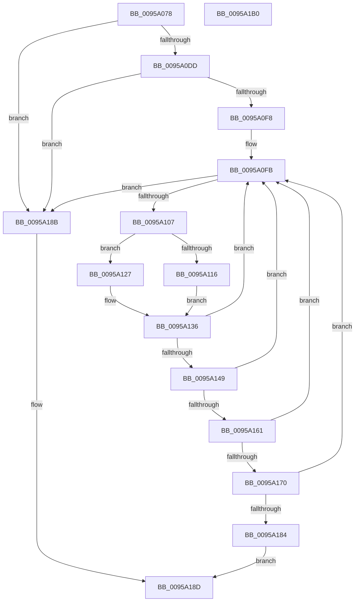

# SdbpFindNextIndexedWildCardTag

- RVA: `0x0095A078`–`0x0095A1B1` (길이 `313` bytes)
- VA: `0x000000014095A078`
- 실행 섹션: `PAGE`
- PDB 이름 있음: `예`; PDB Function 태그: `아니요`
- unwind 정보 RVA: `0x00092910`
- 디코드: `87`개 명령, `313/313` bytes 표시
- 미해석 바이트: `0` (있으면 어셈블리에 `.byte`로 보존)

> 이 문서는 커널 이미지의 기계어와 PDB 기호를 분석해 생성했습니다. 4번과 5번은 함수 원형과 자료형을 바이너리 사용 방식에서 추정한 C 해석이며 원본 소스 복구 결과는 아닙니다.

## 1. Dependencies

- 직접 호출 지점: **10**; 고유 호출 대상: **9**
- 직접 호출자로 확인된 함수: **2**
- RIP 상대 이미지 참조: **1**

### Outgoing calls
- `0x0095A0B6` → [memset](../../text/6C/memset_function_006C6C40.md) (function, `0x006C6C40`)
- `0x0095A0D0` → [AslStringUpcaseToMultiByteN](AslStringUpcaseToMultiByteN_function_0095965C.md) (function, `0x0095965C`)
- `0x0095A0E7` → [SdbpGetIndex](SdbpGetIndex_function_0095BF94.md) (function, `0x0095BF94`)
- `0x0095A11B` → [SdbpKeyToAnsiString](SdbpKeyToAnsiString_function_0095C2A8.md) (function, `0x0095C2A8`)
- `0x0095A12C` → [SdbpKeyToAnsiString](SdbpKeyToAnsiString_function_0095C2A8.md) (function, `0x0095C2A8`)
- `0x0095A140` → [AslStringPatternMatchExA](AslStringPatternMatchExA_function_0095E0A0.md) (function, `0x0095E0A0`)
- `0x0095A158` → [SdbFindFirstTag](SdbFindFirstTag_function_0095E34C.md) (function, `0x0095E34C`)
- `0x0095A166` → [SdbGetStringTagPtr](SdbGetStringTagPtr_function_0095DDA8.md) (function, `0x0095DDA8`)
- `0x0095A177` → [AslStringPatternMatchExW](AslStringPatternMatchExW_function_0095E850.md) (function, `0x0095E850`)
- `0x0095A194` → [_security_check_cookie](../../text/6A/_security_check_cookie_function_006AC640.md) (function, `0x006AC640`)

### Direct callers
- [SdbGetDatabaseMatchEx](SdbGetDatabaseMatchEx_function_0095BD7C.md) at `0x0095BE8C`
- [SdbpSearchDB](../AB/SdbpSearchDB_function_00AB3294.md) at `0x00AB342D`
- [SdbpSearchDB](../AB/SdbpSearchDB_function_00AB3294.md) at `0x00AB3733`

### Static image references
- `0x0095A090` → RVA `0x00E0A740` (`.data`; read)

## 2. Other-region calls and transfers

- 다른 실행 섹션으로 향하는 call: **2**
  - `0x0095A0B6` → [memset](../../text/6C/memset_function_006C6C40.md) (`PAGE` → `.text`)
  - `0x0095A194` → [_security_check_cookie](../../text/6A/_security_check_cookie_function_006AC640.md) (`PAGE` → `.text`)
- 별도 외부 분기/꼬리 이동을 확인하지 못했습니다.

## 3. Assembly (complete function range)

```asm
0095A078  48 89 5C 24 18                  mov qword ptr [rsp + 0x18], rbx
0095A07D  55                              push rbp
0095A07E  56                              push rsi
0095A07F  57                              push rdi
0095A080  41 56                           push r14
0095A082  41 57                           push r15
0095A084  48 8D 6C 24 A0                  lea rbp, [rsp - 0x60]
0095A089  48 81 EC 60 01 00 00            sub rsp, 0x160
0095A090  48 8B 05 A9 06 4B 00            mov rax, qword ptr [rip + 0x4b06a9]
0095A097  48 33 C4                        xor rax, rsp
0095A09A  48 89 45 50                     mov qword ptr [rbp + 0x50], rax
0095A09E  83 64 24 20 00                  and dword ptr [rsp + 0x20], 0
0095A0A3  48 8B FA                        mov rdi, rdx
0095A0A6  4C 8B F9                        mov r15, rcx
0095A0A9  33 D2                           xor edx, edx
0095A0AB  48 8D 4C 24 40                  lea rcx, [rsp + 0x40]
0095A0B0  41 B8 04 01 00 00               mov r8d, 0x104
0095A0B6  E8 85 CB D6 FF                  call 0x1406c6c40
0095A0BB  4C 8B 47 20                     mov r8, qword ptr [rdi + 0x20]
0095A0BF  48 8D 4C 24 40                  lea rcx, [rsp + 0x40]
0095A0C4  33 C0                           xor eax, eax
0095A0C6  48 89 44 24 28                  mov qword ptr [rsp + 0x28], rax
0095A0CB  66 89 44 24 30                  mov word ptr [rsp + 0x30], ax
0095A0D0  E8 87 F5 FF FF                  call 0x14095965c
0095A0D5  85 C0                           test eax, eax
0095A0D7  0F 88 AE 00 00 00               js 0x14095a18b
0095A0DD  8B 17                           mov edx, dword ptr [rdi]
0095A0DF  4C 8D 44 24 20                  lea r8, [rsp + 0x20]
0095A0E4  49 8B CF                        mov rcx, r15
0095A0E7  E8 A8 1E 00 00                  call 0x14095bf94
0095A0EC  4C 8B F0                        mov r14, rax
0095A0EF  48 85 C0                        test rax, rax
0095A0F2  0F 84 93 00 00 00               je 0x14095a18b
0095A0F8  8B 5F 10                        mov ebx, dword ptr [rdi + 0x10]
0095A0FB  FF C3                           inc ebx
0095A0FD  3B 5C 24 20                     cmp ebx, dword ptr [rsp + 0x20]
0095A101  0F 83 84 00 00 00               jae 0x14095a18b
0095A107  8B 47 14                        mov eax, dword ptr [rdi + 0x14]
0095A10A  48 8D 34 5B                     lea rsi, [rbx + rbx*2]
0095A10E  49 8B 0C B6                     mov rcx, qword ptr [r14 + rsi*4]
0095A112  A8 02                           test al, 2
0095A114  74 11                           je 0x14095a127
0095A116  48 8D 54 24 29                  lea rdx, [rsp + 0x29]
0095A11B  E8 88 21 00 00                  call 0x14095c2a8
0095A120  C6 44 24 28 2A                  mov byte ptr [rsp + 0x28], 0x2a
0095A125  EB 0F                           jmp 0x14095a136
0095A127  48 8D 54 24 28                  lea rdx, [rsp + 0x28]
0095A12C  E8 77 21 00 00                  call 0x14095c2a8
0095A131  C6 44 24 30 2A                  mov byte ptr [rsp + 0x30], 0x2a
0095A136  48 8D 54 24 40                  lea rdx, [rsp + 0x40]
0095A13B  48 8D 4C 24 28                  lea rcx, [rsp + 0x28]
0095A140  E8 5B 3F 00 00                  call 0x14095e0a0
0095A145  85 C0                           test eax, eax
0095A147  74 B2                           je 0x14095a0fb
0095A149  41 8B 74 B6 08                  mov esi, dword ptr [r14 + rsi*4 + 8]
0095A14E  49 8B CF                        mov rcx, r15
0095A151  44 0F B7 47 0C                  movzx r8d, word ptr [rdi + 0xc]
0095A156  8B D6                           mov edx, esi
0095A158  E8 EF 41 00 00                  call 0x14095e34c
0095A15D  85 C0                           test eax, eax
0095A15F  74 9A                           je 0x14095a0fb
0095A161  8B D0                           mov edx, eax
0095A163  49 8B CF                        mov rcx, r15
0095A166  E8 3D 3C 00 00                  call 0x14095dda8
0095A16B  48 85 C0                        test rax, rax
0095A16E  74 8B                           je 0x14095a0fb
0095A170  48 8B 57 20                     mov rdx, qword ptr [rdi + 0x20]
0095A174  48 8B C8                        mov rcx, rax
0095A177  E8 D4 46 00 00                  call 0x14095e850
0095A17C  85 C0                           test eax, eax
0095A17E  0F 84 77 FF FF FF               je 0x14095a0fb
0095A184  89 5F 10                        mov dword ptr [rdi + 0x10], ebx
0095A187  8B C6                           mov eax, esi
0095A189  EB 02                           jmp 0x14095a18d
0095A18B  33 C0                           xor eax, eax
0095A18D  48 8B 4D 50                     mov rcx, qword ptr [rbp + 0x50]
0095A191  48 33 CC                        xor rcx, rsp
0095A194  E8 A7 24 D5 FF                  call 0x1406ac640
0095A199  48 8B 9C 24 A0 01 00 00         mov rbx, qword ptr [rsp + 0x1a0]
0095A1A1  48 81 C4 60 01 00 00            add rsp, 0x160
0095A1A8  41 5F                           pop r15
0095A1AA  41 5E                           pop r14
0095A1AC  5F                              pop rdi
0095A1AD  5E                              pop rsi
0095A1AE  5D                              pop rbp
0095A1AF  C3                              ret
0095A1B0  CC                              int3
```

## 4. C-style interpretation (structured pseudocode)

```c
__int64 __fastcall SdbpFindNextIndexedWildCardTag(__int64 a1, __int64 a2)
{
    __int64 result;
    __int64 v_rbx;
    __int64 v_rsp;
    unsigned __int64 v_stack_m148;
    unsigned __int16 v_stack_m158;
    unsigned __int64 v_stack_m15F;
    unsigned __int64 v_stack_m160;
    unsigned int v_stack_m168;
    unsigned __int64 v_stack_m38;
    unsigned __int64 v_stack_m88;
    unsigned __int64 v_stack_p18;

    v_stack_p18 = v_rbx;
    v_rsp = (v_rsp) - (352);
    result = (*(unsigned __int64 *)(v_rip + 4916905)) ^ (v_rsp);
    v_stack_m38 = result;
    a2 = 0;
    result = memset(v_stack_m148, a2, 260, a4);
    result = 0;
    v_stack_m160 = 0;
    v_stack_m158 = 0;
    result = AslStringUpcaseToMultiByteN(v_stack_m148, a2, *(unsigned __int64 *)(a2 + 32), a4);
    if (sign_flag) goto loc_0095A18B;
    result = SdbpGetIndex(a1, (unsigned int)(*(unsigned int *)(a2)), v_stack_m168, a4);
    if (result == 0) goto loc_0095A18B;
loc_0095A0FB:
    v_rbx = (unsigned int)(((unsigned int)(*(unsigned int *)(a2 + 16))) + 1);
    if (((unsigned int)(v_rbx)) >= v_stack_m168) goto loc_0095A18B;
    if ((((unsigned __int8)((unsigned int)(*(unsigned int *)(a2 + 20)))) & (2)) == 0) goto loc_0095A127;
    result = SdbpKeyToAnsiString(*(unsigned __int64 *)(result + v_rbx + v_rbx * 2 * 4), v_stack_m15F, v_stack_m168, a4);
    v_stack_m160 = 42;
    goto loc_0095A136;
loc_0095A127:
    result = SdbpKeyToAnsiString(*(unsigned __int64 *)(result + v_rbx + v_rbx * 2 * 4), v_stack_m160, v_stack_m168, a4);
    v_stack_m158 = 42;
loc_0095A136:
    result = AslStringPatternMatchExA(v_stack_m160, v_stack_m148, v_stack_m168, a4);
    if ((unsigned int)(result) == 0) goto loc_0095A0FB;
    result = SdbFindFirstTag(a1, (unsigned int)((unsigned int)((unsigned int)(*(unsigned int *)(result + v_rbx + v_rbx * 2 * 4 + 8)))), *(unsigned __int16 *)(a2 + 12), a4);
    if ((unsigned int)(result) == 0) goto loc_0095A0FB;
    result = SdbGetStringTagPtr(a1, (unsigned int)((unsigned int)(result)), *(unsigned __int16 *)(a2 + 12), a4);
    if (result == 0) goto loc_0095A0FB;
    result = AslStringPatternMatchExW(result, *(unsigned __int64 *)(a2 + 32), *(unsigned __int16 *)(a2 + 12), a4);
    if ((unsigned int)(result) == 0) goto loc_0095A0FB;
    *(unsigned int *)(a2 + 16) = (unsigned int)(v_rbx);
    goto loc_0095A18D;
loc_0095A18B:
    result = 0;
loc_0095A18D:
    a1 = (v_stack_m38) ^ (v_rsp);
    result = _security_check_cookie(a1, *(unsigned __int64 *)(a2 + 32), *(unsigned __int16 *)(a2 + 12), a4);
    v_rsp = (v_rsp) + (352);
    return result;
}
```

## 5. (Beta) C Style

```c
int64_t SdbpFindNextIndexedWildCardTag(int64_t Arg1, void *Arg2)
{
    uint8_t *arg2 = (uint8_t *)Arg2;

    int64_t result;
    int64_t local_rbx;
    int64_t local_rsp;
    uint64_t v_stack_m148;
    uint16_t v_stack_m158;
    uint64_t v_stack_m15F;
    uint64_t v_stack_m160;
    uint32_t v_stack_m168;
    uint64_t v_stack_m38;
    uint64_t v_stack_m88;
    uint64_t v_stack_p18;

    v_stack_p18 = local_rbx;
    local_rsp = (local_rsp) - (352);
    result = (*(uint64_t *)(v_rip + 0x4B06A9)) ^ (local_rsp);
    v_stack_m38 = result;
    Arg2 = 0;
    result = memset(v_stack_m148, Arg2, 260, a4);
    result = 0;
    v_stack_m160 = 0;
    v_stack_m158 = 0;
    result = AslStringUpcaseToMultiByteN(v_stack_m148, Arg2, *(uint64_t *)(arg2 + 0x20), a4);
    if (sign_flag) goto loc_0095A18B;
    result = SdbpGetIndex(Arg1, (uint32_t)(*(uint32_t *)(arg2)), v_stack_m168, a4);
    if (result == 0) goto loc_0095A18B;
loc_0095A0FB:
    local_rbx = (uint32_t)(((uint32_t)(*(uint32_t *)(arg2 + 0x10))) + 1);
    if (((uint32_t)(local_rbx)) >= v_stack_m168) goto loc_0095A18B;
    if ((((uint8_t)((uint32_t)(*(uint32_t *)(arg2 + 0x14)))) & (2)) == 0) goto loc_0095A127;
    result = SdbpKeyToAnsiString(*(uint64_t *)(result + local_rbx + local_rbx * 2 * 4), v_stack_m15F, v_stack_m168, a4);
    v_stack_m160 = 42;
    goto loc_0095A136;
loc_0095A127:
    result = SdbpKeyToAnsiString(*(uint64_t *)(result + local_rbx + local_rbx * 2 * 4), v_stack_m160, v_stack_m168, a4);
    v_stack_m158 = 42;
loc_0095A136:
    result = AslStringPatternMatchExA(v_stack_m160, v_stack_m148, v_stack_m168, a4);
    if ((uint32_t)(result) == 0) goto loc_0095A0FB;
    result = SdbFindFirstTag(Arg1, (uint32_t)((uint32_t)((uint32_t)(*(uint32_t *)(result + local_rbx + local_rbx * 2 * 4 + 0x8)))), *(uint16_t *)(arg2 + 0xC), a4);
    if ((uint32_t)(result) == 0) goto loc_0095A0FB;
    result = SdbGetStringTagPtr(Arg1, (uint32_t)((uint32_t)(result)), *(uint16_t *)(arg2 + 0xC), a4);
    if (result == 0) goto loc_0095A0FB;
    result = AslStringPatternMatchExW(result, *(uint64_t *)(arg2 + 0x20), *(uint16_t *)(arg2 + 0xC), a4);
    if ((uint32_t)(result) == 0) goto loc_0095A0FB;
    *(uint32_t *)(arg2 + 0x10) = (uint32_t)(local_rbx);
    goto loc_0095A18D;
loc_0095A18B:
    result = 0;
loc_0095A18D:
    Arg1 = (v_stack_m38) ^ (local_rsp);
    result = _security_check_cookie(Arg1, *(uint64_t *)(arg2 + 0x20), *(uint16_t *)(arg2 + 0xC), a4);
    local_rsp = (local_rsp) + (352);
    return result;
}
```

### 관측된 메모리 오프셋

구조체 형식이 확인되지 않은 접근은 인자 기준의 오프셋으로만 기록했습니다.

| 기준 인자 | 오프셋 표현 | 폭 (bit) | 접근 |
|---|---:|---:|---|
| `Arg2` | `+ 0x0` | `32` | `R` |
| `Arg2` | `+ 0xC` | `16` | `R` |
| `Arg2` | `+ 0x10` | `32` | `R` |
| `Arg2` | `+ 0x10` | `32` | `W` |
| `Arg2` | `+ 0x14` | `32` | `R` |
| `Arg2` | `+ 0x20` | `64` | `R` |

## 6. Execution-region graph

[열기: 2D/3D 그래프와 함수 탐색 컨트롤 패널](../../../control-panel.html?section=page&rva=0x0095A078&view=graph)

- 2D 그래프는 위에서 아래로 흐르고, 3D 그래프는 빈 공간을 드래그해 회전합니다. Shift+드래그는 이동, 휠은 확대·축소, 함수 노드 선택은 대상 보고서 이동입니다.

### Static fallback


