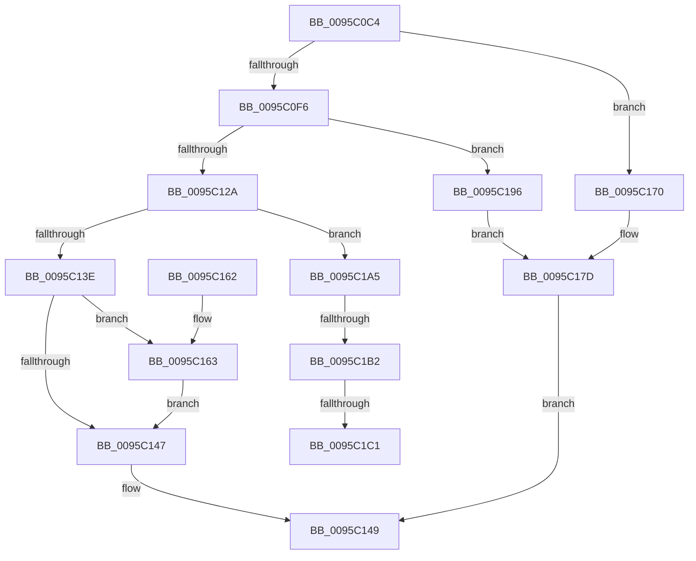

# SdbpGetFirstIndexedRecord

- RVA: `0x0095C0C4`–`0x0095C1D1` (길이 `269` bytes)
- VA: `0x000000014095C0C4`
- 실행 섹션: `PAGE`
- PDB 이름 있음: `예`; PDB Function 태그: `예`
- unwind 정보 RVA: `0x00092C78`
- 디코드: `76`개 명령, `269/269` bytes 표시
- 미해석 바이트: `0` (있으면 어셈블리에 `.byte`로 보존)

> 이 문서는 커널 이미지의 기계어와 PDB 기호를 분석해 생성했습니다. 4번과 5번은 함수 원형과 자료형을 바이너리 사용 방식에서 추정한 C 해석이며 원본 소스 복구 결과는 아닙니다.

## 1. Dependencies

- 직접 호출 지점: **6**; 고유 호출 대상: **6**
- 직접 호출자로 확인된 함수: **2**
- RIP 상대 이미지 참조: **3**

### Outgoing calls
- `0x0095C0E7` → [SdbGetTagFromTagID](SdbGetTagFromTagID_function_0095E3C0.md) (function, `0x0095E3C0`)
- `0x0095C0FB` → [SdbGetTagDataSize](SdbGetTagDataSize_function_0095E230.md) (function, `0x0095E230`)
- `0x0095C11B` → [SdbpGetMappedTagData](SdbpGetMappedTagData_function_0095DD24.md) (function, `0x0095DD24`)
- `0x0095C13E` → [SdbpBinarySearchFirst](SdbpBinarySearchFirst_function_0095C020.md) (function, `0x0095C020`)
- `0x0095C18D` → [AslLogCallPrintf](AslLogCallPrintf_function_0095E4EC.md) (function, `0x0095E4EC`)
- `0x0095C1A5` → [SdbpBinarySearchUnique](../A8/SdbpBinarySearchUnique_function_00A8F5CC.md) (function, `0x00A8F5CC`)

### Direct callers
- [SdbMergeIsEntryUpdated](../81/SdbMergeIsEntryUpdated_function_00819158.md) at `0x008194A6`
- [SdbFindFirstStringIndexedTag](SdbFindFirstStringIndexedTag_function_0095C1D8.md) at `0x0095C243`

### Static image references
- `0x0095C170` → RVA `0x00012858` (`.rdata`; read)
- `0x0095C17D` → RVA `0x00012880` (`.rdata`; read)
- `0x0095C196` → RVA `0x0003E270` (`.rdata`; read)

## 2. Other-region calls and transfers

- 다른 실행 섹션으로 향하는 call: **0**
- call이 아닌 외부 분기/꼬리 이동: **3**
  - `0x0095C1AC` → [sub_00B27A7C](../B2/Unknown_function_00B27A7C.md) (`tail-transfer`)
  - `0x0095C1BB` → [sub_00B27A7C](../B2/Unknown_function_00B27A7C.md) (`tail-transfer`)
  - `0x0095C1CC` → [sub_00B27A7C + 0x2](../B2/Unknown_function_00B27A7C.md) (`tail-transfer`)

## 3. Assembly (complete function range)

```asm
0095C0C4  48 89 5C 24 08                  mov qword ptr [rsp + 8], rbx
0095C0C9  48 89 6C 24 10                  mov qword ptr [rsp + 0x10], rbp
0095C0CE  48 89 74 24 18                  mov qword ptr [rsp + 0x18], rsi
0095C0D3  57                              push rdi
0095C0D4  41 56                           push r14
0095C0D6  41 57                           push r15
0095C0D8  48 83 EC 30                     sub rsp, 0x30
0095C0DC  49 8B F9                        mov rdi, r9
0095C0DF  4D 8B F8                        mov r15, r8
0095C0E2  8B F2                           mov esi, edx
0095C0E4  48 8B D9                        mov rbx, rcx
0095C0E7  E8 D4 22 00 00                  call 0x14095e3c0
0095C0EC  B9 01 98 00 00                  mov ecx, 0x9801
0095C0F1  66 3B C1                        cmp ax, cx
0095C0F4  75 7A                           jne 0x14095c170
0095C0F6  8B D6                           mov edx, esi
0095C0F8  48 8B CB                        mov rcx, rbx
0095C0FB  E8 30 21 00 00                  call 0x14095e230
0095C100  8B C8                           mov ecx, eax
0095C102  48 B8 AB AA AA AA AA AA AA AA   movabs rax, 0xaaaaaaaaaaaaaaab
0095C10C  48 F7 E1                        mul rcx
0095C10F  48 8B CB                        mov rcx, rbx
0095C112  4C 8B F2                        mov r14, rdx
0095C115  8B D6                           mov edx, esi
0095C117  49 C1 EE 03                     shr r14, 3
0095C11B  E8 04 1C 00 00                  call 0x14095dd24
0095C120  33 DB                           xor ebx, ebx
0095C122  48 8B E8                        mov rbp, rax
0095C125  48 85 C0                        test rax, rax
0095C128  74 6C                           je 0x14095c196
0095C12A  8B 47 14                        mov eax, dword ptr [rdi + 0x14]
0095C12D  4C 8D 4F 10                     lea r9, [rdi + 0x10]
0095C131  4D 8B C7                        mov r8, r15
0095C134  41 8B D6                        mov edx, r14d
0095C137  48 8B CD                        mov rcx, rbp
0095C13A  A8 01                           test al, 1
0095C13C  75 67                           jne 0x14095c1a5
0095C13E  E8 DD FE FF FF                  call 0x14095c020
0095C143  85 C0                           test eax, eax
0095C145  75 1C                           jne 0x14095c163
0095C147  8B C3                           mov eax, ebx
0095C149  48 8B 5C 24 50                  mov rbx, qword ptr [rsp + 0x50]
0095C14E  48 8B 6C 24 58                  mov rbp, qword ptr [rsp + 0x58]
0095C153  48 8B 74 24 60                  mov rsi, qword ptr [rsp + 0x60]
0095C158  48 83 C4 30                     add rsp, 0x30
0095C15C  41 5F                           pop r15
0095C15E  41 5E                           pop r14
0095C160  5F                              pop rdi
0095C161  C3                              ret
0095C162  CC                              int3
0095C163  41 8B 01                        mov eax, dword ptr [r9]
0095C166  48 8D 0C 40                     lea rcx, [rax + rax*2]
0095C16A  8B 5C 8D 08                     mov ebx, dword ptr [rbp + rcx*4 + 8]
0095C16E  EB D7                           jmp 0x14095c147
0095C170  4C 8D 0D E1 66 6B FF            lea r9, [rip - 0x94991f]
0095C177  41 B8 B1 02 00 00               mov r8d, 0x2b1
0095C17D  48 8D 15 FC 66 6B FF            lea rdx, [rip - 0x949904]
0095C184  89 74 24 20                     mov dword ptr [rsp + 0x20], esi
0095C188  B9 01 00 00 00                  mov ecx, 1
0095C18D  E8 5A 23 00 00                  call 0x14095e4ec
0095C192  33 C0                           xor eax, eax
0095C194  EB B3                           jmp 0x14095c149
0095C196  4C 8D 0D D3 20 6E FF            lea r9, [rip - 0x91df2d]
0095C19D  41 B8 BA 02 00 00               mov r8d, 0x2ba
0095C1A3  EB D8                           jmp 0x14095c17d
0095C1A5  E8 22 34 13 00                  call 0x140a8f5cc
0095C1AA  85 C0                           test eax, eax
0095C1AC  0F 84 CA B8 1C 00               je 0x140b27a7c
0095C1B2  41 8B 11                        mov edx, dword ptr [r9]
0095C1B5  41 8D 4E FF                     lea ecx, [r14 - 1]
0095C1B9  3B D1                           cmp edx, ecx
0095C1BB  0F 83 BB B8 1C 00               jae 0x140b27a7c
0095C1C1  8D 4A 01                        lea ecx, [rdx + 1]
0095C1C4  48 8D 0C 49                     lea rcx, [rcx + rcx*2]
0095C1C8  8B 54 8D 08                     mov edx, dword ptr [rbp + rcx*4 + 8]
0095C1CC  E9 AD B8 1C 00                  jmp 0x140b27a7e
```

## 4. C-style interpretation (structured pseudocode)

```c
__int64 __fastcall SdbpGetFirstIndexedRecord(__int64 a1, int a2, __int64 a3, __int64 a4)
{
    __int64 result;
    __int64 v_r14;
    __int64 v_rbx;
    __int64 v_rsp;
    unsigned __int64 v_stack_p10;
    unsigned __int64 v_stack_p18;
    unsigned int v_stack_p20;
    unsigned __int64 v_stack_p8;

    v_stack_p8 = v_rbx;
    v_stack_p10 = v_rbp;
    v_stack_p18 = v_rsi;
    v_rsp = (v_rsp) - (48);
    result = SdbGetTagFromTagID(a1, a2, a3, a4);
    if (((unsigned __int16)(result)) != ((unsigned __int16)((unsigned int)(0x9801ULL)))) goto loc_0095C170;
    result = SdbGetTagDataSize(a1, (unsigned int)((unsigned int)((unsigned int)(a2))), a3, a4);
    v_r14 = ((unsigned int)((unsigned int)((unsigned int)(a2)))) >> (3);
    result = SdbpGetMappedTagData(a1, (unsigned int)((unsigned int)((unsigned int)(a2))), a3, a4);
    v_rbx = 0;
    if (result == 0) goto loc_0095C196;
    if ((((unsigned __int8)((unsigned int)(*(unsigned int *)(a4 + 20)))) & (1)) != 0) goto loc_0095C1A5;
    result = SdbpBinarySearchFirst(result, (unsigned int)((unsigned int)(v_r14)), a3, a4 + 16);
    if ((unsigned int)(result) != 0) goto loc_0095C163;
loc_0095C147:
loc_0095C149:
    v_rsp = (v_rsp) + (48);
    return 0;
loc_0095C163:
    goto loc_0095C147;
loc_0095C170:
loc_0095C17D:
    v_stack_p20 = (unsigned int)(v_stack_p18);
    result = AslLogCallPrintf(1, v_rip - 9738500, 689, v_rip - 9738527);
    result = 0;
    goto loc_0095C149;
loc_0095C196:
    goto loc_0095C17D;
loc_0095C1A5:
    result = SdbpBinarySearchUnique(1, v_rip - 9738500, 698, v_rip - 9559853);
}
```

## 5. (Beta) C Style

```c
int64_t SdbpGetFirstIndexedRecord(int64_t Arg1, int32_t Arg2, int64_t Arg3, void *Arg4)
{
    uint8_t *arg4 = (uint8_t *)Arg4;

    int64_t result;
    int64_t local_r14;
    int64_t local_rbx;
    int64_t local_rsp;
    uint64_t v_stack_p10;
    uint64_t v_stack_p18;
    uint32_t v_stack_p20;
    uint64_t v_stack_p8;

    v_stack_p8 = local_rbx;
    v_stack_p10 = local_rbp;
    v_stack_p18 = local_rsi;
    local_rsp = (local_rsp) - (48);
    result = SdbGetTagFromTagID(Arg1, Arg2, Arg3, Arg4);
    if (((uint16_t)(result)) != ((uint16_t)((uint32_t)(0x9801ULL)))) goto loc_0095C170;
    result = SdbGetTagDataSize(Arg1, (uint32_t)((uint32_t)((uint32_t)(Arg2))), Arg3, Arg4);
    local_r14 = ((uint32_t)((uint32_t)((uint32_t)(Arg2)))) >> (3);
    result = SdbpGetMappedTagData(Arg1, (uint32_t)((uint32_t)((uint32_t)(Arg2))), Arg3, Arg4);
    local_rbx = 0;
    if (result == 0) goto loc_0095C196;
    if ((((uint8_t)((uint32_t)(*(uint32_t *)(arg4 + 0x14)))) & (1)) != 0) goto loc_0095C1A5;
    result = SdbpBinarySearchFirst(result, (uint32_t)((uint32_t)(local_r14)), Arg3, Arg4 + 16);
    if ((uint32_t)(result) != 0) goto loc_0095C163;
loc_0095C147:
loc_0095C149:
    local_rsp = (local_rsp) + (48);
    return 0;
loc_0095C163:
    goto loc_0095C147;
loc_0095C170:
loc_0095C17D:
    v_stack_p20 = (uint32_t)(v_stack_p18);
    result = AslLogCallPrintf(1, v_rip - 9738500, 689, v_rip - 9738527);
    result = 0;
    goto loc_0095C149;
loc_0095C196:
    goto loc_0095C17D;
loc_0095C1A5:
    result = SdbpBinarySearchUnique(1, v_rip - 9738500, 698, v_rip - 9559853);
}
```

### 관측된 메모리 오프셋

구조체 형식이 확인되지 않은 접근은 인자 기준의 오프셋으로만 기록했습니다.

| 기준 인자 | 오프셋 표현 | 폭 (bit) | 접근 |
|---|---:|---:|---|
| `Arg4` | `+ 0x10` | `64` | `R` |
| `Arg4` | `+ 0x14` | `32` | `R` |

## 6. Execution-region graph

[열기: 2D/3D 그래프와 함수 탐색 컨트롤 패널](../../../control-panel.html?section=page&rva=0x0095C0C4&view=graph)

- 2D 그래프는 위에서 아래로 흐르고, 3D 그래프는 빈 공간을 드래그해 회전합니다. Shift+드래그는 이동, 휠은 확대·축소, 함수 노드 선택은 대상 보고서 이동입니다.

### Static fallback


