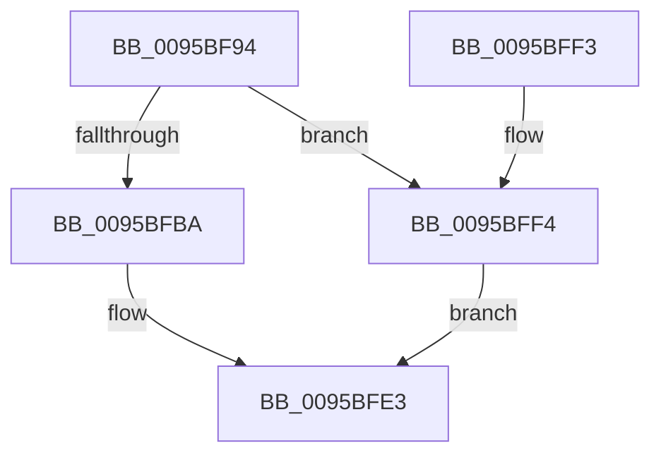

# SdbpGetIndex

- RVA: `0x0095BF94`–`0x0095C01A` (길이 `134` bytes)
- VA: `0x000000014095BF94`
- 실행 섹션: `PAGE`
- PDB 이름 있음: `예`; PDB Function 태그: `아니요`
- unwind 정보 RVA: `0x00092C4C`
- 디코드: `36`개 명령, `134/134` bytes 표시
- 미해석 바이트: `0` (있으면 어셈블리에 `.byte`로 보존)

> 이 문서는 커널 이미지의 기계어와 PDB 기호를 분석해 생성했습니다. 4번과 5번은 함수 원형과 자료형을 바이너리 사용 방식에서 추정한 C 해석이며 원본 소스 복구 결과는 아닙니다.

## 1. Dependencies

- 직접 호출 지점: **4**; 고유 호출 대상: **4**
- 직접 호출자로 확인된 함수: **2**
- RIP 상대 이미지 참조: **2**

### Outgoing calls
- `0x0095BFAB` → [SdbGetTagFromTagID](SdbGetTagFromTagID_function_0095E3C0.md) (function, `0x0095E3C0`)
- `0x0095BFBF` → [SdbGetTagDataSize](SdbGetTagDataSize_function_0095E230.md) (function, `0x0095E230`)
- `0x0095BFDE` → [SdbpGetMappedTagData](SdbpGetMappedTagData_function_0095DD24.md) (function, `0x0095DD24`)
- `0x0095C011` → [AslLogCallPrintf](AslLogCallPrintf_function_0095E4EC.md) (function, `0x0095E4EC`)

### Direct callers
- [SdbpFindNextIndexedWildCardTag](SdbpFindNextIndexedWildCardTag_function_0095A078.md) at `0x0095A0E7`
- [SdbpFindFirstIndexedWildCardTag](SdbpFindFirstIndexedWildCardTag_function_0095DE58.md) at `0x0095DF41`

### Static image references
- `0x0095BFF4` → RVA `0x00012A68` (`.rdata`; read)
- `0x0095C005` → RVA `0x00012A58` (`.rdata`; read)

## 2. Other-region calls and transfers

- 다른 실행 섹션으로 향하는 call: **0**
- 별도 외부 분기/꼬리 이동을 확인하지 못했습니다.

## 3. Assembly (complete function range)

```asm
0095BF94  48 89 5C 24 08                  mov qword ptr [rsp + 8], rbx
0095BF99  48 89 74 24 10                  mov qword ptr [rsp + 0x10], rsi
0095BF9E  57                              push rdi
0095BF9F  48 83 EC 30                     sub rsp, 0x30
0095BFA3  49 8B F0                        mov rsi, r8
0095BFA6  8B DA                           mov ebx, edx
0095BFA8  48 8B F9                        mov rdi, rcx
0095BFAB  E8 10 24 00 00                  call 0x14095e3c0
0095BFB0  B9 01 98 00 00                  mov ecx, 0x9801
0095BFB5  66 3B C1                        cmp ax, cx
0095BFB8  75 3A                           jne 0x14095bff4
0095BFBA  8B D3                           mov edx, ebx
0095BFBC  48 8B CF                        mov rcx, rdi
0095BFBF  E8 6C 22 00 00                  call 0x14095e230
0095BFC4  8B C8                           mov ecx, eax
0095BFC6  48 B8 AB AA AA AA AA AA AA AA   movabs rax, 0xaaaaaaaaaaaaaaab
0095BFD0  48 F7 E1                        mul rcx
0095BFD3  48 8B CF                        mov rcx, rdi
0095BFD6  48 C1 EA 03                     shr rdx, 3
0095BFDA  89 16                           mov dword ptr [rsi], edx
0095BFDC  8B D3                           mov edx, ebx
0095BFDE  E8 41 1D 00 00                  call 0x14095dd24
0095BFE3  48 8B 5C 24 40                  mov rbx, qword ptr [rsp + 0x40]
0095BFE8  48 8B 74 24 48                  mov rsi, qword ptr [rsp + 0x48]
0095BFED  48 83 C4 30                     add rsp, 0x30
0095BFF1  5F                              pop rdi
0095BFF2  C3                              ret
0095BFF3  CC                              int3
0095BFF4  4C 8D 0D 6D 6A 6B FF            lea r9, [rip - 0x949593]
0095BFFB  89 5C 24 20                     mov dword ptr [rsp + 0x20], ebx
0095BFFF  41 B8 5F 05 00 00               mov r8d, 0x55f
0095C005  48 8D 15 4C 6A 6B FF            lea rdx, [rip - 0x9495b4]
0095C00C  B9 01 00 00 00                  mov ecx, 1
0095C011  E8 D6 24 00 00                  call 0x14095e4ec
0095C016  33 C0                           xor eax, eax
0095C018  EB C9                           jmp 0x14095bfe3
```

## 4. C-style interpretation (structured pseudocode)

```c
__int64 __fastcall SdbpGetIndex(__int64 a1, int a2, __int64 a3)
{
    __int64 result;
    __int64 v_rsp;
    unsigned __int64 v_stack_p10;
    unsigned int v_stack_p20;
    unsigned __int64 v_stack_p8;

    v_stack_p8 = v_rbx;
    v_stack_p10 = v_rsi;
    v_rsp = (v_rsp) - (48);
    result = SdbGetTagFromTagID(a1, a2, a3, a4);
    if (((unsigned __int16)(result)) != ((unsigned __int16)((unsigned int)(0x9801ULL)))) goto loc_0095BFF4;
    result = SdbGetTagDataSize(a1, (unsigned int)((unsigned int)((unsigned int)(a2))), a3, a4);
    a2 = ((unsigned int)((unsigned int)((unsigned int)(a2)))) >> (3);
    *(unsigned int *)(a3) = a2;
    result = SdbpGetMappedTagData(a1, (unsigned int)((unsigned int)((unsigned int)(a2))), a3, a4);
loc_0095BFE3:
    v_rsp = (v_rsp) + (48);
    return result;
loc_0095BFF4:
    v_stack_p20 = (unsigned int)(v_stack_p8);
    result = AslLogCallPrintf(1, v_rip - 9737652, (unsigned int)(0x55FULL), v_rip - 9737619);
    result = 0;
    goto loc_0095BFE3;
}
```

## 5. (Beta) C Style

```c
int64_t SdbpGetIndex(int64_t Arg1, int32_t Arg2, void *Arg3)
{
    uint8_t *arg3 = (uint8_t *)Arg3;

    int64_t result;
    int64_t local_rsp;
    uint64_t v_stack_p10;
    uint32_t v_stack_p20;
    uint64_t v_stack_p8;

    v_stack_p8 = local_rbx;
    v_stack_p10 = local_rsi;
    local_rsp = (local_rsp) - (48);
    result = SdbGetTagFromTagID(Arg1, Arg2, Arg3, a4);
    if (((uint16_t)(result)) != ((uint16_t)((uint32_t)(0x9801ULL)))) goto loc_0095BFF4;
    result = SdbGetTagDataSize(Arg1, (uint32_t)((uint32_t)((uint32_t)(Arg2))), Arg3, a4);
    Arg2 = ((uint32_t)((uint32_t)((uint32_t)(Arg2)))) >> (3);
    *(uint32_t *)(arg3) = Arg2;
    result = SdbpGetMappedTagData(Arg1, (uint32_t)((uint32_t)((uint32_t)(Arg2))), Arg3, a4);
loc_0095BFE3:
    local_rsp = (local_rsp) + (48);
    return result;
loc_0095BFF4:
    v_stack_p20 = (uint32_t)(v_stack_p8);
    result = AslLogCallPrintf(1, v_rip - 9737652, (uint32_t)(0x55FULL), v_rip - 9737619);
    result = 0;
    goto loc_0095BFE3;
}
```

### 관측된 메모리 오프셋

구조체 형식이 확인되지 않은 접근은 인자 기준의 오프셋으로만 기록했습니다.

| 기준 인자 | 오프셋 표현 | 폭 (bit) | 접근 |
|---|---:|---:|---|
| `Arg3` | `+ 0x0` | `32` | `W` |

## 6. Execution-region graph

[열기: 2D/3D 그래프와 함수 탐색 컨트롤 패널](../../../control-panel.html?section=page&rva=0x0095BF94&view=graph)

- 2D 그래프는 위에서 아래로 흐르고, 3D 그래프는 빈 공간을 드래그해 회전합니다. Shift+드래그는 이동, 휠은 확대·축소, 함수 노드 선택은 대상 보고서 이동입니다.

### Static fallback


