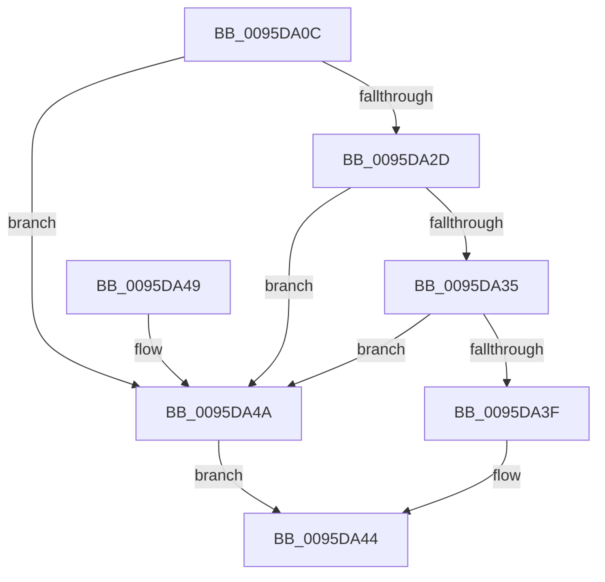

# SdbpGetMappedStringFromTable

- RVA: `0x0095DA0C`–`0x0095DA6C` (길이 `96` bytes)
- VA: `0x000000014095DA0C`
- 실행 섹션: `PAGE`
- PDB 이름 있음: `예`; PDB Function 태그: `아니요`
- unwind 정보 RVA: `0x00092DFC`
- 디코드: `26`개 명령, `96/96` bytes 표시
- 미해석 바이트: `0` (있으면 어셈블리에 `.byte`로 보존)

> 이 문서는 커널 이미지의 기계어와 PDB 기호를 분석해 생성했습니다. 4번과 5번은 함수 원형과 자료형을 바이너리 사용 방식에서 추정한 C 해석이며 원본 소스 복구 결과는 아닙니다.

## 1. Dependencies

- 직접 호출 지점: **3**; 고유 호출 대상: **3**
- 직접 호출자로 확인된 함수: **1**
- RIP 상대 이미지 참조: **2**

### Outgoing calls
- `0x0095DA24` → [SdbpGetStringTableItemFromStringRef](SdbpGetStringTableItemFromStringRef_function_0095DA74.md) (function, `0x0095DA74`)
- `0x0095DA3F` → [SdbpGetMappedTagData](SdbpGetMappedTagData_function_0095DD24.md) (function, `0x0095DD24`)
- `0x0095DA63` → [AslLogCallPrintf](AslLogCallPrintf_function_0095E4EC.md) (function, `0x0095E4EC`)

### Direct callers
- [SdbGetStringTagPtr](SdbGetStringTagPtr_function_0095DDA8.md) at `0x0095DDF7`

### Static image references
- `0x0095DA4A` → RVA `0x00012490` (`.rdata`; read)
- `0x0095DA57` → RVA `0x00012470` (`.rdata`; read)

## 2. Other-region calls and transfers

- 다른 실행 섹션으로 향하는 call: **0**
- 별도 외부 분기/꼬리 이동을 확인하지 못했습니다.

## 3. Assembly (complete function range)

```asm
0095DA0C  48 8B C4                        mov rax, rsp
0095DA0F  48 83 EC 28                     sub rsp, 0x28
0095DA13  83 60 18 00                     and dword ptr [rax + 0x18], 0
0095DA17  4C 8D 48 20                     lea r9, [rax + 0x20]
0095DA1B  48 83 60 20 00                  and qword ptr [rax + 0x20], 0
0095DA20  4C 8D 40 18                     lea r8, [rax + 0x18]
0095DA24  E8 4B 00 00 00                  call 0x14095da74
0095DA29  85 C0                           test eax, eax
0095DA2B  74 1D                           je 0x14095da4a
0095DA2D  8B 54 24 40                     mov edx, dword ptr [rsp + 0x40]
0095DA31  85 D2                           test edx, edx
0095DA33  74 15                           je 0x14095da4a
0095DA35  48 8B 4C 24 48                  mov rcx, qword ptr [rsp + 0x48]
0095DA3A  48 85 C9                        test rcx, rcx
0095DA3D  74 0B                           je 0x14095da4a
0095DA3F  E8 E0 02 00 00                  call 0x14095dd24
0095DA44  48 83 C4 28                     add rsp, 0x28
0095DA48  C3                              ret
0095DA49  CC                              int3
0095DA4A  4C 8D 0D 3F 4A 6B FF            lea r9, [rip - 0x94b5c1]
0095DA51  41 B8 D1 03 00 00               mov r8d, 0x3d1
0095DA57  48 8D 15 12 4A 6B FF            lea rdx, [rip - 0x94b5ee]
0095DA5E  B9 01 00 00 00                  mov ecx, 1
0095DA63  E8 84 0A 00 00                  call 0x14095e4ec
0095DA68  33 C0                           xor eax, eax
0095DA6A  EB D8                           jmp 0x14095da44
```

## 4. C-style interpretation (structured pseudocode)

```c
__int64 __fastcall SdbpGetMappedStringFromTable(void)
{
    __int64 result;
    __int64 v_rsp;
    unsigned int v_stack_p18;
    unsigned __int64 v_stack_p20;

    v_rsp = (v_rsp) - (40);
    result = SdbpGetStringTableItemFromStringRef(a1, a2, v_rsp + 24, v_rsp + 32);
    if ((unsigned int)(result) == 0) goto loc_0095DA4A;
    if ((unsigned int)((unsigned int)(v_stack_p18)) == 0) goto loc_0095DA4A;
    if (v_stack_p20 == 0) goto loc_0095DA4A;
    result = SdbpGetMappedTagData(v_stack_p20, (unsigned int)(v_stack_p18), v_rsp + 24, v_rsp + 32);
loc_0095DA44:
    v_rsp = (v_rsp) + (40);
    return result;
loc_0095DA4A:
    result = AslLogCallPrintf(1, v_rip - 9745902, 977, v_rip - 9745857);
    result = 0;
    goto loc_0095DA44;
}
```

## 5. (Beta) C Style

```c
void SdbpGetMappedStringFromTable(void)
{
    int64_t result;
    int64_t local_rsp;
    uint32_t v_stack_p18;
    uint64_t v_stack_p20;

    local_rsp = (local_rsp) - (40);
    result = SdbpGetStringTableItemFromStringRef(a1, a2, local_rsp + 24, local_rsp + 32);
    if ((uint32_t)(result) == 0) goto loc_0095DA4A;
    if ((uint32_t)((uint32_t)(v_stack_p18)) == 0) goto loc_0095DA4A;
    if (v_stack_p20 == 0) goto loc_0095DA4A;
    result = SdbpGetMappedTagData(v_stack_p20, (uint32_t)(v_stack_p18), local_rsp + 24, local_rsp + 32);
loc_0095DA44:
    local_rsp = (local_rsp) + (40);
    return result;
loc_0095DA4A:
    result = AslLogCallPrintf(1, v_rip - 9745902, 977, v_rip - 9745857);
    result = 0;
    goto loc_0095DA44;
}
```

## 6. Execution-region graph

[열기: 2D/3D 그래프와 함수 탐색 컨트롤 패널](../../../control-panel.html?section=page&rva=0x0095DA0C&view=graph)

- 2D 그래프는 위에서 아래로 흐르고, 3D 그래프는 빈 공간을 드래그해 회전합니다. Shift+드래그는 이동, 휠은 확대·축소, 함수 노드 선택은 대상 보고서 이동입니다.

### Static fallback


