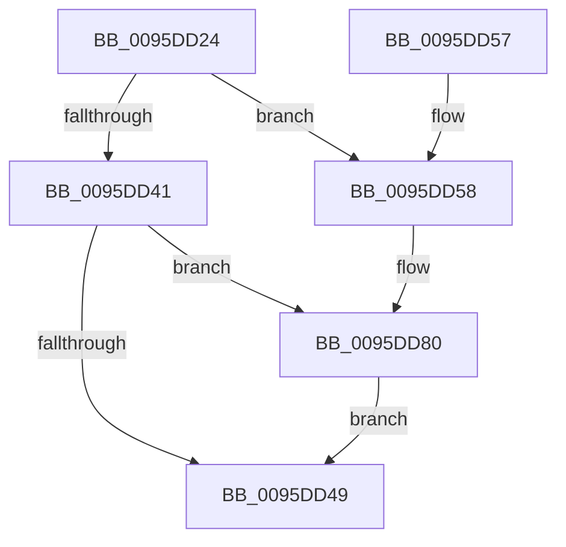

# SdbpGetMappedTagData

- RVA: `0x0095DD24`–`0x0095DDA0` (길이 `124` bytes)
- VA: `0x000000014095DD24`
- 실행 섹션: `PAGE`
- PDB 이름 있음: `예`; PDB Function 태그: `아니요`
- unwind 정보 RVA: `0x00092E54`
- 디코드: `33`개 명령, `124/124` bytes 표시
- 미해석 바이트: `0` (있으면 어셈블리에 `.byte`로 보존)

> 이 문서는 커널 이미지의 기계어와 PDB 기호를 분석해 생성했습니다. 4번과 5번은 함수 원형과 자료형을 바이너리 사용 방식에서 추정한 C 해석이며 원본 소스 복구 결과는 아닙니다.

## 1. Dependencies

- 직접 호출 지점: **3**; 고유 호출 대상: **2**
- 직접 호출자로 확인된 함수: **10**
- RIP 상대 이미지 참조: **4**

### Outgoing calls
- `0x0095DD33` → [SdbpGetTagHeadSize](SdbpGetTagHeadSize_function_0095E6B0.md) (function, `0x0095E6B0`)
- `0x0095DD79` → [AslLogCallPrintf](AslLogCallPrintf_function_0095E4EC.md) (function, `0x0095E4EC`)
- `0x0095DD99` → [AslLogCallPrintf](AslLogCallPrintf_function_0095E4EC.md) (function, `0x0095E4EC`)

### Direct callers
- [KsepDbReadKData](../74/KsepDbReadKData_function_0074923C.md) at `0x007493A9`
- [SdbQueryDataExTagID](../81/SdbQueryDataExTagID_function_008136E0.md) at `0x008139D9`
- [SdbGetBinaryTagData](../81/SdbGetBinaryTagData_function_00816F8C.md) at `0x00816FE9`
- [SdbMergeIsEntryUpdated](../81/SdbMergeIsEntryUpdated_function_00819158.md) at `0x00819466`
- [SdbpMergeAreTagValuesEqual](../81/SdbpMergeAreTagValuesEqual_function_00819524.md) at `0x008195C9`
- [SdbpMergeAreTagValuesEqual](../81/SdbpMergeAreTagValuesEqual_function_00819524.md) at `0x008195D6`
- [SdbpGetIndex](SdbpGetIndex_function_0095BF94.md) at `0x0095BFDE`
- [SdbpGetFirstIndexedRecord](SdbpGetFirstIndexedRecord_function_0095C0C4.md) at `0x0095C11B`
- [SdbpGetMappedStringFromTable](SdbpGetMappedStringFromTable_function_0095DA0C.md) at `0x0095DA3F`
- [SdbGetStringTagPtr](SdbGetStringTagPtr_function_0095DDA8.md) at `0x0095DE49`
- [SdbpGetNextIndexedRecord](../A9/SdbpGetNextIndexedRecord_function_00A91608.md) at `0x00A91641`

### Static image references
- `0x0095DD5C` → RVA `0x0003B410` (`.rdata`; read)
- `0x0095DD72` → RVA `0x0003B3F8` (`.rdata`; read)
- `0x0095DD80` → RVA `0x0003D320` (`.rdata`; read)
- `0x0095DD8D` → RVA `0x0003D308` (`.rdata`; read)

## 2. Other-region calls and transfers

- 다른 실행 섹션으로 향하는 call: **0**
- 별도 외부 분기/꼬리 이동을 확인하지 못했습니다.

## 3. Assembly (complete function range)

```asm
0095DD24  48 89 5C 24 08                  mov qword ptr [rsp + 8], rbx
0095DD29  57                              push rdi
0095DD2A  48 83 EC 30                     sub rsp, 0x30
0095DD2E  8B DA                           mov ebx, edx
0095DD30  48 8B F9                        mov rdi, rcx
0095DD33  E8 78 09 00 00                  call 0x14095e6b0
0095DD38  8B 4F 14                        mov ecx, dword ptr [rdi + 0x14]
0095DD3B  03 C3                           add eax, ebx
0095DD3D  3B C1                           cmp eax, ecx
0095DD3F  73 17                           jae 0x14095dd58
0095DD41  8B D8                           mov ebx, eax
0095DD43  48 03 5F 08                     add rbx, qword ptr [rdi + 8]
0095DD47  74 37                           je 0x14095dd80
0095DD49  48 8B C3                        mov rax, rbx
0095DD4C  48 8B 5C 24 40                  mov rbx, qword ptr [rsp + 0x40]
0095DD51  48 83 C4 30                     add rsp, 0x30
0095DD55  5F                              pop rdi
0095DD56  C3                              ret
0095DD57  CC                              int3
0095DD58  89 4C 24 28                     mov dword ptr [rsp + 0x28], ecx
0095DD5C  4C 8D 0D AD D6 6D FF            lea r9, [rip - 0x922953]
0095DD63  B9 01 00 00 00                  mov ecx, 1
0095DD68  89 44 24 20                     mov dword ptr [rsp + 0x20], eax
0095DD6C  41 B8 69 03 00 00               mov r8d, 0x369
0095DD72  48 8D 15 7F D6 6D FF            lea rdx, [rip - 0x922981]
0095DD79  E8 6E 07 00 00                  call 0x14095e4ec
0095DD7E  33 DB                           xor ebx, ebx
0095DD80  4C 8D 0D 99 F5 6D FF            lea r9, [rip - 0x920a67]
0095DD87  41 B8 26 02 00 00               mov r8d, 0x226
0095DD8D  48 8D 15 74 F5 6D FF            lea rdx, [rip - 0x920a8c]
0095DD94  B9 01 00 00 00                  mov ecx, 1
0095DD99  E8 4E 07 00 00                  call 0x14095e4ec
0095DD9E  EB A9                           jmp 0x14095dd49
```

## 4. C-style interpretation (structured pseudocode)

```c
__int64 __fastcall SdbpGetMappedTagData(__int64 a1, int a2)
{
    __int64 result;
    __int64 v_rbx;
    __int64 v_rsp;
    unsigned int v_stack_p20;
    unsigned int v_stack_p28;
    unsigned __int64 v_stack_p8;

    v_stack_p8 = v_rbx;
    v_rsp = (v_rsp) - (48);
    result = SdbpGetTagHeadSize(a1, a2, a3, a4);
    result = (unsigned int)((result) + ((unsigned int)((unsigned int)(a2))));
    if (((unsigned int)(result)) >= ((unsigned int)((unsigned int)(*(unsigned int *)(a1 + 20))))) goto loc_0095DD58;
    v_rbx = ((unsigned int)((unsigned int)(result))) + (*(unsigned __int64 *)(a1 + 8));
    if (condition_is_equal) goto loc_0095DD80;
loc_0095DD49:
    v_rsp = (v_rsp) + (48);
    return v_rbx;
loc_0095DD58:
    v_stack_p28 = (unsigned int)((unsigned int)(*(unsigned int *)(a1 + 20)));
    v_stack_p20 = (unsigned int)(v_rbx);
    result = AslLogCallPrintf(1, v_rip - 9578881, 873, v_rip - 9578835);
    v_rbx = 0;
loc_0095DD80:
    result = AslLogCallPrintf(1, v_rip - 9570956, 550, v_rip - 9570919);
    goto loc_0095DD49;
}
```

## 5. (Beta) C Style

```c
int64_t SdbpGetMappedTagData(void *Arg1, int32_t Arg2)
{
    uint8_t *arg1 = (uint8_t *)Arg1;

    int64_t result;
    int64_t local_rbx;
    int64_t local_rsp;
    uint32_t v_stack_p20;
    uint32_t v_stack_p28;
    uint64_t v_stack_p8;

    v_stack_p8 = local_rbx;
    local_rsp = (local_rsp) - (48);
    result = SdbpGetTagHeadSize(Arg1, Arg2, a3, a4);
    result = (uint32_t)((result) + ((uint32_t)((uint32_t)(Arg2))));
    if (((uint32_t)(result)) >= ((uint32_t)((uint32_t)(*(uint32_t *)(arg1 + 0x14))))) goto loc_0095DD58;
    local_rbx = ((uint32_t)((uint32_t)(result))) + (*(uint64_t *)(arg1 + 0x8));
    if (condition_is_equal) goto loc_0095DD80;
loc_0095DD49:
    local_rsp = (local_rsp) + (48);
    return local_rbx;
loc_0095DD58:
    v_stack_p28 = (uint32_t)((uint32_t)(*(uint32_t *)(arg1 + 0x14)));
    v_stack_p20 = (uint32_t)(local_rbx);
    result = AslLogCallPrintf(1, v_rip - 9578881, 873, v_rip - 9578835);
    local_rbx = 0;
loc_0095DD80:
    result = AslLogCallPrintf(1, v_rip - 9570956, 550, v_rip - 9570919);
    goto loc_0095DD49;
}
```

### 관측된 메모리 오프셋

구조체 형식이 확인되지 않은 접근은 인자 기준의 오프셋으로만 기록했습니다.

| 기준 인자 | 오프셋 표현 | 폭 (bit) | 접근 |
|---|---:|---:|---|
| `Arg1` | `+ 0x8` | `64` | `R` |
| `Arg1` | `+ 0x14` | `32` | `R` |

## 6. Execution-region graph

[열기: 2D/3D 그래프와 함수 탐색 컨트롤 패널](../../../control-panel.html?section=page&rva=0x0095DD24&view=graph)

- 2D 그래프는 위에서 아래로 흐르고, 3D 그래프는 빈 공간을 드래그해 회전합니다. Shift+드래그는 이동, 휠은 확대·축소, 함수 노드 선택은 대상 보고서 이동입니다.

### Static fallback


