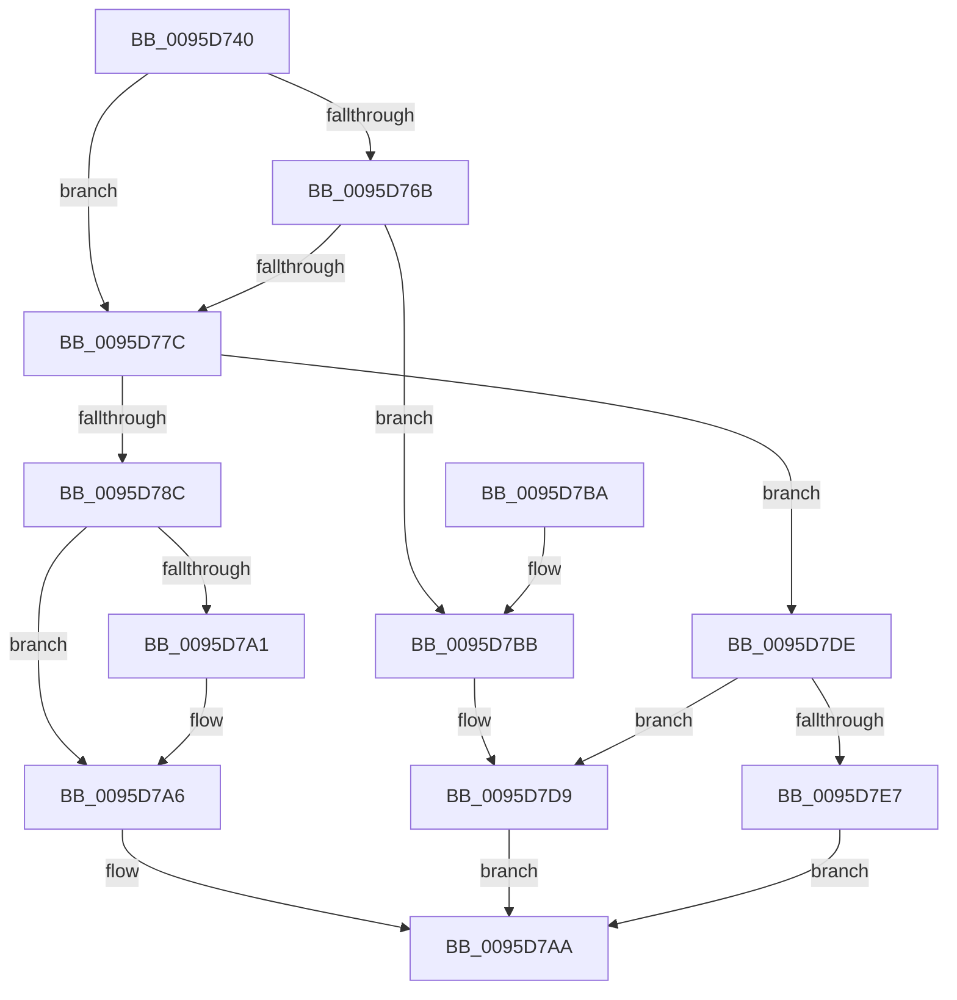

# SdbpGetNextTagId

- RVA: `0x0095D740`–`0x0095D7EE` (길이 `174` bytes)
- VA: `0x000000014095D740`
- 실행 섹션: `PAGE`
- PDB 이름 있음: `예`; PDB Function 태그: `아니요`
- unwind 정보 RVA: `0x00078C74`
- 디코드: `51`개 명령, `174/174` bytes 표시
- 미해석 바이트: `0` (있으면 어셈블리에 `.byte`로 보존)

> 이 문서는 커널 이미지의 기계어와 PDB 기호를 분석해 생성했습니다. 4번과 5번은 함수 원형과 자료형을 바이너리 사용 방식에서 추정한 C 해석이며 원본 소스 복구 결과는 아닙니다.

## 1. Dependencies

- 직접 호출 지점: **6**; 고유 호출 대상: **5**
- 직접 호출자로 확인된 함수: **3**
- RIP 상대 이미지 참조: **2**

### Outgoing calls
- `0x0095D754` → [SdbGetTagFromTagID](SdbGetTagFromTagID_function_0095E3C0.md) (function, `0x0095E3C0`)
- `0x0095D770` → [SdbGetTagDataSize](SdbGetTagDataSize_function_0095E230.md) (function, `0x0095E230`)
- `0x0095D781` → [SdbpGetTagHeadSize](SdbpGetTagHeadSize_function_0095E6B0.md) (function, `0x0095E6B0`)
- `0x0095D791` → [SdbGetTagDataSize](SdbGetTagDataSize_function_0095E230.md) (function, `0x0095E230`)
- `0x0095D7D4` → [AslLogCallPrintf](AslLogCallPrintf_function_0095E4EC.md) (function, `0x0095E4EC`)
- `0x0095D7DE` → [Feature_SdbValidateRootTagsOnOpen__private_IsEnabledDeviceUsageNoInline](../../text/49/Feature_SdbValidateRootTagsOnOpen__private_IsEnabledDeviceUsageNoInline_function_00494B18.md) (function, `0x00494B18`)

### Direct callers
- [SdbGetNextChild](SdbGetNextChild_function_0095E520.md) at `0x0095E55C`
- [SdbGetNextChild](SdbGetNextChild_function_0095E520.md) at `0x0095E578`
- [SdbGetFirstChild](SdbGetFirstChild_function_0095E610.md) at `0x0095E644`
- [sub_00B46D4A](../B4/Unknown_function_00B46D4A.md) at `0x00B46D4F`

### Static image references
- `0x0095D7BB` → RVA `0x00012B20` (`.rdata`; read)
- `0x0095D7C8` → RVA `0x00012B40` (`.rdata`; read)

## 2. Other-region calls and transfers

- 다른 실행 섹션으로 향하는 call: **1**
  - `0x0095D7DE` → [Feature_SdbValidateRootTagsOnOpen__private_IsEnabledDeviceUsageNoInline](../../text/49/Feature_SdbValidateRootTagsOnOpen__private_IsEnabledDeviceUsageNoInline_function_00494B18.md) (`PAGE` → `.text`)
- 별도 외부 분기/꼬리 이동을 확인하지 못했습니다.

## 3. Assembly (complete function range)

```asm
0095D740  48 89 5C 24 08                  mov qword ptr [rsp + 8], rbx
0095D745  48 89 74 24 10                  mov qword ptr [rsp + 0x10], rsi
0095D74A  57                              push rdi
0095D74B  48 83 EC 20                     sub rsp, 0x20
0095D74F  8B FA                           mov edi, edx
0095D751  48 8B D9                        mov rbx, rcx
0095D754  E8 67 0C 00 00                  call 0x14095e3c0
0095D759  B9 00 F0 00 00                  mov ecx, 0xf000
0095D75E  66 23 C1                        and ax, cx
0095D761  B9 00 70 00 00                  mov ecx, 0x7000
0095D766  66 3B C1                        cmp ax, cx
0095D769  75 11                           jne 0x14095d77c
0095D76B  8B D7                           mov edx, edi
0095D76D  48 8B CB                        mov rcx, rbx
0095D770  E8 BB 0A 00 00                  call 0x14095e230
0095D775  3D 00 00 00 20                  cmp eax, 0x20000000
0095D77A  74 3F                           je 0x14095d7bb
0095D77C  8B D7                           mov edx, edi
0095D77E  48 8B CB                        mov rcx, rbx
0095D781  E8 2A 0F 00 00                  call 0x14095e6b0
0095D786  8B F0                           mov esi, eax
0095D788  85 C0                           test eax, eax
0095D78A  74 52                           je 0x14095d7de
0095D78C  8B D7                           mov edx, edi
0095D78E  48 8B CB                        mov rcx, rbx
0095D791  E8 9A 0A 00 00                  call 0x14095e230
0095D796  8B 8B 30 0A 00 00               mov ecx, dword ptr [rbx + 0xa30]
0095D79C  F6 C1 01                        test cl, 1
0095D79F  75 05                           jne 0x14095d7a6
0095D7A1  FF C0                           inc eax
0095D7A3  83 E0 FE                        and eax, 0xfffffffe
0095D7A6  03 C6                           add eax, esi
0095D7A8  03 C7                           add eax, edi
0095D7AA  48 8B 5C 24 30                  mov rbx, qword ptr [rsp + 0x30]
0095D7AF  48 8B 74 24 38                  mov rsi, qword ptr [rsp + 0x38]
0095D7B4  48 83 C4 20                     add rsp, 0x20
0095D7B8  5F                              pop rdi
0095D7B9  C3                              ret
0095D7BA  CC                              int3
0095D7BB  4C 8D 0D 5E 53 6B FF            lea r9, [rip - 0x94aca2]
0095D7C2  41 B8 00 0C 00 00               mov r8d, 0xc00
0095D7C8  48 8D 15 71 53 6B FF            lea rdx, [rip - 0x94ac8f]
0095D7CF  B9 01 00 00 00                  mov ecx, 1
0095D7D4  E8 13 0D 00 00                  call 0x14095e4ec
0095D7D9  8B 43 14                        mov eax, dword ptr [rbx + 0x14]
0095D7DC  EB CC                           jmp 0x14095d7aa
0095D7DE  E8 35 73 B3 FF                  call 0x140494b18
0095D7E3  85 C0                           test eax, eax
0095D7E5  74 F2                           je 0x14095d7d9
0095D7E7  B8 00 00 00 10                  mov eax, 0x10000000
0095D7EC  EB BC                           jmp 0x14095d7aa
```

## 4. C-style interpretation (structured pseudocode)

```c
__int64 __fastcall SdbpGetNextTagId(__int64 a1, int a2)
{
    __int64 result;
    __int64 v_rsp;
    unsigned __int64 v_stack_p10;
    unsigned __int64 v_stack_p8;

    v_stack_p8 = v_rbx;
    v_stack_p10 = v_rsi;
    v_rsp = (v_rsp) - (32);
    result = SdbGetTagFromTagID(a1, a2, a3, a4);
    result = (unsigned __int16)((result) & ((unsigned __int16)((unsigned int)(0xF000ULL))));
    if (((unsigned __int16)(result)) != ((unsigned __int16)((unsigned int)(0x7000ULL)))) goto loc_0095D77C;
    result = SdbGetTagDataSize(a1, (unsigned int)((unsigned int)((unsigned int)(a2))), a3, a4);
    if (((unsigned int)(result)) == 0x20000000ULL) goto loc_0095D7BB;
loc_0095D77C:
    result = SdbpGetTagHeadSize(a1, (unsigned int)((unsigned int)((unsigned int)(a2))), a3, a4);
    if ((unsigned int)(result) == 0) goto loc_0095D7DE;
    result = SdbGetTagDataSize(a1, (unsigned int)((unsigned int)((unsigned int)(a2))), a3, a4);
    if ((((unsigned __int8)((unsigned int)(*(unsigned int *)(a1 + 2608)))) & (1)) == 0) {
        result = (unsigned int)((result) + 1);
        result = (unsigned int)((result) & (0xFFFFFFFEULL));
    }
    result = (unsigned int)((result) + ((unsigned int)((unsigned int)((unsigned int)(result)))));
    result = (unsigned int)((result) + ((unsigned int)((unsigned int)(a2))));
loc_0095D7AA:
    v_rsp = (v_rsp) + (32);
    return result;
loc_0095D7BB:
    result = AslLogCallPrintf(1, v_rip - 9743503, (unsigned int)(0xC00ULL), v_rip - 9743522);
loc_0095D7D9:
    goto loc_0095D7AA;
loc_0095D7DE:
    result = Feature_SdbValidateRootTagsOnOpen__private_IsEnabledDeviceUsageNoInline(1, v_rip - 9743503, (unsigned int)(0xC00ULL), v_rip - 9743522);
    if ((unsigned int)(result) == 0) goto loc_0095D7D9;
    goto loc_0095D7AA;
}
```

## 5. (Beta) C Style

```c
int64_t SdbpGetNextTagId(void *Arg1, int32_t Arg2)
{
    uint8_t *arg1 = (uint8_t *)Arg1;

    int64_t result;
    int64_t local_rsp;
    uint64_t v_stack_p10;
    uint64_t v_stack_p8;

    v_stack_p8 = local_rbx;
    v_stack_p10 = local_rsi;
    local_rsp = (local_rsp) - (32);
    result = SdbGetTagFromTagID(Arg1, Arg2, a3, a4);
    result = (uint16_t)((result) & ((uint16_t)((uint32_t)(0xF000ULL))));
    if (((uint16_t)(result)) != ((uint16_t)((uint32_t)(0x7000ULL)))) goto loc_0095D77C;
    result = SdbGetTagDataSize(Arg1, (uint32_t)((uint32_t)((uint32_t)(Arg2))), a3, a4);
    if (((uint32_t)(result)) == 0x20000000ULL) goto loc_0095D7BB;
loc_0095D77C:
    result = SdbpGetTagHeadSize(Arg1, (uint32_t)((uint32_t)((uint32_t)(Arg2))), a3, a4);
    if ((uint32_t)(result) == 0) goto loc_0095D7DE;
    result = SdbGetTagDataSize(Arg1, (uint32_t)((uint32_t)((uint32_t)(Arg2))), a3, a4);
    if ((((uint8_t)((uint32_t)(*(uint32_t *)(arg1 + 0xA30)))) & (1)) == 0) {
        result = (uint32_t)((result) + 1);
        result = (uint32_t)((result) & (0xFFFFFFFEULL));
    }
    result = (uint32_t)((result) + ((uint32_t)((uint32_t)((uint32_t)(result)))));
    result = (uint32_t)((result) + ((uint32_t)((uint32_t)(Arg2))));
loc_0095D7AA:
    local_rsp = (local_rsp) + (32);
    return result;
loc_0095D7BB:
    result = AslLogCallPrintf(1, v_rip - 9743503, (uint32_t)(0xC00ULL), v_rip - 9743522);
loc_0095D7D9:
    goto loc_0095D7AA;
loc_0095D7DE:
    result = Feature_SdbValidateRootTagsOnOpen__private_IsEnabledDeviceUsageNoInline(1, v_rip - 9743503, (uint32_t)(0xC00ULL), v_rip - 9743522);
    if ((uint32_t)(result) == 0) goto loc_0095D7D9;
    goto loc_0095D7AA;
}
```

### 관측된 메모리 오프셋

구조체 형식이 확인되지 않은 접근은 인자 기준의 오프셋으로만 기록했습니다.

| 기준 인자 | 오프셋 표현 | 폭 (bit) | 접근 |
|---|---:|---:|---|
| `Arg1` | `+ 0x14` | `32` | `R` |
| `Arg1` | `+ 0xA30` | `32` | `R` |

## 6. Execution-region graph

[열기: 2D/3D 그래프와 함수 탐색 컨트롤 패널](../../../control-panel.html?section=page&rva=0x0095D740&view=graph)

- 2D 그래프는 위에서 아래로 흐르고, 3D 그래프는 빈 공간을 드래그해 회전합니다. Shift+드래그는 이동, 휠은 확대·축소, 함수 노드 선택은 대상 보고서 이동입니다.

### Static fallback


